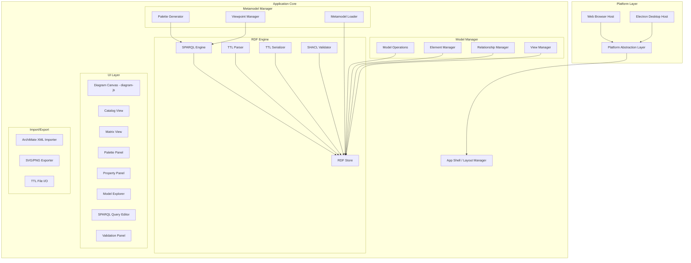
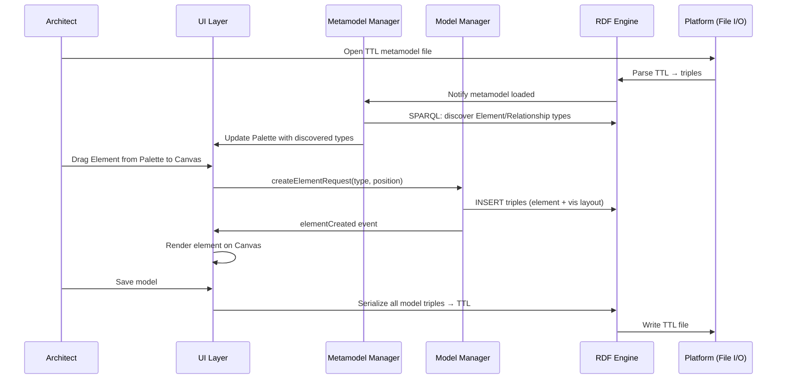
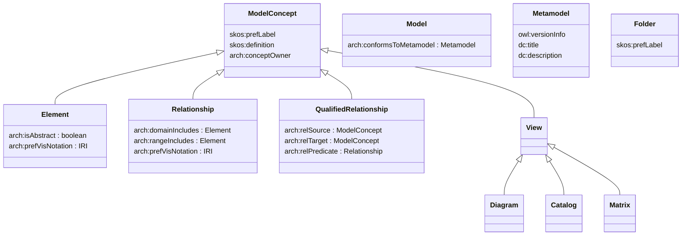
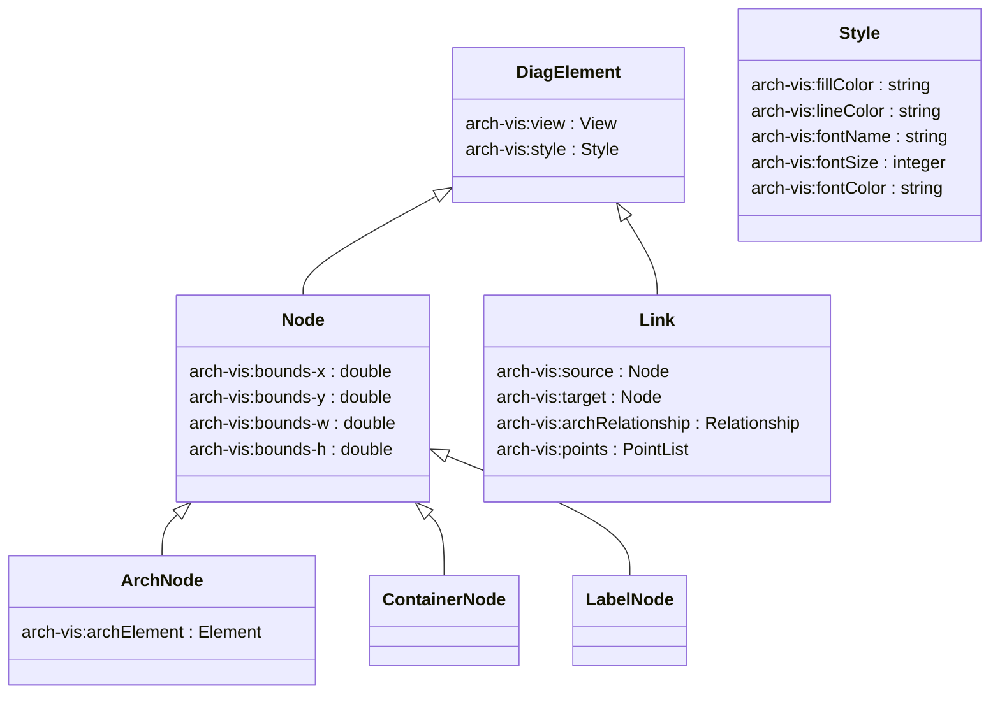

# Design Document: RDF Architecture Modeler

## Overview

The RDF Architecture Modeler is an RDF-native architecture modeling tool that enables architects to create, manage, and visualize architecture models using RDF/TTL ontologies as metamodels. The tool dynamically generates modeling palettes from loaded metamodels via SPARQL queries or direct uploads, persists all models as RDF (Turtle), and supports both web browser and Electron desktop deployment.

The system builds on the existing Linked.Archi core ontology (`arch:`) and visualization ontology (`arch-vis:`) to provide a complete modeling environment with diagram canvas, catalog views, matrix views, SHACL validation, model exploration, and import/export capabilities.

### Key Design Decisions

1. **diagram-js as Canvas Engine**: Leverage the existing diagram-js foundation (already prototyped in `tools/modeller/linkedArchiModeler`) for the interactive diagramming canvas. diagram-js provides a proven, extensible module system for rendering, interaction, and layout.
2. **In-Browser RDF Store**: Use an in-memory RDF/JS-compatible store (e.g., Oxigraph WASM or N3.js) to hold metamodels and architecture models, enabling SPARQL queries without a server.
3. **SPARQL-Driven UI**: Palette generation, view filtering, and model exploration are all driven by SPARQL queries against the RDF store, ensuring the UI always reflects the loaded metamodel.
4. **Single Codebase, Dual Deployment**: A single TypeScript/JavaScript codebase runs in both browser and Electron, with a thin platform abstraction layer for file system access.

## Architecture

### High-Level Architecture Diagram



### Architectural Layers

1. **Platform Layer**: Abstracts browser vs. Electron differences (file I/O, window management). Provides a `PlatformService` interface with implementations for each target.
2. **RDF Engine Layer**: Core RDF infrastructure — triple store, SPARQL engine, TTL parser/serializer, SHACL validator. All other layers interact with models through this layer.
3. **Metamodel Manager Layer**: Loads metamodel ontologies, generates palettes via SPARQL, manages viewpoint filtering. Translates RDF metamodel definitions into UI-consumable structures.
4. **Model Manager Layer**: CRUD operations on architecture model elements, relationships, and views. All mutations go through this layer to ensure RDF store consistency and event propagation.
5. **UI Layer**: Presentation components — diagram canvas (diagram-js), catalog/matrix views, panels. Subscribes to model change events for reactive updates.
6. **Import/Export Layer**: Converters for external formats (ArchiMate Open Exchange XML) and export renderers (SVG/PNG).

### Data Flow



## Components and Interfaces

### 1. RDF Engine

#### TTL Parser (`TtlParser`)
- **Input**: TTL string or file content
- **Output**: Parsed RDF quads loaded into the store, or a `ParseError` with line number and message
- **Library**: N3.js `Parser` (supports Turtle, TriG, N-Triples, N-Quads)
- **Interface**:
  ```typescript
  interface TtlParser {
    parse(input: string): ParseResult<Quad[]>;
    // ParseResult is either { ok: true, quads: Quad[] } or { ok: false, error: ParseError }
  }
  interface ParseError {
    line: number;
    message: string;
  }
  ```

#### TTL Serializer (`TtlSerializer`)
- **Input**: RDF quads from the store
- **Output**: Pretty-printed Turtle string with namespace prefixes, grouped by subject
- **Library**: N3.js `Writer` with custom formatting pass
- **Interface**:
  ```typescript
  interface TtlSerializer {
    serialize(quads: Quad[], prefixes: PrefixMap): string;
  }
  ```

#### RDF Store (`RdfStore`)
- **Implementation**: Oxigraph WASM (preferred for SPARQL 1.1 compliance) or N3.js Store as fallback
- **Interface**:
  ```typescript
  interface RdfStore {
    addQuads(quads: Quad[]): void;
    removeQuads(quads: Quad[]): void;
    getQuads(subject?, predicate?, object?, graph?): Quad[];
    query(sparql: string): SparqlResult;
    update(sparqlUpdate: string): void;
  }
  ```

#### SPARQL Engine (`SparqlEngine`)
- Integrated with the RDF Store (Oxigraph provides built-in SPARQL 1.1)
- Supports SELECT, CONSTRUCT, ASK, DESCRIBE
- Returns results as bindings (SELECT), quads (CONSTRUCT), or boolean (ASK)

#### SHACL Validator (`ShaclValidator`)
- **Library**: rdf-validate-shacl (JavaScript SHACL processor)
- **Interface**:
  ```typescript
  interface ShaclValidator {
    validate(dataGraph: Quad[], shapesGraph: Quad[]): ValidationReport;
    validateIncremental(changedResource: NamedNode, dataGraph: Quad[], shapesGraph: Quad[]): ValidationReport;
  }
  interface ValidationReport {
    conforms: boolean;
    results: ValidationResult[];
  }
  interface ValidationResult {
    focusNode: NamedNode;
    resultPath: NamedNode;
    sourceShape: NamedNode;
    message: string;
    severity: 'Violation' | 'Warning' | 'Info';
  }
  ```

### 2. Metamodel Manager

#### Metamodel Loader (`MetamodelLoader`)
- Parses TTL files, loads triples into a dedicated named graph in the RDF store
- Resolves `owl:imports` transitively
- Extracts metadata (`dc:title`, `owl:versionInfo`, `dc:description`) for display
- **Interface**:
  ```typescript
  interface MetamodelLoader {
    loadMetamodel(ttlContent: string): Promise<MetamodelInfo>;
    loadShapes(ttlContent: string): Promise<void>;
    resolveImports(ontologyIri: string): Promise<void>;
  }
  interface MetamodelInfo {
    iri: string;
    name: string;
    version: string;
    description: string;
  }
  ```

#### Palette Generator (`PaletteGenerator`)
- Executes SPARQL queries to discover `arch:Element` subclasses and `arch:Relationship` instances
- Groups elements by layer/category using metamodel taxonomy
- Filters by viewpoint when one is active
- Excludes abstract types (`arch:isAbstract = true`)
- **Key SPARQL Queries**:
  ```sparql
  # Discover concrete element types
  SELECT ?type ?label ?icon ?category WHERE {
    ?type rdfs:subClassOf+ arch:Element .
    ?type skos:prefLabel ?label .
    OPTIONAL { ?type arch:prefVisNotation ?icon }
    OPTIONAL { ?type skos:broader ?category }
    FILTER NOT EXISTS { ?type arch:isAbstract true }
  }
  ```

  ```sparql
  # Discover relationship types
  SELECT ?rel ?label ?icon ?domain ?range WHERE {
    ?rel a arch:Relationship .
    ?rel skos:prefLabel ?label .
    OPTIONAL { ?rel arch:prefVisNotation ?icon }
    OPTIONAL { ?rel arch:domainIncludes ?domain }
    OPTIONAL { ?rel arch:rangeIncludes ?range }
  }
  ```
- **Interface**:
  ```typescript
  interface PaletteGenerator {
    generatePalette(metamodelGraph: string): PaletteDefinition;
    filterByViewpoint(palette: PaletteDefinition, viewpointIri: string): PaletteDefinition;
  }
  interface PaletteDefinition {
    elementGroups: ElementGroup[];
    relationshipTypes: RelationshipTypeInfo[];
  }
  interface ElementGroup {
    category: string;
    elements: ElementTypeInfo[];
  }
  interface ElementTypeInfo {
    iri: string;
    label: string;
    iconUrl?: string;
    isAbstract: boolean;
  }
  interface RelationshipTypeInfo {
    iri: string;
    label: string;
    iconUrl?: string;
    domainTypes: string[];
    rangeTypes: string[];
  }
  ```

#### Viewpoint Manager (`ViewpointManager`)
- Queries `arch:Viewpoint` instances from the metamodel
- Determines permitted element/relationship types per viewpoint
- **Interface**:
  ```typescript
  interface ViewpointManager {
    getViewpoints(): ViewpointInfo[];
    getPermittedTypes(viewpointIri: string): { elements: string[]; relationships: string[] };
  }
  ```

### 3. Model Manager

#### Element Manager (`ElementManager`)
- Creates element instances with unique IRIs in the model namespace
- Updates element properties (label, definition, custom properties)
- Deletes elements and cascades to associated relationships
- Updates diagram layout properties (`arch-vis:bounds-x/y/w/h`)
- **Interface**:
  ```typescript
  interface ElementManager {
    createElement(typeIri: string, modelIri: string, position: Bounds): NamedNode;
    updateProperty(elementIri: string, property: string, value: RdfTerm): void;
    deleteElement(elementIri: string): void;
    updateLayout(elementIri: string, bounds: Bounds): void;
  }
  interface Bounds { x: number; y: number; width: number; height: number; }
  ```

#### Relationship Manager (`RelationshipManager`)
- Creates relationships as direct triples or `arch:QualifiedRelationship` instances
- Validates source/target compatibility using `arch:domainIncludes` / `arch:rangeIncludes`
- Deletes relationships (triples or qualified relationship resources)
- **Interface**:
  ```typescript
  interface RelationshipManager {
    getValidRelationships(sourceTypeIri: string, targetTypeIri: string): RelationshipTypeInfo[];
    createRelationship(typeIri: string, sourceIri: string, targetIri: string, qualified?: boolean): NamedNode | null;
    deleteRelationship(relationshipIri: string): void;
  }
  ```

#### View Manager (`ViewManager`)
- Creates `arch:View` resources (Diagram, Catalog, Matrix) with viewpoint assignment
- Manages the mapping between model elements and their visual representations in views
- Ensures single underlying RDF resource per element across views
- **Interface**:
  ```typescript
  interface ViewManager {
    createView(type: 'Diagram' | 'Catalog' | 'Matrix', viewpointIri?: string): NamedNode;
    getViews(): ViewInfo[];
    addElementToView(viewIri: string, elementIri: string): void;
    removeElementFromView(viewIri: string, elementIri: string): void;
  }
  ```

### 4. UI Components

#### Diagram Canvas
- Built on **diagram-js** (extending the existing prototype)
- Custom modules:
  - `RdfPaletteProvider`: Replaces `ExamplePaletteProvider`, driven by `PaletteGenerator`
  - `RdfRenderer`: Replaces `SimpleRenderer`, renders elements using `arch:prefVisNotation` icons
  - `RdfRuleProvider`: Replaces `ExampleRuleProvider`, enforces metamodel constraints
  - `RdfContextPadProvider`: Context-sensitive actions based on element type
- Synchronizes canvas state with RDF store via Model Manager events

#### Catalog View
- Tabular view rendering elements filtered by type
- Columns derived from SPARQL query against element properties
- Inline editing of element properties

#### Matrix View
- Grid showing relationships between two sets of element types
- Row/column headers from SPARQL queries
- Cell values indicate relationship existence/type

#### Property Panel
- Displays RDF properties of selected element/relationship
- Form fields generated from SHACL shapes (data types, cardinality)
- Edits propagate through Model Manager to RDF store

#### Model Explorer
- Tree view of model contents organized by `arch:Folder` structure
- Selection synchronizes with Canvas highlighting
- Supports filtering by type, name, or property values
- Updates reactively on model changes

#### SPARQL Query Editor
- Code editor with syntax highlighting (CodeMirror or Monaco)
- Auto-completion for namespace prefixes and vocabulary terms
- Query execution with tabular result display
- Option to render CONSTRUCT results as new diagram views

#### Validation Panel
- Displays SHACL validation results grouped by severity
- Click-to-navigate to focus node on Canvas
- Real-time incremental validation feedback

### 5. Platform Abstraction Layer

```typescript
interface PlatformService {
  readFile(path?: string): Promise<{ content: string; name: string }>;
  writeFile(content: string, suggestedName?: string): Promise<void>;
  showOpenDialog(filters?: FileFilter[]): Promise<string | null>;
  showSaveDialog(filters?: FileFilter[]): Promise<string | null>;
  isDesktop(): boolean;
}
```
- **WebPlatformService**: Uses File API, `<input type="file">`, and download links
- **ElectronPlatformService**: Uses Electron `dialog` and Node.js `fs` modules

### 6. Import/Export

#### ArchiMate XML Importer
- Parses ArchiMate Open Exchange Format XML
- Maps XML elements to RDF triples using the ArchiMate metamodel ontology
- Reports unrecognized types for user mapping or skip

#### SVG/PNG Exporter
- Captures diagram canvas as SVG using diagram-js built-in export
- Converts SVG to PNG via canvas rasterization

## Data Models

### RDF Namespaces

| Prefix | URI | Purpose |
|--------|-----|---------|
| `arch:` | `https://meta.linked.archi/core#` | Core ontology — Element, Relationship, View, Model, Metamodel |
| `arch-vis:` | `https://meta.linked.archi/core-vis#` | Visualization ontology — diagram layout, styles |
| `skos:` | `http://www.w3.org/2004/02/skos/core#` | Labels, definitions, categories |
| `sh:` | `http://www.w3.org/ns/shacl#` | SHACL shapes for validation |
| `owl:` | `http://www.w3.org/2002/07/owl#` | OWL constructs (imports, classes) |
| `rdf:` / `rdfs:` | W3C | RDF/RDFS fundamentals |

### Core RDF Class Hierarchy



### Visualization Data Model (arch-vis)



### Model File Structure (TTL)

A saved architecture model produces a Turtle file with this structure:

```turtle
@prefix arch: <https://meta.linked.archi/core#> .
@prefix arch-vis: <https://meta.linked.archi/core-vis#> .
@prefix skos: <http://www.w3.org/2004/02/skos/core#> .
@prefix ex: <https://example.org/model/> .

ex:myModel a arch:Model ;
    arch:conformsToMetamodel <https://meta.linked.archi/archimate3.1#> ;
    skos:prefLabel "My Architecture Model" .

ex:appService1 a archimate:ApplicationService ;
    skos:prefLabel "Customer Portal" ;
    skos:definition "Web-based customer self-service portal" .

ex:appComp1 a archimate:ApplicationComponent ;
    skos:prefLabel "CRM System" .

ex:appComp1 archimate:serves ex:appService1 .

ex:view1 a arch:Diagram ;
    skos:prefLabel "Application Cooperation View" .

ex:node1 a arch-vis:ArchNode ;
    arch-vis:archElement ex:appService1 ;
    arch-vis:view ex:view1 ;
    arch-vis:bounds-x 100.0 ;
    arch-vis:bounds-y 200.0 ;
    arch-vis:bounds-w 130.0 ;
    arch-vis:bounds-h 60.0 .
```

### Technology Stack

| Component | Technology | Rationale |
|-----------|-----------|-----------|
| Language | TypeScript | Type safety, IDE support, shared web/Electron codebase |
| Build | Webpack 5 | Existing project uses Webpack; supports WASM loading for Oxigraph |
| Canvas | diagram-js | Existing prototype; proven diagramming framework from bpmn.io |
| RDF Store | Oxigraph WASM | Full SPARQL 1.1 support in-browser; high performance |
| TTL Parser/Serializer | N3.js | Mature, streaming Turtle parser/writer for JavaScript |
| SHACL Validation | rdf-validate-shacl | JavaScript SHACL-core processor |
| SPARQL Editor | CodeMirror 6 | Lightweight, extensible code editor with SPARQL mode |
| UI Framework | Lit (Web Components) | Lightweight, standards-based; no heavy framework dependency |
| Desktop | Electron | Cross-platform desktop packaging with native file access |
| Testing | Vitest + fast-check | Fast test runner with property-based testing support |

## Correctness Properties

*A property is a characteristic or behavior that should hold true across all valid executions of a system — essentially, a formal statement about what the system should do. Properties serve as the bridge between human-readable specifications and machine-verifiable correctness guarantees.*

### Property 1: TTL Parse Round Trip

*For any* valid Turtle string, parsing it into RDF quads and then serializing those quads back to Turtle and parsing again shall produce an equivalent set of RDF quads (graph isomorphism).

**Validates: Requirements 1.1, 1.2, 3.4, 9.3, 9.4**

### Property 2: TTL Syntax Error Reporting

*For any* syntactically invalid Turtle string, the TTL parser shall return a `ParseError` containing a non-empty message and a line number greater than zero.

**Validates: Requirements 1.3**

### Property 3: Metamodel Metadata Extraction

*For any* valid metamodel TTL containing `dc:title`, `owl:versionInfo`, and `dc:description` triples, loading the metamodel shall produce a `MetamodelInfo` whose `name`, `version`, and `description` fields match the corresponding RDF literal values.

**Validates: Requirements 1.5**

### Property 4: Metamodel Type Discovery Completeness

*For any* metamodel loaded into the RDF store, the palette generator shall return exactly the set of concrete (non-abstract) `arch:Element` subclasses and all `arch:Relationship` instances defined in that metamodel — no more, no less.

**Validates: Requirements 2.1, 2.2, 2.7**

### Property 5: Palette Entry Completeness

*For any* element type or relationship type discovered from a metamodel, the corresponding palette entry shall contain the `skos:prefLabel` and `arch:prefVisNotation` values from the RDF store (when present).

**Validates: Requirements 2.4, 2.5**

### Property 6: Palette Grouping by Category

*For any* set of element types with `skos:broader` category annotations, the palette shall group all elements sharing the same category together, and every element shall appear in exactly one group.

**Validates: Requirements 2.3**

### Property 7: Viewpoint Palette Filtering

*For any* viewpoint and its defined set of permitted element and relationship types, filtering the palette by that viewpoint shall produce a palette containing only types in the permitted set.

**Validates: Requirements 2.6, 7.2**

### Property 8: Namespace Prefix Preservation

*For any* Turtle file with declared namespace prefixes, saving and reloading the file shall preserve all original namespace prefix mappings.

**Validates: Requirements 3.5**

### Property 9: New Model Conformance Link

*For any* newly created model with an active metamodel, the RDF store shall contain a resource typed `arch:Model` with an `arch:conformsToMetamodel` triple pointing to the active metamodel IRI.

**Validates: Requirements 3.6**

### Property 10: Element Creation in RDF Store

*For any* element type from the palette and any position on the canvas, creating an element shall add to the RDF store a resource of that element type with `arch-vis` layout properties matching the given position, and the element's IRI shall be unique within the model namespace.

**Validates: Requirements 4.1, 4.5, 4.6**

### Property 11: Element Property Edit Propagation

*For any* element in the RDF store and any valid property update (label, definition, or custom property), applying the update shall change exactly the targeted triple in the RDF store, leaving all other triples unchanged.

**Validates: Requirements 4.3**

### Property 12: Element Deletion Cascade

*For any* element that is the source or target of one or more relationships, deleting that element shall remove the element resource and all relationship triples (or QualifiedRelationship resources) where the element appears as source or target.

**Validates: Requirements 4.4**

### Property 13: Relationship Domain/Range Filtering

*For any* pair of source and target element types, the set of valid relationship types returned by the relationship manager shall be exactly those whose `arch:domainIncludes` contains the source type and whose `arch:rangeIncludes` contains the target type.

**Validates: Requirements 5.1**

### Property 14: Relationship Creation Correctness

*For any* valid relationship between a source and target element, creating the relationship shall produce either a direct RDF triple (source → predicate → target) or, when qualified, an `arch:QualifiedRelationship` resource with correct `arch:relSource`, `arch:relTarget`, and `arch:relPredicate` properties.

**Validates: Requirements 5.2, 5.3**

### Property 15: Relationship Deletion Completeness

*For any* relationship (direct triple or QualifiedRelationship), deleting it shall remove all associated triples from the RDF store, and the source and target elements shall remain intact.

**Validates: Requirements 5.4**

### Property 16: SHACL Violation Detection

*For any* model with known SHACL constraint violations, running validation shall produce a report where every violation includes a non-null focus node, source shape, and non-empty human-readable message.

**Validates: Requirements 5.5, 8.1, 8.2**

### Property 17: SPARQL Error Reporting

*For any* syntactically invalid SPARQL query string, the SPARQL engine shall return an error with a non-empty descriptive message.

**Validates: Requirements 6.5**

### Property 18: Single Element Resource Across Views

*For any* element added to multiple views, querying the RDF store shall return exactly one resource for that element, and modifying a property of that element shall be visible when querying from any view context.

**Validates: Requirements 7.6, 7.7**

### Property 19: View Creation Correctness

*For any* view type (Diagram, Catalog, or Matrix), creating a view shall produce an `arch:View` resource in the RDF store typed as the corresponding subclass (`arch:Diagram`, `arch:Catalog`, or `arch:Matrix`).

**Validates: Requirements 7.1, 7.3, 7.4, 7.5**

### Property 20: Model Explorer Tree Correctness

*For any* architecture model with a folder structure, the model explorer tree shall contain exactly the elements present in the RDF store, organized according to the `arch:Folder` containment hierarchy, and shall update when elements are created or deleted.

**Validates: Requirements 11.1, 11.3**

### Property 21: Model Explorer Filtering

*For any* filter criteria (type, name, or property value), the model explorer shall return exactly the elements matching the filter from the full set of model elements.

**Validates: Requirements 11.4**

### Property 22: TTL Serializer Formatting

*For any* set of RDF quads with declared namespace prefixes, the serialized Turtle output shall have all `@prefix` declarations before any triple statements, and shall use the shortest matching prefix for each IRI.

**Validates: Requirements 9.1, 9.2**

### Property 23: ArchiMate Import Type Mapping

*For any* ArchiMate Open Exchange Format XML containing elements and relationships, importing the file shall produce RDF triples where every recognized element type maps to the corresponding `arch:Element` subclass in the ArchiMate metamodel.

**Validates: Requirements 12.1**

### Property 24: Import Unrecognized Type Reporting

*For any* imported file containing element or relationship types not defined in the loaded metamodel, the importer shall report each unrecognized type with its name.

**Validates: Requirements 12.4**

### Property 25: owl:imports Transitive Resolution

*For any* ontology with an `owl:imports` chain of depth N, loading the root ontology shall result in all N imported ontologies being loaded into the RDF store.

**Validates: Requirements 1.4**

## Error Handling

### TTL Parsing Errors
- Invalid Turtle syntax returns a `ParseError` with line number and descriptive message
- Partial parse results are discarded; the RDF store is not modified on parse failure
- UI displays the error in a notification banner with a link to the offending line

### SPARQL Query Errors
- Syntax errors in SPARQL queries return a descriptive error message displayed in the query editor
- Runtime errors (e.g., undefined prefixes) are caught and displayed as warnings
- Query timeout (>2s) cancels execution and notifies the user

### SHACL Validation Errors
- Validation failures are non-blocking — the model remains editable
- Each violation is displayed with severity (Violation, Warning, Info), focus node, shape, and message
- Incremental validation errors are shown inline near the affected element

### Import Errors
- Unrecognized element/relationship types during import are collected and presented to the user
- The user can choose to map unrecognized types to existing metamodel types or skip them
- Malformed XML files produce a descriptive parse error

### File I/O Errors
- File read/write failures (permissions, disk full, network) are caught and displayed as user-facing error messages
- The application state is not corrupted on save failure (write to temp file, then rename)

### owl:imports Resolution Errors
- Failed import resolution (network error, missing file) logs a warning but does not block metamodel loading
- The user is notified of unresolved imports with the IRI that could not be resolved

## Testing Strategy

### Dual Testing Approach

The testing strategy combines unit tests for specific examples and edge cases with property-based tests for universal correctness guarantees.

### Unit Tests
Unit tests focus on:
- Specific examples demonstrating correct behavior (e.g., loading the ArchiMate 3.1 metamodel)
- Integration points between components (e.g., palette generator receiving SPARQL results from the store)
- Edge cases: empty models, models with no relationships, metamodels with only abstract types
- Error conditions: malformed TTL, invalid SPARQL, SHACL violations
- UI component rendering with known data

### Property-Based Tests
Property-based tests use **fast-check** with **Vitest** to verify the 25 correctness properties defined above.

**Configuration**:
- Minimum 100 iterations per property test
- Each test is tagged with a comment referencing the design property
- Tag format: `Feature: rdf-architecture-modeler, Property {number}: {property_text}`

**Key Generators**:
- `arbitraryTtl()`: Generates random valid Turtle strings with varying complexity
- `arbitraryMetamodel()`: Generates metamodels with random Element subclasses, Relationship instances, and Viewpoints
- `arbitraryModel()`: Generates architecture models conforming to a given metamodel
- `arbitraryBounds()`: Generates random position/size for diagram elements
- `arbitrarySparql()`: Generates random valid/invalid SPARQL query strings
- `arbitraryArchiMateXml()`: Generates ArchiMate Open Exchange Format XML fragments

**Property Test Organization**:
- Each correctness property is implemented by a single property-based test
- Tests are organized by component: `rdf-engine.property.test.ts`, `metamodel-manager.property.test.ts`, `model-manager.property.test.ts`, `serializer.property.test.ts`, `import-export.property.test.ts`

### Test Infrastructure
- **Test Runner**: Vitest (with `--run` flag for CI, no watch mode)
- **Property-Based Testing Library**: fast-check
- **RDF Test Fixtures**: Sample TTL files from `linked-archi-meta/` for integration tests
- **Mocking**: Platform abstraction layer mocked for file I/O in unit tests
