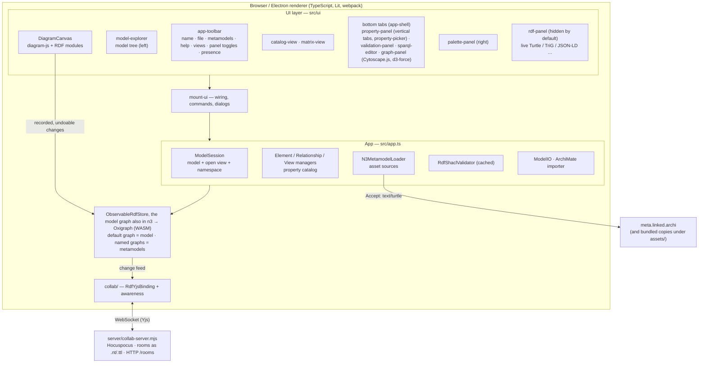
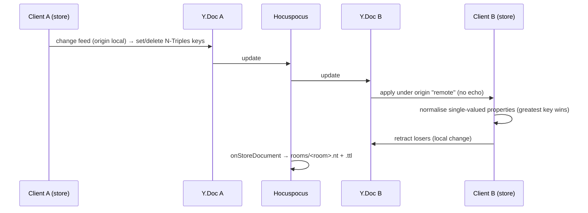

# Design: la-gram

## Overview

The RDF store is the model of record. The diagram canvas (diagram-js), the model
tree, the property panel, catalog and matrix views, files on disk and the
collaboration document are all projections of it, and every change to the model
is a change to triples first. Metamodels are published Linked.Archi assets loaded
at runtime; nothing about any modelling language is compiled in.

This is the design as implemented. The behaviour it serves is in
`requirements.md`; the plan is `tasks.md`; the implementation-independent tool
specification is `docs/linked-archi-tool-spec.md`.

---

## Architecture



### Layers

| Layer | Directory | Responsibility |
|---|---|---|
| RDF engine | `@linked-archi/kernel/rdf-engine` | Oxigraph store (native bulk load), observable wrapper (change feed, recording), IRI minting, parser/serializer, SHACL validator |
| Metamodel manager | `@linked-archi/kernel/metamodel-manager` | Asset sources, manifest-driven loader, catalogue, palette generation (dual classification, axes, notation), viewpoints |
| Model manager | `@linked-archi/kernel/model-manager` | Session, model namespace (minting, moving), element/relationship/view managers, cascade rules, queries, property catalog (what to offer when adding a property), legacy migration, shared vocabulary |
| Import/export | `src/import-export` | Model I/O (six formats, DD-15 partition, profiles), ArchiMate exchange import, SVG/PNG |
| UI | `src/ui` | Shell (layout, side panels, bottom tabs), panels, canvas, dialogs, mounting |
| Collaboration | `src/collab`, `server/` | Y.Doc binding, presence and locks, Hocuspocus server |
| Platform | `src/platform` | Web vs. Electron file access |

---

## Core concepts

### Model / view / canvas

| Concept | RDF | Where at runtime | Persisted |
|---|---|---|---|
| **Model** | `arch:Model` + `arch:modelConformsToMetamodel` + its namespace (`vann:preferredNamespaceUri` / `…Prefix`) | default graph | yes |
| **Element** | a metamodel class; `skos:prefLabel`@en; `arch:inModel` | default graph | yes |
| **Relationship** | `arch:QualifiedRelationship` subclass instance: `arch:source`, `arch:target`, `arch:inModel` — **plus** the unqualified triple (`arch:unqualifiedForm`), which it `rdf:reifies` (RDF 1.2, `<<( s p o )>>`), and the qualified predicate from the source to it (`am4:qualifiedServing`; `arch:hasQualifiedRelationship` for a class with none) | default graph | yes |
| **View** | `arch:View` + `arch:Diagram`/`Catalog`/`Matrix`, `arch:inModel`, `arch:viewConformsToViewpoint` | default graph | yes |
| **Membership** | `arch:inView` on each concept a view presents | default graph | yes |
| **Geometry** | `arch-vis:ArchNode` (bounds, `archElement`, `view`), `arch-vis:Link` (`archRelationship`, `source`/`target` nodes — or, for an end on a relationship, its Link — `points` list with IRI cells) | default graph | yes (droppable profile) |
| **Canvas** | diagram-js elements, keyed by concept IRI | memory | no |

One placement per element per view (the canvas keys shapes by element IRI).

A link ends at the node of the element its relationship has at that end — or,
where that end is a relationship, at that relationship's link (core-vis 0.6
widened `arch-vis:source` / `arch-vis:target` to `arch-vis:DiagElement`, and
core-vis-shapes accepts a Node or a Link). `view-manager.ts` resolves an end so
(`endFor`), lists a view's links each after the links it ends on (`endsFirst`,
which is what lets the canvas draw them in one pass), and draws a list of
relationships in passes (`addRelationshipsToView`: copying a view, drawing what
placed elements have, a diagram from results, the exchange import). A link goes
with the link it ends on, from the view and from the model: `cascade.ts` deletes
the relationships ending on a deleted relationship, as deleting an element
deletes those at its ends.

### IRIs

UUID-based, minted at creation, never changed by editing (`rdf-engine/iri.ts`).
A model owns a **namespace**, `{base}{notation}/{modelId}/` (DD-15/DD-29), and
what is minted for it follows the layout every Linked.Archi tool shares (DD-41,
key design decision 33), written short in Turtle (key design decision 32):

```
{base}{notation}/{uuid}/           namespace     (base: https://example.org/ unless configured)
{ns}model                          model         m:model
{ns}element/{uuid}                 element       me:…
{ns}relationship/{uuid}            relationship  mr:…
{ns}view/{uuid}                    view          mv:…
{ns}folder/{uuid}                  folder        mf:…
{view}#node-{uuid}                 ArchNode      mv{hash}:node-…
{view}#link-{uuid}                 Link          mv{hash}:link-…    route: {link}-points-{i} (cells), {link}-point-{i} (points)
{shape}-style, {shape}-style-{h}   own styles    and {link}-label, {node}-label-expression[-{h}]
{element}/name/{h}[/{lang}]        names         and {element}/picture[/{h}]
```

After a view's `#`, names are joined with `-` and need no escape in Turtle; elsewhere a part is joined to
its owner with `/` (`partIri`).

A model la-gram saved before DD-41 keeps its names, which are read as before:
`{ns}element-{uuid}`, `{ns}node-{uuid}`, `{owner}-style[-{h}]`,
`{link}-points-{i}`, `{link}-p{i}`, `{link}-label`, `{node}-label-expression[-{h}]`,
`{element}-name-{h}[-{lang}]`, `{element}-picture[-{h}]`.

The namespace is stated on the model with the VANN properties the Linked.Archi
ontologies use for their own (`model-manager/model-namespace.ts`):

```turtle
m:model a arch:Model ;
    vann:preferredNamespacePrefix "m" ;
    vann:preferredNamespaceUri "https://example.org/archimate/3f2c…/" .
```

A model that states none (an older file, another tool's) gets a derived one:
`{ns}` for `{ns}model`, else the model IRI plus `/` — where earlier versions of
la-gram minted (`urn:la-gram:archimate/{uuid}/element/{uuid}`).

**Configuring it.** The base for new models is `https://example.org/` (a
placeholder domain) unless `createApp({ base })` / `?base=` says otherwise; New
model shows the namespace it will use and lets it be edited. **Model settings**
(the model name in the toolbar, File menu, tree menu) edits name, namespace and
prefix. Changing the namespace **moves** the model's IRIs into it by default:
every IRI in the model data under the old namespace is rewritten under the new
one, keeping its local name exactly — a shape moves with its view — and
`arch:Model` becomes `{ns}model`. Terms a loaded vocabulary
defines are never renamed. The move is one store change — one Yjs update —
and a collaborator's session follows it to the same view under its new IRI
(`ModelSession.resync`). Unticking "move" keeps existing IRIs and mints only new
ones in the new namespace. The canvas re-opens the view, which starts a fresh
undo history, so the move itself is not undoable.

No blank nodes are minted: geometry is synchronised triple by triple, and a blank
node has no identity outside its store.

### Named graphs

At runtime the **default graph is the model** and each metamodel document is a
named graph keyed by its ontology IRI — which is what lets a metamodel be
swapped without touching the model and lets files contain only the model. At
rest, formats that carry graphs use DD-15:

```
{ns}graph/model       the arch:Model resource
{ns}graph/semantic    elements, relationships, views, membership
{ns}graph/views       arch-vis geometry only
```

With `{ns}` = `{base}{notation}/{modelId}/`, these are exactly DD-15's graph
IRIs. (The model resource itself is `{ns}model` rather than DD-15's
`{base}{notation}/{modelId}`, so that it too is a prefixed name, `m:model`.)

Loading flattens every quad into the default graph.

**The model graph, also in JavaScript** (Task 22). Every quad read out of
Oxigraph crosses from its WebAssembly and is converted term by term — 10 µs a
quad, and garbage the collector and Oxigraph's finalizers then spend as long
on. `ObservableRdfStore`, which sees every write to the model, keeps a copy of
the default graph in an n3 store, in the form Oxigraph holds it
(`RdfStore.canonical`: numbers, booleans and dates canonical, language tags in
lower case — Oxigraph rewrites both; a number of an integer type, a double or a
decimal written plainly is rewritten in JavaScript by Oxigraph's rules, checked
against it on thousands of values, the rest put through a scratch Oxigraph
store). A read of the default graph is answered
from the copy — `modelQuads()`, and any pattern with the default graph but a
literal object, which Oxigraph matches in any of its forms; a read of
everything is the copy and Oxigraph's named graphs one by one
(`RdfStore.namedGraphs`); other reads, SPARQL and the metamodel graphs stay
with Oxigraph, which keeps the model too. n3 tells as it adds or removes a quad
whether the model had it, which is what makes a change effective; a write
Oxigraph refuses part-way reads the copy again from it. What reads model
resources reads them from the default graph: the view manager (views, nodes,
links, routes), and names and types (`labelOf`, `hasLabel`, `statementsOf`) —
there first, every graph after. On a 347 000-triple model the copy holds
~100 MB of heap; opening went from 47 s to 11 s.

A large addition to the model — 5 000 quads or more, as opening one is — reaches
the copy at once and Oxigraph in the background, in slices of 12 ms between
frames: converting every quad into Oxigraph was 4 s of opening 353 000 triples.
Its terms are checked at once, each distinct one made with Oxigraph's own
constructors (`RdfStore.check`), so a model Oxigraph cannot hold fails to open
as before; a quad removed before it is given is passed over. The whole model
removed — as opening another does — is cleared from Oxigraph in one go
(`CLEAR SILENT DEFAULT`), and what it was still to be given dropped: deleting it
a quad at a time, each converted first, was a 6-second freeze. Until Oxigraph has
the whole model (`behind`), a read of every graph is the copy's model and
Oxigraph's quads outside the default graph. SPARQL over everything, an update,
a bulk load into the default graph and `size` give it the rest first
(`giveAll`); SPARQL about the metamodels — `graphScope`'s viewpoints,
relationship tables and permitted relationships, which read the default graph
only for metamodel data loaded there — goes through `queryMetamodels`, which
does not wait; it takes the list of named graphs the store keeps
(`namedGraphs`, read with `GRAPH ?g {}` until a named graph is written to) —
enumerating them by a pattern scanned every metamodel quad, for each of the
forty relationship lookups a context pad makes. The relationship manager keeps
what one task reads of the metamodels (scope, relationship types, class
closures) until the task ends or the store is written to, and the relationship
tables are read when the browser is idle after a model or metamodel loads. The palette reads the metamodel graphs into a store of its own
and the model through the copy (`modelGraph`), without copying it in too; the
metamodels' store is not kept between palettes, which would hold 100 MB.

---

## Key flows

### Metamodel loading

`N3MetamodelLoader` reads the manifest, follows the `arch:*` asset properties
and `owl:imports` a level at a time in parallel, and asks an **asset source
chain** for each document IRI:

```
uploaded  →  bundled (assets/, mirrors meta.linked.archi)  →  remote (Accept: text/turtle)
```

(`bundled-first`, the browser default; `remote-first` and `offline` reorder or
drop the remote source). Every fetch revalidates (`cache: 'no-cache'`): neither
the static server nor meta.linked.archi sends `Cache-Control`, and a browser
would otherwise keep a heuristically fresh copy for hours. Glyphs and
pictures are loaded by the browser as images, which no fetch option reaches:
`assetUrl` puts the build's digest of `assets/` on every bundled asset's address
(`?v=…`, `__LA_GRAM_ASSETS_VERSION__`, worked out in `webpack.config.js` from
the files' names and contents), so a build with other assets gives them other
addresses and the same ones keep theirs; the servers, and the desktop app's
`app://` handler, read the path alone. `assets/` is
copied from the installed kernel package. Asset refresh and qualification belong in that repository;
la-gram installs its new archive/version with the lockfile. Every discovered document gets a status (loaded,
already-loaded, skipped, unavailable, error) and an origin. Documents are bulk
loaded natively into Oxigraph — 110 ms for the 72 740-quad ArchiMate 3.2
relationship shapes, against 1.4 s quad by quad. Derivation rules, deliverable
templates, reference models and the framework document are skipped. A document
imported by its `owl:versionIRI` (meta's relationship tables import
`…/archimate4/onto/4.0#`) resolves to the bundled document it versions. Reference
data is loaded (and bundled for both ArchiMate versions): its `skos:prefLabel`s
label the `sh:in` choices in the property panel. Question sets are loaded too:
a metamodel's through its manifest's `arch:hasQuestionSet` (role `questions`,
bundled for ArchiMate 4.0 and 3.2), the core set with the core files (`coreQuestions`) —
model questions (`model-manager/questions.ts`; see the la-queries spec), in their
own named graphs, never model data.

**Relationship ends** (Req 2.17). The palette carries each decoration's
published symbol (`decorationSymbols`: `arch-vis:decorSymbol` on the core-vis
`arch-vis:Decoration` individuals, resolved to the bundled
`assets/core-vis/markers/` copy). The renderer draws a `<marker>` from it:
the SVG is rebuilt from plain shape elements and their geometry and paint
attributes only (no scripts, handlers, styles or references), with the
symbol's viewBox and size, `refX`/`refY` at the middle of the viewBox's right
edge, `orient="auto-start-reverse"` at a source end, and `color` set to the
line colour for `currentColor`. The first connection to need a decoration
starts loading its symbol; until it arrives that marker uses built-in
geometry, and is then replaced in place (same id, so every line using it
follows). A symbol that cannot be loaded leaves the built-in marker.

**Relationship icons** (Req 2.20). A relationship type's icon is its
descriptor's `arch:prefVisNotation`; ArchiMate 4.0 and 3.2 publish none for
their relationships (Basic does). For those, `withRelationshipIcons`
(`notation-shapes.ts`) gives the palette `mount-ui` hands out a drawn one
(`relationshipIconDataUri`): a standalone 24 × 24 SVG as a `data:` URI — a
diagonal line, source at the lower left, in the type's line colour with its
dashes shortened, and the built-in marker geometry of its end decorations at
three quarters of the canvas's size. Built-in, not the published symbols: those
load asynchronously, and an `` cannot load what an SVG it shows
references. The line colour is escaped into the markup. Every menu that offers
relationship types takes its icon from the palette, as the append menu did:
the change-type and connect-two menus now show them too. The palette's icon
comes before the one the relationship manager reads off the class.

An icon a metamodel names may not load: the ArchiMate 3.2 ontology gives its
classes `arch:prefVisNotation` links to images that were never published (the
3.2 notation names bundled icons for elements, none for relationships, so the
class's own link is what the lookup finds). `mount-ui` tries each relationship
icon the palette names once (`new Image()`); one that fails is remembered and
the palette — and the canvas's menus, without redrawing the shapes
(`updatePaletteDefinition(…, { iconsOnly: true })`) — take the drawn one. The
swap waits on the network: a few seconds for a link that does not resolve.

**Bare triples become relationships** (Req 4.22). `ModelSession.adopt` repairs a model as it opens —
membership, `rdf:reifies`, qualified pointers — and `ensureRelationshipResources` runs between the second and
the third: for each predicate some relationship class names as its `arch:unqualifiedForm`, the most general
such class (a bare triple says no more), and for each `owl:inverseOf` of one, the drawn predicate read the
other way; every model triple of those, both ends concepts of the model and not yet reified, gets a resource.
Its IRI is `{namespace}relationship/{digest of "s p o"}` — the IRI meta's ArchiMate derivation rules give the
same triple (`:QualifyRelationships`), key decision 36 — so the repair is idempotent and two clients adopting
one room's data make one resource, not two: a random IRI, as a drawn link gets, would have made both. The
digest is computed synchronously (`keyDigest`, `short-hash.ts`), as the repairs are; Web Crypto's is
asynchronous. A resource made before, `{namespace}relationship-{SHA-1}`, keeps its name. Making them on
opening rather than when a link is placed on a view (decision D6 of meta's decision task) is what lists them
under Relationships and lets a view draw them: the model changes on the next save, as the other repairs
change it.

**Links in the property picker** (Req 3.6). `PropertyCatalog.suggest` offers an object property by
`rdfs:domain` or `arch:domainIncludes`, and leaves out what a relationship class draws: every
`arch:unqualifiedForm`, the qualified predicates (which name one too), and the `owl:inverseOf` of either. A
link whose only fitting domain is `arch:Element`, `arch:ModelConcept` or `owl:Thing` is not offered: core's
are notation and metamodel authoring (`arch:prefVisNotation`, `arch:templateResource`,
`arch:hasQualifiedRelationship`), and under *More* they took a typed name's Enter — "owner" became
`arch:conceptOwner` rather than a new `m:owner`.

**Element icons** (Req 2.26). An element type's icon is its descriptor's
`arch:prefVisNotation`, else its `arch-vis:iconSymbol` badge glyph. A notation
may name glyphs not yet published — LeanIX's, BPMN's, UML's and Backstage's
answer 404 — and a type with no notation names none. `withElementIcons`
(`notation-shapes.ts`) gives those its figure (`elementIconDataUri`): a
standalone 24 × 24 SVG as a `data:` URI, the shape `shapeGeometry` builds for
the canvas at 22 × 15 — a notation's own shape from its templates, inner lines
stroked — in its fill and line colours, escaped into the markup. `mount-ui`
tries the element icons with the relationship icons, once each, and swaps a
broken one the same way. Only the palette and the menus read an element
type's icon; the canvas draws a shape from its style and its badge from
`iconSymbol`, so the drawn figure never reaches a diagram. The palette panel
also swaps an `` that fails for the figure itself (its `error` event), so
the palette shows no broken image while the probe is waiting on the network.

**The palette panel** (Req 2.8, 2.22). `palette-panel.ts` lists the
relationship types first, above the element groups — a short list, kept in
reach — in a section that folds by its header as a group does; its state is
kept apart from the groups', since a category could share its name. A search
opens whatever is folded. The open view's viewpoint filters the element types to
those it names and the relationship types to those it names — all of them when
it names element types and none, which is every ArchiMate 4.0 viewpoint: they
name element types, and a relationship the metamodel permits between those is in
the viewpoint (connect still asks the rules for each pair). What a viewpoint
names, `viewpoint-manager.ts` (`getPermittedTypes`) sorts by class: a named class
and its subclasses, relationship types being those under
`arch:QualifiedRelationship`, whether named with `arch:includesConcept` or the
older `arch:permitsElement` / `arch:permitsRelationship`.

**Element shapes** (Req 2.18). `notation-shapes.ts` turns a shape into one
geometry with two encodings: the drawn body (`shapeGeometry`: a `rect`,
`ellipse`, `circle`, `polygon` or `path`, plus `details`, a path of inner lines)
and the outline in absolute coordinates that connection docking crops against
(`shapePath`). The eight core shapes are coded. A notation's own shape is a
`CustomShape` that `notation.ts` reads from the notation data (`readCustomShape`:
the fallback and the path templates); `drawCustomShape` evaluates its
`shapeVariables` and fills each `{expression}` with a small parser of its own —
numbers, `w`, `h`, the variables, `+ - * /`, parentheses, `min`, `max`; never
`eval` — into the compact path form the core shapes use, and `translatePath`
moves the outline for docking. Templates are absolute SVG path commands, so
arcs and curves reach `path-intersection` as they stand. A straight link — one
segment, as a link is first drawn — is docked by computation instead
(`straight-docking.ts`, Task 22): against an outline of lines and unrotated arcs
(every core shape, and a notation's straight-edged ones) the segment's
intersections are a line's with a line or an ellipse, chosen as diagram-js's
`getElementLineIntersection` chooses — the same point for polygons, within a
pixel for arcs, which diagram-js approximates as Béziers; a curve, a rotated arc
or a bent link is left to diagram-js. The renderer keeps each shape's outline
until it moves, resizes, is retyped or the notation changes. `shapeLayout` takes the
content and label boxes from the templates (a label box's height decides how
many lines the label gets). A template that cannot be evaluated is reported once
and the shape drawn as its fallback. The ArchiMate shapes come from the bundled
notation files, and their tests check them against the published pictures; the
C4 and EDGY ones are tested from fixtures mirroring linked-archi-meta. The label
is drawn in `arch-vis:fontColor`, else the line colour; under an IconCentric
icon, where it sits on the canvas, black unless `fontColor` is given.

`arch-vis:borderStyle` takes the relationship dash patterns. Badges stay
`<image href>`: the published glyphs are transparent where the element's fill
shows (the vocabulary's `arch-vis:iconSymbol` convention), so they need no
recolouring to match the pictures.

Palette generation (existing, unchanged in approach): dual classification over
the taxonomy (`conceptClassification`) and ontology, several axes — in the order
the manifest's palette grouping gives, each axis's groups in the order of its
thesaurus array (key design decision 20). A group's members are the element
types the ontology declares: a class the taxonomy lists, or a concept with nothing
under it that stands for one (`rdfs:seeAlso`, or the same local name). A concept
with nothing under it and no class behind it is an empty concept — neither an
element type nor a reason its parent is no axis. Within a section, the types
come first in the order of the array under their own group, where it has one
(`memberRanksByAxis`, from the axis's `memberRanks` — ArchiMate 4.0's Common
Domain), then by their groups' ranks under the other grouping axes, then by name.
A group under no axis and no
other group (ArchiMate's Junction, a top concept of its own) is kept as a
standalone axis of its one group: its members are palette types, in a section of
its name when no grouping axis classifies them, and it is offered as no way of
grouping. The relationship types take their category from the first axis whose
groups list relationship types (ArchiMate's Relationship), through their nearest
superclass for a kind the taxonomy does not list, and come in the order of that
axis's array; within a category, in the order of the array under it (the axis's
`memberRanks` — ArchiMate's strongest first), a kind after its superclass, then
by name (`categoriseRelationships`). The panel shows a group per category inside
the Relationships section. Notation is
resolved per class by `notation-resolver.ts` in five steps (Req 2.16):

For a class C, the active set A is the set that the active presentation context
names with `arch:usesNotationSet`, or else the primary metamodel's
`arch:notationSet`. The fallback layers F are the default sets
(`arch:notationSet`) of all loaded metamodels except A itself, in load order,
then the core notation's (`coreNotationSetIris`), which no manifest names and
which is never A: it draws the core's own relationship types — Association,
Depends On, and Has Part and Refines, which nesting may draw (DD-42). F
includes the default set of A's own metamodel when a presentation context
picked an alternative set.

1. A descriptor in A for C.
2. A descriptor for C in F, the first match in load order.
3. C's own `arch:prefVisNotation`.
4. A descriptor for the nearest superclass of C that has one in A or F. The
   walk goes breadth-first over `rdfs:subClassOf`: by distance first, and
   superclasses at the same distance in IRI order. It stops at `arch:Element`
   and `arch:QualifiedRelationship`. For each superclass, A is checked first,
   then F in load order.
5. Built-in defaults. Elements: a rectangle with a white fill and a black line.
   Relationships: a solid black line.

Anything published for the class itself beats anything inherited; among
inherited descriptors the nearest ancestor wins; the active set only breaks
ties.

So a generic set such as Basic, when active, leaves ArchiMate's own notation in
place, and an extension subclass of an ArchiMate class with nothing of its own
takes its parent's look. `class-hierarchy.ts` does the walk. The palette
carries every resolved class in `notationIndex`. The canvas's
`NotationStyleRegistry` reads it for types the palette does not list, and so do
the Graph tab's type look and a new view's element sizes in `mount-ui.ts`,
through a registry of their own, so every path gives the same answer. The
loader also loads the sets the presentation contexts name
(`arch:usesNotationSet`).

**Basic, the generic language** (Req 1.12; meta.linked.archi's, bundled:
`assets/basic/`, `https://meta.linked.archi/basic/metamodel#Basic`). Every
metamodel la-gram offers is meta.linked.archi's; for elements no loaded
language has, Basic is the one to add. Its Connection's domain and range name
Basic's three element types, so it relates any two of them, proposed after
Aggregation and before Association (Basic's `arch:relationshipProposalOrder`);
Association and Aggregation keep Basic's restrictions, and between a Basic
element and another language's the core's types are offered (Req 4.21). A
relationship is *generic* (`RelationshipTypeInfo.generic`) when its domain and
range name only core classes and no relationship table governs it, since a
table restricts a type whatever its hints name (`isGenericRelationshipType`,
decided in the relationship manager, which knows the tables). A generic relationship relates
any two elements of its own metamodel, ranks with the fallbacks, below
Association, and counts as generic in the append menu
(`isGenericRelationship`), so it never makes a choice ambiguous. A core class is never a palette type, whatever a taxonomy
lists. So that adding a language does not disturb the first: the palette's
axes come in the loaded metamodels' order (`PaletteOptions.metamodelIris`,
which the UI passes as it passes the notation sets), so the first language's
grouping stays the default, and under its axis another language's types are
in "Other". Only an axis that groups some element type is offered: a taxonomy
may also classify relationship types — ArchiMate's relationship categories —
which are no palette elements. Basic's notation draws `arch:Element` and
`arch:QualifiedRelationship` generically, so an element typed by a core class
alone is drawn too. The core ontology document loads under its bundled
`coreOntology` role, which unloading never drops.

**The Metamodels menu** (Req 1.2) lists meta.linked.archi's DCAT catalogue
(`https://meta.linked.archi/catalog`, `catalogue.ts`): a metamodel manifest's
dataset names its `arch:Metamodel` (`foaf:primaryTopic`) with its label, and
its section of the site's index as `dcat:theme`; the menu lists the sections
whose notation is `languages`, `frameworks`, `extensions` or `core`, by label,
with the label's trailing " Metamodel" dropped; a section with nothing to
offer is not shown. `App.loadCatalogue` hands
the menu the bundled copy (`assets/catalog.ttl`, through the bundled source by
the catalogue IRI — not a registry entry, so nothing loads it into the store),
then — unless offline — the published one, read from meta.linked.archi
whatever the asset mode: under `bundled-first` the chain would always answer
from the bundle, and a newly published metamodel would wait for a new la-gram.
A published catalogue that is missing or unreadable leaves the bundled list.
The installed kernel provides the bundled catalogue; updates arrive with a qualified kernel package.

Snapshot freshness is a release preparation step (key design decision 25). The sync command compares
the files already bundled with the selected source. Online mode fetches Turtle by namespace path,
icons by their relative paths and the published catalogue; downloads are staged before writing,
with a failed required request failing the run and preserving the snapshot. It does not silently
fall back to local files. `--meta` or `LINKED_ARCHI_META` selects local mode; `--online` overrides the
environment selection. Local mode does not regenerate its catalogue. Neither mode adds other
languages' Turtle documents, and webpack copies the snapshot without syncing it. A catalogue-only
entry such as LeanIX resolves remotely. Documents already loaded into the session's store stay
there until the app is reopened; HTTP revalidation applies to a new fetch.
The CLI package's generated `assets/` sits beside webpack's `dist/` output and outside its normal
cleanup. Its build therefore cleans the copied asset folder explicitly, so obsolete semantic
documents cannot survive a rebuild. Package metadata and other sibling folders are preserved.

### Editing on the canvas — recorded changes

diagram-js owns *when* things happen (its command stack, rules, tools);
la-gram owns *what* the model becomes. Every canvas gesture that changes the
model runs its model operation inside a nested command:

| Gesture | diagram-js command | Nested RDF command |
|---|---|---|
| Palette drop / append | `shape.create` | `rdf.element.create` → element + node (snapshot for redo) |
| Tree drop / "add to view" | `shape.create` (existing IRI) | `rdf.store.change` → node; then draws its relationships (`connection.create` + existing-relationship hint) |
| Connect | `connection.create` | `rdf.relationship.create` → qualified resource + triple + link |
| Change type | `rdf.relationship.retype` | retype in place (same IRI) |
| Change an element's type (property panel, right-click menu) | `rdf.element.retype` | `rdf.store.change` → the `rdf:type` (and the default name); also redraws the shape in the new notation, on undo too |
| Rename in the box (double-click, F2) — an element's, or a relationship's on its line | `rdf.element.relabel` | `rdf.store.change` → the `skos:prefLabel` in the shown language (a relationship's, emptied, removed); also relabels the shape or the line, on undo too |
| Move / resize | `shape.move` / `shape.resize` | `rdf.store.change` → node bounds |
| Route change | `connection.layout` / `updateWaypoints` / `move` | `rdf.store.change` → point list, and a moved name's bounds; relationships ending on the line follow it (nested `connection.layout`, see Routes and docking) |
| Move a relationship's name (drag it; right-click › Move name back to the middle) | `rdf.link.label.move` | `rdf.store.change` → the link's `arch-vis:LabelNode`, or its removal; also places the name on the line, on undo too |
| Reconnect end | `connection.reconnect` | `rdf.store.change` → ends, triple, links in other views |
| Delete (key, pad ×) | `shape.delete` / `connection.delete` | `rdf.store.change` → remove from **view** |
| Delete from model (pad ✖, tree) | `rdf.model.delete` | removes shapes, then the concept everywhere |
| Property edit, add, remove (property panel); rename from the tree; restore a version | `rdf.store.edit` (`DiagramCanvas.recordChange`) | the change itself, recorded; undo and redo redraw the canvas from the store |
| Drop or move into an element (nesting) | `shape.create` / `shape.move` with an element as parent | `rdf.store.change` → the node's `arch-vis:inNode`; `AutoResize` grows the containers (nested `shape.resize`); then the "which relationship?" menu — the one picked as `rdf.store.edit`, not drawn |

`rdf.store.change` runs its operation once inside `ObservableRdfStore.record`;
undo applies the inverse diff, redo re-applies it. Re-running logic on redo
would mint new IRIs; replaying the diff cannot.

A relationship's type from the property panel (Req 4.23) is
`DiagramCanvas.retypeRelationship(iri, type)`: drawn in the open view, the line's
own `changeRelationshipType` (`rdf.relationship.retype`); else the kernel's
`retypeRelationship`, in place, inside `recordChange`. Its field's choices,
`relationshipTypeChoices(iri)`, are `getValidRelationships` for the types of its
two ends — the order the line's menu proposes — grouped by category in mount-ui.
The field's *IRI* shows the type's IRI only; every IRI the panel shows that is a
web address is a link opening a new window (`iriLink`), which the desktop app
hands to the system's browser (`setWindowOpenHandler`).

Changing an element's type (`rdf-element-replace-menu-provider.ts`,
`rdf-element-retype.ts`) is `DiagramCanvas.retypeElement(iri, type)`, asked by
the property panel's type field (`property-retype`, answered so a cancelled
change puts the field back) and by the right-click menu's "Change type…", which
opens the `la-element-replace` popup: the canvas's palette definition — every
loaded element type, unfiltered by the viewpoint, grouped under the palette's
current axis — searching names and groups only (definitions would match half
the list). Types that share a name (ArchiMate 3's Business Actor and ArchiMate
4's) show their IRIs on the entry's second line, and the header's "Show IRIs"
shows every one — one setting with the property panel's pickers (`show-iris.ts`);
an IRI shown is searched too (`archimate3 role`). The type in force is marked
(bold, ✓). An element in the open view changes through the command, undoably;
one that is not (selected in the tree) changes in the store directly, like any
property panel edit. Before either, the canvas checks each of the element's relationships with
`getValidRelationships(source, target)` under the new type; any that would not
be permitted are passed to `confirmRetypeElement` (the app's confirm dialog,
listing them) and, if confirmed, kept for validation to flag — deleting
relationships to make a type change fit would silently lose model content.

The **right-click menu** (`rdf-context-menu-provider.ts`, popup provider
`la-context-menu`) opens on `element.contextmenu` for elements and
relationships (the browser's menu is suppressed; the concept is selected first),
and on the empty canvas for the open view (the selection is cleared). Over a
line, diagram-js draws its segment and bendpoint handles in the overlays layer,
on top of it, and they belong to no diagram element, so a right-click there
reaches the root: the handles' group (`.djs-bendpoints[data-element-id]`) names
the line, and the menu opens for it. The canvas decides the actions
(`contextMenuActions`) in sections — edit (Rename, Change type… / a
relationship's Rename — not a derivation the model does not state, as in the
model tree — and Change relationship type…, then Move to folder… when
the host's `canMoveToFolder` says the model has folders), relate (Append…), show
(Properties, Show in model tree, Show relationship graph and Ask about this
element… / a relationship's Show source and Show target), copy (Copy IRI), delete (Delete from view, Delete from
model…); on the canvas, the open view's (`viewContextMenuActions`): edit (Rename
view…, Set viewpoint…, Duplicate view), view (Select all, Zoom to fit), show
(View properties, Show in model tree), copy (Copy IRI), delete (Delete view…),
what the model tree offers for a view — and hands all but the canvas's own
(rename on the canvas, the type menus, append, select all, zoom, delete from
view) to the host (`onContextAction`), which runs the model tree's actions for
them. On one of several selected of a kind, with folders, the
selection is kept and the menu is *Move N … to folder…* alone (see *Finding the
folder*). A menu an action opens (the type
menu, the append menu) is opened on the next tick: diagram-js closes the menu
an entry was picked from after its action runs. The pad keeps delete, connect,
append and a relationship's change type; an element's type moved to the panel
and the menu.

Renaming in the box (`ui/canvas/rdf-label-editing.ts`) uses
`diagram-js-direct-editing`, the text box bpmn-js edits its labels with (its
`DirectEditing` class, declared in la-gram's own module: the package entry
imports a diagram-js folder without `/index.js`, which Node's ESM loader
refuses). The provider offers element shapes and relationships' lines
(`isRenamable`). Over a shape, it lays the box over the shape with the
renderer's font scaled by the zoom and room for the badge, hides the drawn name
meanwhile (a marker), and selects the whole name. Completing with a changed,
non-empty name runs `rdf.element.relabel`; canvas commands are not followed by a
re-read of the store, so the command relabels the shape itself on execute and
on revert.

A relationship is named the same way: a double-click on its line — on its
handles too, which diagram-js's bendpoints forward to the line — or on its drawn
name, or F2 with it selected. The box opens where the name is drawn
(`connectionLabelLayout`: the middle of the route, under a derivation badge), on
white, at least an element's width wide and growing downwards as the name does,
holding the name — or nothing, for a relationship without one: its type is not
offered as a name. It opens whether names are shown or not. Emptied, the name is
removed (the writer removes the `skos:prefLabel` in the shown language): most
relationships have none, so having none is a state to go back to, where an
element's name is never emptied. Not offered: a derivation the model does not
state (confirm it first — the model tree offers no Rename on one either), and a
bare triple with no relationship resource to carry the name (a connection whose
`iri` is a `relationshipKey`, `isRelationshipKey`).

**A relationship's name on its line** (`rdf-renderer.ts`) is drawn when the
canvas toolbar's *Relationship names* switch is on — off by default, remembered
in the browser (`relationship-names.ts`) — and the relationship has a name of
its own (`named`): its type, which `labelOf` would give one without a name, is
never drawn. The renderer reads the switch from `RenderOptions`, a value the
canvas holds (`rdfRendererModule(styles, options)`); flipping it
(`DiagramCanvas.setRelationshipNamesShown`) redraws every line alone
(`element.changed`, not `elements.changed`, which re-stacks). The name is
centred on the middle of the route (`midpointOf`), wrapped at an element's
default width to at most three lines as a shape's name is (`wrapLabel`), in the
line's colour on a white box — the line stops at the name, between its words
too — or, on a derived line, just under the badge and faded as the line is. The
box is open to the pointer, so a click or a double-click on the name reaches the
relationship: diagram-js leaves drawn graphics deaf to the pointer and hits a
line on its stroke alone. diagram-js measures a line by its waypoints only, so
the export's crop (`toSvg`) adds each drawn name's box. The canvas puts the name
on a line's business object when it draws the line and when it reconciles with
the store (`syncFromStore`), so a rename in the dialog, the property panel or by
a collaborator, and its undo, show on the line. It is read through
`ConceptDescription.modelName` — `modelNameOf`, the model graph alone, which the
store answers from its copy in JavaScript — not `label`, which looks in every
graph for a concept the model does not name: that read, for every line each
time a view is drawn, is what Task 22 took out. The name is the model's; where
it is drawn, once moved, is the view's: see key decisions 15 and 16.

**Help and About** (Req 15.4–15.7; `src/help-links.ts`, `src/ui/help.ts`,
the toolbar's `_appMenu` under the name, `installMenu` in `electron-main.ts`).
The pages the menu opens are one list, `HELP_LINKS`, with no DOM, so the toolbar and the
desktop app's menu bar read the same. A page of la-gram's own documentation (`docsPage`:
*la-gram documentation*, and the shortcuts' page) is resolved by `helpHref`/`docsHref`
to the published copy for the build's channel (`laGramDocs`: `LA_GRAM_DOCS`, or the
alpha's, `/la-gram-alpha/docs/`), never against the app's address: an installation
elsewhere — another host, the desktop app, a developer's machine — need not serve the
site, and still opens the documentation online (2026-11-23). `mount-ui` gives the
toolbar, the shortcuts and *Download the desktop app…* the channel (`BUILD.channel`);
About's *Third-party licences* stays the file beside the web app it runs from. *Download the desktop app…* is a dialog of
blocks too (`downloadBlocks`): a link for each of `DESKTOP_DOWNLOADS` at
app.linked.archi — absolute, unlike the documentation: the apps are the project's
release, which a deployment elsewhere does not build — those of the system the user
agent names first (`systemOf`; a Mac's arm64 and x64 both, as a browser does not
say which), then how to open an unsigned app, the checksums and the Releases page. About and the keyboard shortcuts are
`DetailBlock`s — a header, headings, text, links, two columns — that
`Dialogs.details` shows; it is optional, and `mount-ui` shows a `Dialogs`
without it the same blocks as text (`detailLines`), so the scripted dialogs of
the tests need nothing new. The version and the open-source components come
from the build (`__LA_GRAM_BUILD__`: `package.json`'s version, and each
component's own `package.json` — name, version, licence — Electron in the
desktop builds); under Vitest there is none, and About says "Development
build". Where it runs is read off the user agent (`runtimeOf`). The shortcuts
are written once as `Mod+Shift+Z` and shown for the platform (`keyCombo`: `⇧⌘Z`
on a Mac, `Ctrl+Shift+Z` elsewhere), each one checked against the code that
binds it — diagram-js's `KeyboardBindings`, the lasso's and the selection's
Shift, F2 in `rdf-label-editing`, Alt+arrows in `mount-ui`, the SPARQL
editor's keymap. The title is the open model's (`modelTitle`, set with the
toolbar's name and unsaved mark); the page's own title is put back when the UI
is taken down. The toolbar's menus, buttons and toggles do not shrink; the
model's name does, down to 64 px, and media queries narrow the selectors, then
hide their names, then the toggles' words, so the bar holds from 1100 px.

**Releases** (Req 15.8, 15.11, 15.12; `.github/workflows/la-gram.yml`). A tag
`la-gram-v<version>` starts `version` (the tag's version against `package.json`,
before anything is built), the tests, `web` (the web build; it also runs on every
pull request) and `docs`, and `desktop`, a matrix of five targets packaged on
GitHub's Linux runner: @electron/packager downloads each target's Electron and
builds a macOS app off macOS, leaving out the asar integrity digest that only
`codesign` could re-seal — so Electron's ad-hoc signature holds and Apple silicon
launches it — and edits the Windows executable's resources with `resedit`,
without Wine (its publisher from `win32metadata`, else package.json's `author`).
The macOS app's bundle then has no valid seal — Electron's binary keeps its ad-hoc
signature, the renamed bundle has none over it — which Gatekeeper reports for a
downloaded copy as "damaged", with no Open Anyway; rcodesign (pinned, checksum
checked) signs it ad hoc on the runner, as `codesign --sign -` would. The macOS
and Windows apps are zipped (`zip -y` keeps the app bundle's symbolic links), the
Linux ones tarred (modes kept). `release` then makes the GitHub Release, in the
environment `production`, whose reviewer approves it: the five apps, the web app
with its documentation as one tarball, `SHA256SUMS.txt`, and an attestation of
each (`actions/attest-build-provenance`, signed with the run's OIDC token).
Nothing in the workflow reaches the server: app.linked.archi installs the newest
release itself (`ops/pull-deploy/la-gram-pull`, a systemd timer per channel), and
only a file whose sum and attestation check — this workflow, this repository, a
GitHub-hosted runner, the release's tag (the alpha's: `main`). It puts the
desktop apps into the release's `downloads/`, each named without its version
(`la-gram-darwin-arm64.zip`), with their sums, so la-gram's menu and
documentation link the latest release's apps without knowing its version
(`DESKTOP_DOWNLOADS` in `help-links.ts`; `pull-deploy.test.ts` checks the
workflow, the script and the menu name the same files); copies every version's
page into it (`versions/`); and swaps the served link in one rename, checking the
site serves the new `index.html` and swapping back if not. A pre-release is a
GitHub pre-release, which the server never takes. The web app needs nothing to
run under `/la-gram/`: webpack's `publicPath` is `auto`, and the bundled
assets resolve against `document.baseURI`. The host's site for app.linked.archi
— kept with the host's configuration, not here — serves the link under
`/la-gram/` (its exact name taking the host over from the `*.linked.archi`
catch-all), the page and the metamodels revalidated, the content-named scripts
and WebAssembly kept, and the desktop app's Content-Security-Policy with
`https:` and `wss:` connections; *Hosting the web app* says what la-gram needs of it.
The version's page names la-gram's repository as the menu does (`REPOSITORY` in
`help-links.ts`, `webpack.config.js`), and the commit from GitHub's `GITHUB_SHA`,
none when `GITHUB_REF_TYPE` is `tag`.

**Exporting the open view** (Req 14; `toSvg` in `diagram-canvas.ts`,
`svg-png-exporter.ts`, `exportView` in `mount-ui.ts`). `toSvg` builds the file
as a DOM — the viewport's layers cloned, interaction chrome taken out, every
`<defs>` of the canvas (the lines' end markers are in their own,
`defs.la-notation-markers`), a white background, cropped to what is drawn and
the lines' names — and writes it with `XMLSerializer`: an HTML serialisation
(`innerHTML`) writes a non-breaking space as `&nbsp;`, which XML does not know.
Its pictures are still the addresses drawn on the canvas: the bundled glyphs at
the app's own addresses (`assetUrl`, with `?v=`; `app://` in the desktop app),
pictures at theirs. A PNG is drawn by loading the SVG into an `` and that
onto a canvas, and an SVG drawn as an image loads nothing from outside itself:
every glyph was a broken image. So `inlineImages` reads each picture's address
once (`readImageAsDataUrl`: `fetch`, the type from the response or, when it says
none, the address's extension; a page served in its place is not a picture) and
writes it into both `href` and `xlink:href` as a `data:` URI. What cannot be read
— a site sending no `Access-Control-Allow-Origin`, which the canvas can still
show but the app cannot read — stays linked in an SVG (a viewer opening the file
online loads it) and is taken out of a PNG (`dropMissing`), and the toast names
it. `exportPng` takes a scale (2 from the menus): the SVG's own `width` and
`height` set to the PNG's, its `viewBox` kept, so the vector is rasterised at
that size rather than drawn small and stretched; it is lowered to fit a canvas
a browser can draw. Both menus run the same `exportView`; the right-click menu's
entries are in an *export* section of their own.

**Moving a relationship's name** (`rdf-link-label.ts`). A press on a drawn name
starts diagram-js's `dragging` (`rdf.linkLabel.*`), the selection kept. The press
reaches the line as `element.mousedown` whatever node it landed on — the name's
box, or the segment handle diagram-js's bendpoints draw over the line's middle,
on top of it, which forwards its press to the line — so the listener sits above
`Bendpoints`' own (1500 over 1000) and takes the press only when the pointer, in
diagram coordinates, is inside the name's box (`drawnConnectionLabel`); anywhere
else on the line the bendpoints take it as before. The name follows the pointer
(redrawn through `graphicsFactory.update`, no command); let go, it is moved by
`rdf.link.label.move`, a recorded store change whose writer
(`ViewManager.setLinkLabel`) keeps the link's `arch-vis:LabelNode` —
`{link}-label` (`partIri`; the one a link already has keeps its name), typed, in the view, with bounds — or, moved to nowhere (*Move
name back to the middle*), drops it. On the line the name is an offset from the
route's middle (`RdfBusinessObject.labelOffset`): read from the kept bounds'
centre when the line is drawn (`labelOffsetOf`, `addRelationship`) and when the
store changes (`syncFromStore`, which takes a difference of a pixel or less for
the bounds' rounding), and kept as the route changes, so the name follows the
line; `writeRoute` writes the bounds again at the new middle, in the route's own
nested change, so one undo takes both back. The bounds are written in whole
pixels around the centre rounded (`labelBoundsAt`), the centre being what is
read back. Not while a collaborator holds the line, and not without an open view
(`canMoveLinkLabel`). The view manager removes the label node with its link
(`collectLinkQuads`; the model cascade's own `linkQuads` too), with its view, and
copies it with the view.

### Routes and docking

diagram-js leaves docking to the application: its `features/modeling` binds
`modeling` and `layouter` only, and its `BaseLayouter` runs a line centre to
centre. `rdfModelingModule` binds three services that belong together
(`connection-docking.ts`, `straight-docking.ts`; Req 4.6, 4.10, 4.16):

- **`layouter` — `CroppingLayouter`.** `MoveShapeHandler`, `MoveHelper`,
  `ResizeShapeHandler` and `ReconnectConnectionHandler` lay a connection out
  again on postExecute, passing the moved end as `connectionStart` /
  `connectionEnd`, and expect the route kept — bpmn-js's `BpmnLayouter` repairs
  it. The layouter keeps a connection's bends as they are and moves only its
  ends: an end with a hint goes where the hint says; one without keeps its
  reference — the uncropped point its last docking recorded as `original`, or
  the end itself for a route read from the store — unless that lies off its
  element, when it is the element's centre. A resize that grows an element over
  bends hands the last (or first) of them over as the end
  (`getResizedSourceAnchor` / `getResizedTargetAnchor`), and the bends from
  there to the element go. A right-angled route (bends, every segment along an
  axis — as Arrange view draws them) stays right-angled: the bend next to a moved
  end follows it along their segment's axis, the others stay; where that would put
  a bend inside an element, or fold two points into one, the line is routed again
  at right angles between the centres, leaving as the old route left the source
  (diagram-js's `connectRectangles`). An arranged straight line — along an axis,
  its ends on the outlines where a drawn line's are aimed at the centres — stays
  straight while its ends share the axis, and turns right-angled when an element
  leaves it, out of and into the elements where it was. A connection with no route yet — a new
  line between two elements — is laid out centre to centre, the gesture's points
  aside; both ends are then cropped by the docking service. Only shapes with finite
  bounds replace a gesture's point with their centre. During a connect preview the
  hovered diagram root has no bounds: its end keeps the pointer hint, and
  `FastCroppingConnectionDocking` leaves that free end uncropped (Req 4.1).
- **`connectionDocking` — `FastCroppingConnectionDocking`.** diagram-js's
  cropping assumes an end's reference lies inside the element, and keeps the
  reference as the end when the line misses the outline. A shape is hit-tested on
  its bounding box with a 15 px stroke, so a reattach dropped beside an element,
  or in the empty corner of a diamond or an ellipse, hands over such a reference
  — as can a segment drag or a resize, which decide "inside" by the bounds. A
  reference outside the outline (by the parity of the crossings on the way to
  the element's centre) is moved just inside it, on that way, before cropping,
  and recorded as the end's `original`. An end on a relationship goes on the
  nearest point of its line: a connection has no outline (the renderer's
  `getShapePath` reads bounds a connection does not have).
- **`attachedConnectionBehavior` — `AttachedConnectionBehavior`.** diagram-js
  re-lays out the connections attached to a shape, not those attached to a
  connection. Before any command that re-routes a connection
  (`connection.layout`, `updateWaypoints`, `move`, `reconnect`) it records how
  far along the line each attached end lies, as a fraction of its length; after
  it (`postExecuted`, which follows a reconnect's own layout) it lays each
  attached connection out with that end at the same fraction — nested, so one
  undo takes back both, and in turn for lines attached to those. A line already
  being followed is skipped, which ends a cycle.

The reconnect rule (`RdfRules.checkReconnect`) answers `false`, not
`undefined`, for an end with no type: diagram-js's `Rules` reads `undefined` as
allowed, and a reattach let go over empty canvas — the diagram's root — was
attached to it.

### Automatic layout

Req 21; key design decision 21. `src/layout/` is DOM-free; `ui/arrange-view.ts`
and `mount-ui` use it.

| File | Does |
|---|---|
| `layout-types.ts` | `LayoutInput` (nodes with size, parent, padding, band and sort key; edges, an association marked), `LayoutOptions` (direction, spacing, bands, origin, `maxNodes` 2 000, `timeoutMs` 10 000), `LayoutResult` (bounds by node, routes by edge, the engine and why) |
| `elk-graph.ts` | the input as ELK's JSON graph: nodes nested under their parents, in the order of their keys (band, type, name, IRI); edges at the root, by IRI, none between a node and one nested in it; the options, and ELK's effort by the diagram's size (below) |
| `elk-result.ts` | ELK's result as top-left bounds and routes (start, bends, end), rounded and moved to the origin |
| `bands.ts` | the bands: the list a loaded manifest names with `arch:diagramGroupOrder`, a band for each type it lists; `withNeighbourBands` gives an element of no band the band most of what it holds, else most of what it is related to, is in |
| `grid-layout.ts` | the fallback: rows, what is nested inside its parent |
| `layout-service.ts` | `layout()`: the size limit, ELK raced against the timeout (the worker stopped when it loses), the grid on failure; never half of one |
| `elk-engine.ts`, `elk.worker.ts`, `elk-node-engine.ts` | ELK in a worker, created on the first layout (`elk-api.js` with the worker as one webpack chunk), for the browser and the desktop app; the bundled ELK in Node, for the tests |
| `view-layout.ts` | a view as an input — each placement by its node IRI, at its current size, nesting and figures included — and a result written back by node and link IRI (`updateNodeBounds`, `updateLinkWaypoints`); a line ELK did not route whose ends moved is made straight |

ELK is asked for layered layout (`elk.algorithm` layered), the direction, orthogonal
routes, `elk.hierarchyHandling` INCLUDE_CHILDREN (nested nodes in their parents, in
one run), `elk.randomSeed` 1, the spacing (node to node 30 / 50 / 80, layer to layer
50 / 80 / 120), coordinates relative to the root (`elk.json.shapeCoords` and
`edgeCoords` ROOT, so nested results need no adding up), and with bands
`elk.partitioning.activate` and each node's `elk.partitioning.partition`. An
association's edge has `elk.layered.priority.direction` 0. Its effort follows the
diagram's size (`effortOptions`): up to 150 nodes
`elk.layered.considerModelOrder.strategy` NODES_AND_EDGES, so a layer keeps the
given order where it adds no crossing; above, with bands,
`elk.layered.layering.strategy` LONGEST_PATH; above 500,
`elk.layered.thoroughness` 1.

Where it runs:

- ***Arrange view…*** (`arrangeView`): the dialog, then `layoutView` — the view's
  placements, or those selected and what is nested in them, kept at their top-left
  (the input's origin) — then `diagramCanvas.recordChange(() =>
  applyViewLayout(…))`: one `rdf.store.edit` on the command stack, so one step to
  undo and one change for collaborators. The choices are `arrange-settings.ts`'s,
  remembered as `la-gram:arrange-view`.
- **A model opened with no geometry**: `ModelSession.autoLayoutIfNoGeometry`
  places every element in the grid on the first diagram, as before; then
  `layoutLoaded` lays that view out with the remembered choices and writes it as
  part of the load, not as a step to undo. When the grid stays, the message says why.
- ***Render as new view***: `layoutPlan` lays out the elements and relationships the
  plan holds, not yet placed, at their notation's default sizes, and
  `createViewWith` writes the bounds and the routes.

`npm run bench -- --layout` arranges diagrams of 100, 500 and 2 000 elements, each
with twice as many relationships between random types, in the built app in Chrome,
at CPU rate 1 and 4×, and fails when one is not laid out by ELK, or has an element
over another, at rate 1.

### Arrange options

*Arrange relationships*, align and distribute, align to a grid and sizes (Req 22) tidy a diagram without laying it
out again. Each computes, from the shapes on the canvas, moves (a delta per placement), resizes (bounds per
placement) or routes (waypoints per line) — `layout/arrange-geometry.ts` and `layout/orthogonal-router.ts`, pure
functions — and `ui/canvas/canvas-arrange.ts` runs them as one diagram-js command, `la.arrange.apply`, whose
`preExecute` calls `modeling.moveShape`, `resizeShape` and `updateWaypoints`. Nested, they share the outer command's
undo step, and the canvas's `shape.move` / `shape.resize` / `connection.updateWaypoints` hooks write them to the view
as a drag's are written: a moved element's lines keep their bends and re-dock their ends, a container grows to hold
what moves into its edge.

What is acted on is what is selected less what is in a selected container (it moves with it), unlocked; with nothing
selected, align to grid, arrange relationships and the default size act on the whole view. *Arrange relationships*
also takes the selected lines.

The router routes each line, in order of IRI, on the orthogonal visibility graph of the placements near it: the grid
of the edges, grown by a 16 px margin, of every placement but the line's ends and their containers, with the ports'
stubs and the middle of the gap between the two ends, within the ends' bounding box grown by a border (widened if no
route is found); each obstacle marks the vertices and steps it covers by binary search, so building the graph costs
the obstacles' areas on it. Its ports are the middle of each side and, where the two placements face each other with
their sides overlapping, a point they share — the same for both, so the line runs straight: the middle of the one
with the shorter side, moved into the overlap, and only within the middle half of that side, so a small element
beside a large one keeps its line at its middle and none is pushed to an edge; a port off the middle costs 0.4 per
pixel. A* weighs, in pixels of length: a bend 150, a bend within 24 px of either
end's placement 150 more — as much as a second bend, so two bends clear of the elements beat one cramped against
one — a crossing of a line already routed 40: fewer bends come first, and a line is not bent to avoid one or two
crossings. Then the lines on each side of a placement dock so that none crosses another as it leaves: straight ones
stay at the point they share with their other end, lines on one point moving apart — a straight one only where both
its ends can, so no bend is added. A line that turns may dock between the level it turns to and the first straight
line beyond that level that runs further than it before turning; one ending sooner it passes by. Along the side, the
lines turning towards one end before those turning towards the other, of those turning one way the one turning
soonest outermost, the straight ones fixed among them; each placed as near where the search docked it — the middle —
as that order allows, by least squares (adjacent violators pooled), 12 px apart, else 6, else 4. Where even 4 leaves
no room, every line goes 4 px apart anywhere along the side: a crossing comes before lines on top of one another. A
move that would run through a placement is not made, and the others are placed again about that line. Then each
inner segment is moved to the middle of
the gap between the placements either side of it — open on one side, 72 px wide — segments sharing a gap side by
side about its middle, 4–16 px apart so the outer ones stay 24 px from the placements where the gap has room, in
the order that crosses least: where one leaves the gap before the other, it goes on the side it leaves towards; and
the ends are docked again, for lines that left a side on one level and now turn on two. Each
move is kept only where the segment and its neighbours stay clear of every placement and keep their direction, read
from the line as it is then; a U — a line stepping out and back — only comes nearer its ends, never further out, and
a last pass brings each U between two inner segments to the nearer of its far ends as far as the placements allow,
flat where the line returns to the level it left: a step round an element is never grown into a loop. Routing every line a second
time, around all the others, was tried and dropped: 2% fewer crossings for 8% more bends and twice the time. It runs on the main thread: 200 lines among 100
placements in 40 ms, 1 000 among 500 in 0.35–1.8 s, 4 000 among 2 000 in 4.4 s (Node, Apple M4 Pro).

*Arrange view*, a model opened with no geometry and *Render as new view* take ELK's placement and the router's
routes (`layout/reroute.ts`): ELK's own dock anywhere along a side — at a corner, beside a large element — and bend
close to the elements. Up to 500 placements: the router runs on the main thread, and a layout spreads a large
diagram wide, its lines long — 500 placements add about a second, 2 000 would add nine or more — so above it ELK's
routes stay, and *Arrange relationships* routes them when asked. For a long line in a wide diagram the router keeps
its effort bounded: the simple shapes first (straight, an L, a Z through the middle of the gap), taken when clear and
crossing nothing; the search's estimate counts the bends still needed, not only the distance; a search past 30 000
states is done again with crossings free; a grid above 60 000 vertices is not searched.

The toolbar's quick actions use what the dialogs last chose, remembered per browser (`la-gram:arrange-grid`,
`la-gram:arrange-sizes`, `arrange-settings.ts`), and say it in their tooltips; the toolbar is told how many
placements and lines are selected (`DiagramCanvas.arrangeAvailability`) on every selection change, to enable what that allows.

**Kept lines.** Routing some of a view's lines — *Arrange relationships* on a selection, *Right angles* — the router
is given the others as kept lines (`routeOrthogonal`'s `kept`): never routed or moved, and counted as lines routed
before. The search weighs crossing their horizontal and vertical segments (a diagonal one is not weighed); docking,
a kept line's end holds its point — a straight one as a straight line does, a bent one in the order of the bent lines,
as a line that cannot move — and a routed line on its point moves off it; in a gap, a kept segment holds its place and
a routed one goes as near its own as it can, the spacing from it. With none, the router routes as it did, so
*Arrange relationships* on the whole view and *Arrange view* are unchanged.

**Line shape** (Req 22.9, 22.10; `.agents/tasks/line-shape/`). `CanvasArrange.shapeLines` takes the selected lines
between two placements, computes each one's route and runs the changed ones as `la.arrange.apply`'s routes: one undo
step, written as a bent line is. *Straight* asks the canvas's layouter for the line with no route — centre to centre,
cropped by the docking service, each end keeping the centre as its reference, as a new line is drawn. *Right angles*
is the router with the other lines kept. The elbows are `layout/line-shapes.ts`'s `elbowRoute`, pure: one bend at
the corner of the two centres, ends at the middles of the sides on the bounding box, as the router's are; straight
between facing sides where the corner would fall inside one. The toolbar's *Line shape* button opens its menu as the
arrange menu opens; the right-click menu's group runs the same through the host's context actions
(`line-straight`, …), which say what was done.

### Which relationships are permitted

`RelationshipManager.getValidRelationships(source, target)` answers for connect,
append and "change type". The authority is the metamodel's **relationship
shapes**: ArchiMate 4.0's and 3.2's are generated from the specification's
relationship matrix — one node shape per qualified relationship class whose
`sh:or` lists every permitted (source class, target classes) pair — and C4's
and Backstage's list theirs in the same form.
`model-manager/relationship-table.ts` reads them into a lookup, walking the RDF
lists with indexed quad lookups (136 ms for ArchiMate 4.0, 500 ms for 3.2; the
same as one SPARQL query with `rdf:rest*` took ~50 s), cached until the loaded
graphs change. As in validation, `sh:targetClass` reaches subclasses, so every
shape on a class in the relationship's closure must admit the pair — Composition
is allowed exactly where Aggregation is. Relationship classes no shape covers
(metamodels without relationship shapes) fall back to the `domainIncludes` /
`rangeIncludes` hints, where `arch:Element` and `arch:ModelConcept` match any
element. A language's types relate its own elements (linked-archi-meta's
DD-40): one whose hints name only core classes, or none, is offered only
between elements of its own metamodel (`model-manager/own-metamodel.ts`) — the
documents a loaded manifest names as its concepts beside the one that declares
it, and what they import; else that document and what it imports; for a type
no named graph declares, its namespace — and an element type is of it when it
or a superclass is declared there. So between two languages the core's types
are offered, while an extension's type that names its own class at one end and
`arch:ModelConcept` at the other (a decision's Modifies) relates any concept
there. A relationship class marked `arch:isAbstractClass` (EDGY's Enterprise
Relationship, the superclass of its Link, Flow and Tree) is never offered, as
it is no palette type; the mark is read from every graph, outside the
two-pass query. Before the table, the hints admitted every ArchiMate 4.0
pair, and the relationship an append created by default failed the shapes for
68% of them.

**Direct first.** The shapes say what is permitted, not how: the relationship
tables meta publishes beside them (`archimate4-relationship-tables.ttl`,
`archimate3.2-relationship-tables.ttl`, bundled with role `relationshipTables`,
kept out of the shapes graph) also say which relationships a modeller may draw
directly — the specification's upper case — and which are permitted only as the
conclusion of a derivation (`am4:realizes am4rt:permittedDirectlyBy
am4rt:permitsDirectRealization`). `model-manager/direct-permissions.ts` reads
them, finding the annotation by its declaration and name
(`permittedDirectlyBy`) in whatever namespace, and the manager marks each
candidate `direct: true | false`, or leaves it unmarked where the tables do not
say (a junction, which they do not list). The same tables say which
relationships the specification's metamodel figures draw for a pair
(`am4:assignedTo am4rt:drawnBy am4rt:drawsAssignment`), read by the same code
under the name `drawnBy` and said on the candidate (`drawn`), not ranked by. The
order is the metamodel's: the ordered collections its manifest names with
`arch:relationshipProposalOrder` (`model-manager/proposal-order.ts`, which reads
the pointer only from a named graph — a metamodel's document — never the
model's default graph), a general one and ones scoped with `arch:domainIncludes`
/ `arch:rangeIncludes` to kinds of element. Candidates come in three groups,
core's rule: what the tables let a modeller draw directly, or say nothing about;
then `direct: false`, only by derivation; then the fallbacks (`fallback`),
Association and a generic relationship, unless an order scoped to the
pair lists one — ArchiMate's association to a meaning or a value. Within a group,
each takes the place the most specific order that lists it gives it
(`Proposal`: the ends an order names, then the closure sizes of the classes it
matches them by, then the position): between two processes Triggering, Flow,
Composition, Aggregation; from a process to a service Realization; elsewhere the
general order, strongest first. What no order lists — every candidate, in a
language that publishes none — follows: one whose hints describe the pair first,
then the score's nudges (Specialization, Composition and Aggregation down), then
the label. A connect with no type chosen
draws the best-ranked type, and where the pair permits more than one specific
type, `connect.end` (after `Connect`'s own handler) opens the relationship-type
menu on the new line: picking one is a retype, Escape keeps it. So in 4.0 an
application component is assigned to a data object — the system of record, as
the Application Structure metamodel draws it — with Access, derived, second. The
menus say in words (`preferenceNotes`): "drawn in the metamodel", "only by
derivation", "always permitted"; the candidate's reason says it too. The "+"
menu's target types come in the order a modeller reaches for next
(`appendableTargetTypes`): the source's own type, then the rest of its palette
section, then the other sections in the palette's order; within a section the
types most like the source first — the most superclasses in common — then the
palette's order. Both orders are the metamodel's data: its palette grouping and
thesaurus arrays, its ontology. (The figures ordered them before, and so led a
process's menu with the Technology Domain: a figure draws access to an artifact,
and the twelve drawn types tied, broken by name.)

**Append.** "+" on the pad lists the element types some relationship is
permitted to, with the palette's icons. Association is permitted between any two
elements, so a silent default would always hide a choice: the entry decides
alone only when one *specific* relationship is permitted (or Association alone);
otherwise a second menu lists them, best-ranked first, Association last, and the
pick is required for that one append. A drag from the menu cannot pause to ask
and takes the best-ranked one.

**Two selected elements.** A selection of exactly two elements gets one pad
entry, "Connect these two…" (`RdfContextPadProvider.getMultiElementContextPadEntries`),
opening a menu of the relationships they may have in both directions — each
direction a group, each ranked by `getValidRelationships`, derived-only ones
marked (`rdf-pair-connect-menu-provider.ts`). The pick goes through the same
`modeling.connect` a connect drag ends in, so it is one undo step. It is offered,
not popped up: a menu on every two-element selection would be in the way.

**A relationship type from the palette.** Picking one arms the connect tool with
that type *required* (`RdfRuleProvider.setPreferredType`): `canConnect` answers
it or nothing, so a pair that does not permit it shows the not-allowed cursor,
and releasing on one creates nothing and tells the user why
(`RdfRuleProvider.refusal` → `DiagramCanvas` `onNotice` → a toast listing what
the pair permits). It used to be a mere preference, quietly replaced by the
best-ranked type where forbidden — which hid the rule.

**Existing relationships.** The same menu's header carries two tabs (diagram-js
header entries in their own group, styled as a tab strip): *New element* and
*Existing relationships (n)* — what the element is already related to in the
model, other ends not in the view listed first. A click places the other end
beside the source (`findFreePosition`, right of it for an outgoing relationship,
left for an incoming one) through the same path as the tree's "Add to current
view", which draws its relationships to what is placed; a drag is the tree's
drag. The tabs exist only when either list has something, because a header entry
alone makes a popup menu non-empty — and emptiness is what hides the pad's "+".

### Store → canvas

Changes that do not come from the canvas — a collaborator, the tree, the
property panel, opening a file — reach the canvas as `model-changed` events, and
`DiagramCanvas.syncFromStore()` reconciles the drawn view with the store
(add / remove / move / relabel / re-route) **without** the command stack, so they
never appear in the undo history. Markers (viewpoint, validation, remote
selection, lock) are kept per concept and re-applied to shapes drawn later.

A stored route (`arch-vis:points`) is drawn as core-vis reads it: its first and
last points are its ends when they lie on their shapes' outlines — as la-gram
writes a route and a BPMN diagram has it — and otherwise bends, the line run
from each shape to them and docked to its outline as a line drawn here is (the
ArchiMate exchange format, and so the ArchiMate converter, keeps the bends
alone); one point is one bend. Whether a point is on the outline: a 3-pixel
probe across it meets the outline docking crops against (the bounds' edge for
an outline with curves) — inside the shape is not enough, a bend may be there,
on a line to a nested node. An end on a relationship is on that relationship's
line, within the same 3 pixels; otherwise it is a bend, and the line runs on to
the nearest point of the other.

The model tree reads the model once after the events of one task (opening a
model fires several), in one pass for each concept's types, names and ends;
another active view only re-marks the tree it has (Task 22). What it reads is
kept by `ModelContentsIndex`, told every change by the store: after an edit it
reads again only the concepts the change touched — from their own triples, and
the relationships labelled with a renamed end's name — and moves each in its
sorted list (by type, name, IRI: a place unique, found by binary search); it
reads the whole model at first, when the metamodels or the class hierarchy
change, and when a change touches more than 2 000 concepts. The RDF panel's
counts and the Graph tab's types read the same.

**Folders** (Req 10.10–10.12; key decisions 13, 14). `readFolders` (`model-queries.ts`)
reads the model's `arch:Folder`s: a folder's name is its `schema:name`, else its
label; its members are what says `dcterms:isPartOf` it together with the
`schema:item` of its `schema:itemListElement` entries — the converters state
both, but either alone is enough. A folder held by another is inside it; held
by several, it is inside the first by IRI. `ModelContentsIndex` keeps the folders with the contents and reads them
again — all of them, there are few — only after a change that touches one: a
triple of `dcterms:isPartOf`, `schema:itemListElement`, `schema:item` or
`schema:name`, a type `arch:Folder`, or any triple about a known folder. A
rename elsewhere does not read them.

**By kind** (Req 10.10; key decision 14). `folderLayout` (`model-manager/folders.ts`, pure over
the contents) puts the folders in the tree's three groups — a kind of concept
in folders of its own — without knowing any tool's folder
names. A converter's folder for the model itself (`modelFolderOf`: the one top
folder, holding folders and none of the model's concepts, named as the model is
— its name, or its IRI's last segment, the model id the converters name it by;
the name is what tells it from a user's *Business* holding only *Actors*) is the
model again, and the folders inside it are the top. A top folder named as a
group — *Elements*, *Relationships*, *Views*: what la-gram writes, and the
converters inside their folder for the model — stands for the group: its
folders are the group's top folders, everything inside them is of the group,
and what it holds directly is in no folder of it. Any other top folder is under
the groups of what it holds at any depth (concepts by the contents' kind, an
unclassified one with the elements), each folder inside likewise, and an empty
one under its parent's groups, or under Elements at the top. So an Archi model's
layer folders fall under Elements, its relations folder under Relationships,
and its *Views* folder is the Views group. Folders in a cycle, with no way up to
a top folder, are in no group, and what they hold is in no folder.

`buildModelTree(contents, activeView, placed, grouping)` makes the tree
(`model-explorer.ts`, a pure function). With `folders` and a model that has
any, each group (`folderKind` on its row) holds its folders first — each folder
row a `folderKind` and `folderIri`, id `folder-iri:{kind}:{iri}` (a folder may
be under two groups), its subfolders of the group then its members of the
group's kind, each by name, `folded`, its detail the number of the group's
concepts under it — then the group's concepts in none of them, by type as the
`types` grouping has the whole model; the group's detail counts both. Derived
relationships after the groups. The component starts a folded node closed
unless the user opened it or a filter is typed, and `revealIri` opens the
folders around the concept it reveals — or the folder: one is shown only in the
folders, so the tree switches to them for it. The grouping is the component's
state, kept in `localStorage` (`la-gram:explorer-grouping`), read and written in
`try`/`catch` so a browser without storage still shows the tree.

**Folders changed** (Req 10.13–10.15). The tree's menu offers a group's *New
folder…*, a folder's *New folder…*, *Rename…*, *Move to folder…* and *Delete
folder*, and a concept's *Move to folder…* once the model has folders
(`actionsFor`); the picks reach `mount-ui` as `explorer-action`s with the
folder's IRI, and the group (`folderKind`) for the folder actions. New in a
group goes into the folder standing for it — made in the same step when the
model has none (`groupFolder`, at the top of the model or in a converter's
folder for the model). `model-manager/folders.ts` works each change out as a
`FolderChange`, the quads to remove and to add (`combine` makes several one),
and `mount-ui` makes it inside `recordChange` — one step on the open view's undo
stack, whose `rdf.store.edit` replays the diff — then refreshes the tree and
reveals the folder or the (first) concept. A folder is written as the converters
write one; a membership from the member's end alone, `dcterms:isPartOf` (key
decision 13). Moving a concept removes every membership it has — its
`dcterms:isPartOf` a folder and any folder's list entry naming it, the entry's
blank node with all it says — and adds the one picked; a folder moved is first
checked not to go into itself or one inside it, and moved to the top of its
group goes into the folder standing for the group. Deleting a folder removes it,
its list entries and what names it, and moves what it held — found from both
ends — to the folder around it, or to the top: folders `dcterms:isPartOf` the
model (or the converter's folder shown as the model), concepts into no folder.

**Finding the folder** (Req 10.14). *Move to folder…* asks with
`Dialogs.choose`: the group's folders only (`folderLayout`'s kinds), each with
its path under it (`folderPath`, up to the group), sorted by path; the five
folders last moved into this session first, under *Recent*; the one the
concept is in picked. `choose` puts a filter over a list of more than ten that
keeps a row when every word typed is in its name or what is under it — "busi
act" finds *Actors* in *Business*; a model from Archi can have thousands of
folders. The tree also takes a drop: a press on a concept or folder row past
the drag threshold, while the folders are shown, drags it — with the rows
selected of its group — and the row under the pointer (from the event's
composed path, by its `data-id`) is a target when it is a folder of the group,
not inside a folder dragged, or the group itself (out of their folders); it is
marked, and one folded unfolds after 600 ms. Letting go there fires
`explorer-move`; anywhere else, or Escape, nothing. An element's drag still
starts diagram-js's `create` too, which places it if it is let go on the
canvas. Several are selected in the tree with Ctrl/Cmd-click (one added or
taken) and Shift-click (the concept rows shown between the last clicked and
this, in the order shown); a selection from outside — the canvas, a reveal —
replaces it. The canvas keeps its selection when right-clicked on one of
several of a kind (elements, or relationships) and the model has folders
(`canMoveToFolder`), and its menu is then *Move N elements to folder…* alone,
handed to the host (`move-to-folder`), which moves the selected of that kind.

**Made in the tree** (Req 10.16). `actionsFor` puts what can be made in a group first,
before *New folder…* (`NEW_IN_GROUP`): on the Views group and a folder of views
`new-diagram`, `new-catalog`, `new-matrix`; on the Elements group and a folder of
elements `new-element`; on an element type's row (a `typeIri` row holding elements)
`new-element` with the type (`ExplorerActionDetail.typeIri`). `mount-ui` handles them
with the toolbar's own steps: `newView(kind, folderIri)` asks the name and the
viewpoint and calls `ModelSession.createView` with `folderIri`, which writes the
view's `dcterms:isPartOf` in the same batch as the view, then opens it; the toolbar's
*New view* is `newView(kind)`. `newElement(folderIri, typeIri)` offers the palette's
element types — `currentPalette.elementGroups`, abstract ones left out, each under its
category — through `Dialogs.choose`, which filters a long list; asks the name, the
type's label offered; and makes the element and files it inside one
`changeProperties` (`createElement`, then `moveToFolder`'s `FolderChange`), so undo
takes both back together (key decision 13's membership, from the member's end). The
element is placed in no view: the tree reveals it — unfolding
the folder — and `selectConcept` shows it in the property panel, from where it is
dragged onto a diagram. A relationship needs both ends, so the Relationships group
makes nothing.

A view of thousands of shapes (Task 22): a sync indexes the connections drawn
once, and `findConnection` looks a relationship up by id or among the few
connections the user drew (diagram-js names those itself); a view already drawn
in the task is only brought up to date (opening a model says it is loaded, then
that its view is open); a shape renamed is redrawn alone (`element.changed` —
`elements.changed` re-stacks every sibling, 30 000 in a view of 10 000), and
after a move or a nesting only what changed is put back in its place among its
siblings (diagram-js's `updateContainments` replaced; a parent where the sibling
before is not in place is re-stacked whole), placed in their parent's order — a
line laid out again after its container moved below it would otherwise go after
the container's old place, to the front. The view
manager keeps each view's nodes and links until a write touches geometry, a
node's or link's type or a route (`ObservableRdfStore.onEveryWrite`, told inside
a batch too), so the canvas and the tree read a view once between such writes;
what a view shows (`placedIn`: the elements and relationships its nodes and
links draw) is kept as its shapes move — the tree's marks and a link's route
written after a move read it.

### Layout

```
┌──────────────────────── toolbar ─────────────────────────┐
│ model    │ canvas                      │ palette │ RDF    │
│ tree     │─────────────────────────────│         │ (hidden│
│          │ [Properties|Validation|SPARQL|Graph]  │  until │
│          │ bottom panel                │         │ opened)│
└──────────┴─────────────────────────────┴─────────┴────────┘
```

`app-shell.ts` is a CSS grid with named slots: `explorer`, `canvas`,
`properties` / `validation` / `sparql` / `graph` (the bottom panel's tabs), `palette`,
`rdf`. The tree and the two right-hand columns are *side panels*: each column's
width is a CSS variable that is 0 while the panel is hidden, and each has a
drag handle on its inner edge — the tree's right (≥ 160 px), the palette's and
the RDF panel's left (≥ 180, ≥ 280 px). The bottom panel's row height is
dragged by its top edge (≥ 120 px); clicking the open tab folds the row to the
tab strip, and another tab opens and unfolds it. The canvas keeps at least
240 × 160 px.

*Maximized*, the bottom panel spans the grid's rows 2–3 and every column, over
the other panels (`z-index`), which stay laid out underneath and are `inert` —
so the canvas keeps its size, viewbox and selection, and nothing has to be
re-laid out on restore. Esc restores unless a dialog or a diagram-js popup is
open; so does folding, and `mount-ui` restores it when a view is opened. The
Graph tab watches its drawing area with a `ResizeObserver` (Cytoscape.js
notices window resizes only) and refits when it changes, at rest and unless the user has taken the camera
(*Relationship graph*). Sizes, the open tab and the folding are remembered per browser in
`localStorage`. The Validation tab carries the number of violations of its
scope (the open view or the model), since it is often not the open one. A `ResizeObserver` on the canvas host tells
diagram-js (`canvas.resized()`) whenever a panel changes the canvas's size.

### Property panel tabs

The panel (the bottom panel's Properties tab) has vertical tabs on the left,
under the heading (kind and type), each with a count where one applies:
**‹Kind› information** — ID, type, model, name, definition, always in that
order; **Properties** — everything else on the concept, then the add field;
**Analysis** — the relationships (or a relationship's ends); **Appears in
views**. Only the open tab's pane is rendered; its fields sit side by side where
there is room, a text area taking the whole row. Up/Down move between the tabs.
The open tab is kept in `localStorage` (`la-gram:property-panel-tab`), so it
holds from one selection to the next and across reloads; a concept without that
tab (a model has no analysis) shows its information instead.

**Properties and relationships** (key design decision 26). The Properties tab
lists everything the concept states but its relationships: data properties and
links, whether the value is a concept of the model (`ad:relatedDecision` to
another decision) or not (a reference data value, a document, an address). A
drawn relationship's direct statement (`am4:serves` to the element served — a
predicate a relationship type declares as its `arch:unqualifiedForm`) is left
out: the relationship is on the Analysis tab. The value of a link added is
picked by name from the model's elements, relationships and views, and by kind:
`named-picker`'s `group-filter` gives a switch for each group its options come
in, all on at first. The way in to each relationship it is
the source of is left out — known by name (`isQualifiedPredicate`) and by what it
links (a relationship whose `arch:source` the concept is), so a converter's or a
mapping's own name for it is left out too.

The panel reads without knowing RDF. A field is named in words: the ones every
concept has as a modeller knows them (Type, Model, Name, Definition, Other
name), the rest by their shape's `sh:name` or their vocabulary's label when that
is more than the local name again (`prefLabel`, `source`), else by the local name
in words (`modelRepresentsSystem` → "Model represents system"). A link to
another resource shows that resource's name (`labelOf`, else its local name in
words), and the ID the concept's short identifier (its local name). Clicking a
field's name, or a link, shows the IRIs behind the row — the property's, and the
value's when it is a link — under it, each selected whole by a click, to copy;
clicking again hides them, and another selection starts with them hidden. A
value's language is named when it is not English, the language la-gram reads
names in ("German"; its tag on hovering).

An element's type, and the value of a link being added, are picked by name in a
search field (`named-picker.ts`, which the add field's property picker is built
on): the list in groups, each entry's name first and under it, smaller, what it
is and its IRI. IRIs are behind the list's **Show IRIs** switch — remembered per
browser, for every picker that has one — except where entries share a name
(ArchiMate 3's Business Actor and ArchiMate 4's), which show theirs anyway. The
type field shows the current type's name and goes back to it when left without
a pick, or when the change is not made after all. Its adjacent **IRI** button
toggles the row's existing `_shownIris` disclosure, as its label and read-only
types do; it does not focus the picker or emit `property-retype` (Req 3.11).
A property takes a link when
its shape says so (`sh:class`, a `sh:nodeKind` that admits IRIs) or its
vocabulary does (an object property, a range that is a class), and for
`rdfs:seeAlso`, `prov:wasDerivedFrom` and `dcterms:source` / `relation` /
`references` (`PropertyCatalog.takesLinks`); its value is then one of the
model's elements, relationships and views by name (the first 100, typing
narrows), or an address typed (`https:`, `urn:`, `mailto:`) — a link — or text.

### Back and forward between views

`ui/view-history.ts` keeps the views visited, as a browser keeps pages. Every
way of opening a view ends in `ModelSession.openView` and its `view-opened`;
there, mount-ui records where the view on the canvas is being left — the
viewbox (`DiagramCanvas.viewport`) and the selection — and the new visit, unless
Back or Forward is opening it, in which case the view is put back as it was left
(`restoreViewport`, `selectIris`). A new visit drops the later ones; a view
opened twice in a row is one visit; a deleted view is skipped; 50 are kept; the
history is cleared with another model, and the view open at mount is the first
visit. The toolbar's ← and → name the view they go to; Alt+← / Alt+→ do the same
outside text fields and dialogs (`preventDefault`, so a browser does not leave
the page for its own history).

### Type guide (About ‹type›)

The left column is the model tree over `type-guide-panel` (the shell's `guide`
slot): what the loaded metamodels say about the selected concept's type — or
about a type picked in the palette (element or relationship), which stays until
something is selected. Starting to create clears the canvas selection, so a
cleared selection does not clear a palette pick; nor does the refresh after a
model change. The
shell sizes the section like the bottom panel — its height is dragged by its
top edge (≥ 90 px, the tree keeping 120 px), it folds to its header, and both
are remembered (`la-gram:guide-height`, `la-gram:guide-folded`); the header
asks for the fold (`guide-fold-toggle`) and the shell answers
(`guide-panel-changed`). It lives there rather than in the property panel: it
describes the *type*, not the concept being edited, and stays in view while
the bottom panel shows validation, a query or the graph.

**Which type, by IRI** (Req 3.10, 2.21). Under the type's name the guide
gives its prefixed name (`curieOf` over `ModelIO.collectPrefixes()` — the
standard prefixes and every `vann:preferredNamespacePrefix` a loaded vocabulary
declares, so `am4:`, `am:`, `basic:` without a table); a click shows the whole
IRI, selectable whole, with Copy. The host recomputes the prefixes with the
palette (metamodels change) and hands the same function to the palette, which
names the prefixed IRI in each entry's tooltip, matches it in the search, and —
for a name more than one loaded type has (by IRI, so a type in two groups is
one) — shows the prefix beside it. The palette says which entry is under the
pointer (`palette-hover`); `mount-ui` shows it as the guide's `previewIri`
after 350 ms (60 ms once one is shown, so moving down the list follows), and
clears it 250 ms after the pointer leaves — a sweep across the palette shows
nothing. A preview hides the guide's way back and leaves its trail as it was;
picking the entry ends it. Nothing is drawn over the canvas.

The guide is read by `metamodel-manager/type-guide.ts` from whatever
metamodels are loaded (all graphs of the store), structurally, so any notation
that publishes the same properties gets the same page. From the ontology:
`skos:definition`, `skos:scopeNote` (as paragraphs — the published texts are
hard-wrapped, so a line break starts a paragraph only after a sentence ends),
`skos:altLabel`, `skos:changeNote`, `arch:isAbstractClass`, the
`rdfs:subClassOf` closure nearest first, `rdfs:seeAlso` / `dcterms:source`
links that are web pages rather than resources of the metamodels, and facts by
kind — `arch:domainIncludes` / `rangeIncludes` / `unqualifiedForm` for a
relationship, `arch:includesConcept` / `targetsStakeholder` /
`viewpointFramesConcern` / `viewpointHasPurpose` for a viewpoint. From the taxonomy: every SKOS concept
that holds the type (`skos:narrower`, or the type's `skos:broader`), with the
path up to its top concept (the axis), the concept's definition, notes and
changes, and its other members. The host caches a guide per type until a
metamodel or a model is loaded. `guideIri` says what to describe: the type, or
for a view its viewpoint. Links inside the section open another type's page in
place (a trail with a way back); the trail is dropped when the selection's
type changes, not when the host merely re-sends the same one after a model
change. The sections are `<details>`, their open state in
`localStorage` (`la-gram:about-sections`); guidance and classification start
open, superclasses and changes folded. Source links open in a new browser tab
— in Electron in the system browser: the main process denies new windows and
navigation away from the app, so nothing but the app's own page loads in its
window.

### Adding a property

The property panel's "Add a property…" field is a picker over
`model-manager/property-catalog.ts`, which decides what to offer from the loaded
vocabularies' own `rdfs:domain` declarations (and SHACL shapes) rather than
offering every declared property — the core-vis ontology alone would bring the
diagram geometry and notation styling. Groups: **For ‹type›** (domain or shape
covers the selected concept's type closure), **Used in this model** (literal-valued
properties on the model's concepts, and anything in the model's namespace — so a
custom property added once is offered everywhere), **Documentation** (SKOS, Dublin
Core, PROV — not `skos:definition`, which the panel always lists under the name,
nor `dcterms:description`, which would say it again), and **More** (no declared domain; folded until opened or searched).
Never offered: `arch-vis:` / `sh:` / `owl:` terms, what the tool writes itself
(type, membership, ends, conformance, the name, the model's namespace) and the
metamodel-authoring annotations (`arch:unqualifiedForm`, `domainIncludes`, …).
A property whose domain is another class is not listed but can be typed. Typed
text resolves as a CURIE with a known prefix, an absolute IRI, or a plain name in
the model's namespace (`cost center` → `m:costCenter`). Each entry shows the name
first and the prefixed IRI under it, always. The list floats (`position: fixed`) under the
field, or above it when there is more room there — as in the bottom panel — so
no scrolling container clips it; a native `<datalist>` could neither group
nor put the name first.

### Relationship graph

The Graph tab (`ui/panels/graph-panel.ts`) draws the relationships around the
selected element. `model-manager/relationship-graph.ts` gets the graph's triples
two ways, required by tests to be the same set:

- `buildGraphQuery` writes the "query behind the graph" the tab exports, run
  in the SPARQL Query tab or downloaded (`.rq`): a `CONSTRUCT` (the triples —
  RDF) or, from the same `WHERE`, a `SELECT` (one row per relationship: source,
  relationship, type, target and their names — a table). It is plain SPARQL
  1.1, so it runs on any store holding the model.
- `traverseGraph` walks the store breadth first with indexed lookups
  (`getQuads` on `arch:source` / `arch:target` / `rdf:type`, memoised). This is
  what is drawn, and what the Turtle export (`ModelIO.serializeQuads`, the
  model's prefixes and ordering) writes.

Both find every qualified relationship (`arch:source` + `arch:target`) within
*n* hops, either direction: the elements within *n − 1* hops level by level,
then one more hop for the relationships and their ends. Filters sit on every
hop (`FILTER(?rt IN (…))`, `FILTER(?nt IN (…))` in the query), so a type left out
prunes the traversal; relationship ends that are themselves relationships are
not followed. The depth is capped at 5. In the query, each level is a
`SELECT DISTINCT` subquery over the previous one, so it does not enumerate
paths as a flat UNION of hop chains would; a level includes the one before
(a hop's ends include the element it starts from), and the root is added to
the last level explicitly, since a filter may leave it out.

*Which type a node or line is drawn by* (`readGraph`'s `TypeChooser`). A
concept may have several types: the converters write `a arch:Element,
arch:ModelConcept` (or `arch:QualifiedRelationship`) beside the language's
own. Drawn by the first, a node lost its glyph and colour and a line read
"Model Concept". `mount-ui` passes `mostSpecificType` over the class closure —
the type with the most superclasses, as the model tree takes it, a core class
last on a tie; without one, `notCoreType` takes the first type outside
`arch:`. The type filters were not affected: they list the most specific types
already, and a hop passes on any listed type.

*The query's shape* (2026-09-27) is chosen for Oxigraph, measured on
synthetic models with two relationships per element (Node). Oxigraph joins a
bound variable into triple patterns, property paths and filters one lookup at
a time, but:

- a `UNION` on the right of a join is evaluated over the whole model — so a
  hop's two directions are one property path, `?p ^(arch:source|arch:target) ?r`
  (the union form: 1.1 s at depth 1, 2,000 elements; the path: 0 ms);
- anything after a `BIND` in a group is evaluated on its own — so the other
  end of a relationship is picked by a filter,
  `?r arch:source|arch:target ?n FILTER(!sameTerm(?n, ?p) || sameTerm(?s, ?t))`
  (with `BIND(IF(…))`: 4.7 s at depth 1, 2,000 elements; without: 1 ms);
- a join between a level (a subquery) and the next hop is reordered so that
  the subquery is re-run for every relationship in the model — so every hop
  is written `OPTIONAL { … } FILTER(BOUND(?r))`, the same rows as a join, which
  the optimizer does not reorder (depth 2, 2,000 elements: 9.4 s → 58 ms). The
  filter must end the hop's own group: a group's `FILTER` applies after all of
  its `OPTIONAL`s, and a later `OPTIONAL { ?r skos:prefLabel … }` would bind
  `?r` where the hop did not (the agreement tests caught this).

The first shape (subquery levels with `UNION`, `BIND` and `NOT EXISTS`) took
1.7 s at depth 2 and 7 s at depth 5 at 100 elements, and 13.9 s at depth 1 at
200. This one: 10 ms at depth 5 at 100 elements; 42 ms at 500; 0.4 s at 2,000;
around a hub (a hundred relationships on the root) 0.2 s at 500 and 3.4 s at
2,000 elements, depth 5.

The walk still draws, because it touches only what it reaches — 1–2 ms in
those cases, 62 ms around the 2,000-element hub. The agreement tests
(`relationship-graph.test.ts`) run the walk, the `CONSTRUCT` and the `SELECT`
on a hand-made model, corner cases (several types, labels in several
languages, loops, untyped things, other graphs) and generated models, at every
depth and filter, so the export stays honest: run on the same model, the query
returns exactly what is drawn.

**＋ New view** sends the drawn elements and relationships, with their
positions in the drawing, to the same path as the SPARQL tab's *Render as new
view* (below); the positions are spread by 1.3 — the drawing's boxes are
smaller and closer than a diagram's.

Drawing is Cytoscape.js (`graph-view.ts`, behind a factory so the panel is
tested without a canvas): round rectangles in the notation's fill colour with the
badge glyph, edges with the notation's line style and end decorations; a fit
never zooms past 1.25× and may zoom out to 0.05. The drawing is updated in place —
elements gone removed, the rest given their new names and styles, new ones added —
so a refresh that changes nothing drawn moves nothing, camera included. The view is
created the first time the tab is shown — a hidden container has no size — and the
panel neither queries nor draws while the tab is hidden; while shown it refreshes
300 ms after a model change. The root follows the selection unless the selection
came from the graph itself.

The layouts (key design decision 17). **Rings** (breadth-first, circular, around the
root) and **Tree** are Cytoscape.js's `breadthfirst`, framed after each layout.
**Force**, the default, is d3-force's simulation, live, stepped by la-gram's own
frame loop in `graph-force.ts` (`LiveForce`), which imports only d3-force; the view
writes its positions into Cytoscape.js in one `cy.batch()` a frame. A run starts on
the first drawing and on every change of the middle element, the depth or the
filters, reheated by how much changed (`topologyChange`: the nodes and lines added
or removed over the smaller graph's, 0.3 to 1; nothing when nothing drawn changed),
and decides how it runs when it starts: **animated** up to `animateMaxNodes`
elements without a reduced-motion preference — a step a frame, more while 4 ms
holds, three at most — and otherwise **laid out at once**: the whole layout before
the first paint when it fits in 100 ms (`syncSettleMs`), or a slice a frame
(12 ms, `sliceMs`), written once at the end, within 1.5 s of computing
(`settleBudgetMs`; alpha decays over 200 steps there). A step always runs whole,
and every budget is checked before a step with the last step's time. With at least
half of the new graph drawn before, the drawn elements are held during a
computation, so nothing the user was looking at moves. Above `forceMaxNodes`, Force
runs no simulation: the graph is laid out as Rings and the stats line says *drawn in
rings: Force lays out up to k elements* (`layoutStats().drawnBy`). *Forces*, under
*Layout* with Force (a folded `<details>`, native range inputs, disabled where Force
draws rings), set the link distance, the charge and a factor on the collision radius
(`ForceParams`, key design decision 17): an animated run follows a slider as it
moves, at most one update a frame; a run laid out at once follows its release. Seeding
(`seedPositions`): drawn elements start where they are; a new one one collision
diameter (twice half the box's diagonal plus 2, times the collision factor: 133 px
at 1.0×) from the element it was
reached from breadth first, siblings fanned outward over at most a half circle, the
fan turned in 30° steps until it clears every drawn element (cells one diameter
wide make the check linear); a new middle element beside its first drawn neighbour,
towards the view's centre, or at the centre. The middle element is pinned where it
starts, the anchor of a weak pull (`forceX`/`forceY`, 0.02 along the drawing's long
side, up to 4× along the short one) — no `forceCenter`, which would slide the graph
against a drag. Dragging: **live** during an animated run and at rest up to
`liveDragMaxNodes` (the node fixed at the pointer, `alphaTarget` 0.3; released on
drop, it settles back), **held** while a computation's slices run (fixed at the
drop until the one write), **alone** otherwise; the middle element stays where it
is dropped, and the pull with it. d3 gets objects of `LiveForce`'s own, made anew at
each rebuild, so the panel's nodes and lines are never changed. The camera moves by
itself only at rest: the run frames the graph before `data-layout` turns `settled`,
while the view is *following* — a press, scroll or pinch in the drawing ends it; the
first drawing, a change the user asked for, a switch of layout, a change of forces
and *Fit* start it.
The wheel is la-gram's (Req 17.14; `wheel-zoom.ts`): a listener added to the drawing's
element before Cytoscape.js is made runs before its own wheel zoom there and stops it.
Cytoscape.js takes a wheel whose first events are all one size for a mouse, each event a
fixed small step, and any other for a trackpad, every pixel counted: a mouse's notch zoomed
0.8% (with the `wheelSensitivity` 0.3 the panel had), 1 000 px of a trackpad's scrolling 16×.
Each event is now measured in pixels — a line 40, a page the panel's height — and zooms
2^(−Δ/500), clamped to ±½ a doubling an event; a pinch, which browsers send as a wheel with
Ctrl, 2^(−Δ/69), as the scale it stands for, e^(−Δ/100). The zoom stays within the view's 0.05–3×,
and still says `scrollzoom`, which ends following.
The panel says whether a drawing was asked for (`show(…, { follow })`) by comparing
what is asked — source, root, depth, filters — with what it drew, so a refresh after
a model change and a return to the tab keep the camera. Hiding the tab or folding
the panel pauses the loop, a switch to Rings or Tree ends the run, removal destroys
it; at rest nothing is scheduled. `layoutStats()` gives the layout, what drew it,
the run's steps, times and alpha, and the limits, for the bench. Headless,
`layoutPositions(…, 'force')` is `forcePositions`: the same forces (the defaults
unless `params` are given) and seeding round (0, 0), deterministic, with no time
budget and no force limit.

### SPARQL tab and views from results

`sparql-editor` runs the query on the store and shows the result as a table: a
SELECT's rows, with its projected variables as the columns (read from the
query, so a column no row binds is still there); a CONSTRUCT's triples as
subject / predicate / object; at most 500 rows. IRIs are prefixed names —
the model's prefixes (`ModelIO.collectPrefixes`, read when the query runs) and
the vocabularies' — and clicking one reveals the concept as the RDF panel
does. The query-form detection masks IRIs and strings before it strips
comments, so a `#` in `<…/core#>` is not a comment.

*Render as new view* (`model-manager/view-from-results.ts`): `planView` takes
the IRIs the result mentions, in order, and keeps the model's elements
(`rdf:type` in the default graph — a metamodel class is not one) and the
relationships between elements, each bringing its ends; `placeNodes` turns
layout centres into bounds at each element's notation default size;
`ModelSession.createViewWith` writes the diagram, its nodes and links in one
batch and opens it. Without positions from a drawing for every element, the
elements are laid out by ELK, with their routes (`layoutPlan`, *Automatic
layout*). Like *New view*, it is not on the canvas's undo stack; deleting the view
removes it.

### Model questions in the workbench

The questions of the loaded question sets (`model-manager/questions.ts`; the
la-queries spec) are asked from three places. `mount-ui` lists them once
(`listQuestions`, read again on `metamodel-loaded`) and offers those of the
open model's languages (`offeredQuestions` over the graphs of the loaded
metamodels the model declares with `arch:modelConformsToMetamodel` — of every
loaded one when it declares none: ArchiMate 4.0 stays loaded beside 3.2, and
its questions answer nothing on a 3.2 model), the open view's viewpoint's first. It binds what the workbench
shows: the open model (`?model`), view (`?view`) and its viewpoint
(`?viewpoint`); one selected element (`?focus` — on the canvas, else in the
tree), or two (`?from`, `?to`); the type picked in the palette, until something
is selected (`?conceptType`).

- **Questions menu** (SPARQL tab, beside *Run*). `sparql-editor` reads the
  questions (`questionSource`) and the bindings (`bindingSource`) when it opens:
  groups by stage (`questionGroups`; those fitting the open view's viewpoint
  first, under *Fits this view*), a concern filter, what is bound, by name. A
  question whose required parameter is unbound is disabled, saying what to
  select (`whatToSelect`). Picking one puts `buildQuery(…)` — prefixes, `VALUES`,
  `LIMIT` — in the editor and runs it; the result is headed by the question,
  what a row means (`arch:answers`) and what it does not prove
  (`arch:doesNotProve`) — for a finding with no rows, "None found". Editing the
  query and running it again drops the heading: it is another query.
- **Ask about this element…** (right-click menu on an element, action `ask`):
  the SPARQL tab, the menu opened with only the questions taking `?focus`, bound
  to the element.
- **Model checks** (Validation tab header). On request (la-queries Req 12.2),
  `runModelChecks` asks every offered finding question with `?model` bound and
  turns each row into a `ValidationResult` — the concept in its
  `arch:findingFocus` column (once per question), severity from
  `arch:findingSeverity`, the question as the message, its IRI as the source
  shape (shown as "Check: …"). The panel keeps them apart from the SHACL
  results (`checks`) and shows both (`allResults`): the scope, the summary, the
  badge and the canvas markers count them alike. It says how many ran, which
  stopped at their `arch:defaultLimit` (there may be more), which could not run
  and why (a required parameter unbound, a query error), and — after an edit —
  that the model has changed since. They are dropped when another model opens.
  The queries run on the main thread: the button reads "Checking…" first.

*Render as new view* from a question's result names the view after the question
and passes its viewpoint (`viewpointOfAnswer`): the one it fits, or the one it
was asked about (`?viewpoint`, `viewpoint-scope`) — `createViewWith(…, {
viewpointIri })`.

### Drawing order

What is drawn above what (Req 22.11, 22.12; `.agents/tasks/drawing-order/`). A node's `arch-vis:zOrder` (core-vis
0.10, linked-archi-meta's DD-45) orders it among the nodes in its place; the kernel compares
(`compareDrawingOrder`: zOrder, then node IRI by code point) and reorders (`reorder`). On the canvas
(`rdf-ordering.ts`), each shape's business object carries its node's `zOrder`, from the store (`zOrderToDraw`, as
`appearanceToDraw`); `shapeIndex(parent, shape)` puts a shape among its parent's shapes in that order, before the
first line, wherever one is added — `syncFromStore`, a re-parent, diagram-js's create and move through `RdfOrdering` —
so a move keeps a shape's place. At the end of every sync, `applyDrawingOrder` takes each placement's zOrder from the
store and `sortShapes` puts a parent's shapes back in order in the places shapes held, its lines and labels where
they were; the shapes that moved are said changed, and the canvas's re-stacking puts their graphics in place. A
canvas command that wrote zOrders — `rdf.store.change` whose diff holds `arch-vis:zOrder` — done, undone or
redone, applies it once the stack settles; an edit outside the canvas (`rdf.store.edit`) is followed by a sync.

The four (`DiagramCanvas.reorderSelection`) group the selected placements, less what is in a selected container and
what a collaborator holds, by parent, ask `reorder` for each, and write the changes with `recordChange`: one
`rdf.store.edit`. New placements (`inFront`): after a `shape.create` has written the node and its container
(priority 400, after nesting at 500), a placement under one it overlaps in its place is brought to the front of it, in
a nested `rdf.store.change`; a paste does the same inside its recorded change (`placeInFront` on the clipboard's
host); `writeLayout` does it when a move changes a node's container. The ArchiMate exchange import writes each
place's file order as zOrder where any of its nodes overlap.

### The loader

Opening a model, or drawing a large diagram, holds the page's main thread for up to seconds (Task 22: a view of 2 941
shapes in 0.56 s, one of 10 000 in 2.2 s, a model with such a view 3.3 s), and the browser paints nothing meanwhile
(Req 11.13). `busy.ts`'s `BusyIndicator.while(message, work)` puts the loader on the page, waits until it is painted
(`nextPaint`: the next animation frame, then a task after it), and only then runs the work; several share one
overlay. Its spinner turns by a CSS `transform` animation and it fades in by an `opacity` animation after 0.25 s —
both run by the compositor, off the main thread, so they go on while the work holds it, and a quick open never shows
it. mount-ui's `openView` is how the toolbar, the tree, the panels, references, history and reveals open a view: a
diagram of `LOADER_FROM_SHAPES` (500) nodes and links or more goes under the loader, and its callers await it before
acting on the view; a smaller one opens at once, synchronously, as before. `openModelText`, the import and the
`?model=` start-up run under it. The overlay is under the dialogs and the messages (z-index 1990).

### Split view

Two views at once (Req 24; `.agents/tasks/split-view/`). The canvas area holds the canvas toolbar and, under it,
`split-view.ts`'s `SplitLayout`: one pane, or two with a divider — a flex row or column, the first pane's share as its
`flex-basis` (less the divider), the second taking the rest; dragged with pointer capture, moved with the arrow keys,
reset by a double-click; the orientation, the share and *Sync selection* remembered in `localStorage`. mount-ui's
*pane* is a column — a header (the view's name, ×), a diagram host with its own `DiagramCanvas`, a catalog and a
matrix — with the view it shows, its kind and its own `ViewHistory`. The second pane is made by `split` and destroyed
by `closePane` (its canvas's diagram-js, listeners and observers with it).

The pane in use is mount-ui's `pane`; `diagramCanvas`, `canvasHost`, `catalogView`, `matrixView` and `viewHistory`
are its parts, so the code that acts on "the canvas" acts on the pane in use. A capture-phase `pointerdown` or a
`focusin` on a pane calls `usePane` before diagram-js sees the event: the canvas left gives up the
keys (`setInUse(false)`: diagram-js's `Keyboard.unbind`, the clipboard ignored, its context pad closed), the find bar
moves to the pane and searches it, and `session.openView(pane.viewIri)` runs with `switchingPane` set, so that
`onViewOpened` only follows the view (`followActiveView`: the viewpoint, the tree, the toolbar, the headers) and shows
the pane's own selection, without drawing, visiting the history or starting undo afresh. What is said to every
canvas — the palette, the relationship-names and notation-only switches, labels, violations, what collaborators hold
(`setCanvasMarkers`, `setLockedIris`, remembered for a pane made later) — goes to both (`eachCanvas`).

The pane not in use is brought up to date from the store: every model event (`onAnyModelChange`) asks for
`syncOtherPanes`, which runs once in a microtask after the burst — `syncFromStore` for a diagram, `refresh` for a
catalog or a matrix — and closes the pane whose view is gone. *Sync selection* is `la-selected-elsewhere`, set on the
other canvas by `setMarkers` with what the pane in use has selected (its canvas's selection, or the concept a catalog
selected), and a catalog's `selectedIri`. On `model-loaded`, a model moved (`previousModelIri`) keeps the other pane
on its view under the new namespace (`namespaceShown`, the namespace before); another model closes it.

### Search

Search on the canvas and in the RDF panel (Req 23; `.agents/tasks/search/`). Both use one find bar, `find-bar`, a
Lit component that searches nothing itself: it says what is typed and pressed (`find-query`, `find-step`,
`find-close`, `find-select-all`, `find-elsewhere`) and shows the count its host gives it; Esc in it goes no further,
so the maximized RDF panel is not also restored.

**The diagram's.** `canvas-search.ts`: a shape's texts (`searchTextsOf`: its label — a name, a figure's text, a view
reference's view — its own text, and an element's or a relationship's type's name, as the palette names it), matched
case-insensitively with runs of white space as one; the matches sorted into reading order (rows of 20 px by their
top, left to right; a line by its route's top left). Each wears the diagram-js marker `la-search-match`, the current
one `la-search-current` too, painted on `.djs-outline` in orange in `index.html` — over the selection's outline,
which the current one also has; exports drop `.djs-outline`. The current match is selected and scrolled to
(`canvas.scrollToElement`). `DiagramCanvas.search(query, again)`: a new text makes the first match current; `again`
keeps the current one while it matches and selects nothing — called after `syncFromStore`, another view, and every
`commandStack.changed`, and said to the host (`onSearchUpdated`), which updates the bar. The bar is inside the diagram
host, so it hides with it under a catalog or a matrix. "N more in other views" counts the model's elements and stated
relationships (`ModelContentsIndex`, as the tree lists them) matching by name or type's name and not placed in the
view; its link shows the tree and sets its filter (`ModelExplorer.focusFilter`).

**The RDF panel's.** `text-search.ts`: `findMatches` (plain text, case ignored unless asked; a text whose lower case
has another length — İ — is searched as it is, so the offsets stay its own) and `rangesOf` (offsets as DOM ranges
over the code element's text nodes, found by binary search). They are painted with the CSS Custom Highlight API —
`CSS.highlights`, `la-rdf-match` and `la-rdf-current`, styled by `::highlight(…)` in the panel's styles — so the HTML
the tokenizer assigned is never touched, and a match may run across tokens. A new text (`updated`, after the HTML is
assigned) is searched again, keeping the match nearest the current one's offset. Without the API the current match
is the page's text selection.

**Ctrl/⌘+F.** One window listener, as Ctrl/⌘+S's: the key's composed path says where it came from — the RDF panel,
the model tree, the SPARQL editor. The RDF text and the tree's rows take no focus, so a key from the page itself goes
by the path of the last `pointerdown` (captured on the window).

### RDF panel

`rdf-panel` shows the model as Save writes it — its text comes from `ModelIO`,
in any of the six formats, with or without geometry — of a **scope**, chosen at
the head of the counts line and remembered per browser:

- **View** (the default): the open view's statements, its concepts' (`arch:inView`)
  and its diagram's (`arch-vis:view`), each subject with the blank nodes and
  route cells only it reaches (`model-manager/rdf-scope.ts`), written by
  `ModelIO.serialize` with those statements (`SerializeOptions.quads`) — the same
  prefixes, order and graphs as a saved file. It follows the open view.
- **Selection**: the selected concepts' statements and how they are drawn in the
  open view — every one of several selected on the canvas ("3 selected"), where
  the other panels follow the first; it follows the selection.
- **Model**: the whole model, as Save writes it (`App.saveModel`). A whole model
  past the highlighting limit (`HIGHLIGHT_LIMIT`, 1.5 MB) is not shown: its size
  is, with Copy and Download, and it is not serialized again on every change —
  only when the scope, format or geometry is chosen, and afresh for Copy.

The panel maximizes over the workspace as the bottom panel does — its ⤢ asks
the shell (`rdf-maximize-toggle`), which lays it over the canvas, the tree, the
palette and the bottom panel (inert meanwhile) and says so (`rdf-panel-changed`);
Esc, ⤡ or hiding it restores it, and maximizing one panel restores the other.

A view or a concept stays small on any model — on a model of 431 000 triples
(33.8 MB of Turtle), the largest of its 569 views is 0.35 MB without geometry
and 0.72 MB with it, and a view serializes in milliseconds — so it is always
highlighted. The counts are the scope's; Download writes the scope (the whole
model through Save). The panel is hidden by default (the shell's fourth column is 0 wide) and does
no work while hidden; while shown it re-serializes on model events, debounced
250 ms. Highlighting is a line tokenizer producing one HTML string, assigned
once per change — cheaper than an editor component for a read-only view of a
possibly large file — and it wraps each subject's statements in a block keyed by
the subject IRI, which is what lets the panel highlight the selected concept and
turn a click on statements into a selection.

### Validation

Shapes: every `shapes` graph of the loaded metamodels + core + core-vis shapes
(+ legacy `urn:la-gram:shapes`), cached as one array so the validator keeps its
compiled engine. Data: the model + all `rdfs:subClassOf` axioms + the types of
referenced resources — only their types, so what a shape finds of such a
resource itself is left out of the report (a catalogue's viewpoint, a view's
viewpoint, would be found to include no concept: `ValidationEngine.outsideOnly`),
unless the model says something of it. `sh:sparql` is taken out of what the SHACL library is
given, and run with Oxigraph instead (below). Debounced 300 ms. Results go to
the Validation tab; the tab carries the number of Violations (Warnings and
Infos are listed, not counted), and violating concepts are marked on the canvas.

**SPARQL-based constraints** (Req 6.4; Git collaboration plan, Phase 3,
`rdf-engine/sparql-constraints.ts`). The shapes' `sh:sparql` constraints —
ArchiMate's self-loops and cycles, its principles, core's viewpoint rules,
core-vis's nesting: 36 in ArchiMate 4.0 with core, 35 more in 3.2 — which
rdf-validate-shacl cannot run, and which therefore ran nowhere. The validation
engine keeps a copy of its data in Oxigraph, made only when the shapes have
such constraints and Oxigraph is loaded (the worker loads its WebAssembly
before handling a message; where it cannot, the rest of validation goes on),
with the metamodels' statements the queries name in a graph of their own
(`EngineSetup.sparqlContext`, queried with the default graph as the union).
One query per constraint: the shape's targets joined into its outer `WHERE`,
binding `$this` (a sub-query; `VALUES` inside it when only some nodes are
validated), `$PATH` a property shape's path; `{$this}`/`{?var}` in a message
take the node's name where it has one. After an edit, the nodes within one hop
of what changed, both ways, are validated again — the shapes' reach does not
bound a query's; more than the engine's limit, all of them. Results report
`sh:SPARQLConstraintComponent`. Memory: about 0.7 KB a triple in the copy
(78 MB at 100 000). Time — whole model, Node: the 46 fast rules 0.16 s at
25 000 triples, 1.0 s at 100 000; for 20 nodes after an edit, 8–14 ms
(measured with the rules of 2026-11-05). Three of meta's rule kinds were slow
in Oxigraph, using `FILTER NOT EXISTS` over a property path:
`OrphanedElementShape` grew with the square of the model (2.2 s at 25 000
triples, 31 s at 100 000), the viewpoint conformance rules took 1–3 s on
Archisurance. Meta writes them with `MINUS` since 2026-11-06: the same results
(compared on Archisurance, the benchmark model and meta's viewpoint example),
17 ms at 25 000 triples and about 12 ms on Archisurance. A `MINUS` group is
evaluated over the whole data, not only the nodes validated, so after an edit
these three cost what the whole model does (17–23 ms at 25 000 triples). The
same day meta took out the rules that restated its relationship tables, which
rejected relationships the tables permit — flow and triggering between active
structure elements among them; which types a relationship may connect is the
tables check's alone (`relationship-validity.ts`). Archisurance, both ArchiMate
languages loaded: validated in 1.7 s (9.4 s before), 13 violations, none from
the rules. Each language's `OrphanedElementShape` targets its own elements and
junctions (it targeted `arch:Element`, and with both languages loaded found
each orphan twice). The viewpoint conformance rules — a view declares one
viewpoint, its type, elements and relationships' ends fit it, a viewpoint says
what it admits — are core's (`core-shapes`): they name no ArchiMate term, and
each ArchiMate version had a copy, so with both loaded each finding came twice.
Core's shapes are loaded for every model, so a view of any notation without a
viewpoint is a Warning.

**The shape a finding points to** (Req 6.5, `rdf-engine/finding-shape.ts`).
A finding names its source shape, as SHACL reports it; most of a metamodel's
rules are written inline, though — a property shape inside a node shape, a
member of an `sh:or` list — and a blank node has no IRI to show. For such a
finding the validator also gives the named shape it is written in
(`ValidationResult.withinShape`: up through `sh:property`, `sh:node`, `sh:not`,
`sh:qualifiedValueShape` and the lists of `sh:or`, `sh:and`, `sh:xone`, to the
first named node; cached per shapes graph), carried through the worker
(`PlainResult.withinShape`). `shapeIriOf` picks the IRI to show: the source
shape's, else that one. The Validation tab shows it by its local name, the IRI
on hover, as a link when it is a web address — meta's pages have an anchor per
shape, so the IRI itself opens the shape's documentation; a click on the link
opens it and does not also select the concept. `la-gram-git check` writes the
IRI after each finding, and keys a finding to the base version by it.

**References to what is not there** (Req 6.12,
`model-manager/missing-references.ts`): a relationship's end, a view node's
element, a link's relationship or end shapes, a shape's view, a route's cells,
`arch:inView`, `arch:inModel`, a folder entry, naming something no triple is
about. Found by the same engine, for the nodes validated; reported without a
shape (no vocabulary is made up), so the tab shows no shape line.

**Scope** (Req 6.10). The Validation tab lists the open view's findings (the
default) or the whole model's, remembered per browser
(`la-gram:validation-scope`). The validator always checks the whole model;
the tab only filters, by focus node: `viewMembers` (`model-manager/rdf-scope.ts`)
gives what a view is about — the view, the concepts it presents (`arch:inView`),
its diagram's nodes and links (`arch-vis:view`) and the concepts they draw.
`mount-ui` hands that set to the panel (`viewIris`) when a view opens, a model
loads and new findings arrive — validation follows every edit, so it stays
current. In the view scope the summary says whether the view conforms and how
many findings the rest of the model has, as a link to the model scope. The tab's
badge counts the Violations of the scope shown; the canvas marks every
violation drawn.

**Another model opened.** Validation is debounced and, in the browser, runs in
the worker, so a newly opened model's findings come later — seconds on a large
model. Until then the tab held the last model's, which read as the new one's
(in the view scope, as "n more in the model"). On `model-loaded`, when a
validation is due (`App.validationPending`) and there are shapes to validate
against, `mount-ui` empties the tab and sets `validating`: it says
"Validating…" rather than that the model conforms, until `validation-updated`.

**Relationships by the tables, not the shapes** (Task 22,
`model-manager/relationship-validity.ts`). The relationship shapes generated
from a language's matrix check a relationship against an `sh:or` of every
permitted pair, and rdf-validate-shacl builds — and discards — a full result for
each pair that fails: 12 of 14 s on a 34 000-triple model. `App.relationshipCheck`
(cached with the shapes) takes out of the shapes graph what the loaded
relationship tables cover, recognised by form — a node shape on a relationship
class whose `arch:unqualifiedForm` the tables cover, made of an `sh:or` alone; a
node shape whose property shapes are all on covered predicates, each an `sh:or`
of classes or `sh:maxCount 0` — and keeps the rest (an attribute shape on a
relationship class, the element, principle and viewpoint shapes). SHACL checks
what is kept; `checkRelationshipsByTables` checks each qualified relationship and
each direct triple on a covered predicate by lookup in the tables (`permittedBy`:
direct or derived), over the ends' type closures, a junction at either end always
permitted — junctions read from the replaced shapes (a class they accept that the
tables never name and that is not a relationship class). A finding is reported
under the replaced shape's IRI and its `sh:message`. The same findings as the
shapes, checked on three models (56, 0 and 95 relationships): validation
14.9 s → 1.25 s + 8 ms (34 000 triples), 78 s → 14 s + 49 ms (347 000).

**Off the UI thread** (Task 22, `rdf-engine/validation-engine.ts`,
`validation-service.ts`, `validation.worker.ts`). Validation runs in a Web
Worker in the browser and the desktop app, so the UI never waits for it; in
Node and the tests it runs on the calling thread and answers at once. Both run a
`ValidationEngine`, which keeps its own copy of the model in an n3 store: given
whole once, then each change from the store's change feed — so a validation
copies nothing out of Oxigraph on the UI thread. What it needs of the
metamodels — the shapes graph, the `rdfs:subClassOf` axioms, the types of
resources outside the model, each relationship class's `arch:unqualifiedForm`,
the tables as plain data — is posted again whenever the metamodels change; the
engine splits the shapes as above and keeps the compiled SHACL. Terms cross as
n3 ids, a triple term as a nested triple (`term-codec.ts`). A worker validation
is not interrupted: asked again meanwhile, it runs once more when it ends, and
only the last request's report is published.

The data graph is the engine's store itself: the model with its extras — the
`rdfs:subClassOf` axioms, and the types of each outside resource while the model
refers to it (counted from the changes, `rdf:type` objects aside) — all in the
default graph; a quad both the model and the extras hold stays until neither
does. SHACL (`RdfShaclValidator.validateStore`) and the tables read it as it is,
so a validation copies nothing. rdf-validate-shacl keeps, until its next run, a
counter per node and shape checked (keyed by both as JSON), the report's graph
and the data graph; with the compiled validator kept between runs, that was
250 MB on a 347 000-triple model, so it is dropped once the report is read.

**After an edit, only what it can change** (Task 22, `rdf-engine/shape-reach.ts`).
The engine keeps the last findings by focus node, and notes what each change
touches: the subjects of the triples added and removed, and their objects when
nodes. Validating a focus node reads its own triples, those along each
`sh:path` — L hops for a path of length L, whose value nodes' types `sh:class`
reads — and what a shape nested on the values reads from there; `shapesReach`
computes the most hops of the shapes SHACL keeps (1 for ArchiMate and the core
shapes). The nodes an edit can change the findings of are then the changed
subjects and the nodes up to that many hops before them (incoming triples; both
ways when a path is inverse), at least one hop — the table check reads a
relationship's ends — and the changed objects (a `sh:targetObjectsOf` target).
They are validated again, each against the shapes that target it, chosen as a
whole validation chooses them (`RdfShaclValidator.validateNodes`: class targets
with the data's subclasses, `sh:targetNode`, `sh:targetSubjectsOf`,
`sh:targetObjectsOf`); the tables check them on their triples and the types of
what they point to; their findings replace theirs. The whole model is validated
on loading, when the metamodels change, when the class hierarchy does, when the
shapes reach without bound (`*`/`+` paths, a shape nested in itself), when a
property shape has a `sh:property` of its own (rdf-validate-shacl reports that
with the value node as the focus node), when an edit reaches more nodes than one
in 20 of the model's quads, and after 100 such validations. With no shape nested
in itself, rdf-validate-shacl's limit of 50 checks of a node against a shape per
run — a guard against recursion, which otherwise lets a node referred to from
many places pass unchecked, differently when validated alone — is switched off.
Checked by replaying random edits (renames, retypes, deletions and restorations,
references moved and added) into two engines, one validating the whole model
each time: the same findings after 1 000 edits on the 34 000-triple model (7 ms an
edit against 700 ms) and 30 on the 347 000-triple one (1 ms against 9.3 s).

A copy kept up to date by changes is only right if the changes say what the
store holds. Oxigraph keeps a number, a boolean or a date in canonical form —
`"010"^^xsd:int` is kept, and read back, as `"10"^^xsd:integer` — so the change
feed reports a typed literal in the form the store holds (`RdfStore.canonical`,
learnt through a scratch store); fed the form as added, the copy found 1 324
`sh:datatype xsd:integer` violations the store does not have. Undo and the
collaboration binding read the same feed, and now remove and key what is there.

### Collaboration



The server's Turtle snapshot uses the model's own prefix, read from the model's
`vann:` statements as the editor reads them. A namespace move arrives at the
other clients as one update; `ModelSession.resync` re-points them at the model
and at the same view under its new IRI.

The Y.Doc holds one `Y.Map<true>` keyed by canonical N-Triples: an RDF graph is a
set of triples, and a map-as-set is its CRDT. Single-valued predicates are
normalised deterministically after remote changes, so concurrent moves converge:
the built-in ones (bounds, points, list cells, endpoints, `skos:prefLabel` per
language, the model's `dcterms:modified` the later stamp) and the loaded
metamodels' — `owl:FunctionalProperty` for every subject, `sh:maxCount 1` and
`sh:uniqueLang` for the classes a shape targets —
defined once in `rdf-engine/single-valued.ts` for the room and the Git merge
alike (*Merging versions*). `App.singleValued()` reads them from every graph but
the model's, cached until the metamodels change. Awareness
carries name, colour, open view and selection; what others select is marked and
locked (a rule at priority 3000 denies move/resize/delete/re-route).

### Files

`ModelIO.serialize` writes the default graph only, sorted (deterministic;
`rdf:type` first under each subject), with prefixes from the loaded
vocabularies' `vann:` declarations — after the standard ones, in order of the
prefix, not of the store, which returns them in the order the metamodels were
loaded, an order that differs from one machine to another — and the model's own
(`m:` unless it declares another), partitioned per DD-15 for graph formats; `no-geometry` drops the views graph. Turtle and
TriG go through n3's writer; JSON-LD, RDF/XML, N-Quads, N-Triples through
Oxigraph. Every format but JSON-LD carries RDF 1.2 triple terms (`rdf:reifies
<<( s p o )>>`; RDF/XML as `rdf:parseType="Triple"`); JSON-LD has none, so its
export leaves `rdf:reifies` out — loading the file gives it back. `ModelSession.adopt` runs after every load: migrate retired
vocabulary, ensure `arch:Model` and `arch:inModel`, ensure a view, and lay the
elements out in a grid when the data has no geometry. Membership goes to what
classifies as an element, relationship or view — or as nothing a loaded
metamodel knows, so a model opened before its metamodel does not look empty —
but never to a resource typed only from a non-model vocabulary: geometry, the
RDF vocabularies, and the PROV-O and schema.org metadata the Linked.Archi
converters record about a conversion (its run, agent, source file and named
graphs; `model-queries.ts`, *converter-models.test* with the ArchiMate
converter's own output as fixture).

**The desktop build.** Electron 44. The window is sandboxed, with context
isolation and without Node integration: the renderer is the web build (webpack
target `web`), served from `app://la-gram/` — a standard, secure scheme the main
process registers and answers from the build's `renderer/` directory, the
bundled assets included — so it fetches its assets as the web build does, has an
origin for IndexedDB, and every response carries a Content-Security-Policy:
script only from the app itself and WebAssembly (Oxigraph), styles inline too,
data from `https:`, `ws:`/`wss:` and localhost (remote metamodels, the
collaboration server). The renderer reaches the desktop only through the
preload's bridge, `window.laGramDesktop` (`src/electron-preload.ts`,
`src/platform/desktop-bridge.ts`): the native open and save dialogs, and reading
or writing a file — one the user chose in a dialog this session, and no other.
Before, the renderer ran with Node integration and asked Electron for `dialog`,
which only the main process has, so Open and Save had no native dialog.

### Catalog and matrix views

A catalog lists, and a matrix indexes, the elements the view presents: its
`arch:inView` members — the core's "a Catalog that lists it, a Matrix that
indexes it", the same fact a diagram writes beside its geometry
(`ui/views/view-members.ts`; `ViewManager.getMembers` / `addMember` /
`removeMember` write `arch:inView` alone). An "Add" picker offers the model's
element types not yet wholly in the view and adds a type's elements; a catalog
row's ✕ removes the membership, not the element. The catalog groups its members
by type, columns from the properties they have, structural links (`arch:inModel`,
`arch:inView`, `rdf:reifies`) left out; an inline edit writes a language-tagged
name or definition (it wrote a literal with no datatype, which the store could
not convert). The matrix takes its rows and columns from its members of a row
type and a column type (default: the two most common; "All elements" either
way), each cell the relationship the model has between the two. Before, neither
view was given anything to show: the catalog's type filter and the matrix's row
and column types were never set, so both opened empty. The matrix's axis choice
is kept per view in the browser (`localStorage`); kept in the model, it would
need vocabulary the core does not have (a view's settings) — a possible
improvement, not planned.

### Nesting

A node drawn inside another says so with `arch-vis:inNode` (core-vis 0.5);
bounds stay in diagram coordinates, so a renderer that ignores nesting still
draws everything in place. On the canvas the container is the shape's
diagram-js parent: moving it moves what is inside, `RdfAutoResize` (diagram-js
`AutoResize`, margins for the name) grows it to fit, and its name moves to the
top of its content box once it holds something. That band is two lines with the
badge padding (`containerNameBand`, 34 px), and `RdfAutoResize`'s top trigger
and margin are its height: what is dropped or moved into it makes the container
grow above it, so it never covers the name (the trigger was 30 px, and the
second line went under). The store-led drawing draws containers before what is
inside them, so a container is drawn empty, its name in the middle; it is
redrawn once the view is drawn (`redrawContainers`) — and when a collaborator
empties it, so the name goes back to the middle. Before, the name went to the
top on the canvas's own move and back to the middle whenever the view was
opened again, under what was inside. Any element can hold others
(`RdfRules`: not a relationship, not a junction, not itself or what it holds).
`syncFromStore` draws containers first and re-parents a shape whose container
changed in the store (`reparentDirect`, as diagram-js's own commands do); a
removed container leaves what it held drawn.

**What is drawn above what** (Req 4.19; `canvas/rdf-ordering.ts`). Every line
is the root's and comes after the shapes, so it is drawn above every element,
nested ones (inside their container's group) included, and its name with it.
diagram-js on its own put a created or moved shape last among its parent's
children, above the lines drawn before it, and gave a line drawn from a nested
element that element's container as its parent. `RdfOrdering`, diagram-js's
`OrderingProvider`, gives a line the root on create and move, and a shape the
place after its parent's other shapes, before the first line (`shapeIndex`) —
still above the shapes it is moved over. A connection being created has no
waypoints yet: it is told by its `source` reference. The store-led drawing,
which adds without commands, places a shape (`addShape`'s index) and a
re-parented one (`reparentDirect`) the same way.

What a nesting means is a relationship of its own. The notation says which
relationships nesting may draw and which end goes inside (`arch-vis:nestedEnd`
on the relationship's `VisualNotation`); after a drop, `nestingOffers`
(`canvas/nesting.ts`) lists those the metamodel permits between the two and the
model does not already have, and the menu creates the one picked — or none.

The view shows those by the nesting, not by a line. A relationship in a diagram
that is the view's (`arch:inView`) and has no link is one the nesting shows: the
one picked in the menu is given `arch:inView` with it (`nestAs`), and on a nesting
`showByNesting` removes every line between the two, of any type and either way,
and gives each relationship the nesting may draw between them
(`relationshipsShownByNesting`) `arch:inView` though no line drew it — removing a
link removes `arch:inView` with the last one, so it is given back after. A
relationship the model has between the two that the view does not show stays out. A
move out of a container (`showAsLines`) draws as lines the relationships between
the two that are the view's and have no line, and those the nesting stood for
though nothing recorded it (`relationshipsShownByNesting`: a model opened
nested, converted from Archi, records no more) — never the model's others
between them. Both run inside the move or create command, so undo puts
lines and membership back; but at its end: a move of several lays out their
lines after moving the shapes (diagram-js's `MoveHelper`), and a line removed
halfway was laid out with no ends. The changes are noted at `shape.move` /
`shape.create` and done at the end of `elements.move` / `elements.create`, or of
the shape's own command when it is not inside one; redo replays what was done.

**Drawing a relationship the model already has** (Req 4.20;
`canvas/reuse-relationship.ts`). `RdfModeling.connect` — every line drawn goes
through it: a connect drag, the palette's relationship tool, *Connect these
two…* — asks `RdfReuseCheck` before it creates: when the model already relates
the two by the type, in that direction, and the view does not draw it (no
derivation the model does not state), the canvas opens a menu at the target —
*Use the existing ‹type›* or *Use “‹name›”*, one per such relationship, and *New
‹type›* — and nothing is drawn now. Using one draws it (`drawExistingRelationship`,
undoable); *New* connects again with `RDF_REUSE_ANSWERED_HINT`, which creates as
before; Esc leaves nothing.

### An element placed more than once

Req 3.14. A view may place an element more than once; each placement is a node
(`arch-vis:ArchNode`). The view manager keys a node by its IRI wherever it keys
by an element's (`nodeIrisFor`): `updateNodeBounds`, `setNodeParent`,
`removeElementFromView` and `getNode` take either, a node naming that one
placement — removing one drops the element's `arch:inView` only with its last.
`addElementToView(…, { another: true })` places again; `addRelationshipToView`
takes the placements (`ends`) a link joins, its ends' first otherwise;
`NodeInfo.parentNodeIri` says which placement a node is inside; a copied view
copies node by node.

On the canvas a placement's shape carries its node (`RdfBusinessObject.nodeIri`).
The first placement of an element keeps the element's IRI as its id — a view
placing each element once is drawn as before, ids and DOM included — and each
further one takes its node's. An index kept from diagram-js's `shape.added` /
`shape.removed` finds an element's placements and a node's shape
(`shapesOf`, `shapeOf`, `shapeOfNode`), so no lookup scans a view. The view is
synced node by node; layout, nesting and deletion write the placement's node
(`writeLayout`, `containerIri`, `shape.delete`); a line created or drawn carries
the placements of its ends to the link (`RdfRelationshipRequest.sourceNodeIri`,
`draw(…, ends)`); a store-led line is drawn between the placements its link
names. Dragging an element from the tree places it again (the element writer's
`place` always adds a placement, the behaviour giving a further one its node as
id); its relationships are drawn with its first placement only. Selecting or
revealing it selects every placement; a rename and a type change on one
placement show on all (the relabel and retype commands carry the others, undo
included); deleting it from the model takes every placement. Lines between a
nested placement and its container are those between those two shapes.

A relationship may be drawn more than once too, each line a link
(`arch-vis:Link`): a link's IRI keys it wherever a relationship's does
(`linkIrisFor`: `updateLinkWaypoints`, `setLinkLabel`,
`removeRelationshipFromView`), `addRelationshipToView(…, { another: true })`
draws again, a copied view copies link by link. A line carries its link
(`RdfBusinessObject.linkIri`): its relationship's IRI keys its first line, a
further one its link's; an index of each relationship's lines and each line by
its link (`linesOf`, `lineOfLink`, `lineBetween`) is kept from `connection.added`
/ `.removed`, at a priority above every other listener — diagram-js stops an
event at the first listener that returns a value, and one of la-gram's did
(`Set.delete`), so later listeners missed every removed line. The view is synced
link by link; a route, a moved name and a deletion write that line's link; a
line drawn gets its link from the writer (`RdfRelationshipRequest.linkIri`), one
drawn of an existing relationship from `draw`, which reuses a link joining the
same placements and otherwise draws another. The reuse question (Req 4.20) asks
unless the relationship is drawn between the two placements already; using it
draws it again there. A rename or a type change on one line shows on every line.
Taken out of a container, a relationship with a line elsewhere in the view gets
no second one.

### Figures

Req 3.13. Drawing with no model element behind it: a group, a sticky note, a
core-vis shape. In the view they are core-vis nodes (`OxigraphViewManager.addFigure`):
a group an `arch-vis:ContainerNode`; a shape a `ContainerNode` whose own
`arch-vis:style` (`{node}-style`, removed with it) gives an `arch-vis:shapeType`;
a note an `arch-vis:LabelNode` that no element's `arch-vis:label` points at — a
relationship's moved name, which is one, is not read as a note. Their text is
`skos:prefLabel`, language-tagged: core-vis names no text property for a node
that stands for no element, and the canonical label is what every tool reads.

A figure has no element, so its node is its key: `NodeInfo.elementIri` is the
node's IRI and `NodeInfo.figure` says what it is, and the view manager resolves
"the node of this IRI" to the node itself (`nodeIrisFor`), so moving, resizing,
nesting (`setNodeParent` — a figure's `parentElementIri` is the figure's node),
removal and duplication go the ways an element's go, undo included. A figure's
text write clears the view cache (told by the node's type). The canvas draws a
figure from `syncFromStore` (`syncFigure`) with `kind: 'figure'`; the renderer
draws a group with its name in a tab, a shape by its shape type, a note folded
at its top right (`drawFigure`). `startCreateFigure` starts the toolbar's drag;
the node is written in the `shape.create` command, the shape taking the node's
IRI before it is drawn. Rules: no relationship ends on a figure; a group or a
shape holds as an element does, a note nothing. The context pad offers Delete;
renaming writes `skos:prefLabel` as for an element (core-vis documents it as a figure's text). Selected, the heading is
*Group*, *Note* or *Shape* — no type, analysis or guide — and the property
panel's information tab shows the `skos:prefLabel` entry labelled *Text*
(`_renderFigureText`); its colours, font and lines are the Appearance tab's
(below), kept on the figure's own style with its shape type. `syncFigure`
redraws a figure whose look changed. Unset, a figure is drawn in its kind's
colours (`FIGURE_DEFAULT_COLOURS`, `figureColours`). The toolbar's second
row (`canvas-toolbar`, `figure-bar.ts`) is opened by *Shapes*, remembered per
browser. The Exchange importer draws a `Container` as a group and a `Label` as
a note, with their `<label>`, and what was nested inside one inside it.

A line from a figure — a note's, to what it is about — is a *connector*: an
`arch-vis:Link` with no `arch-vis:archRelationship` (core-vis permits one: the
property has no minimum), its ends nodes of the view, placements or figures,
and no `arch:inView` for anything. As a figure's node is its key, a connector's
link is its own: `LinkInfo.connector` says what it is and its `relationshipIri`
is the link's IRI, so `linkIrisFor` resolves the link to itself and routing
(`updateLinkWaypoints`), removal and the removal of a node's links go the ways
a relationship's line's go; `addConnector` writes one (an element's IRI names
its first placement) and `reconnectConnector` re-points it; `duplicateView`
copies it between the copies of its ends. On the canvas its business object is
`kind: 'connector'` (`syncConnector`), drawn thin, dashed and grey with no
decorations (`drawConnector`). What it says is the link's `skos:prefLabel`
(`LinkInfo.text`; the view's cache is read again when a link's is written):
the business object's `label`, drawn by `drawConnectionLabel` at the middle or
at its `labelOffset` — `drawnConnectionLabel` lays it out always, not only with
*Relationship names* on, in its own font — and written on the canvas as a
relationship's name is (`isNameableLine` takes a connector; the relabel command
and `labelWriter` write any IRI's), moved as one is (`rdf-link-label`, the
view's `arch-vis:LabelNode`); `duplicateView` copies both. The rules answer a connect with a figure at an
end with `{ connector: true }` (`checkConnector`: two different shapes, no
relationship type picked in the palette), and `connection.start` allows a
figure; `RdfModeling.connect` creates the line with no relationship hint, and
the canvas writes its link in `connection.create`'s `preExecute`, the line
taking the link's IRI — one undo step. A reconnect keeps a figure at an end
(`checkReconnect`) and re-points the link. The pad offers a figure Connect and
a connector Delete. The Exchange importer draws a `connection` with no
`relationshipRef` between the nodes it joins as one.

A line taken off the canvas by the store (`removeConnectionDirect`) is also
taken off its ends: diagram-js's canvas unsets a removed connection's parent
but not its `source`/`target`, so its ends kept it in `incoming`/`outgoing`,
and deleting one of them later deleted the parentless line again and threw.

### Appearance

Req 3.15. How one thing drawn in a view looks — an element's placement, a
relationship's line, a figure, a line from a note — set on that one diagram
object, kept on that node's or link's own core-vis
style (`arch-vis:style`). `model-manager/appearance.ts` is the one place the
values are named, written and read:

| `Appearance` key | core-vis | written as |
| --- | --- | --- |
| `fillColor`, `lineColor`, `fontColor`, `iconColor` | `arch-vis:fillColor` …, `iconColor` (0.7) | `#rrggbb`, or `#rrggbbaa` when not opaque — the alpha is the opacity |
| `gradient` | `arch-vis:gradient` (0.7) | `arch-vis:GradientTop`, `GradientLeft`, `GradientRight`, `GradientBottom` |
| `lineWidth` | `arch-vis:lineWidth` (0.7) | an `xsd:integer`; normal, medium, heavy are 1, 2, 3 |
| `borderStyle` | `arch-vis:borderStyle` | `arch-vis:SolidLine`, `DashedLine`, `DottedLine` |
| `fontName`, `fontSize` | `arch-vis:fontName`, `fontSize` | a string; an `xsd:integer` |
| `fontStyle` | `arch-vis:fontStyle` (0.7) | `bold`, `italic`, `underline`, separated by spaces, in that order |
| `textAlignment` | `arch-vis:textAlignment` (0.7) | `arch-vis:AlignLeft`, `AlignCenter`, `AlignRight` |
| `textPosition` | `arch-vis:textPosition` (0.7) | `arch-vis:PositionTop`, `PositionMiddle`, `PositionBottom` |
| `labelAnchor` | `arch-vis:labelAnchor` (0.7) | `arch-vis:AnchorSource`, `AnchorMiddle`, `AnchorTarget`: where along a line its text sits |
| `image` | `arch-vis:image` (0.7) | an `xsd:anyURI` literal: an http(s) URL or a `data:image/…` URI (`imageUri`), nothing else written or read |
| `imagePosition` | `arch-vis:imagePosition` (0.7) | an `arch-vis:IconPlacement`: `TopLeft` … `BottomRight`, `Fill` |

A colour is read as meant (`cssColour`): core-vis says a CSS colour string, its
alpha CSS's (0–1, said in so many words since 0.7), but the ArchiMate converter
wrote the exchange format's alpha as it is before then, a percentage
(`rgba(181,201,255,100)`), or out of 255, which CSS reads as opaque whatever it
is; an alpha above 1 is read as a percentage up to 100, out of 255 beyond.
la-gram writes `#rrggbbaa`, which no reader takes two ways, and so does the
converter now.

**Store.** `ViewManager.setAppearance(viewIri, iri, changes)` takes a node's or
a link's IRI — of the view, else nothing is written — and sets each value
given, `null` taking one back. The style it writes on is the node's or link's
own, `partIri(iri, 'style')` — `{iri}-style` for a shape in its view's IRI — or the one it has under the
other joiner (`ownStyle`, generalised from the figures' `ownFigureStyle`; `isOwnStyle` matches either name exactly): written on in place, made when there is none; a style another tool wrote — a converter's blank node,
or one others share — copied into it first, so the change is to this one alone
and keeps what the old one said (a shape type, a font). A style left with
nothing to say is removed, with the node's `arch-vis:style` to it.
`NodeInfo.appearance` (an element's placement), `FigureInfo` (a figure's, with
its kind) and `LinkInfo.appearance` carry what the style says
(`appearanceOf`); the own style goes with its node (`placementQuads`) or link
(`linkQuads`), and `duplicateView` copies each placement's and line's look.
`setFigureColours` remains, for figures, as `setAppearance`.

**Canvas.** `syncFromStore` reads each node's and link's look into
`appearanceToDraw`, so a placement or a line is drawn with it the first time
(`addElement`, `addRelationship`, `syncConnector` put it on the business
object), and `restyle` redraws one whose look changed — set in the panel, by a
collaborator, undone. `selectedAppearance()` describes the canvas selection
for the panel (`ui/appearance-selection.ts`): each one's node or link and what
it is, the first one's own look, what it is drawn with where it sets nothing
(`elementDefaults` from its notation's style — the text in the notation's text
colour, else its line colour — `lineDefaults`, `figureDefaults`), and the
fields every one selected has (`APPEARANCE_FIELDS`): a relationship's line no
fill, line style or alignment — its line style says what kind of relationship
it is — only an element an icon colour, a group no alignment (its name sits in
its tab), a line from a note its colour, width, line style and ends (`lineStyle`,
`sourceDecor`, `targetDecor` — core-vis's terms for a relationship's line, on the
line's own style: `drawConnector` dashes it by `strokeDashArray`, dashed `4 3`
and with no ends where it says nothing, and puts its ends on as
`applyDecoration` puts a relationship's).

**Renderer.** The business object's `appearance` is drawn over the notation's
style (`withOwnStyle`): fill, line colour, outline style, `lineWidth` as the
stroke width, a gradient (`applyGradient`: a `linearGradient` from the fill at
the side named to white, the body filled with it), the glyph's colour
(`colourGlyph`: an SVG filter flooding the badge's or icon's opaque lines with
it, as core-vis glyphs are drawn — opaque lines, transparent where the fill
shows — the image itself unchanged), each defined in the shape's own `<defs>`,
named by what it draws, so a shape draws alike on the canvas and exported, the font (`fontOf`, `fontAttributes`: the name quoted before
la-gram's own family, which stands in where it is not installed; bold, italic,
underline), and the text's place — `labelLayout`'s `align` (the lines start or
end at the edge of the band they were wrapped to, `anchor` `start` or `end`)
and `position` (top or bottom, unless a `Center` or `BottomCenter` badge says
where). The text keeps the notation's colour when only the line colour is
set. A relationship's line takes its colour, width and its name's
font and size (`connectionLabelLayout`'s `fontSize`); a figure its outline, font
and text place (a note from its top left unless set; `appendFigureText`); a
line from a note its colour, width and its text's font. `RenderOptions.notationOnly` — the
toolbar's *Notation only* switch (`notation-only.ts`, remembered per browser,
`setNotationOnly` redraws everything) — leaves out the look of what has a
notation; figures and lines from notes keep theirs.

**Panel.** The property panel's `appearance` (an `AppearanceSelection`) is set
by `mount-ui` for a selection made on the canvas — not for a concept picked in
the tree, which is the model's — and adds the *Appearance* tab, last; a figure
or a line from a note has its information tab and this one. `_renderAppearance`
lays the fields out in rows of two (`APPEARANCE_ROWS`, a missing field's
place left empty, a row with neither left out): fill colour and gradient, fill
opacity, line colour and width, line opacity and style, icon colour, text
alignment and position (segmented buttons), font (a name, offered from a list or
typed; a size; bold, italic, underline) and font colour. While the canvas draws
the notation alone, a notice over the fields says so for an element or a
relationship, its button sending `notation-only` (`{ on: false }`), as the
toolbar's switch does (`propertyPanel.notationOnly` follows the switch). Each shows the first one's own value, else
the default; one of its own has a reset, and *Reset all* takes every one back.
A change is an `appearance-change` event; `mount-ui` writes it to every one
selected inside one `recordChange`, so it is one undo step, and re-reads the
selection's look — as it does after any model change (undo, redo, a
collaborator).

**Label expressions (the Label tab).** `model-manager/label-expression.ts`
parses an expression (`parseLabelExpression`: lines of text and placeholders —
`name`, `type`, a path of steps, each a prefixed name or `<iri>`, `^` for one
followed backwards — and what could not be read) and evaluates it for a concept
(`evaluateLabelExpression`, `labelFromExpression`) over a `LabelSource` the
workbench gives the canvas (`diagramCanvas.labelSource`: the store's values and
subjects; `nameOf`, a resource's name for the presentation context chosen — its
SKOS-XL name there, else `labelOf`; `nameForContext`, that name alone; the
type's name; and `collectPrefixes`, kept until the model or the metamodels
change). Expressions are scoped to a presentation context (core 0.5.0's
`arch:inPresentationContext`), not to a notation set, which several contexts may
share (DD-34 in meta's design decisions). Where one is said: a placement's own
style (`ViewManager.setLabelExpression(view, node, context, text)`, read into
`NodeInfo.labelExpressions` — `{ context?, expression }` — named
`{node}-label-expression`, or `…-label-expression-{hash of the context}` for
one context, so the merge can match it — one named under the other joiner keeps its name when replaced; removed with the node, copied by
`duplicateView`); a type's notation (`buildVisualNotations` puts every
expression of the notation and its default style on the style,
`VisualStyle.labelExpressions`, so the notation lookup — superclasses included
— carries them); and the presentation context (`PaletteGenerator` reads the
chosen one's into `PaletteDefinition.presentationContextLabelExpression`, with
`presentationContextIri` and `presentationContextLabel`).
`NotationStyleRegistry` keeps the context chosen (`activePresentationContext`)
and answers `labelExpressionFor(type)` — the notation's for the context, else
for every context (`labelExpressionIn`), else the context's;
`DiagramCanvas.labelExpressionOf` puts the placement's own for the context and
for every context first. `refreshLabelTexts` sets each element placement's
`labelText` — the expression's text, else its name for the context
(`nameForContext`) — drawn in place of `label`, which stays the name renaming
edits, and each relationship line's `labelText` to its name for the context
(`drawnConnectionLabel` draws it); after a sync, a palette change (another
context) and every command (a rename on the canvas is followed by no sync).
`wrapLabel` wraps each of a label's lines on its own. The panel's
`_renderLabelTab` edits the context's expression or — *The same in every
presentation*, the only one with no context chosen — the one for every
context, and sends `label-expression-change` (`LabelExpressionChangeDetail`:
`expression`, `everyContext`, `all`); `mount-ui` writes it for every element
selected in one `recordChange`, the one for the context chosen taken away when
one for every context is written.

**Names by presentation.** `model-manager/context-names.ts` reads an element's
SKOS-XL names (`contextNamesOf`: each `skosxl:altLabel` with an
`arch:inPresentationContext`, its `skosxl:literalForm` and language;
`contextNameOf(store, iri, context, language)` — in that language, else none,
else any) and works out a change (`contextNameChange`: the label for that
context and language and its link go, with its plain `skos:altLabel` unless
another of its names has the same text; a new one is `{element}/name/{hash}` —
`/{language}` beyond English, and one replaced keeps its name, `-name-…` before DD-41 — typed `skosxl:Label`, its literal form, its
context, linked by `skosxl:altLabel`, its text also a `skos:altLabel`). The
property panel lists the loaded metamodels' presentation contexts
(`presentationContexts`, set with the toolbar's; the chosen one,
`activeContextIri`, marked) as *Names by presentation* in the information tab
of an element or a relationship (`_renderContextNames`), each a field;
`skosxl:altLabel` is a hidden field there (`HIDDEN_FIELDS`). A change is
`context-name-change` (`ContextNameChangeDetail`); `mount-ui` applies
`contextNameChange` in `changeProperties` — one undoable step — and redraws the
labels. Switching context (`presentation-context-changed`) regenerates the
palette, which carries the context to the canvas, and refreshes the panel's
Label tab and names.

**Looks and pictures per presentation.** A placement may have one style for
every presentation context and one for each (core-vis 0.7; meta's DD-35):
`ViewManager.setAppearance(view, iri, changes, context?)` writes the style for
`context` — `{node}-style-{shortHash(context)}`, typed `arch-vis:Style`, with
`arch:inPresentationContext`, made on demand and removed when it says nothing
else — or, without, `{node}-style` (`ownStyle` copies another tool's blank node or
a shared style, ignoring context styles). `styleOf(subject, context?)` is the
one read of a style: the figure, the look, the label expressions all read the
style for every context; `contextAppearancesOf` reads the others into
`NodeInfo.contextAppearances`; `ownStylesQuads` removes them all with the node,
and with its view (`collectViewQuads`, so that deleting a view leaves no style of
what it drew, nor the label expressions on them, a converter's blank-node styles
included); `duplicateView` copies them. The canvas draws a placement with
`lookFor(node)` — its style for every context, the context's laid over it —
in `syncFromStore` and in `refreshLabelTexts`, which runs on every presentation
switch. An element's own pictures (core 0.5.0) are read and written by
`model-manager/element-pictures.ts` (`picturesOf`, `pictureOf(store, iri,
context)` — the one for the context, else `arch:prefVisNotation` —
`pictureChange`, ImageObjects `{element}/picture[/{hash}]` — one replaced keeps its name — with an
`xsd:anyURI` `schema:contentUrl`; an address `imageUri` refuses changes
nothing); the refresh puts the one for the presentation chosen on the business
object (`elementPicture`, from `labelSource.pictureFor`), and the renderer's
`iconOf` draws it as the icon where the placement is drawn as its icon, or
where its look says `useElementPicture` (core-vis 0.8: its badge in box mode),
and its own look names no `iconSymbol` — for drawing, for `drawnMode` (the
in-place editor) and for the docking outline's stamp — not recoloured, marked
`data-element-picture`. Drawn as a box, `pictureInside` draws it as an
`arch-vis:image` of the placement's would be, at its `imagePosition`, where the
look has no `image`, no `iconSymbol` and no `useElementPicture`; the badge is
then the glyph. `useElementPicture` is an `xsd:boolean`, the one Appearance
value of its kind (`appearanceObject` → `{ boolean }`), never taken from a
notation (`lookOf` skips it, as it does `iconSymbol`).
The Image tab's `ImageChoices` carries the style for every presentation's
picture (`ImageScope`: picture, position, `asFigure`, `asBadge` — its own
`iconSymbol`, told apart by the mode it is drawn in, its own else what is under
it — `elementAsFigure`, `elementAsBadge`) and, *Draw it* being about the
placement's own picture, else about its element's; and,
with a presentation chosen and elements selected, `context`, `contextLabel`,
`forContext` and the element's picture; `_renderImage` edits one scope
(`_imageEveryContext`, reset with the selection or the presentation, as the
Label tab's `_labelEveryContext`; a change keeps `mount-ui`'s `lookScope` in the
scope it was made in, so emptying the presentation's own look does not move the
tabs to every presentation), its changes an `appearance-change` with
`context`, or — for every presentation with one chosen — `clearContext`
(`IMAGE_SCOPE_KEYS` taken away from the chosen presentation's style); the
Figure tab sends `clearContext` for the figure keys. `mount-ui` writes both in
one `recordChange`. *Pictures by presentation* (`_renderContextPictures`) sends
`context-picture-change`, applied with `pictureChange` in `changeProperties`;
`usedImages` adds the model's elements' pictures. The cascade (`ownedQuads`)
takes an element's pictures and every style of a node or a link.

Every look per presentation (Req 3.21): `readNode` and `readLink` read
`contextAppearances` for figures and lines too; the canvas draws a figure with
`figureFor(node)` and a line with `lookFor(link)`, in the sync and in the
per-context refresh. `selectedAppearance(scope?)` works out the scope
(`'context'` | `'every'`; default: the context when the first one has a look of
its own for it, or none for every presentation) and returns `own` and
`defaults` for it — for one presentation the first one's `contextOwn`, and its
look for every presentation over its defaults — with `scope` and `contextLabel`;
`appearanceOfDrawn` gives each thing's `contextOwn`. `figureChoices(…,
everyLook)` says the notation's figure out for one presentation when the look
for every one says another. The panel's `_renderLookScope` heads the
Appearance, Figure and Image tabs; its checkbox sends `look-scope-change`, and
`mount-ui` keeps the scope (`lookScope`, forgotten on another selection or
presentation) and reads `selectedAppearance(lookScope)` again.
`_appearanceChange` sends the context when the tabs show one presentation's
look. The format painter picks `own` with `contextOwn` laid over it and writes
with the context chosen. The model tree's `pictureProvider` (`pictureOf` for
the presentation chosen) gives an element row its picture; `mount-ui` asks it to
update on a presentation switch and a picture written.

**Exchange import.** A node's or a connection's `<style>` (`parseExchangeStyle`)
is its look: `fillColor` and `lineColor` (the `a` attribute a percentage),
`lineWidth`, and the font's name, size, style and colour.

**A notation's look.** `extractElementStyle` reads a style's core-vis 0.7 terms
(`NotationLook`: `lineWidth`, `fontName`, `fontSize`, `fontStyle`,
`textAlignment`, `textPosition`, `gradient`, `iconColor`) onto `VisualStyle`,
and `extractRelationshipStyle` a relationship's line width, font and
`fontColor` — a relationship notation saying only those is one. The renderer
draws `{ ...lookOf(notation), ...own }` (`lookOf` picks the appearance keys any
style has), so the notation's look is drawn where the placement sets nothing,
*Notation only* included; a relationship's name is laid out in its notation's
size under the line's own (`drawnConnectionLabel`'s `notationFontSize`, passed
by the canvas and `rdf-link-label`). The Appearance tab's defaults
(`elementDefaults`, `lineDefaults`) show the notation's values.

**Format painter.** The canvas toolbar's 🖌 (`data-action="format-painter"`)
calls `toggleFormatPainter`; the canvas holds `painter` — on, and once picked
the look it copies — and says so with `format-painter-changed` (`off`, `pick`,
`paint`: the button's state, the canvas's cursor classes `la-format-painter`,
`la-format-painting`). With it on, an `element.click` listener ahead of
selection (priority 2000) takes the click: the first picks the clicked thing's
own look (`appearanceOfDrawn`), each after writes it to the clicked one with
`setAppearance` inside one `recordChange` — every field of
`APPEARANCE_FIELDS[kind]`, `null` where the picked look has none, so the target
takes its default there; `renderingMode` and `shapeType`, the *Figure* tab's, and
`image` and `imagePosition`, the *Image* tab's, are in no kind's fields and stay
as they are. Esc (`keyboard.keydown`), the button again, or another view
(`showView`) puts it down.

**Where a line's text sits.** `labelAnchor` is a field of a relationship's line
and a line from a note (`APPEARANCE_FIELDS`), shown as three buttons in its own
row; its default is the notation's (`extractRelationshipStyle` reads
`arch-vis:labelAnchor` off the relationship type's notation or its default
style), else the middle (`lineDefaults`). `connectionLabelLayout`'s `anchor`
puts the text, when it has not been moved by hand, centred on the route clear of
the end it names (`anchoredAt`: as far along the route as the box reaches along
the end's segment — half its width level, half its height upright — and 8
units, no further than the middle; `pointAlong`); `drawnConnectionLabel` takes
the line's own anchor over the notation's (its second argument, the notation's
look for the name: `fontSize`, `labelAnchor`), the own one left out with
*Notation only* for a relationship. A text moved by hand is an offset from the
route's middle whatever the anchor, so it stays put when the anchor or *Notation
only* changes; `setAppearance` given another anchor drops the link's
`arch-vis:LabelNode`, so a name moved by hand goes to the place chosen — the
same anchor again (the format painter's) leaves it. *Move name back to its
place* (right-click) drops it too.

**Pictures (the Image tab).** For an element's placement or a figure — every
one selected (`IMAGE_KINDS`) — `selectedAppearance` adds `image`
(`ImageChoices`: the first one's picture and position, and
`ViewManager.usedImages()`, every `arch-vis:image` of the model once each). The
panel's `_renderImage` shows a preview, *Choose file…* (a hidden
`<input type="file" accept="image/*">`; `_keepPictureFile` reads an image of at
most `KEPT_PICTURE_LIMIT`, 200 KB, with `FileReader.readAsDataURL` and writes the
`data:` URI as the picture — anything else is refused, the tab saying why), the
address (an `https://`… or
`data:image/…`; `imageUri` refuses any other where it is typed, the field saying
so, and `setAppearance` ignores a value that is not one of its key's rather than
take the old one away), the position (`IMAGE_POSITIONS`, disabled with no
picture), *Remove image* (both keys `null`) and the model's pictures to pick —
with none, a note that they will be listed there —
each an `appearance-change`, so one undoable step for every one selected.
`RdfRenderer.drawImage` draws it in each kind's area — the node inset by 3
units, a group's below its tab, an element drawn as its icon the whole node —
over the fill (after the gradient), under the glyph and the text: at
`imageBox`, its own size made smaller to fit, placed by the position's row and
column, `preserveAspectRatio` aligned to match; at `Fill`, the whole area,
`none`. Its own size comes from loading it once (`new Image()`, a module-level
cache by address, `rememberImageSize` for tests); until then it is not drawn,
and the elements waiting for it are redrawn (`element.changed`) when it loads;
one that fails is never drawn. *Draw it as the figure* (elements only,
`ImageChoices.canBeFigure`) writes the picture as the placement's own
`iconSymbol` with `renderingMode` `IconCentric` — `image` and `imagePosition`
taken away — and *inside* the reverse; `selectedAppearance` reads an own
`iconSymbol` as the picture, drawn as the figure (`asFigure`), and every way of
giving a picture then writes `iconSymbol`. The renderer takes the own icon over
the notation's (`withOwnStyle`; `drawnMode` and the docking outline's stamp
too), draws it as `drawIconCentric` or `drawBadge` would the glyph, marked
`data-own-icon`, and leaves the icon colour to the notation's glyph. `lookOf`
skips `iconSymbol`, a notation's glyph being no look to take over;
`usedImages` lists an own icon — a style a diagram element hangs — and not a
notation's. The Figure tab marks none of its figures (`selected` -1, a note
above them) and each one's changes take the own icon away. A placement's picture is its own look, so
*Notation only* leaves it out; a figure's is always drawn.

**In-place renaming.** `RdfRenderer.drawnLook(element)` is the look a name is
drawn with now — a figure's own, from a note's or a group's top left — and
`drawnMode(element)` the figure it is drawn as. The label-editing provider
(through the injector, so a diagram without la-gram's renderer keeps the plain
box) sets the text box by them: the font family, size and weight in its style,
italic, underline and colour on its content once open (the box's own style
leaves them out); `textAlign` the alignment; centred down the box in the
middle, from its top, or — at the bottom — its padding leaving the lines as they
wrap now at the bottom; a group's box its tab, an element drawn as its icon the
band under it. A relationship's box is laid out in its name's size.

**Figure.** Req 3.16. A placement's own `arch-vis:renderingMode` and
`arch-vis:shapeType` (`Appearance` keys the Appearance tab leaves out) choose
what it is drawn as. A notation's other figures, `arch-vis:alternativeStyle`,
are read onto its default style (`VisualStyle.alternatives`, a custom shape's
`skos:prefLabel` its `label`); `NotationStyleRegistry.shapeFor(type, shapeIri)`
resolves a placement's shape among the type's default and alternatives (or a
core shape), and the renderer draws and docks it (`withShape`, `ownShape`, the
outline's cache stamp including it). `figureChoices` lists the options — the
notation's own, its alternatives, the generic modes — each with what picking it
writes and a preview outline (`shapePath`, `shapeGeometry`'s details). The mode: `effectiveMode` takes it over the notation's, still `ShapeOnly`
without a drawable glyph, and the docking outline's cache stamp includes it.
`selectedAppearance` adds `figure` (`FigureChoices`) when every one selected is
an element whose notation has a glyph: the three modes, the notation's, the
first one's own, the glyph and its colours for the previews. The panel's
*Figure* tab (`_renderFigureChoices`) shows a preview each (lit's `svg` tag for
what is inside an `<svg>`); picking the notation's sends `renderingMode: null`.

### Version history

A *checkpoint* — what the History tab calls it, so that "commit" means a Git
commit (Req 18); the code, written before, still says `Commit`
(`model-manager/version-history.ts`, the `history-commit` event, the
`la-gram-history` store), which nobody sees — is a snapshot of the default
graph — model and view geometry — as canonical N-Triples: sorted, one triple
per line, so snapshots compare line by line and the same model gives the same
checkpoint. Snapshots, not deltas: restore and diff need no other checkpoint.
They are kept per model IRI in IndexedDB (Chromium in the browser and Electron
alike), in memory where there is none; a saved file does not carry them, and a
Git save does not push them. Each records its time (strictly after the model's
previous one), message, author (`App.currentEditor()`'s name: *Settings › You*'s, else the Git account's,
else the collaboration name) and
the one before it. The History tab (*Save checkpoint*, its tooltip saying it is
not a Git commit) lists them with +/− triple counts against the one before,
shows what a checkpoint changed — against the one before or against the model
now — by element (*Comparing versions by element*) or as triples added and
removed, with prefixed names, and restores one: the default graph is replaced as one `rdf.store.edit`
step, so undo takes it back while the view is open; in a room, collaborators
receive it like any other change. Blank-node labels are not stable across
sessions, so a triple about a blank node may show as removed and added again.

**The bound file's Git commits** (Task 21, Req 18.23). The Git module gives the
tab a `HistoryGitSource` through `MountedUi.setGitHistory` — one per bound file
and commit (`git/git-history.ts`) — and the tab lists the file's commits on the
branch (`fileCommits`, 100 a page, *Older commits…* for more) beside the
checkpoints, newest first by date, a Git commit marked as one, with its author
and short id linked to the host. Git is read when the tab opens and on *Read
again*, never polled, and again after a save (`model-saved`) or a merge rebinds
the model (the source's key — host, repository, branch, path, commit —
changes). A first read asks for nothing: a host that refuses without a token
says so in the tab, and *Read again* asks for one, as Open does (`Access`). A
selected commit's comparison reads its file and its first parent's — kept, the
last 8 read — and shows the same diff as a checkpoint's; *Open this version*
asks, then replaces the model with that file through the merge's
`MergeSupport.replace` (one undoable step), takes a merge's conflicts away, and
leaves the binding: the next save names the version it last saw, so it commits
the old version as a change, or meets the conflict choice. For a model bound to
another branch than the default, the first entry is that branch against the
default: the file where they parted (`mergeBase` of the two heads) against the
branch's head, or against the model now — what merging it would bring.

### Git storage (optional module)

Req 18, Task 19. A model is opened from, and committed to, one file in a Git
repository, through the host's REST API: GitHub's and GitLab's both answer a browser's cross-origin request with a
token, so the web build needs no Git client, clone or proxy, and the desktop
build's Content-Security-Policy already admits `https:` (a web deployment with
a policy of its own lists the Git hosts in `connect-src`). One file per model,
written by `ModelIO.serialize` — sorted, so a commit's diff is the change; the
path's extension picks the format (TriG keeps the DD-15 partition, Turtle the
union).

```
src/modules.ts              the switchboard: registered modules, on/off, start/stop
src/git/                    imported only when the module is on — a chunk of its own
  module.ts                 started: its File-menu entries, its token store; stopped: both gone
  link.ts                   a pasted address → host, provider, API base, repository, branch?, path?
  providers/provider.ts     the interface, the shared request (token in the header only), base64
  providers/github.ts       REST v3: github.com, or https://HOST/api/v3 (Enterprise)
  providers/gitlab.ts       REST v4: gitlab.com, or https://HOST/api/v4 (self-managed)
  credentials.ts            tokens per host: the session; the keychain (desktop) or, if asked, localStorage (web)
  bindings.ts               model IRI → the file it is bound to (localStorage)
  git-save.ts               Save to Git: dialog, token, version, commit, conflict; offers a merge request after a new branch
  git-merge.ts              Merge with the newer version; Update from main; a merged model's commit
  git-review.ts             Open merge request: the bound branch into the default, described by element
  git-history.ts            the bound file's commits for the History tab; Open this version
  merge-support.ts          what merging needs of la-gram: rules, the model replaced, the Conflicts tab
  conflicts-panel.ts        the Conflicts tab (<git-conflicts>)
  git-open.ts               Open from Git: address, files to choose, read, open, bind
  errors.ts                 failures in words, from the status — never the request or the host's text
src/platform/secret-file.ts the desktop's secrets file (main process)
```

```typescript
interface GitHostProvider {
  defaultBranch(): Promise<string>;
  branchHead(branch: string): Promise<string>;
  readFile(ref: string, path: string): Promise<{ text: string; version: string } | undefined>;
  commitFile(change: {
    branch: string; newBranch?: string; startFrom?: string;   // a new branch, from this commit
    path: string; text: string; message: string;
    expectedVersion?: string;   // the version replaced; absent for a new file
  }): Promise<{ version: string; commit: string; branch: string; webUrl: string }>;
  listFiles(ref: string): Promise<{ paths: string[]; truncated: boolean }>;
  listBranches(): Promise<string[]>;
  mergeBase(a: string, b: string): Promise<string>;
  commitMerge?(change: {                                       // GitHub only: two parents
    branch: string; head: string; mergeOf: string; path: string; text: string; message: string;
  }): Promise<{ version: string; commit: string; branch: string; webUrl: string }>;
  fileCommits(ref: string, path: string, page?: number): Promise<{   // newest first, 100 a page
    commits: Array<{ commit: string; parents: string[]; author: string; date: string; message: string; webUrl: string }>;
    more: boolean;
  }>;
  findMergeRequest(source: string, target: string): Promise<MergeRequest | undefined>;   // an open one
  openMergeRequest(change: { source: string; target: string; title: string; description: string }): Promise<MergeRequest>;
}
// MergeRequest: { number, title, webUrl, source, target } — GitHub's pull number, GitLab's iid
```

| | GitHub | GitLab |
|---|---|---|
| Read | `GET /repos/{o}/{r}/contents/{path}?ref=`; version = the blob `sha`; over 1 MB asked again raw | `GET /projects/{id}/repository/files/{path}?ref=`; version = `last_commit_id` |
| Commit | `PUT /repos/{o}/{r}/contents/{path}` — `message`, base64 `content`, `branch`, `sha` = expected version; 409 (or 422, no `sha`) when the file moved on | `POST /projects/{id}/repository/commits` — one `create` / `update` action with `last_commit_id` = expected version; 400 when it moved on. The commit is the file's new version |
| New branch | `POST /repos/{o}/{r}/git/refs` from `startFrom`, else the base branch's head; then commit | `start_sha` = `startFrom`, else `start_branch` |
| Default branch, head | `GET /repos/{o}/{r}`, `…/branches/{b}` | `GET /projects/{id}`, `…/repository/branches/{b}` |
| Files | `GET /repos/{o}/{r}/git/trees/{commit}?recursive=1` — one answer, `truncated` past GitHub's limit | `GET /projects/{id}/repository/tree?recursive=true&ref=`, paged |
| Branches | `GET /repos/{o}/{r}/branches`, paged | `GET /projects/{id}/repository/branches`, paged |
| Merge base | `GET /repos/{o}/{r}/compare/{a}...{b}` → `merge_base_commit` | `GET /projects/{id}/repository/merge_base?refs[]=a&refs[]=b` |
| Merge commit | the head commit's tree; `POST …/git/blobs`, `…/git/trees`, `…/git/commits` (both parents); `PATCH …/git/refs/heads/{b}` without force — 422 when the branch moved on | none: a commit through the REST API has one parent |
| A file's commits | `GET /repos/{o}/{r}/commits?sha={ref}&path=`, 100 a page | `GET /projects/{id}/repository/commits?ref_name={ref}&path=`, 100 a page |
| Open request | `GET /repos/{o}/{r}/pulls?state=open&head={owner}:{b}&base={t}` | `GET /projects/{id}/merge_requests?state=opened&source_branch=&target_branch=` |
| Open one | `POST /repos/{o}/{r}/pulls` — `title`, `head`, `base`, `body`; the token needs *Pull requests: read and write* | `POST /projects/{id}/merge_requests` — `source_branch`, `target_branch`, `title`, `description` |

GitLab's project `{id}` is the URL-encoded path (`group%2Fsub%2Frepo`). Both
take the token as `Authorization: Bearer`. A paged listing is read 100 at a
time until a page comes back short (the paging headers are not always exposed
to another origin), 50 pages at most.

**The switch.** `index.ts` registers the module with `ModuleSwitchboard` only
`if (__LA_GRAM_GIT__)` — a `DefinePlugin` constant from `LA_GRAM_GIT` (default
on), so with it off webpack drops the branch and the `git` chunk is not emitted
(*module-boundary.test* holds every other import of `src/git/` out). The
switchboard starts a registered module unless `?git=off` (the session) or the
setting kept in `localStorage` (`la-gram:modules`) says off; *File ›
Settings…*'s Modules section switches it, starting or stopping it at once. Started, the module adds its entries through `MountedUi.addFileMenu`,
asked each time the menu opens so they name the model's binding; stopped, it
removes them and forgets the session's tokens. It is la-gram's first
switchable module; collaboration could be the second.

**Tokens.** Kept per host (lower case, with its port), sent only to it, in the
`Authorization` header — no cookie (`credentials: 'omit'`), never in a URL,
the model, a file, a binding or a message: a failure is reported from its
status, and the host's own error text is only matched for the kind of failure,
never shown. Every token is held for the session. Desktop: remembered by
default, through the bridge (`secretGet` / `secretSet` / `secretDelete` /
`secretKeys`) — the main process encrypts with `safeStorage` into
`userData/secrets.json` (base64 ciphertext under keys `git:<host>`, written
atomically, mode 600) and refuses where there is no real keychain (Linux's
plain-text `basic_text` fallback), the token then kept for the session only.
Web: remembered only when *Remember on this browser* is ticked, which says it
is stored unencrypted. A refused token (401) is forgotten. *File › Settings…*
lists the tokens kept, to forget one.

**Save.** Unbound, or *Save to Git as…*: the dialog asks for the repository's
address (a link to a branch or a file fills those in), the host kind when the
address does not say (GitHub Enterprise, self-managed GitLab), the branch
(empty: the default), a new branch, the path and the message; the token is
asked when the host has none. A path the model is not bound to is read first:
a file there is replaced only on confirmation, naming its version. Bound: the
message only, and the commit names the binding's version. When the host
refuses (the file moved on), the choice is — for the bound file, first — *Merge
with the newer version* (*Merging versions*); a new branch — from the commit the
model was opened or last saved at, replacing the version it saw, so it cannot
conflict — overwrite (naming the newer version, on confirmation), or open the
newer version instead (asking first: what changed here is lost). Before anything
is asked, a model with conflicts not chosen, or with blank nodes (once a
session), is saved only on confirmation. A commit binds the model {host, provider, API base,
repository, branch, path, version, commit} in `localStorage`
(`la-gram:git-bindings`), emits `model-saved` (the dirty marker clears) and
reports the commit with its URL.

**Review.** *Open merge request…* (bound models, `git-review.ts`, Req 18.22):
the token; the default branch, or the branch given; an open request from the
bound branch into it is named and none opened; changes not saved to Git are
asked about (the request shows what is committed); a branch whose head is the
merge base has nothing to merge. The dialog — titled *Open pull request* on
GitHub, *Open merge request* on GitLab, the hosts' own words — offers a title
(the branch's last commit of the file) and a description: the file at the merge
base against the branch's head, by element, as Markdown (`markdownOfDiff`, at
most 100 concepts), editable (a form's `textarea` field). A save that made a new
branch offers it at once, into the branch it started from — the default branch
for *Update from main* on GitLab, whose new branch replaces the old one's
request. Refused for want of permission, it says which permission; refused as
one opened meanwhile, it names that one.

**Open.** *Open from Git…* asks for an address (and, when it does not say, the
host kind and a branch); `?git=<link>` opens one at startup, once. A link to a
model file opens it; a link to a repository, branch or folder lists the model
files there (by extension) at the branch's head commit, grouped by folder, with
*Another branch…* to list another's; a link to a file that is not a model is
refused. The file is read at the branch's head commit — so the binding's
version and commit belong together — and only then is the user asked before
the model is replaced (unsaved changes, a shared room); it opens as File › Open
does (`MountedUi.openModelText`) and the model is bound {…, branch, path, the
file's version, the head commit}. Reads go without a token unless one is kept
for the host — a public repository needs none — and when the host refuses (a
private repository answers 404, a rate limit 403/429) the token is asked for,
naming read access, and the read tried again.

**Tests.** *link.test* (both hosts, Enterprise and self-managed, subgroups,
SSH addresses, what is refused); *providers.test* (the requests and answers of
both APIs, recorded; conflicts, branches, failures — and no token in a message);
*credentials.test*, *secret-file.test*; *git-save.test* (the flow against a
fake host: first save, bound save, a file already there, conflicts, the token
nowhere it must not be); *git-open.test* (a file link, a repository's files by
folder, another branch, a folder, a private repository, a refused token, the
newer version on a conflict); *modules.test*; *module-boundary.test*;
*git-module.test* (the module in the mounted UI, the network stubbed: save,
then open what was saved; the History tab's Git commits); *workbench.spec*
(Chrome: the menu, the token typed unseen, the Open dialog; `?git=off` — no
entries, the chunk never fetched). Review: *git-review.test* (as GitHub and as
GitLab, a repository in memory: opened, titled and described; one open
already; unsaved changes; nothing to merge; no permission; offered after a new
branch, not after a save to the same one); *git-history.test* (commits a page at
a time, a file at a commit read once, the branch range, a token asked only on
demand, *Open this version*); *history-panel.test* (Git commits and checkpoints
together, a commit's changes either way, the branch entry, a failure and *Read
again*, older commits); *providers.test* (both hosts' history and request
endpoints, recorded); *git-merge.spec* (Chrome: a save to a new branch, the pull
request it offers, described by element; the History tab's branch entry).

### Merging versions

Phase 1 of the Git collaboration plan (`.agents/tasks/git-collaboration/tasks.md`).
`model-manager/model-merge.ts`
merges two versions of a model made from a common one — the file at the commit
the model was opened at, the branch's head, the model — three-way, over canonical
N-Triples (`snapshotOf`), and returns the conflicts as data. It lives outside
`src/git/` so that the room (Phase 4) and a command-line tool (Phase 3) can use it.

```
mergeSnapshots(base, ours, theirs, { singleValued?, counts? }) → { merged, conflicts }
applyChoice(merged, conflict, 'ours' | 'theirs') → merged       // one conflict resolved
snapshotOfText(text, fileName) → snapshot                         // a file read as opening it reads it
shaclCountCheck(validator, shapes, context) → CountCheck          // count limits, by the in-app validator
```

A file is read into one model, every graph flattened, as *Open* reads it, so a
TriG file's DD-15 graphs are not lost: the merged model is saved like any other,
and the save partitions it again.

Each changed triple merges in the first unit that applies:

| Unit | What |
|---|---|
| A deleted concept | Triples in base, none on one side. A conflict when the other side *added* a triple about it or pointing to it — changed it, related something to it, placed it, filed it; removals agree with a deletion. Kept while open: the deletion is undone, with what went with it (its relationships, nodes, links, routes — by `arch:source`/`target`, `arch-vis:archElement`, `archRelationship`, `view`, `source`, `target`, and the parts a link owns) where those can come back whole |
| A route | A link's `arch-vis:points` and every cell and point reached from it |
| Bounds | A subject's four `arch-vis:bounds-*` |
| A connection | A relationship's types, `arch:source`, `arch:target`, `rdf:reifies`, the triple it reifies, the qualified predicate from its source |
| Types | A concept's `rdf:type`s |
| A single value | `rdf-engine/single-valued.ts`: one value, or one per language; the model's `dcterms:modified` takes the later stamp, no conflict |
| A triple | Kept when either side added it, dropped when either removed it |

A unit changed on one side takes that side's version; changed alike on both,
that; changed differently, it is a conflict and the merged model holds base's
version — neither side's change wins unseen, the model stays as valid as base,
and the result is the same whichever side is "ours". Routes and bounds merge as
units because their triples only mean something together (two reroutes of one
line merged triple by triple make a route neither drew); a connection and types
for the same reason (a retarget changes four triples, a retype several).

Then on the merged model: **two placements** — both sides placed the same
element (or drew the same relationship) in a view, each with a node of its own;
an element may be placed in a view more than once (Req 3.14), so the merged
model keeps both, each with what its side drew at it (its links, their routes,
the `arch:inView` written with them) — `held` the two together — and the
conflict offers to keep only one (*Keep only mine*, *Keep only theirs*): two
people placing the same element at once most likely meant it once — and **count limits** the combination breaks (each side added a value to a
`sh:maxCount 2` property; each removed a different one of the values a
`sh:minCount` requires), checked on the nodes both sides changed and reported
only where neither side alone breaks them.

A conflict — kind `deleted`, `placement`, `value` (connections and types
included), `bounds`, `route` or `count` — names its subjects, the property and
language where it has them, the side that deleted, the validator's message, the
lines of the merged model that stand for it (`held`) and, per side, the lines
that replace them. For a deleted concept the deleting side's lines take with it
everything the other side hung on it — its new relationships to it, nodes for it
and their links — so nothing is left pointing at nothing.

Blank nodes do not match between versions (their labels are not kept), so both
sides' copies end up in the merged model; la-gram makes none, and a Git save asks
first for an imported model that has them.

**A model moved to another namespace** (Req 18.28; DD-41's scenario S7; key
design decision 34). After the quick answers (a side unchanged, the sides
alike), `snapshotModel` reads each version's `arch:Model` and its namespace —
`vann:preferredNamespaceUri`, else derived from the model's IRI. A side whose
model has another IRI than base's moved it (a move makes it `{to}model`); a
namespace set without moving the IRIs keeps the model's IRI and merges as the
value it is. One side moved: base and the other side are moved after it
(`moveLines`, through quads so that a moved line is the canonical one), each
IRI under the old namespace to the same local part under the new one, inside
triple terms too, unless the mover still has it (a vocabulary's term, which
`planNamespaceChange` leaves alone), the model to the mover's IRI and its
`vann:preferredNamespaceUri` lines to the mover's; then the moved versions are
merged as any, and the result carries `moved: { from, to, by }`. Moved alike on
both sides: base is moved. To two namespaces: `NamespaceConflict`, nothing
merged.

```
mergeSnapshots(…) → { merged, conflicts, moved? }   // moved: { from, to, by: 'ours' | 'theirs' | 'both' }
snapshotModel(snapshot) → { model, namespace } | undefined
```

**In the editor** (`src/git/git-merge.ts`, Req 18.18–18.21). The three versions
are read alike — the model through its own serialization, `snapshotOfText` —
so a difference of form is never a change.

- *Merge with the newer version*, the first choice when a save of the bound file
  is refused: base the file at `binding.commit`, theirs at the branch's head.
  Without conflicts the merged model replaces the model (`MergeSupport.replace`:
  the difference, as one `rdf.store.edit` step) and is committed naming the
  head's version, merged again from that one when the branch moved on meanwhile
  (three tries); everything already there commits nothing and binds to the head.
  With conflicts it is not committed: the model is bound to the head and the
  Conflicts tab opens, so the save after choosing commits on top of it.
- *Update from main…* (bound models): another branch, the default offered first.
  The model's own branch first, when it moved on; then base the file at the two
  heads' merge base, theirs at the other head. The binding keeps the other head
  (`GitBinding.update`) until a commit records it: `commitMerge` on GitHub — the
  branch's head and the other's as parents, so the merge base moves and the
  pull request merges cleanly — and on GitLab, whose REST API has no merge
  commit, a new branch started from the other head (named on asking), the model
  bound to it, its merge request to open in place of the old one's. Without
  conflicts the save follows at once (the message asked, `Merge main into …`).
- The Conflicts tab (`<git-conflicts>`, added with `MountedUi.addBottomTab` — the
  module's own tab after la-gram's, with a badge — and gone after a commit or
  another model's opening): a row per conflict, named by `MountedUi.describeConcept`
  and `propertyName`; each side's version in words (a value, `source → target`,
  `at x, y · w × h`, the route's bends, the count's values); *Keep mine* /
  *Take theirs*, *Keep it* / *Delete it* for a deletion. A choice swaps the
  lines that stand for the conflict for the chosen side's, as one undoable step;
  it can be changed.
- A namespace move (Req 18.27–18.28). Every merge here goes through `mergeHere`:
  a `NamespaceConflict` becomes a message, and a result whose model is not the
  open model's — the other version moved it, or holds another model — is refused
  before `replace`, saying what to do (`movedElsewhere`); *Open this version*
  refuses such a commit too. Model settings asks the module first
  (`MountedUi.addNamespaceCheck`: *Model saved to Git*, `namespaceMoveMessage`).
  The binding is kept by model IRI, so it moves with the model: the session's
  `model-loaded` says which IRI a move renamed (`previousModelIri`, after Model
  settings, and after a collaborator's move when the open view is found under
  the same local part — not a new model started in the room), and
  `GitBindings.move` carries the binding over, noting `movedFrom`, the IRI the
  bound file still has. `checkSnapshot` accepts that IRI in the file;
  `advanced` keeps it while the file read still has it, and a commit from here
  drops it.
- Where the model is kept, in Model settings (Req 18.30). The module gives
  Model settings its *Git* part (`MountedUi.addModelSettingsInfo`,
  `modelSettingsFields`), asked each time the dialog opens, so mount-ui knows
  nothing of bindings and a build without the module shows none. The address
  is `fileLink`, the inverse of `parseRepositoryLink` for a file on a branch,
  so what is copied opens the same file. mount-ui makes every field a module
  gives read-only (`FormField.readOnly`, which, unlike `disabled`, lets its
  text be selected) and applies none of them.

**Measured** (*model-merge-bench.test*): 350 000 triples, a few hundred renames,
moves and deletions on each side — reading one version from Turtle 0.5–0.6 s,
merging about 0.5 s; under the plan's 1 s for splitting a model into files. The
suite runs it on 100 000 (`MERGE_BENCH_TRIPLES` for more): the large one, beside
the other tests, pushed *questions-bench.test* past its limits.

**Tests.** *model-merge.test* — a fixture per kind (kernel `src/__tests__/fixtures/merge/`,
each side's additions and removals on one base model): changes that combine;
a name per language; a retype; a retarget kept whole; a concept deleted against
a rename, a new relationship, a placement, a folder entry, and deletions that
agree; bounds; a route; two placements; count limits; TriG read whole; blank
nodes; a model moved to another namespace on one side against a rename, an
addition with its triple term and a deletion, a value both changed, a deletion
after the move, moved alike, moved apart, a vocabulary term the move left, a
namespace set without a move. *model-merge.property.test* (fast-check, on models la-gram's managers
build and edit): the result does not depend on which side is ours; a version
merged with itself or an unchanged base comes back; edits on disjoint halves
never conflict and are all kept (`MERGE_RUNS` for a longer search).
*single-valued.test*, *rdf-yjs-binding.test*, *create-app.test* for the rules.
*git-merge.test* (a repository in memory, its commits with their parents, as
GitHub and as GitLab): the merge committed to the same branch; again when the
branch moves on; conflicts listed, then committed after choosing; asked before
saving with conflicts or blank nodes; *Update from main* as a merge commit and
as a new branch, with conflicts, after catching up, up to date; a model moved
here merged with a colleague's change and committed to the same file, the
binding moved with it; one moved there refused; moved apart refused; a branch
started before the move merged into it, and *Update from main…* on that branch
refused. *git-pull.test*: pulled into a model
moved here; refused when the branch moved it. *git-history.test*: a commit from
before the move not opened. *providers.test*:
the merge base and GitHub's merge commit, recorded. *conflicts-panel.test*,
*git-module.test* (the tab in the mounted UI). *git-merge.spec* (Chrome, two
browser contexts, a fake GitHub): the second save merged on the same branch,
then a conflict chosen in the tab and saved.

### la-gram-git

Req 20; Git collaboration plan, Phase 3. The command-line tool, from la-gram's
source: `src/cli/` (`main.ts` the commands, `check.ts`, `diff.ts` with the
comment, `merge.ts` the driver, `init.ts`, `models.ts` what they share,
`git.ts`), built by webpack's `la-gram-git` configuration into
`packages/la-gram-git/dist/la-gram-git.js` — an ES module for Node 20, its
packages left as imports (n3, oxigraph, rdf-validate-shacl: the package's
dependencies, each with its licence), `import.meta.url` left to Node so that
`assets/` and `ci/`, copied beside `dist/` with `LICENSE`, are found from where
it runs. `bin.ts` silences la-gram's logging on the standard output (`diff`
writes Markdown there; `LA_GRAM_GIT_DEBUG` keeps it) and exits once its output
is written — the engine's timers would keep Node running.

Each model file is opened in an App of its own (`createApp`, offline, inline
validation): its declared metamodels from the bundled copies, as File › Open
does, so the findings are the editor's — whatever other files were opened
before. "As la-gram writes it" is the file's triples loaded and serialized as
Save does, with its declared metamodels' prefixes, and nothing more: what
opening adds (a default view, a layout for unplaced elements, migrations) is
not formatting, so `check` does not require it and `fix` does not add it. With
`--base`, the file at the merge base of the branch and `HEAD` is validated too;
a Violation fails when its key — node, path, constraint, message, and the
shape when it is named (an inline shape is a blank node whose label changes
from one reading to the next) — is not among the base's. `diff` reads the files
with `git show` at the merge base and the head; `--comment` finds the request
from GitHub Actions' or GitLab CI's environment and updates the comment that
carries la-gram-git's marker, or adds one. The merge driver merges with
`mergeSnapshots`, the rules of the metamodels "ours" declares, and writes the
result as `fix` would.

The CI templates are `ci/github/la-gram-git.yml` and
`ci/gitlab/la-gram-git.gitlab-ci.yml`: the check against the branch the request
goes into, then the diff as a comment (`if: always()`; GitLab's in
`after_script`). Measured: a check of a small model takes about 1 s, most of it
starting the engine.

`--shapes` reads a folder's `.ttl` files and refuses, before any model is
checked, one that does not parse or names no graph (`owl:Ontology` or
`skos:ConceptScheme`, what la-gram's loader asks of a document): otherwise each
model failed "could not be opened", naming no file. A later loading error is
given with the file's name too.

The merge driver merges a file la-gram's way only when both sides are la-gram
models: `.gitattributes` routes files by extension, so ontologies and shapes
files come to it too, and those — and a side that does not parse — go to Git's
own text merge (`git merge-file`, labelled ours/base/theirs), as without the
driver. A namespace move is followed in either direction, as *Merging versions*
says, and told on the standard error; a `NamespaceConflict` is a file not
merged, left as ours (exit 1).

**The IRI layout** (Req 20.2; DD-41; key design decision 35).
`model-manager/iri-conformance.ts`, `layoutReport(quads)`, takes the file's own
triples (`parseModelText`), not the opened model, which adds a default view and
a layout. The model is the first `arch:Model`, its namespace stated or derived;
a shape is a subject with `arch-vis:view` that is not a node's or a line's label;
a part is the object of `arch-vis:style`, `label`, `labelExpression`,
`skosxl:altLabel`, `arch:prefVisNotation`, `arch:altVisNotation` or
`schema:itemListElement` from exactly one owner, and a route's cells and points
are the line's. Each IRI of the namespace, and the model's, goes into the first
category that applies — `characters`, `hashes`, `shape`, `part`, `outside` — or
`legacy` when it is named as before the layout (`{kind}-…`, `{owner}-…`, a
converter's `{ns}view/{v}/node/{id}`). `check.ts`'s `layoutNotes` writes them
under *IRI layout (DD-41), advisory*, after the SPARQL-based rules, each counted
with its first three names relative to the namespace; a model all in the layout
gets no line.

**Release** (Req 20.9). `.github/workflows/la-gram.yml`, la-gram's only
workflow, runs on a tag `la-gram-git-v<version>`, and for pull requests and pushes
to `main`. A newer push to a pull request cancels what is still running; `main`
and tags run to the end. `version` checks the tag against
`packages/la-gram-git/package.json` (its case before every other tag's, which
would refuse it as not `la-gram-v<version>`) and says `cli`: `release`,
`prerelease` or `none`. `test` — typecheck and the unit suite, the three benchmark
files left out (`--exclude '**/{*-bench,bench-*}.test.ts'`: they time the
runner); `package` — `build:cli`, `npm pack`, the packed file installed globally
and run: `--version`, and `check` on `packages/la-gram-git/smoke/` (a model as
la-gram writes it); its artifact, the packed file, is what is published. `web`
and `docs` do not run on la-gram-git's tag, nor `package` on la-gram's. `npm`
publishes with `--access public` and `--provenance`, a pre-release under `next`,
in the environment `la-gram-git` (tags `la-gram-git-v*` only, a required
reviewer): by npm's trusted publishing, which takes the run's OIDC token
(`id-token: write`) for this repository, workflow and environment, and writes
`NPM_TOKEN` to `.npmrc` as a reference npm resolves, only when the secret is set
— the first publish, before the package exists to configure trusted publishing
on. The image waits for `npm`, so the one approval releases both, and is built on
each platform natively — `image`'s matrix on `ubuntu-24.04` and
`ubuntu-24.04-arm`, GitHub's arm64 runner for public repositories — and pushed
to `ghcr.io/linked-archi/la-gram-git` as `<version>-<arch>` with the run's token
(`packages: write`); `image-tags` then makes each published tag an index of both,
with `docker buildx imagetools create`. Each build is of
`packages/la-gram-git/Dockerfile`: `node:22`'s slim image, Git and CA
certificates, `safe.directory` `*` (a mounted repository belongs to the host's
user), the packed file installed globally, no entrypoint (a CI job runs its
script in the image's shell); the context is the packed file alone
(`.dockerignore`); its `org.opencontainers.image.source` label names la-gram's
repository, which links the image to it on ghcr.io. It runs `--version` and
`check` on the smoke model on its own platform, before it is pushed; the
published tags are the version, its major version and `latest`. The webpack copy
of `LICENSE` is a file (`toType: 'file'`; without it, `LICENSE/LICENSE`).
`package.json`'s `repository` names la-gram's GitHub repository, as npm's
provenance requires of the repository that publishes. Measured by hand: the
image is 526 MB, and checks and diffs a mounted repository as root and as the
host's user; both platforms' images built (amd64 under emulation), tried, pushed
to a local registry and combined with `imagetools create`, each tag listing
`linux/amd64` and `linux/arm64`.

Docs: `packages/la-gram-git/README.md` (npm's page: every command, exit codes,
environment; the image — tags and digests, `linux/amd64`, no entrypoint, a mounted
repository with `--user`, paths and `--shapes` inside the container, the variables
a `docker run` in CI must pass, copying it into one's own registry, not for the
merge driver), `ci/README.md` (the templates, shipped in the package; the image as a GitLab
job's `image:` and a GitHub Actions job's `container:`),
`packages/la-gram-git/docs/gitaly.md` (the driver on a self-managed GitLab's
Gitaly: install on every node, absolute paths, the `gitlab.rb` / `gitaly.toml` /
Helm keys, `.gitattributes`, a test that conflicts as text and merges with the
driver), and `RELEASING.md`.

**Tests.** *cli.test* (real Git repositories in a temporary folder, model files
la-gram writes: a good change passes; a file not as la-gram writes it, a
missing reference, a violation the change adds fail — one already at the base
does not; `fix`; `diff`; the comment's target and its update; the merge driver
clean and with a conflict; a file that is not a model merged as text; `init`);
*package.test* (the package declares the packages the tool's source imports,
at la-gram's versions; what it ships; the pipeline's tag rule against the
package's version; the packed file's name in the pipeline, the Dockerfile and
`.dockerignore`; the smoke model passes); the built tool run by hand against a
repository with real `git merge`s through the driver.

### Comparing versions by element

`model-manager/model-diff.ts` (Phase 2 of the Git collaboration plan). Two
snapshots compared as a reviewer reads a change: which concepts were added,
removed or changed, and how — not 400 lines of Turtle. Every line added or
removed is put under the concept it is about: a concept's own lines under it; a
relationship's unqualified triple (the one its `rdf:reifies` names) and the
qualified predicate leading to it from its source under the relationship; a
diagram's shapes — nodes, links, their route cells, points and label nodes,
found by `arch-vis:view` and the owning predicates the merge uses — under their
view; `X arch:inView V` under the view, shown only where no shape placed or
removed says it already. Each line is read in the version that has it, so a
deletion is attributed by the version it was deleted from.

A property that takes one value — or one per language — by the same rules as
the merge and the room (`SingleValued`, the metamodels' included) shows as old →
new; a changed type too; any other property as values added and removed. A
relationship's `rdf:reifies` is not shown (its ends say it), nor a concept's
types and `arch:inModel` when it is added or removed whole. A view's shapes
are placed, removed, or changed: moved, resized (from the bounds before and
after), rerouted, reconnected, restyled. Names are read from the versions
compared (`about`: name and types of every concept and value named), so a
concept removed is still named. The order: model, elements, relationships,
views, folders, the rest; by name within each.

`model-diff-text.ts` words it — `Name (en): “Billing” → “Invoicing”`, `placed
ERP`, `rerouted and reconnected Serving`, a relationship as `Billing → ERP` —
for the History tab's `<model-diff-view>` and as Markdown for a merge request's
description; CI's comment (Phase 3) is to use the same. 200 ms on 350 000 triples
(*model-merge-bench.test*).

**Tests.** *model-diff.test* (a fixture with each kind of change,
the kernel’s `src/__tests__/fixtures/diff/`: a rename in one language, an element added and
placed, one deleted, a retarget, moves and resizes, a value added, a folder
entry; a retype; a metamodel's single-valued property; the Markdown);
*model-merge.property.test* (on random edits: every line under one concept, no
shape or cell a concept of its own, the same concepts compared either way).


### Configuration

Req 18.13–18.17, Req 19, Task 20. Two layers, both optional, over la-gram's
own defaults.

**The deployment's file**, `la-gram.config.json`, beside `index.html`: fetched
once at startup (`loadDeploymentConfig`, fetched while the app starts, awaited
before the modules start; `index.ts`), same origin. A web deployment drops it
into the build's directory; `LA_GRAM_CONFIG=<file> npm run
build` (or `npm run package`) copies it in, for the desktop app too — whose
renderer fetches it from `app://la-gram/` like any other file. 404 — or an
HTML page in its place, which a server answering every path with its index
gives — is no configuration. No URL parameter names another file: a link must
not be able to widen the hosts a token may go to.

```json
{
  "modules": { "git": "on" },
  "git": {
    "hosts": [
      { "host": "github.com", "kind": "github" },
      { "host": "git.acme.example", "kind": "gitlab", "api": "https://git.acme.example/api/v4" }
    ],
    "rememberTokens": "ask",
    "defaults": { "repository": "https://git.acme.example/architecture/models", "folder": "models" }
  }
}
```

| Key | Values | |
|---|---|---|
| `modules.<id>` | `on` (default), `off`, `unavailable` | `off`: off until switched on; `unavailable`: not registered, as if not built |
| `git.hosts` | `{ host, kind, api? }[]` | given: the allow-list — an address on another host is refused before any request, and no token goes there; `api` defaults as a link's would (`/api/v3`, `/api/v4`; `api.github.com`) |
| `git.rememberTokens` | `ask` (default), `never` | `never`: no *Remember* checkbox, nothing kept beyond the session, on the web and the desktop |
| `git.defaults` | `repository`, `branch`, `folder`, `message`, `branchPrefix` | defaults personal settings may override |

`src/config.ts` reads and checks it — a small hand-written check, no schema
library: the shape, the values, a host per entry, `https:` API addresses, and
no key that looks like a secret (`token`, `password`, `secret`, `key`, case
apart) and no value that looks like one (`ghp_…`, `github_pat_…`, `glpat-…`).
Unknown keys are reported and ignored. A file that is there but fails the check
— or cannot be fetched (a 5xx), or is not JSON — is reported once (a toast and
the console), and `index.ts` hands the switchboard `git: unavailable` for the
session — failing closed: a deployment that meant an allow-list must not get
none.

Where the hosts list acts: `parseRepositoryLink` takes it — an address on
another host is refused there, in the dialog's own check, before a token is
asked or a request made, and a listed host's kind and API address are the
list's; a model bound to a host the list no longer has is refused before its
save asks anything (*Save to Git as…* commits elsewhere); and `providerFor`
refuses one as the last check before a request. `never`: the token stores are
made without remembering — the web store reads and writes no `localStorage`,
the desktop store neither reads nor writes the keychain — so no *Remember* is
offered. The defaults: `gitDefaults` resolves them (la-gram's: folder `models`,
message `{action} {model}`, prefix `la-gram/`), `commitMessage` fills the
template; the Save dialog's repository, branch, path and message, the Open
dialog's address and a new branch's suggested name start from them.

**Personal settings**, kept in `localStorage` (`la-gram:settings`, a section
each; `src/settings.ts`) on this machine: *File › Settings…* — one form, a
tab per part down its side (the form's `tabs` option: each `section` field a
tab; Up/Down move between them; Apply and Cancel are the whole form's, and a
part's problem opens its tab, marked) — replaces *File › Modules…* (the
`modules` command opens it too). `MountedUi.addSettingsSection(section)` lets a module add its
own (`fields()`, asked each time the dialog opens; `validate`; `apply`); field
names are prefixed with the section's id, and each section applies its own,
the modules' switches last. la-gram's own, first, **Metamodels**: a switch per
catalogue entry, grouped as the Metamodels menu groups them (a `group` field, a
smaller heading within a section), for whether the menu offers it. It keeps the
entries hidden (`metamodels.hidden`), so one the catalogue gains later is
offered, and one hidden while the catalogue was out of reach stays hidden; a
loaded metamodel is listed under *Loaded* anyway, and *Load by IRI…* reaches any.
The menu ends with *Choose which to show…* (how many are hidden), which opens
the dialog at that tab (`openSection`). A group's switches sit in two columns,
with *All* and *None* on its heading. Git's (`git/settings-section.ts`): default
repository, branch, folder (`.` for the repository's top); the commit message
template (`{action} {model}`; `{action}` is *Add* for a new file, *Update* for
one there); the new-branch prefix (`la-gram/`); whether *Remember* starts
ticked; the tokens kept, a checkbox each to forget; the host kinds learned, to
forget. An emptied field keeps no setting — its hint names the default that
applies. Applied at once: the flows read the settings each time
(`ctx.personal()`), and *Remember* goes to the token store as it is applied.
The repository a dialog starts from: the model's binding, else the user's
default, else the last used, else the deployment's; a link's own branch and
file win over the defaults the dialog filled in.

What the deployment enforces — the hosts list, `never` — shows in the dialog
as a disabled field, "Set by the deployment" (`FormField.disabled`; a module
`unavailable` is not listed at all); what it defaults is named in the field's
hint. Resolution, first winning: the build → the deployment's
`unavailable` and policies → `?git=off` → personal → the deployment's defaults
→ la-gram's.

**Host kinds learned.** Choosing GitHub or GitLab for a self-hosted address not
in the hosts list remembers the kind for that host (`git/host-kinds.ts`,
`localStorage` `la-gram:git-hosts`); the dialogs read addresses with
`readLink` — the deployment's list first, then the user's choice, then the
kind learned when the host does not decide.

**Tests.** *config.test* (the check, case by case: shape, values, hosts, API
addresses, a token by key, by shape, in an address; reading: none, a fallback
page, not JSON, a 5xx, beside the page only); *modules.test* (`off`,
`unavailable`); *git-config.test* (the hosts list in links, flows and
`providerFor` — refused before any token or request; `never` in both stores;
the defaults in the dialogs); *workbench.spec* (Chrome, the file served: Git
`unavailable`; a failed check said and Git off; a hosts list named and another
host refused in the Save dialog; *File › Settings…* with both sections, the
deployment's values fixed, a default kept); *settings-section.test* (the
defaults' precedence, the fields fixed or named, checking, applying, forgetting,
host kinds learned); *settings.test*; *dialogs.test* (headings, fixed fields, a
secret, a select); *git-module.test* (Settings applied at once to the next Save
dialog; the modules' section).

---

## Key design decisions

1. **Store first.** The canvas never holds state the store does not; it is
   rebuilt from the store on every view switch and reconciled on every external
   change. (The alternative — semantic data in canvas elements, RDF at export —
   is what `la-modeller-excalidraw` does, and what makes integrity a post-hoc
   fix-up there.)
2. **The published vocabulary, exactly.** `arch:inModel`, `arch:inView`,
   `arch:modelConformsToMetamodel`, `arch:viewConformsToViewpoint`,
   `arch:source`/`arch:target`, `arch-vis:ArchNode`/`Link` — core 0.4.0 and
   core-vis, validated by `core-shapes` and `core-vis-shapes`. Retired terms are
   migrated on load, never written.
3. **Both relationship forms** (DD-10): the qualified resource is what views
   draw and properties hang off; the unqualified triple is what SPARQL walks;
   the resource `rdf:reifies` the triple (RDF 1.2), so a consumer that goes by
   reification — meta's derivations among them — finds which triple it is about.
   La-gram writes it on create and keeps it in step through retype and reconnect;
   loading a model gives it to a relationship that has none (an older file, or
   another tool's); the properties panel does not offer it for editing. So with
   the qualified predicate that leads from the source to the resource — the way
   in, as `arch:source` is the way out: the type's own, which the metamodel
   declares with the class as its `rdfs:range` and names after it, as PROV-O
   does (`am4:qualifiedRealization` for `am4:Realization`), else core's
   `arch:hasQualifiedRelationship` (`cascade.ts`, `qualifiedFormOf`). It moves
   with the source on reconnect, is swapped on retype, goes with the
   relationship on delete, and is given on load to a relationship without one;
   one the data has, of whichever predicate, is kept. The Properties tab leaves
   it out — Analysis lists the relationships. A proposition — a resource that
   reifies a triple the model does not assert, with no qualified predicate
   leading to it, as a potential derivation is until a modeller confirms it — is
   not a relationship of the model, and loading leaves it as it is: a qualified
   predicate leading to it would be half of confirming it, so it gets none, nor
   `arch:inModel`, nor a link when a model with no geometry is laid out.
   **Derived relationships are shown as derived** (`derivations.ts`). A resource
   with a derivation certainty (`…/derivation#derivationCertainty`) is one; it is
   stated only once a modeller has confirmed it, which takes a qualified predicate
   leading to it — its triple alone does not say so, as another derivation of the
   same triple, confirmed, asserts it too. A valid derivation, which holds though
   nobody stated it, and a potential one not confirmed get no `arch:inModel` and
   no link from a layout, are not drawn with their ends when an element is
   placed, and are listed apart in the explorer, under *Derived relationships* by
   certainty (Valid, Potential) and type, in italics, with the rule. Drawn on
   purpose (*Add to current view*), a derived link keeps its notation's line,
   faded, with a badge at its middle — D for valid, P for potential — whose
   tooltip names the rule; the properties panel says what derived it and from
   which relationships. *Confirm* (the explorer's menu, the properties panel)
   states a potential one — its triple, the qualified predicate leading to it,
   `arch:inModel` — as one undoable step (`confirmationQuads`), and it is then a
   relationship of the model, its certainty kept as the record of the rule that
   proposed it. la-gram does not derive: the rules need a server-side engine.
4. **Offline first, network when asked.** ArchiMate 4.0 and 3.2 are bundled;
   every other published metamodel is one click away when online.
5. **Undo = inverse diff.** One mechanism for every model change a gesture
   makes.
6. **Collaboration shares the model, not the canvas.** A triple-set CRDT;
   deterministic convergence for single-valued properties; soft locks on
   selection.
7. **Indicative vs. normative.** `domainIncludes`/`rangeIncludes` are hints;
   the relationship shapes decide — what the canvas offers as well as what
   validation reports (`relationship-table.ts`).
8. **A model owns a namespace.** HTTP IRIs, minted in it in the Linked.Archi
   layout (key design decision 33) and written short in Turtle (32); the namespace
   is data on the model and can be moved.
9. **The vocabularies decide what to offer.** Properties are suggested by
   `rdfs:domain` and SHACL, not listed wholesale.
10. **The relationship graph is drawn with Cytoscape.js, not D3** (2026-09-27).
    Cytoscape.js is a graph component — pan/zoom, drag, click/double-click,
    selection, fit, and breadth-first (rings, tree) and force layouts built in,
    canvas-rendered so hundreds to thousands of nodes stay responsive, and a
    stylesheet whose arrow shapes and line styles map almost one-to-one onto the
    notation's decorations; `graph-view.ts` is ~250 lines. D3 is a toolkit: the
    SVG rendering, markers, labels, hit-testing, fit and every layout but force
    would be ours to write and test (d3-hierarchy needs a tree; a relationship
    graph is not one), and an SVG force graph slows past a thousand or two
    nodes. Cost accepted: 435 KB minified / 137 KB gzipped (≈3% of the bundle,
    which Oxigraph dominates), MIT, no dependencies. What D3 would buy — and the
    reason to revisit — is drawing the graph with the diagram's own ArchiMate
    shapes (`notation-shapes.ts` already builds them as SVG) and trivial SVG
    export; diagram-js with an auto-layout (elkjs) was the third option, heavier
    for a read-only view. Switching is contained: the drawing sits behind
    `GraphView` / `GraphViewFactory`, so the panel, query, filters and exports
    would not change. Since 2026-11 the force layout is d3-force's, live
    (decision 17); Cytoscape.js still draws, hit-tests, pans, zooms and selects.
11. **The graph is walked; the query is exported** (2026-09-27). The Graph tab
    offers the SPARQL query behind the graph because a query is the portable,
    rerunnable definition of "what this element is related to" — it runs on
    any SPARQL 1.1 store and can be edited in the SPARQL tab; as a `SELECT` it
    is a table, as a `CONSTRUCT` it returns RDF. It is generated because depth
    and filters vary, and SPARQL has no bounded-length paths or per-hop filters
    in property paths. Its shape is chosen for Oxigraph's evaluator (see
    *Relationship graph*): tens of milliseconds where the first shape took
    seconds to minutes. The drawing still walks the store, which touches only
    what it reaches, and tests hold the walk and both query forms to the same
    result.
12. **A bottom tab is maximized in the window, not opened in another**
    (2026-09-27). The SPARQL and Graph tabs work on the model in this window's
    store; a second window (a popup in the browser, a `BrowserWindow` in
    Electron) would need its own copy of the model kept in step — the
    collaboration channel could do it, at the cost of a second store,
    popup-blocker handling and a second Electron renderer. The browser's
    Fullscreen API on the panel was ruled out too: only the full-screened
    element is shown, so the dialogs the panels open ("New view", toasts) would
    open unseen. Maximizing within the window works the same in the browser and
    Electron, keeps every dialog, and the OS's own full screen gives the whole
    display; side by side with the canvas is the resizable panel's job. The
    reason to revisit: a second monitor. Then a synced second window, over the
    collaboration channel, is the path.
13. **A model's folders are shown by name, and the switch is always there**
    (2026-11-04). `arch:Folder` is, in the core, a navigation container that
    keeps a tool's own organisation. la-gram shows it, and makes and changes
    it as the converters write it — but states a membership from the member's
    end only, `dcterms:isPartOf`: the folder's end, `schema:itemListElement`,
    takes a list entry, a blank node, which la-gram writes into no model, and
    a position, which nothing it shows uses.
    The converters also give each folder entry a `schema:position`, but that is
    the order the source file lists them in — for an Archi model, the order the
    concepts were made in, not an order anybody arranged (ArchiSurance's views
    came out "Phase D" before "Phase A"). So la-gram sorts by name, subfolders
    first, and ignores the position. The
    Folders | Types switch is shown for a model without folders too, *Folders*
    greyed out: a switch that appeared only with folders left a user looking
    for it on a model whose export had none, with nothing to say why.
14. **Folders by kind, under Views, Elements and Relationships** (2026-11-04).
    A source tool may keep each kind in folders of its own — its layer folders hold
    elements, *Relations* relationships, *Views* views — and the other
    converters write Elements, Relationships and Views folders; a tree that
    mixed them in one folder list, with a *Not in a folder* bucket, matched
    neither. So the groups are fixed and each holds its own folders. An empty
    folder has to remember its group: la-gram writes the converters' folders
    — a top folder named *Elements*, *Relationships* or *Views*, made the first
    time one is needed — and puts the user's folders in them, which needs no
    new vocabulary. The alternative, a core property giving a folder's kind,
    would have meant a change to the published core and a term to name. Any
    other folder is placed by what it holds, never by its name: nothing of
    Archi's (or any tool's) folder names is known, and an empty one goes
    with its parent, or with the elements, the commonest. Filing keeps the
    kinds apart: *Move to folder…* lists the group's folders only, and a drop
    is taken only by a folder of the dragged rows' group.

15. **A relationship's name belongs to the relationship, and is hidden by
    default** (2026-11-05). The name is the relationship resource's
    `skos:prefLabel`, as an element's is, so every view that draws the
    relationship shows the same name and the property panel, the tree and the
    canvas edit one value. Drawn at the middle of the route, its place follows
    the route and needs nothing in the view. A view reads its relationships from
    their lines' notation — line style and ends — and a name on every line
    crowds one of any size, so the names are off unless the *Relationship names*
    switch is on (the user's call); a relationship without a name shows nothing,
    not its type. A name moved off the middle is the view's: see 16.

16. **A moved name is kept as bounds, and follows its line as an offset**
    (2026-11-05). core-vis gives a label node bounds in the diagram's
    coordinates, as BPMN DI gives a label, and nothing relative to a route. So
    the view keeps the bounds — an `arch-vis:LabelNode` on the link with
    `arch-vis:label`, as core-vis and its shapes describe it, needing no change
    to them — and the canvas reads the name's offset from the route's middle out
    of them, keeps that offset as the route changes, and writes the bounds again
    with each new route. The alternative, a property for an offset from the
    route, would have meant a change to the published core-vis and a term to
    name. A tool that moves the line without writing the bounds again leaves the
    name where it was, as bounds say. The label node is named after its link
    (`{link}-label`), as the route's cells are (`{link}-points-0`), so it has an
    identity collaborators share; a press on the name drags the name — the
    line's handles keep the rest of it — rather than a separate diagram-js
    label element, which would put a second element per line in every place
    that walks the canvas.

17. **The Graph tab's force layout is d3-force, live, stepped by la-gram's own
    loop** (2026-11-09). Force, the Graph tab's default layout, moves the graph into
    place, comes to rest and stops, and a dragged element pulls the elements linked
    to it. It is d3-force 3 (ISC): D3's own force module, typed (`@types/d3-force`),
    16 KB minified with its three dependencies, no `eval` or `Function` in any of its
    files, plain JavaScript that runs in the Electron renderer as in a browser.
    Pinned exactly: `d3-force` 3.0.1 and `@types/d3-force` 3.0.10 in `package.json`;
    the lockfile holds d3-dispatch, d3-quadtree and d3-timer 3.0.2 (no `overrides`,
    as for every package). la-gram's loop (`graph-force.ts`) steps it; d3's timer
    never does (the simulation is stopped when made, `restart()` never called), so
    there is one frame handle to cancel on pause, on a switch to Rings or Tree and
    on removal, and the loop can seed, anchor, slice and stop as Req 17.9–17.12
    ask. Rejected: cytoscape-cola and cytoscape-d3-force pull neighbours only with
    `infinite`, which never comes to rest, and are old and untyped; cytoscape-euler,
    the built-in `cose` and fcose lay out and end, so a drag moves the node alone.
    **A dropped element is released**: positions are the drawing's only, and pins
    would be hidden state with no way to see or clear them. **The element in the
    middle is pinned** where it is drawn, the anchor of a weak pull, stronger across
    a wide panel; no `forceCenter`, which would slide the graph against a drag.
    **The camera moves by itself only at rest**, and only while the user has not
    pressed, scrolled or pinched since the last graph they asked for. **Above
    `forceMaxNodes` Force draws rings**: there one step is longer than a 60 Hz frame
    on the benchmark's 4×-throttled CPU, and force steps from the rings within the
    1.5 s budget would stop half-formed (about 40 steps, alpha about 0.25, at 1 400
    elements), while rings are a finished layout at any size; the stats line says
    so. This band departs from the brief (a force layout at every size), and is
    for the user to confirm. Settings: `linkDistance` 180 (at 150 a relationship's
    type name was hidden between boxes side by side), `chargeStrength` −350 within
    600, `gravity` 0.02 along the long side and up to 4× that along the short; the
    collision radius half the drawn box's diagonal plus 2, new elements seeded twice
    that from their parent; d3's alpha (300 steps, 200 above `animateMaxNodes`);
    4 ms and three steps an animated frame; `syncSettleMs` 100, `sliceMs` 12,
    `settleBudgetMs` 1 500. **Three of them are the user's** (Req 17.13), as
    `ForceParams`: *Link distance* (40–400 px, step 10), *Charge strength* (0–1 500,
    step 50) and *Collision radius* (0.5×–2×, step 0.1), their defaults the settings
    above, so the layout at the defaults is the one these settings give. The charge's
    slider shows the push, `-chargeStrength`, so that further right is stronger, as on
    the other two; d3 and storage keep its sign (−350). The collision radius is a
    factor on the radius above, not pixels added: the radius comes from the box's
    size, and a headless layout gets other sizes than the drawn 120 × 46, so 1.0×
    means the same for any box; new elements are seeded twice the scaled radius from
    their parent. `toForceParams` clamps and snaps whatever it is given — a slider,
    storage, a caller. `LiveForce.setParams` keeps them, and d3 gets them at the next
    start, frame or rebuild, so any number of changes between two frames are one
    update; with a graph it holds nothing still, raises alpha to at least
    `reheatMin` (0.3), and cuts a run laid out at once off, so that the next one
    starts afresh with a whole budget (an element held by a drag stays held). The
    view applies a slider's `input` while the run animates, and otherwise only its
    `change` (let go, or a key), which lays the graph out again at once; a change of
    forces is one the user asked for, so the rest is framed. They are remembered as
    one JSON object, `la-gram:graph-forces`, brought into range on read, never
    rewritten then, and removed by *Reset*. **The remembered layout is not
    migrated**: `la-gram:graph-layout` keeps a stored `rings` or `tree`; a stored
    `force` is the live Force; only the default changed, from Rings to Force.
    **The limits, measured** on 2026-11-10 (Apple M4 Pro,
    Chrome, CPU throttled 4× through CDP, standing for a typical laptop):
    `animateMaxNodes` **100**, `liveDragMaxNodes` **100**, `forceMaxNodes` **800**.
    How to measure them again: set the three to 5 000 in `FORCE`,
    `npm run build:web`, `npm run bench -- --graph` (the graph model
    `test-results/bench/graph.ttl`, a tree of each size from 100 to 3 000 elements,
    each drawn at depth 5, in four passes: animated and under reduced motion, at CPU
    rate 1 and 4; it ends with the limits' error, its results written). From the 4×
    rows, each limit is the largest size at and below which every size passes:
    `forceMaxNodes`, the reduced-motion run's mean step at most 16 ms;
    `animateMaxNodes` (at most that), the animated run's median frame at most
    20 ms, its p95 at most two 60 Hz frames (33 ms) and its rest within 3 s of the
    call's return; `liveDragMaxNodes` (between the two), the drag's p95 at most
    50 ms, a drag not measured failing. `syncSettleMs` stays 100 unless a
    reduced-motion run laid out whole inside its call has a longest task over
    150 ms. Then set the values, build, and run `--graph` again: it must exit 0 —
    it fails when a row is not laid out as the limits say, or a node limit is above
    3 000 (as *graph-force.test* does).
18. **Every bundled package's licence, gathered from what the bundle emits, by
    la-gram's own build plugin** (2026-11-12, Req 15.9). Minification keeps only the
    comments marked `/*!` or `@license` (the `*.js.LICENSE.txt` files), and many
    packages mark none — Cytoscape.js, diagram-js and D3 among them — so their
    notices were not shipped. `scripts/third-party-licences.mjs` adds
    `third-party-licences.txt` beside the web build's and the desktop renderer's
    `index.html`: every npm package one of the bundle's emitted modules comes from
    (the modules of every chunk, inside concatenated modules too), each with its
    version, the licence its `package.json` declares, and each licence or notice
    file it ships (`LICENSE`, `LICENCE`, `COPYING`, `NOTICE`, with a `-MIT`-style
    suffix or a `.md`/`.txt` extension), as it ships it. A package shipping none is
    listed with its declared licence, author and source repository. **What the
    bundle emits, not what is installed**: a dependency whose code tree shaking
    removed, or a development tool, is not in the app, and listing it would say
    otherwise. **Our own plugin, not a dependency**: it is about 150 lines and reads
    nothing but `package.json` files and licence files, where a plugin package would
    be one more dependency in the build whose own output la-gram must then trust.
    The desktop app's main and preload bundles emit no npm code (Electron's own
    licences, `LICENSE` and `LICENSES.chromium.html`, are put in the app by
    `@electron/packager`), and la-gram-git keeps every package an import, installed
    with its own licence (`externals`), so neither gets the file. *About la-gram*
    links to the file beside the web app it runs from; the desktop app, which opens
    only web pages, links to the published web app's, whose packages are the
    renderer's — the same build of `src/index.ts`.
19. **Copy and paste are store changes, read back through a view manager, placed by
    *Duplicate view*'s code** (2026-11-12, Req 3.22, 10.17; the copy-paste task). A
    copy is RDF (`model-manager/clipboard.ts`): the copied concepts' own triples and
    each placement's triples with what hangs off it — its route's cells, a moved
    name's label node, its styles, looks and label expressions. A paste makes or
    reuses the concepts through the managers, then reads the placements back through
    a view manager over a scratch store holding the copy, and places them with
    `copyPlacements` (`placement-copy.ts`), the function *Duplicate view* now calls
    too: figures, an element placed twice, nesting, appearances per presentation,
    label expressions, connectors, routes, moved names and a line on a line are
    placed again the same way by both, and a later kind of placement or look is
    copied by both. **Not diagram-js's `copyPaste`**: it copies shapes and pastes by
    creating them through modelling commands, which la-gram would have to catch and
    turn into model triples; here the store is the model of record, so a paste is
    one recorded change (`recordChange`) the canvas redraws from, as it does a
    collaborator's. **The browser's copy and paste events**, not the asynchronous
    Clipboard API: they need no permission, the desktop app's Edit menu fires them,
    and another la-gram window reads la-gram's type from them
    (`application/x-la-gram-clipboard+json`, a JSON envelope — the source as JSON,
    so no vocabulary is invented for it — with the triples as N-Triples), with Turtle
    as `text/plain`. The forced pastes, *Duplicate* and the menus are not paste
    events and a page may not read the clipboard unasked, so the window keeps what
    it copied or pasted last for them. **A copy keeps type, names and definition
    only**: an identifier, an owner or a status belongs to the original. **The
    paste's mode follows the context** — the same concepts into another view of the
    model, copies into the same view or another model — because a second placement in
    the same view is rarely what a paste means.
20. **The palette's grouping and a diagram's bands are the metamodel's data: an
    axis's order in a thesaurus array, two lists the manifest points to**
    (2026-11-13, Req 2.5, 2.6, 2.23; meta's DD-36). An axis stays a SKOS concept,
    its groups narrower than it; the order of the groups is an ISO 25964 thesaurus
    array, an ordered collection whose `iso-thes:superOrdinate` is the axis
    (`taxonomy.ts` reads its `skos:memberList`) — a published term, so reading it
    is not a rule of la-gram's, and a taxonomy without one still classifies. The
    manifest names the palette's axes, main one first (`arch:paletteGrouping`),
    and the groups a diagram keeps in bands, top first (`arch:diagramGroupOrder`,
    read by `layout/bands.ts`). The palette and the diagram want different orders
    — ArchiMate 3.2 has no motivation layer, yet its diagrams draw motivation on
    top — so they are two lists, not one. The palette grouping replaces a guess:
    which axis is the default, from "aspect" in its label (gone: without a palette
    grouping, the axes come by name); and an axis it names is taken as one whatever
    its shape, where the structural detection would find one beneath it.
21. **Automatic layout is ELK's, in a worker, its effort set by the diagram's
    size, the grid when it cannot** (2026-11-12, 2026-11-15; Req 21). One library
    gives what the three uses need: layered layout with right-angled routes,
    nesting in the same run (INCLUDE_CHILDREN) and ordered bands (partitions) —
    `elkjs` 0.12.1, pinned exactly, used under EPL-2.0, its licence shipped with
    the others (decision 18). It runs in a worker, so a long layout never freezes
    the app; it uses neither `eval` nor `new Function`, so it runs under the web
    app's Content-Security-Policy. Determinism (Req 21.6) comes from the input
    order and the seed, not from ELK's model order. Keeping the given order inside
    each layer costs most, and more with bands — on the benchmark's diagrams, 0.3 s
    at 100 elements, 1.1 s at 200, 4.8 s at 300, 14.5 s at 500 (Node, Apple M4
    Pro), so the first measurement of 500 elements hit the 10 s limit and fell back
    to the grid — so it is kept up to 150 elements, where a layout is read most
    closely; above, banded layers by longest path (network simplex costs several
    times more within partitions) and above 500 less crossing effort: in the app,
    500 elements are arranged in 1.9 s and 2 000 in 6.6 s. The grid stays for
    what ELK cannot do in time, said, never half a layout. The result is written
    through the view manager in one recorded change, so it is undone, and shared,
    as one.
22. **The order of proposal is the metamodel's — orders its manifest names, by
    the kinds of the two elements — under one rule, core's; the figures are said,
    not ranked by** (2026-11-15; Req 4.2; meta's DD-38). la-gram had five tiers:
    a scoped exception, then what the figures draw, then direct, derived,
    fallback. The figures split the order — a relationship they do not draw fell
    below every one they do, so composition between two processes came after flow
    in 4.0 and before it in 3.2 — and, expanded from abstract types, put
    assignment first between two roles. The order is now data: orders for kinds of
    element (between behaviour elements triggering first), each kept only where
    taking it out changes a pair, and a general one. Derivation still demotes:
    letting the order alone decide put a derived relationship before a direct one
    in 46 of the 5 364 pairs of 4.0 and 3.2, 42 for the worse (in 3.2, across
    layers, triggering before the realization the tables permit directly). The
    orders are found through the manifest, not by a class searched for in every
    graph, so a model file cannot change them. "Subclass of" between two orders'
    classes is measured by closure size, which agrees with it wherever one's
    classes are subclasses of the other's.
23. **Arrange options are moves, resizes and routes run as one command; routing
    alone is la-gram's own router** (2026-11-15; Req 22; `.agents/tasks/arrange-options/`).
    Run as diagram-js's own `moveShape` / `resizeShape` / `updateWaypoints` inside
    one command, an option is undone in one step and written to the view exactly
    as a drag is, lines re-docked as after a drag — nothing of the canvas's
    write-back is repeated. diagram-js's align and distribute features were left
    unused: they need rules of their own and move through `elements.align`, where
    sizes, the grid and routes would have needed three more paths. Routing without
    moving cannot be ELK's — its layered layout places the elements, its fixed one
    routes nothing — and libavoid, the orthogonal router of record, would bring an
    LGPL licence and a WebAssembly file of its own; la-gram's is a few hundred lines,
    deterministic, after Wybrow, Marriott and Stuckey's orthogonal connector routing.
    The quick actions take the dialogs' last choices so that a click needs no
    question, and say them in their tooltips. The median is the "middle" size.

24. **What a metamodel leaves unsaid, la-gram supplies from the core and says so** (Req 2.24, 2.25, 4.21;
    `metamodel-manager/metamodel-completeness.ts`, `palette-generator.ts`, `model-manager/relationship-manager.ts`,
    `own-metamodel.ts`).
    Loaded metamodels are data of uneven completeness, and several are loaded at once. Three rules keep that
    from hiding things. *Types:* every non-abstract element class of the documents a manifest names as its
    concepts (and of what they import) is offered — under its own metamodel's group, else *Other* — and a notice
    names each metamodel that leaves something out; an ontology loaded only because a shapes document imports it
    gives no types. *Relationships:* where the loaded metamodels permit nothing between two elements, the core's
    own are offered (the least said first, `CORE_ORDER`: Association, Depends On, Has Part, Refines), marked as the
    fallback they are; they are flagged `core` on the palette's types so the canvas can draw and name them, and the
    palette panel does not list them. A language's type relates its own elements: one whose hints name only core
    classes, or none, says nothing about another language's, and is offered only within its own metamodel, so that
    C4's Uses does not stand in for the core's between a C4 container and an EDGY capability; an abstract
    relationship type is never offered. Not by narrowing `arch:Element` in every hint to the language's own
    elements: the decision extension names `arch:ModelConcept` at one end of its links because they relate any
    concept. *Looks:* a
    relationship type no notation describes is given a style when the palette is generated — an open arrowhead
    at the target, none where its predicate is `owl:SymmetricProperty` — so the canvas, the menus and the icons
    all draw the same thing without knowing why. Not done by loading Basic silently: that would add a metamodel
    to the model the modeller did not choose.

25. **One qualified asset snapshot, owned by the kernel** (Req 1.9; L01, updated 2026-11-24).
    The kernel owns the synchronizer and bundled assets. la-gram copies and digests the installed package's
    snapshot for web, Electron and CLI; it performs no implicit refresh during builds. Both editing tools
    install the same qualified archive. This removes independently refreshable snapshots and duplicate model
    implementations. TypeScript in the installed package is compiled by webpack; the CLI bundles it while
    leaving its RDF runtime dependencies external. The migration task inventories imports for K02.

---


## Technology stack

| Concern | Choice |
|---|---|
| Canvas | diagram-js 14 (MIT) + custom RDF renderer, rules, modeling, context pad, popup menus |
| Relationship graph | Cytoscape.js 3 (MIT); its live force layout d3-force 3 (ISC) |
| Renaming on the canvas | diagram-js-direct-editing 3 (MIT) |
| UI | Lit 3 web components, CodeMirror 6 (SPARQL) |
| RDF store / SPARQL | Oxigraph 0.5 (WASM in the browser, native module in Node) — RDF 1.2 and SPARQL 1.2 |
| Parsing / writing | n3 2 (Turtle, TriG, N-Triples, N-Quads — RDF 1.2), Oxigraph (JSON-LD, RDF/XML) |
| SHACL | rdf-validate-shacl |
| Collaboration | Yjs 13 + Hocuspocus 4 (provider and server) |
| Build | webpack 5 (web, electron-main, electron-preload, electron-renderer — the web build again), TypeScript 5 (strict) |
| Tests | Vitest (unit, jsdom) + Playwright (browser suite against the production build) |
| Desktop | Electron 44 — sandboxed renderer without Node, `app://la-gram/`, Content-Security-Policy, preload bridge for files |

26. **What a relationship type draws is analysis; any other link is a property** (Req 11.4, 3.6;
    2026-11-17). Decided so on 2026-11-17: the Analysis tab lists a concept's relationships, to and from it,
    and the Properties tab every other property, a link to another concept among them; a predicate a
    relationship class draws is never a property, in the list or the picker. Listing links between concepts
    that no relationship type draws on the Analysis tab was tried and left: they are the concept's own
    statements, and a link that should be drawn is better given a relationship type in its metamodel.

27. **A free connection end stays at the pointer** (Req 4.1; 2026-11-17).
    diagram-js reports the root as the hovered target over empty canvas. It has
    neither a centre nor an outline, so layout keeps the pointer hint and docking
    keeps that endpoint. This lets the blue connect preview follow the pointer
    before entering a target and after leaving one, while actual shapes retain
    centre-to-centre routing cropped to their outlines.

28. **Inspect the current type beside its editor** (Req 3.11; 2026-11-17).
    A separate, keyboard-operable **IRI** button beside the direct type's picker
    reveals its current IRI through the same disclosure used for read-only types.
    Keeping the button outside the picker lets a modeller inspect or copy the
    IRI without opening the choices or changing the type.

29. **Pull incorporates a remote base without committing** (Req 18.24; 2026-11-17).
    `git-pull.ts` reads the bound commit and the file at a pinned branch head through the
    shared read-access helper. After all I/O, it serializes the latest working model and
    validates all snapshots before `git-merge.ts`’s shared `reconcile` applies the existing
    three-way merge as one store-change command. With no await between that snapshot and
    application, edits during network requests are included without a revision retry loop.
    A no-op skips the command. The binding records the incorporated remote head/version,
    independently of local-file saves and undo; bindings read from storage are pinned per
    editor so another tab cannot silently advance its base. A fresh snapshot comparison
    determines the dirty marker, and conflicts keep it dirty. Model-loaded generations,
    the full binding and room state reject obsolete reads; module stop invalidates them.
    A module-owned busy guard prevents overlapping manual Git menu flows. Pull cannot run
    in shared rooms or with an unfinished cross-branch merge. Periodic checks are described in key design decision 30; auto-commit is described in key design decision 31,
    and History stays demand-loaded.

30. **Observe first, incorporate only when explicitly allowed** (Req 18.25; 2026-11-18).
    `git-observation.ts` reads pinned immutable versions and caches the base and observed remote
    snapshot separately. Checking never advances the incorporated binding. `git-sync.ts` schedules
    one completion-based timeout, captures the latest local snapshot after I/O, and calls
    `applyGitObservation` only for an opted-in scheduled check; that helper checks the clean-only
    precondition again synchronously before the existing undoable store change. Local status is
    debounced from effective model changes, independently of the app's local-file dirty marker.
    The Git tab reports status without opening itself; File provides the manual check action. The tab's buttons
    send the module the File menu's actions (`git-sync-action`): its *Save to Git* is the menu's `save`, run by the
    same `run`, enabled by the status's `canSave` — bound, and no check, commit or other Git operation running —
    which a room or unchosen conflicts do not clear, as they do not hide the menu's (2026-11-26). What a Git action
    says is kept on screen until closed (Req 18.31): the module's one `report` (`gitReport`) asks the app's for a
    `sticky` toast, which has a × and no timeout; a call marked `progress` — *Pulling …* — stays transient. Every
    toast's web addresses are links (`linkedText`: http(s) only, trailing punctuation left out, the rest as text).
    A message covers what is under it until closed; the gaps between stacked ones pass clicks through
    (`pointer-events`), and they sit above dialogs, so an error during one is seen.
    Personal defaults are Off, with intervals 1/2/5/10 minutes and clean-only auto-pull Off.
    A queued Web Lock selects the visible, online owner per destination; a different short lock
    coordinates Git operations, allowing a waiting editor to act manually. Lifecycle/environment
    changes invalidate pending reads and release ownership; no lock support means no automation.
    Hidden/offline time yields at most one due check on return. Network/server/rate-limit errors
    back off exponentially up to ten minutes, waiting longer when Retry-After or an exposed reset
    header requires it. Other failures pause for a manual retry/settings change. Reads in flight
    may finish after cancellation but cannot apply obsolete results. No background prompts,
    repository writes or history polling are introduced.

31. **Automatic writes require a destination opt-in and a recoverable result** (Req 18.26; 2026-11-18).
    `auto-commit-settings.ts` stores personal settings and persistent pauses per model IRI and complete
    destination (excluding baseline versions). Separate journal keys prevent a settings update from
    erasing a pending write. `git-sync.ts` schedules checks and commits through the same owner and
    operation locks, including when checks are Off. Idle deadlines follow effective local edits;
    synchronous internal merge/pull mutations are excluded. Interval attempts schedule from completion.
    Conflicts/required decisions persist a pause; resolving choices alone never publishes.
    `git-auto-commit.ts` reuses `observeGit`, undoable reconciliation and the provider's existing
    immutable-text `commitFile` primitive. A full binding guard is advanced synchronously after its
    own merge. It names the expected file version, retries at most three explicit version conflicts,
    and never calls prompting, branch creation, overwrite or review flows. After success, it compares
    the current snapshot with the submitted snapshot before marking clean. A separate editor epoch
    allows sent writes to settle after Pause/Off but prevents old results rebinding a reloaded model.
    Before sending, a verified local-storage journal records the source binding, editor epoch and
    SHA-256 of canonical submitted content, with no text/token. Network/server/unknown write failures
    retain that journal and pause. Confirmation checks pinned remote content and at most one history
    page, requiring ancestry from the submitted base and reachability from the current head. Finding
    an older confirmed write adopts that commit, not a later head, so subsequent remote deletions
    remain changes for the next merge. A new editor must already incorporate the confirmed commit
    before clearing the journal; manual Save can also acknowledge it. Confirmation leaves an explicit
    pause so newer edits are published only after Resume. Unconfirmed results never lead to a blind
    automatic retry. This conservative recovery avoids needing to persist private model snapshots.
    Web and Electron use the same settings/status/module wiring; all tests use fake hosts and tokens.

32. **The IRI layout is written short by one method of N3's writer, with n3 pinned** (Req 5.13; DD-41;
    2026-11-18). `rdf-engine/turtle-writer.ts` writes Turtle and TriG for `ModelIO` and the copy as
    Turtle. A prefixed name holds a `/` or a `#` only escaped, and N3.js 2.13.12 makes an IRI relative to
    a `baseIRI` before it looks for a prefix, so with a base it writes `<element/…>`, never `me:…`. The
    writer is therefore N3's `Writer` with its own `_encodeIriOrBlank`, the one method N3 calls for every
    IRI it writes: it takes N3's answer where N3 found a prefix, and otherwise tries the view's prefix with
    the fragment escaped, then a reference relative to the namespace. N3 is given no base, so it makes
    nothing relative itself, another model's IRIs included; `@base` is put in front when something was
    written relative. A writer of la-gram's own would have changed every file's text, grouping and
    literals included, which `la-gram-git check` compares byte for byte, so the override was chosen; the
    method is internal, so `package.json` and la-gram-git's pin n3 exactly, and `turtle-writer.test.ts`
    fails when another version is installed. View prefixes are named by SHA-256 (`sha256Hex`, synchronous),
    as DD-41 names them, so that a converter writing the same view gives the same
    prefix. The derived prefixes are checked against every known prefix, not only those a file uses, so a
    file does not swap a prefix for relative IRIs when it starts using a vocabulary's term.

33. **la-gram mints the Linked.Archi layout and renames nothing it finds** (Req 9.7c; DD-41; 2026-11-18,
    `-` after a view's `#` 2026-11-19). `mintIri` mints `{ns}{kind}/{uuid}`; `mintShapeIri` a node or a
    line in its view's IRI, `{view}#node-{uuid}`, so that a shape's IRI opens its view's page; and parts are
    `partIri(owner, …)`, joined with `-` to an owner whose IRI holds a `#` (`{node}-style`,
    `{link}-points-0`) and with `/` to any other (`{element}/name/{h}`). A `-` after the `#` because Turtle
    writes a `/` in a prefixed name only escaped (`mv{hash}:node\/…`), and a view's shapes and their parts
    are most of a saved model's names. What a part belongs to is read from the triples (`arch-vis:style`,
    `arch-vis:points` and its list, `arch-vis:label`), not from its name. The cost of the `-` is that a
    part can take the name of a shape beside its owner: `{link}-point-0` of line `c1` is line `c1-point-0`'s
    IRI. la-gram's own shapes are UUIDs, which never end in a part's name; an Exchange import gives a UUID
    instead to a shape whose id is another's of its kind in the view followed by a part's name (`-style`,
    `-label`, `-points-{i}`, …; `shapeIri`), where the converters refuse the file. Every name la-gram or a
    converter wrote before is kept: `isPartNamed` reads a part named with `/` or with `-`, exactly
    (`{owner}-style-x` of another node is not its), and what replaces a part takes its name — a placement's own style is written on in place, a
    route keeps its pattern and only what differs is written (`rewritePoints`), a moved name, a label
    expression, a name or a picture for a presentation context keep theirs. A route in another form (blank
    nodes, another tool's names) is written anew under la-gram's. A relationship is minted in its source's
    model's namespace (`conceptNamespace`), never beside the source's IRI, now that an element's IRI is
    `{ns}element/…`. In a view whose IRI already holds a `#` — a model saved with a `#` namespace, which a new
    model can no longer have (`namespaceProblem`) — a shape is minted flat, `{ns}node-{uuid}`, as before:
    an IRI holds one `#`, and asking for a namespace change before the first shape would rename the whole
    model. An Exchange import names what it makes as the ArchiMate converter does (`pathSegment`, Java's
    `URLEncoder`), so an import and a conversion of one file give the same local names. A namespace change
    keeps every local part. A relationship made for a bare triple is named as meta's rules name it
    (decision 36).

34. **A merge follows a namespace move, and so does the open model** (Req 18.27–18.28, 20.5; DD-41's
    scenario S7; 2026-11-18, the open model following a move made elsewhere 2026-11-19). Moving a model
    renames every IRI in it, so a move on one side and an edit on the other merged as they are read as
    everything deleted on one side — the one scenario DD-41 found to break every layout. `mergeSnapshots`
    therefore moves base and the other side after the mover first, keeping local parts as
    `planNamespaceChange` does; it is in the merge, not in a caller, so that the driver, *Pull*, *Merge with
    the newer version* and *Update from main…* all have it. A move is told by the model's IRI, which a move
    always changes (`{to}model`); a namespace set without moving the IRIs is not taken for one, so the IRIs
    the other side added are not renamed behind the user's back. An IRI the mover still has stays, as its
    move left it. Two moves to two namespaces have no namespace to merge into: refused, not guessed.

    The binding moves with the model when it is moved here, so that *Save to Git* commits the move to the
    same file, naming the version it replaces, instead of asking where and replacing the file unmerged;
    `movedFrom` lets Pull and the checks read that file until the move is committed. A move made elsewhere
    is followed the same way, from the one place every merge and *Open this version* go through: the merged
    model replaces the open one (`MergeSupport.replace`), and when it has the model under another IRI,
    `ModelSession.resync({ moved: true })` re-points the session at it and its view, and emits `model-loaded`
    with `previousModelIri`, by which the Git module moves the binding, as for a move made here; the History
    tab and the canvas read the model's new IRI from the session. The flows themselves only re-read the
    IRI after applying (`mergeHere`'s `followed`, `keptAs` for the binding), so none of them carries its
    own copy of the rename. The canvas opens the view under its new IRI, which starts a fresh undo
    history: undo does not take the move back, as after a move in Model settings, rather than restoring
    the old IRIs under a session that names the new ones.

    Only a merge someone asked for follows. A version with the model in another namespace is a move of the
    whole model, so an automatic pull or commit (Req 18.25–18.26) stops at it and says that *Pull from Git*
    follows it, rather than rename the model while nobody is looking; its checks still read and report the
    version. A move is a change of namespace to `{namespace}model`: a version with another model IRI in the
    same namespace, or one not named so, holds another model, and is not merged into this one. Auto-commit
    stays keyed by model IRI, so it is off for a model moved either way until turned on again: a namespace
    change is the moment to look at what it would commit.

35. **The IRI layout is reported, never failed, from the file's own triples** (Req 20.2; DD-41;
    2026-11-18). No tool renames an IRI (DD-41), so a check that failed on names given before the layout
    would fail a repository's models for good, and one that failed on names outside it would fail the hand-
    written example model and every converted model from before. `la-gram-git check` lists them, as it lists
    the SPARQL-based rules, under *IRI layout (DD-41), advisory*, with legacy names counted apart from the
    rest. It reads the file's triples rather than the opened model, so that what opening adds is not
    counted, and finds a shape, a part and its owner from the triples, as the guide's *Reading IRIs* says to,
    never from the name.
36. **A relationship made for a bare triple is named as meta's derivation rules name it** (Req 4.22; DD-41;
    2026-11-19). `ensureRelationshipResources` and the rules' `:QualifyRelationships` both mint
    `{ns}relationship/{digest}`, the digest DD-41's and the converters' — the first 20 hex characters of the
    SHA-256 (`keyDigest`) — of the triple's three IRIs joined by spaces, so a file opened in la-gram and run
    through the rules gets one resource, not two. The rules build the key in SPARQL, and the key is joined by
    spaces rather than length-prefixed as the converters' `PartIri.encode` does: SPARQL's `STRLEN` counts
    characters where JavaScript counts UTF-16 code units, so the two would build different keys for an IRI
    outside the Basic Multilingual Plane, and no IRI holds a space. A resource made before, named
    `relationship-` and the SHA-1, keeps its name, and `la-gram-git check` counts it as legacy, with the
    rules' own former names, `derivation-{sha1}` and `derivation-activity-{sha1}[-association]`. Neither
    the rules nor `ensureRelationshipResources` makes a second resource beside it: both look for one that
    is there, whatever its name. `sha1Hex` went with the SHA-1.
37. **Save writes TriG; the File menu groups by what an entry does** (Req 9.8, 11.10, 11.12; 2026-11-20).
    TriG keeps the model in its DD-15 graphs, which Turtle flattens, at the same size (the example model:
    9 400 characters against 9 287), so *Save* writes it and Turtle is one entry of *Save as ▸*. The menu
    had thirteen entries in a column with a module's mixed into it — Git's *Open from Git…* under *Open…*,
    its six others after the formats — so the formats are one submenu and a module's entries another
    (`ModuleMenuItem.submenu`), placed after *Save*; the toolbar draws a submenu beside its entry inside the
    menu, which therefore does not scroll. A submenu replaced on the pointer waits 250 ms, so a diagonal move
    to an open one does not close it on the way. Ctrl/⌘+O and +S are taken on `window`, not by the canvas's
    keyboard, so they work from a panel too; they leave the focused field first, through the shadow roots, so
    a name being typed is committed before it is saved.
38. **A picture goes to the clipboard as the click's own** (Req 14.4; 2026-11-20). Safari writes to the
    clipboard only within the user's gesture, and drawing a PNG takes longer than that may last, so the
    `ClipboardItem` is made in the click's handler with a promise per type (`import-export/image-clipboard.ts`),
    as Chrome and Firefox accept too. A PNG is `image/png` alone: an application that finds text beside a
    picture may paste the text. An SVG is its markup as `text/plain` always, and `image/svg+xml` where
    `ClipboardItem.supports` says the browser writes it; with no `ClipboardItem`, the markup by `writeText`.
    The desktop app uses the same API: its window is a secure context, and Electron grants the write.
39. **Edits are stamped inside themselves, one activity a session** (Req 9.16; meta's DD-27 and *IRI
    Minting*, *Provenance of edits*; 2026-11-20). `ObservableRdfStore.setStamper` hands what a local edit
    changed to `EditProvenance.stamp` at the end of its outermost write — a `record`, a `batch`, or a write
    outside both — while the edit is still recorded and batched, so the stamps are in its undo diff and its
    notification, and a collaborator receives them with it; `applyDiff` (undo, redo), another origin
    (`remote`) and `withoutStamps` (opening, importing, a new model, merging, restoring, a namespace move)
    collect nothing. Stamping at save instead would write what the panel never showed and undo never took
    back. The unit is the editing activity, not the change: per change, a model would grow with every
    keystroke; one global activity could not say who. A concept names only the activity that changed it
    last, and an activity nothing names is removed in the same edit, so a model holds what is behind its
    current state — four statements a concept, five an activity — and its history stays in checkpoints and
    Git. What a change is about is read from the triples: the subject if it is in the model (`arch:inModel`,
    or `arch:Model`), a shape's view (`arch-vis:view`), else the owner of the link that leads to it, walked
    up — not through a folder's links. The activities and users are IRIs in the model's namespace, since
    la-gram knows no dataset base (DD-29): `{ns}provenance/edit-{uuid}` and `{ns}provenance/user-{digest}` —
    the word for a reader of the Turtle (a `/` would need escaping in a prefixed name), the id opaque. A
    user's digest is of their Git account's page, else their address, else their name: the most lasting
    first, so one user is one resource on every machine, and nothing personal is in an IRI that is copied
    wherever the model goes; who they are is the user's own statements, replaced with what is known when an
    activity starts (DD 41). la-gram itself is one IRI per version, the same in every
    model, whose page the web build writes (`scripts/version-page.mjs`) and the deploy keeps
    (`--filter='P /v[0-9]*/'`). The save puts every `prov:` statement, and what a PROV class types, in
    `{ns}graph/provenance` — a converter's run with la-gram's, told apart by the agent. The diff by element
    leaves the stamps and the provenance out of what changed, and says instead who made each change and when
    (`ConceptChange.edit`) — only where the later version's `prov:wasGeneratedBy` line is new, so a change
    made where nothing records edits is not put on whoever edited the concept before; the merge settles `prov:generatedAtTime` and
    `prov:endedAtTime` as `latest`, as `dcterms:modified` already was, and keeps the activity that ended
    later (`settleEditProvenance`). The panel reads it apart from the properties and shows it as text;
    `prov:` is not offered (`prov:wasDerivedFrom` was).
40. **The alpha keeps its browser storage under its channel** (Req 15.10; 2026-11-20). The alpha is served
    beside the release, `/la-gram-alpha/` and `/la-gram/` on app.linked.archi — one origin, whose
    `localStorage` and IndexedDB every page of it shares. Shared, an alpha could write settings, bindings or
    checkpoints in a form the release cannot read yet, and the two would overwrite each other's open
    state. A build for a channel (`LA_GRAM_CHANNEL=alpha`, `__LA_GRAM_BUILD__.channel`) therefore replaces
    `globalThis.localStorage`, before any other module runs (`storage-scope-install.ts`, the entry point's
    first import), with a `ScopedStorage` that puts every key under `alpha:`, and names the checkpoints'
    database `la-gram-history-alpha` (`scopedName`): every module keeps reading `localStorage` as it does,
    and none had to learn a prefix. A release's build installs nothing, so its users' storage is as it was.
    A storage event names the inner key; the Git module reads it through `unscopedKey`. Another origin per
    channel would have needed a host name and a certificate of its own; the version page and the IRI stay
    under `/la-gram/` either way. `alpha`, not `snapshot`: pre-release labels sort as text, and
    `0.3.0-snapshot` would sort after `0.3.0-rc.1`.
41. **Who commits is the user; whose account is the host's answer** (Req 18.29, 9.16; 2026-11-20). la-gram
    commits through the user's token, so the host attributed every commit to the token's owner and the
    History tab could not say who made a change. A provider's commits now carry an author —
    `RestProvider.commitAuthor`, set by `providerFor` from `App.currentEditor()` — GitLab's `author_name`
    and `author_email`, GitHub's `author`, which GitHub takes only with both; the owner stays the
    committer. The account is read from the host with the token la-gram already has (`currentAccount`,
    `GET /user`), once a session per host and in the background (`GitAccounts.learn`), kept with the
    personal settings rather than the tokens — it is no secret — and followed to the open model's host on
    each load and save (`App.gitAccount`). A token without the scope only leaves it unknown. The account
    names the user in the provenance (`schema:sameAs`, `schema:alternateName`, the digest's key) unless
    *Record my Git account with my edits* is unticked; its name stands in for a name not given either way,
    since it is the token owner's name the host would show anyway.
42. **A reference to another view is drawn as a figure, is its view's placement, and its view's presence follows it** (Req 3.23, 13.4; 2026-11-21).
    core-vis 0.9 makes a reference to another view an `arch-vis:ViewReferenceNode` paired with
    `arch-vis:referencesView`, as `ArchNode` is with `archElement`, and no longer a `LabelNode`; the ArchiMate
    converter writes it so. la-gram drew a node standing for no element only as a group, a shape or a note,
    so it dropped every one. It is a fourth `FigureKind`, `reference`, with the view in `FigureInfo.view`,
    because la-gram draws and edits it as it does a figure — it names no element, has no notation, holds
    nothing. Its view's `arch:inView` is the presence an element's placement gives the element (DD-30), so
    it follows the same rule: written with the first reference (`addFigure`), taken with the last
    (`collectNodeQuads`). Deleting a view deletes the references to it (`collectViewQuads`, the undo twin),
    since one left behind would open nothing and fail core-vis-shapes 0.5.0; paste turns one whose view the
    target model lacks into a note (`placement-copy.ts`), the converter's rule for a `viewRef` naming no
    view. The model-manager part was made in `linked-archi-kernel` too, file for file (L01's rule).

    Made, it is made as any figure is (2026-11-21; `.agents/tasks/view-references/`, VR-DD-1–8). The model
    tree's drag of a view's row (`explorer-drag-start` carries the row's kind) starts
    `DiagramCanvas.startCreateReference`, and its *Reference in the open view* calls `placeReference`; both make
    it in the figure-create command (`addFigure`, `kind: 'reference'`), so undo, collaboration, nesting on drop
    and selection come as they do for a note. The open view's own row is refused by a `shape.create` rule above
    the metamodel's, and said why at `create.end` when let go over the diagram — not when let go in the tree,
    where the same drag files a view in a folder. A new reference has no `skos:prefLabel`: the canvas names it as its
    view is now (`figureTextOf`) and draws its own text in the name's place once it has one, and a name written on
    a view — which no figure of the open view carries, so no figure's cache sees it — renames the references to it
    there (`ViewManager.referencesTo`, from the store's changes). Double-click opens its view: `rdf-label-editing.ts`
    leaves a reference out of double-click editing, and the canvas emits `open-referenced-view` for its
    double-click and its pad's and menu's *Open view*, which mount-ui opens or says is not in the model. Emptied in
    the panel, its text is written empty (`""@en`): no term is needed to draw nothing, and none of its own still
    means the view's name — the panel's × takes its own away. *Change…* is one store change, `setReferenceView`, whose quads are
    read first (`setReferenceViewQuads`), as a removal's are by its `collect…` twin, and which moves the presence
    by the rule `addFigure` and `collectNodeQuads` follow. Deleting a view counts the references
    `collectViewQuads` takes with it, by holder, in the confirmation; with another diagram open the deletion is a
    recorded change on its undo stack, so undo brings the view back with them. A view's *Referenced from* is read
    from its `arch:inView`, which this rule keeps true, rather than from every view's nodes: the answer holds for
    a model opened without its views' geometry. Nesting is the figure rule — `canContain` lets a reference into a
    box and nothing into it. The canvas's right-click menu opens on figures too: a reference's starts with *Open
    view*, and drawing — a note, a group, a shape — gets none of the model's entries (*Move to folder…*, *Show in
    model tree*, *Delete from model…*). `referencesTo` and `setReferenceView` were made in `linked-archi-kernel`
    too, file for file (VR-DD-6).

    A reference is its view's placement, as an element's box is the element's (2026-11-21;
    `.agents/tasks/views-as-concepts/`, VC-DD-1–8): a view is a model concept, so a relationship may end on it, a
    nesting may stand for one, and the panels show it. It stays a figure where it is drawn — its look, its text,
    its glyph, the Appearance and Image tabs — and answers with its view wherever a concept is asked for. In the
    view manager, a reference node's concept is its `arch-vis:referencesView` (`conceptOf`, so `readLink` gives a
    link's end as the view), a view's IRI keys its references in a view (`nodeIrisFor`, so `getNode`,
    `removeElementFromView`, `addRelationshipToView` and `refreshLinksOf` take it), and `placedIn` and
    `viewsContaining` count them. `collectViewQuads` takes the relationships the view is an end of, with
    `collectRelationshipQuads`, and a concept's `arch:refinedInto` it; `setReferenceViewQuads` takes the lines of
    the old view's relationships at the node and keeps the connectors. On the canvas, a reference's shape keeps its
    node as its `iri` and gets it as its `nodeIri` too — a line drawn from it is drawn from that placement — and
    its view's class as its `typeIri` (`arch:Diagram`, `arch:Catalog`, `arch:Matrix`), which the rules ask
    `getValidRelationships` with, so the core's types arrive through Req 4.21 unchanged. Its `label` is its
    view's name, which F2 and *Rename* rename on every reference to it (the relabel command writes the view, as
    it writes an element), and its own text is its `labelText`, drawn in the name's place as a label expression's
    is; the panel's *Text* writes the node. `view-reference.ts` holds what a shape stands for (`conceptIriOf`,
    `isDrawingOnly`, `viewClassOf`) for the modeling's `connect`, the rules — only a note, a group or a shape gives
    a line standing for no relationship — the reuse check, nesting, reconnecting and the pad and menus, and the
    placement index files a reference under its node and its view, so `reveal`, `shapesOf` and the drawing of
    relationships find it. Made, it draws its view's relationships with its first placement, as a placed element
    does; it emits no `element-created`, and the viewpoint's greying skips figures. Selected, mount-ui maps it to
    its view (`referencedViewOf`) and `headingFor(view)` adds the canvas's `selectedReference()`, whose rows
    write the reference (`PropertyEntry.subject`); the panel follows a reference pointed at another view. A
    reference's *Delete view from model…* is the tree's *Delete view* (`onContextAction('delete-view')`), whose
    confirmation counts the relationships with the view. Zoom in reads `ViewManager.viewsRefining`
    (`V arch:refines X`, or `X arch:refinedInto V` as another tool may write it): the pad opens the one view or a
    menu of several (`zoom-in.ts`), the right-click menu lists each, and the canvas emits `open-view`, which
    mount-ui opens so that Back comes back. What nesting may stand for comes from the notation, as for elements:
    the core's relationship types get one in linked-archi-meta, `core/core-notation.ttl` (its DD-42), a
    descriptor for each: Association's with no `arch-vis:nestedEnd`, Has Part's with `arch-vis:TargetEnd` (the
    part inside the whole, so `nestingOffers` lists it first, the inner shape the target) and Refines' with
    `arch-vis:SourceEnd`. Their lines are those Req 2.25 gave them before: Association plain, the other two
    with an open arrowhead at the target. Depends On's (meta's DD-40) is dashed, with an open arrowhead at the
    concept depended on and no nested end. No manifest names it; it is bundled with the
    core (`coreNotation`) and its sets are the last fallback layer (`coreNotationSetIris`), never the active set,
    and the nesting offer needs no change, since the palette's relationship types carry the core's (`core`,
    hidden from the palette panel only). Rejected: references as element shapes, which would have given
    relationships for free and lost their look; F2 editing the reference's own text, which would make a view's
    placement the one box F2 does not rename; offering every permitted type on nesting, past what a notation says.
    The model-manager and metamodel-manager parts and the asset were made in `linked-archi-kernel` too, file for
    file (VC-DD-8).

43. **GitHub only, and the server pulls** (Req 15.8, 15.11, 15.12, 20.9; 2026-11-25;
    `.agents/tasks/github-move/`, `.agents/tasks/pull-deploy/`). la-gram moved from GitLab to GitHub, public,
    with its history, and 0.4.0 is the first release made there: one workflow builds and publishes la-gram and
    la-gram-git, and `.gitlab-ci.yml` is gone, so no second pipeline can publish what the first did not
    build. The server installs releases itself, rather than a job copying them in: a job that could write to
    the server would hold a key to it, which a changed workflow, a compromised action or an account could
    use; with the pull, the worst they can do is publish a release, and the server takes only a file whose
    attestation says this workflow built it from a release tag or `main`. Publishing is therefore deploying,
    and the approval moves to the environment that publishes (`production`; `la-gram-git` for npm, whose
    versions cannot be taken back). The workflow's one secret is `NPM_TOKEN`, in `la-gram-git` only, for the
    first npm publish, which trusted publishing cannot make; it is deleted after. The image is built on each
    platform's own runner, as before, rather than with QEMU: no emulation, and no action to pin beyond
    checkout, setup-node and the artifact pair. Rejected: GitHub Pages (it cannot send the headers
    app.linked.archi sends), and an SSH push with a restricted key (still a key).

44. **A line's shape is set once, as its route, until core-vis says how a line is routed** (Req 22.9, 22.10;
    2026-11-26; `.agents/tasks/line-shape/`). *Line shape* writes the line's `arch-vis:points`, as a bend dragged by
    hand is: every tool that reads core-vis, and every earlier la-gram, draws the line as it was shaped, and nothing
    new is stored. A shape kept as a property of the line — routed again whenever an element moves, or drawn as a
    curve — needs a core-vis term on the line's style, which has none for routing; it waits for the next core-vis and
    kernel, the term first in meta. Until then a right-angled line stays right-angled as elements move (Req 4.6),
    and a line with no bends runs centre to centre. The elbows bend once and do not go around elements, as asked
    of them; going around is *Right angles*, which routes with the router and keeps the view's other lines where
    they are (kept lines) — the same as *Arrange relationships* on a selection, which before routed the lines of the
    selected elements as if no other line were drawn, docking on top of them.

45. **One find bar for the diagram and the RDF panel; the RDF panel's matches painted, not marked up** (Req 23;
    2026-11-26; `.agents/tasks/search/`). The desktop app has no find at all, and the browser's reads the page — not the
    diagram's viewport, and not by name and type. diagram-js's search pad (a field with a list of results) was not
    used: one bar for both places steps through matches as a text editor's does, and has room for *Select all* and
    what is in other views. The canvas's matches are diagram-js markers, so an export, which drops outlines, never
    shows them. The RDF panel's text is one HTML string assigned once per change; wrapping matches in elements would
    rewrite it on every keystroke and split its tokens, so the matches are highlights (`CSS.highlights`), which paint
    ranges and leave the DOM as it is. Ctrl/⌘+F takes the browser's find only where la-gram has a better one: not in
    the SPARQL editor, and not over a catalog or a matrix, which are tables the browser's find reads well.

46. **Drawing order is a number per node, written only where it shows** (Req 22.11, 22.12; 2026-11-26;
    `.agents/tasks/drawing-order/`; linked-archi-meta's DD-45). la-gram drew a view's nodes in the order the store
    returned them — by IRI hash — and put a moved shape on top until the next reload, so what was drawn was not what
    was saved. A core-vis term makes the order data that every tool reads, merges and copies; the order of nodes
    without one is their IRIs', so most nodes never get one: a node is given a zOrder when it is reordered, or placed
    over another, and nowhere else — fewer triples, smaller diffs, fewer conflicts. A step goes past the next shape
    a shape overlaps, because order shows only between shapes that overlap, and changes no other two that do. A move
    keeps the order, so that what is drawn is what is saved.

47. **The loader is painted before the work, and turned by the compositor** (Req 11.13; 2026-11-26). The work that
    makes a modeller wait — parsing a model, drawing thousands of shapes — is synchronous, so a loader shown in the
    same task would never be painted. Yielding one frame first gets it on screen; animations of `transform` and
    `opacity`, which the browser runs off the main thread, keep it alive while the work runs (checked frame by frame
    with Chrome's screencast during a 2.5 s draw). Only diagrams of 500 shapes and lines or more wait a frame: a small
    view still opens synchronously, so every caller that acts on the view it opened behaves as before.

48. **The pane in use is the session's open view; the other is drawn from the store** (Req 24; 2026-11-26). The
    session has one open view, and every panel, the toolbar, validation's scope, export and the collaborators'
    presence read it; putting a pane in use opens its view in the session, with its drawing kept, so all of them follow
    without knowing there are two — and the kernel is unchanged. Each pane has its own `DiagramCanvas`: one diagram-js
    showing two views is not possible, and its undo steps are a view's. The app's events about the open view
    (`element-created` with bounds, `element-deleted` from a view, `element-updated`) name no view, so the canvas not
    in use ignores them and is synced from the store after each change; and diagram-js binds its keys to the
    document, so only the canvas in use has them bound — otherwise Delete or Ctrl+Z would act in both panes.

## Running

| What | Command |
|---|---|
| Build and serve (http://localhost:8080) | `npm run dev` |
| Collaboration server (ws://localhost:1234) | `npm run collab` |
| Unit tests | `npm test` |
| Browser tests (builds first) | `npm run test:browser:build` |
| Type-check | `npm run typecheck` |
| Benchmark (builds nothing: `npm run build:web` first) | `npm run bench` — generated models of 10 000 to 500 000 triples (`scripts/bench-model.mjs`: the same model for the same options, with faults planted), or `-- <files>`; `--sizes`, `--view-size`. Opening, the largest view, a rename, the findings, opening again over the open model, and the heap, in Chrome; the Graph tab at depths 1–5 on every model, and the graph model's sweep (`test-results/bench/graph.ttl`), animated and under reduced motion, unthrottled and at 4× CPU, which measures and checks the force layout's limits (key design decision 17); `--graph` for the sweep alone; `test-results/bench/` (Task 22) |
| Desktop | `npm run build:electron && npm run electron`; package the app with `npm run package` (`scripts/package-electron.mjs`: `@electron/packager`, `dist/electron` and `package.json` only, in an asar; `dist/packages/`) |
