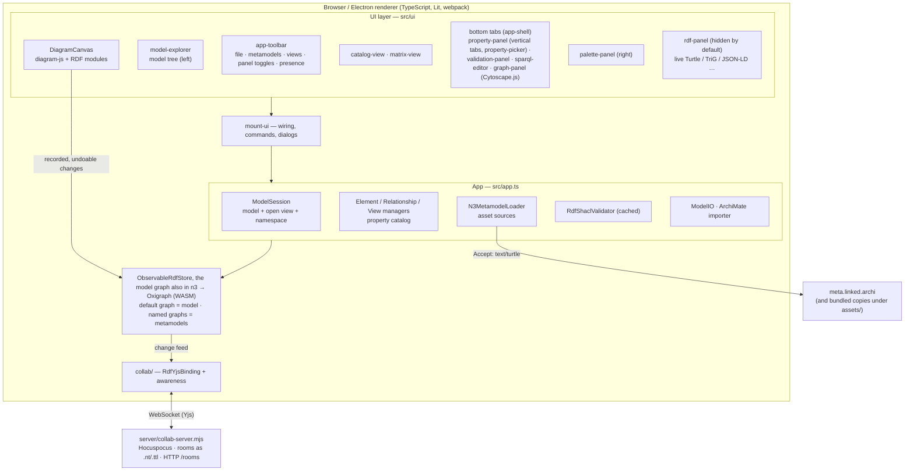
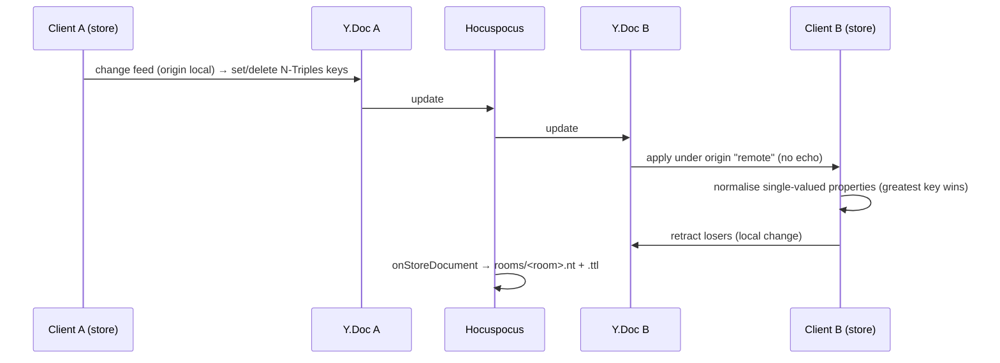

# Design: la-gram

## Overview

The RDF store is the model of record. The diagram canvas (diagram-js), the model
tree, the property panel, catalog and matrix views, files on disk and the
collaboration document are all projections of it, and every change to the model
is a change to triples first. Metamodels are published Linked.Archi assets loaded
at runtime; nothing about any modelling language is compiled in.

This is the design as implemented. The behaviour it serves is in
`requirements.md`; the plan is `tasks.md`; the implementation-independent tool
specification is `docs/linked-archi-tool-spec.md`.

---

## Architecture



### Layers

| Layer | Directory | Responsibility |
|---|---|---|
| RDF engine | `src/rdf-engine` | Oxigraph store (native bulk load), observable wrapper (change feed, recording), IRI minting, parser/serializer, SHACL validator |
| Metamodel manager | `src/metamodel-manager` | Asset sources, manifest-driven loader, catalogue, palette generation (dual classification, axes, notation), viewpoints |
| Model manager | `src/model-manager` | Session, model namespace (minting, moving), element/relationship/view managers, cascade rules, queries, property catalog (what to offer when adding a property), legacy migration, shared vocabulary |
| Import/export | `src/import-export` | Model I/O (six formats, DD-15 partition, profiles), ArchiMate exchange import, SVG/PNG |
| UI | `src/ui` | Shell (layout, side panels, bottom tabs), panels, canvas, dialogs, mounting |
| Collaboration | `src/collab`, `server/` | Y.Doc binding, presence and locks, Hocuspocus server |
| Platform | `src/platform` | Web vs. Electron file access |

---

## Core concepts

### Model / view / canvas

| Concept | RDF | Where at runtime | Persisted |
|---|---|---|---|
| **Model** | `arch:Model` + `arch:modelConformsToMetamodel` + its namespace (`vann:preferredNamespaceUri` / `…Prefix`) | default graph | yes |
| **Element** | a metamodel class; `skos:prefLabel`@en; `arch:inModel` | default graph | yes |
| **Relationship** | `arch:QualifiedRelationship` subclass instance: `arch:source`, `arch:target`, `arch:inModel` — **plus** the unqualified triple (`arch:unqualifiedForm`), which it `rdf:reifies` (RDF 1.2, `<<( s p o )>>`), and the qualified predicate from the source to it (`am4:qualifiedServes`; `arch:hasQualifiedRelationship` for a class with none) | default graph | yes |
| **View** | `arch:View` + `arch:Diagram`/`Catalog`/`Matrix`, `arch:inModel`, `arch:viewConformsToViewpoint` | default graph | yes |
| **Membership** | `arch:inView` on each concept a view presents | default graph | yes |
| **Geometry** | `arch-vis:ArchNode` (bounds, `archElement`, `view`), `arch-vis:Link` (`archRelationship`, `source`/`target` nodes, `points` list with IRI cells) | default graph | yes (droppable profile) |
| **Canvas** | diagram-js elements, keyed by concept IRI | memory | no |

One placement per element per view (the canvas keys shapes by element IRI).

### IRIs

UUID-based, minted at creation, never changed by editing (`rdf-engine/iri.ts`).
A model owns a **namespace**, `{base}{notation}/{modelId}/` (DD-15/DD-29), and
everything minted for it is a flat local name in it — flat because a Turtle
prefixed name cannot contain `/`, so the whole model is written with `m:`:

```
{base}{notation}/{uuid}/           namespace     (base: https://example.org/ unless configured)
{ns}model                          model         m:model
{ns}element-{uuid}                 element       m:element-…
{ns}relationship-{uuid}            relationship  m:relationship-…
{ns}view-{uuid}                    view          m:view-…
{ns}node-{uuid}                    ArchNode      m:node-…
{ns}link-{uuid}                    Link          m:link-…   route: {link}-points-{i} (cells), {link}-p{i} (points)
```

The namespace is stated on the model with the VANN properties the Linked.Archi
ontologies use for their own (`model-manager/model-namespace.ts`):

```turtle
m:model a arch:Model ;
    vann:preferredNamespacePrefix "m" ;
    vann:preferredNamespaceUri "https://example.org/archimate/3f2c…/" .
```

A model that states none (an older file, another tool's) gets a derived one:
`{ns}` for `{ns}model`, else the model IRI plus `/` — where earlier versions of
la-gram minted (`urn:la-gram:archimate/{uuid}/element/{uuid}`).

**Configuring it.** The base for new models is `https://example.org/` (a
placeholder domain) unless `createApp({ base })` / `?base=` says otherwise; New
model shows the namespace it will use and lets it be edited. **Model settings**
(the model name in the toolbar, File menu, tree menu) edits name, namespace and
prefix. Changing the namespace **moves** the model's IRIs into it by default:
every IRI in the model data under the old namespace is rewritten under the new
one, keeping its local name with any `/` turned into `-` (so legacy IRIs become
prefixable), and `arch:Model` becomes `{ns}model`. Terms a loaded vocabulary
defines are never renamed. The move is one store change — one Yjs update —
and a collaborator's session follows it to the same view under its new IRI
(`ModelSession.resync`). Unticking "move" keeps existing IRIs and mints only new
ones in the new namespace. The canvas re-opens the view, which starts a fresh
undo history, so the move itself is not undoable.

No blank nodes are minted: geometry is synchronised triple by triple, and a blank
node has no identity outside its store.

### Named graphs

At runtime the **default graph is the model** and each metamodel document is a
named graph keyed by its ontology IRI — which is what lets a metamodel be
swapped without touching the model and lets files contain only the model. At
rest, formats that carry graphs use DD-15:

```
{ns}graph/model       the arch:Model resource
{ns}graph/semantic    elements, relationships, views, membership
{ns}graph/views       arch-vis geometry only
```

With `{ns}` = `{base}{notation}/{modelId}/`, these are exactly DD-15's graph
IRIs. (The model resource itself is `{ns}model` rather than DD-15's
`{base}{notation}/{modelId}`, so that it too is a prefixed name, `m:model`.)

Loading flattens every quad into the default graph.

**The model graph, also in JavaScript** (Task 22). Every quad read out of
Oxigraph crosses from its WebAssembly and is converted term by term — 10 µs a
quad, and garbage the collector and Oxigraph's finalizers then spend as long
on. `ObservableRdfStore`, which sees every write to the model, keeps a copy of
the default graph in an n3 store, in the form Oxigraph holds it
(`RdfStore.canonical`: numbers, booleans and dates canonical, language tags in
lower case — Oxigraph rewrites both; a number of an integer type, a double or a
decimal written plainly is rewritten in JavaScript by Oxigraph's rules, checked
against it on thousands of values, the rest put through a scratch Oxigraph
store). A read of the default graph is answered
from the copy — `modelQuads()`, and any pattern with the default graph but a
literal object, which Oxigraph matches in any of its forms; a read of
everything is the copy and Oxigraph's named graphs one by one
(`RdfStore.namedGraphs`); other reads, SPARQL and the metamodel graphs stay
with Oxigraph, which keeps the model too. n3 tells as it adds or removes a quad
whether the model had it, which is what makes a change effective; a write
Oxigraph refuses part-way reads the copy again from it. What reads model
resources reads them from the default graph: the view manager (views, nodes,
links, routes), and names and types (`labelOf`, `hasLabel`, `statementsOf`) —
there first, every graph after. On a 347 000-triple model the copy holds
~100 MB of heap; opening went from 47 s to 11 s.

A large addition to the model — 5 000 quads or more, as opening one is — reaches
the copy at once and Oxigraph in the background, in slices of 12 ms between
frames: converting every quad into Oxigraph was 4 s of opening 353 000 triples.
Its terms are checked at once, each distinct one made with Oxigraph's own
constructors (`RdfStore.check`), so a model Oxigraph cannot hold fails to open
as before; a quad removed before it is given is passed over. The whole model
removed — as opening another does — is cleared from Oxigraph in one go
(`CLEAR SILENT DEFAULT`), and what it was still to be given dropped: deleting it
a quad at a time, each converted first, was a 6-second freeze. Until Oxigraph has
the whole model (`behind`), a read of every graph is the copy's model and
Oxigraph's quads outside the default graph. SPARQL over everything, an update,
a bulk load into the default graph and `size` give it the rest first
(`giveAll`); SPARQL about the metamodels — `graphScope`'s viewpoints,
relationship tables and permitted relationships, which read the default graph
only for metamodel data loaded there — goes through `queryMetamodels`, which
does not wait; it takes the list of named graphs the store keeps
(`namedGraphs`, read with `GRAPH ?g {}` until a named graph is written to) —
enumerating them by a pattern scanned every metamodel quad, for each of the
forty relationship lookups a context pad makes. The relationship manager keeps
what one task reads of the metamodels (scope, relationship types, class
closures) until the task ends or the store is written to, and the relationship
tables are read when the browser is idle after a model or metamodel loads. The palette reads the metamodel graphs into a store of its own
and the model through the copy (`modelGraph`), without copying it in too; the
metamodels' store is not kept between palettes, which would hold 100 MB.

---

## Key flows

### Metamodel loading

`N3MetamodelLoader` reads the manifest, follows the `arch:*` asset properties
and `owl:imports` a level at a time in parallel, and asks an **asset source
chain** for each document IRI:

```
uploaded  →  bundled (assets/, mirrors meta.linked.archi)  →  remote (Accept: text/turtle)
```

(`bundled-first`, the browser default; `remote-first` and `offline` reorder or
drop the remote source). Every fetch revalidates (`cache: 'no-cache'`): neither
the static server nor meta.linked.archi sends `Cache-Control`, and a browser
would otherwise keep a heuristically fresh copy for hours. `assets/` is
refreshed from a linked-archi-meta checkout with `npm run sync-assets`, which
uses that repository's own publishing scripts for the mapping. Every discovered document gets a status (loaded,
already-loaded, skipped, unavailable, error) and an origin. Documents are bulk
loaded natively into Oxigraph — 110 ms for the 72 740-quad ArchiMate 3.2
relationship shapes, against 1.4 s quad by quad. Derivation rules, deliverable
templates, reference models and the framework document are skipped. A document
imported by its `owl:versionIRI` (meta's relationship tables import
`…/archimate4/onto/4.0#`) resolves to the bundled document it versions. Reference
data is loaded (and bundled for both ArchiMate versions): its `skos:prefLabel`s
label the `sh:in` choices in the property panel.

**Relationship ends** (Req 2.17). The palette carries each decoration's
published symbol (`decorationSymbols`: `arch-vis:decorSymbol` on the core-vis
`arch-vis:Decoration` individuals, resolved to the bundled
`assets/core-vis/markers/` copy). The renderer draws a `<marker>` from it:
the SVG is rebuilt from plain shape elements and their geometry and paint
attributes only (no scripts, handlers, styles or references), with the
symbol's viewBox and size, `refX`/`refY` at the middle of the viewBox's right
edge, `orient="auto-start-reverse"` at a source end, and `color` set to the
line colour for `currentColor`. The first connection to need a decoration
starts loading its symbol; until it arrives that marker uses built-in
geometry, and is then replaced in place (same id, so every line using it
follows). A symbol that cannot be loaded leaves the built-in marker.

**Element shapes** (Req 2.18). `notation-shapes.ts` turns a shape into one
geometry with two encodings: the drawn body (`shapeGeometry`: a `rect`,
`ellipse`, `circle`, `polygon` or `path`, plus `details`, a path of inner lines)
and the outline in absolute coordinates that connection docking crops against
(`shapePath`). The eight core shapes are coded. A notation's own shape is a
`CustomShape` that `notation.ts` reads from the notation data (`readCustomShape`:
the fallback and the path templates); `drawCustomShape` evaluates its
`shapeVariables` and fills each `{expression}` with a small parser of its own —
numbers, `w`, `h`, the variables, `+ - * /`, parentheses, `min`, `max`; never
`eval` — into the compact path form the core shapes use, and `translatePath`
moves the outline for docking. Templates are absolute SVG path commands, so
arcs and curves reach `path-intersection` as they stand. A straight link — one
segment, as a link is first drawn — is docked by computation instead
(`straight-docking.ts`, Task 22): against an outline of lines and unrotated arcs
(every core shape, and a notation's straight-edged ones) the segment's
intersections are a line's with a line or an ellipse, chosen as diagram-js's
`getElementLineIntersection` chooses — the same point for polygons, within a
pixel for arcs, which diagram-js approximates as Béziers; a curve, a rotated arc
or a bent link is left to diagram-js. The renderer keeps each shape's outline
until it moves, resizes, is retyped or the notation changes. `shapeLayout` takes the
content and label boxes from the templates (a label box's height decides how
many lines the label gets). A template that cannot be evaluated is reported once
and the shape drawn as its fallback. The ArchiMate shapes come from the bundled
notation files, and their tests check them against the published pictures; the
C4 and EDGY ones are tested from fixtures mirroring linked-archi-meta. The label
is drawn in `arch-vis:fontColor`, else the line colour; under an IconCentric
icon, where it sits on the canvas, black unless `fontColor` is given.

`arch-vis:borderStyle` takes the relationship dash patterns. Badges stay
`<image href>`: the published glyphs are transparent where the element's fill
shows (the vocabulary's `arch-vis:iconSymbol` convention), so they need no
recolouring to match the pictures.

Palette generation (existing, unchanged in approach): dual classification over
the taxonomy (`conceptClassification`) and ontology, several axes. Notation is
resolved per class by `notation-resolver.ts` in five steps (Req 2.16):

For a class C, the active set A is the set that the active presentation context
names with `arch:usesNotationSet`, or else the primary metamodel's
`arch:notationSet`. The fallback layers F are the default sets
(`arch:notationSet`) of all loaded metamodels except A itself, in load order.
F includes the default set of A's own metamodel when a presentation context
picked an alternative set.

1. A descriptor in A for C.
2. A descriptor for C in F, the first match in load order.
3. C's own `arch:prefVisNotation`.
4. A descriptor for the nearest superclass of C that has one in A or F. The
   walk goes breadth-first over `rdfs:subClassOf`: by distance first, and
   superclasses at the same distance in IRI order. It stops at `arch:Element`
   and `arch:QualifiedRelationship`. For each superclass, A is checked first,
   then F in load order.
5. Built-in defaults. Elements: a rectangle with a white fill and a black line.
   Relationships: a solid black line.

Anything published for the class itself beats anything inherited; among
inherited descriptors the nearest ancestor wins; the active set only breaks
ties.

So a generic set such as Basic, when active, leaves ArchiMate's own notation in
place, and an extension subclass of an ArchiMate class with nothing of its own
takes its parent's look. `class-hierarchy.ts` does the walk. The palette
carries every resolved class in `notationIndex`. The canvas's
`NotationStyleRegistry` reads it for types the palette does not list, and so do
the Graph tab's type look and a new view's element sizes in `mount-ui.ts`,
through a registry of their own, so every path gives the same answer. The
loader also loads the sets the presentation contexts name
(`arch:usesNotationSet`).

**Basic, the generic language** (Req 1.12; meta.linked.archi's, bundled:
`assets/basic/`, `https://meta.linked.archi/basic/metamodel#Basic`). Every
metamodel la-gram offers is meta.linked.archi's; for elements and
relationships no loaded language has, Basic is the one to add. Its
Connection's domain and range are `arch:Element`, so it relates any two
elements, across languages; Association and Aggregation keep Basic's
restrictions. A relationship is *generic* (`RelationshipTypeInfo.generic`)
when its domain and range name only core classes and no relationship table
governs it — ArchiMate names `arch:Element` on Specialization and Composition
and restricts them in its tables, so they are not (`isGenericRelationshipType`,
decided in the relationship manager, which knows the tables). A generic
relationship ranks with the fallbacks, below Association, and counts as
generic in the append menu (`isGenericRelationship`), so it never makes a
choice ambiguous. A core class is never a palette type, whatever a taxonomy
lists. So that adding a language does not disturb the first: the palette's
axes come in the loaded metamodels' order (`PaletteOptions.metamodelIris`,
which the UI passes as it passes the notation sets), so the first language's
grouping stays the default, and under its axis another language's types are
in "Other". Only an axis that groups some element type is offered: a taxonomy
may also classify relationship types — ArchiMate's Relationship by Category —
which are no palette elements. Basic's notation draws `arch:Element` and
`arch:QualifiedRelationship` generically, so an element typed by a core class
alone is drawn too. The core ontology document loads under its bundled
`coreOntology` role, which unloading never drops.

**The Metamodels menu** (Req 1.2) lists meta.linked.archi's DCAT catalogue
(`https://meta.linked.archi/catalog`, `catalogue.ts`): a metamodel manifest's
dataset names its `arch:Metamodel` (`foaf:primaryTopic`) with its label, and
its section of the site's index as `dcat:theme`; the menu lists the sections
whose notation is `languages`, `frameworks`, `extensions` or `core`, by label,
with the label's trailing " Metamodel" dropped; a section with nothing to
offer is not shown. `App.loadCatalogue` hands
the menu the bundled copy (`assets/catalog.ttl`, through the bundled source by
the catalogue IRI — not a registry entry, so nothing loads it into the store),
then — unless offline — the published one, read from meta.linked.archi
whatever the asset mode: under `bundled-first` the chain would always answer
from the bundle, and a newly published metamodel would wait for a new la-gram.
A published catalogue that is missing or unreadable leaves the bundled list.
`npm run sync-assets` takes the catalogue from the meta checkout's last
generated site (`.onto-docs/catalog.ttl`).

### Editing on the canvas — recorded changes

diagram-js owns *when* things happen (its command stack, rules, tools);
la-gram owns *what* the model becomes. Every canvas gesture that changes the
model runs its model operation inside a nested command:

| Gesture | diagram-js command | Nested RDF command |
|---|---|---|
| Palette drop / append | `shape.create` | `rdf.element.create` → element + node (snapshot for redo) |
| Tree drop / "add to view" | `shape.create` (existing IRI) | `rdf.store.change` → node; then draws its relationships (`connection.create` + existing-relationship hint) |
| Connect | `connection.create` | `rdf.relationship.create` → qualified resource + triple + link |
| Change type | `rdf.relationship.retype` | retype in place (same IRI) |
| Change an element's type (property panel, right-click menu) | `rdf.element.retype` | `rdf.store.change` → the `rdf:type` (and the default name); also redraws the shape in the new notation, on undo too |
| Rename in the box (double-click, F2) | `rdf.element.relabel` | `rdf.store.change` → the `skos:prefLabel` in the shown language; also relabels the shape, on undo too |
| Move / resize | `shape.move` / `shape.resize` | `rdf.store.change` → node bounds |
| Route change | `connection.layout` / `updateWaypoints` / `move` | `rdf.store.change` → point list |
| Reconnect end | `connection.reconnect` | `rdf.store.change` → ends, triple, links in other views |
| Delete (key, pad ×) | `shape.delete` / `connection.delete` | `rdf.store.change` → remove from **view** |
| Delete from model (pad ✖, tree) | `rdf.model.delete` | removes shapes, then the concept everywhere |
| Property edit, add, remove (property panel); rename from the tree; restore a version | `rdf.store.edit` (`DiagramCanvas.recordChange`) | the change itself, recorded; undo and redo redraw the canvas from the store |
| Drop or move into an element (nesting) | `shape.create` / `shape.move` with an element as parent | `rdf.store.change` → the node's `arch-vis:inNode`; `AutoResize` grows the containers (nested `shape.resize`); then the "which relationship?" menu — the one picked as `rdf.store.edit`, not drawn |

`rdf.store.change` runs its operation once inside `ObservableRdfStore.record`;
undo applies the inverse diff, redo re-applies it. Re-running logic on redo
would mint new IRIs; replaying the diff cannot.

Changing an element's type (`rdf-element-replace-menu-provider.ts`,
`rdf-element-retype.ts`) is `DiagramCanvas.retypeElement(iri, type)`, asked by
the property panel's type field (`property-retype`, answered so a cancelled
change puts the field back) and by the right-click menu's "Change type…", which
opens the `la-element-replace` popup: the canvas's palette definition — every
loaded element type, unfiltered by the viewpoint, grouped under the palette's
current axis — searching names and groups only (definitions would match half
the list). An element in the open view changes through the command, undoably;
one that is not (selected in the tree) changes in the store directly, like any
property panel edit. Before either, the canvas checks each of the element's relationships with
`getValidRelationships(source, target)` under the new type; any that would not
be permitted are passed to `confirmRetypeElement` (the app's confirm dialog,
listing them) and, if confirmed, kept for validation to flag — deleting
relationships to make a type change fit would silently lose model content.

The **right-click menu** (`rdf-context-menu-provider.ts`, popup provider
`la-context-menu`) opens on `element.contextmenu` for elements and
relationships (the browser's menu is suppressed; the concept is selected first).
The canvas decides the actions (`contextMenuActions`) in sections — edit
(Rename, Change type… / Change relationship type…), relate (Append…), show
(Properties, Show in model tree, Show relationship graph), copy (Copy IRI),
delete (Delete from view, Delete from model…) — and hands the "show" and
"copy" ones to the host (`onContextAction`). A menu an action opens (the type
menu, the append menu) is opened on the next tick: diagram-js closes the menu
an entry was picked from after its action runs. The pad keeps delete, connect,
append and a relationship's change type; an element's type moved to the panel
and the menu.

Renaming in the box (`ui/canvas/rdf-label-editing.ts`) uses
`diagram-js-direct-editing`, the text box bpmn-js edits its labels with (its
`DirectEditing` class, declared in la-gram's own module: the package entry
imports a diagram-js folder without `/index.js`, which Node's ESM loader
refuses). The provider offers element shapes only, lays the box over the shape
with the renderer's font scaled by the zoom and room for the badge, hides the
drawn name meanwhile (a marker), and selects the whole name. Completing with a
changed, non-empty name runs `rdf.element.relabel`; canvas commands are not
followed by a re-read of the store, so the command relabels the shape itself on
execute and on revert.

### Which relationships are permitted

`RelationshipManager.getValidRelationships(source, target)` answers for connect,
append and "change type". The authority is the metamodel's **relationship
shapes**: ArchiMate 4.0's and 3.2's are generated from the specification's
relationship matrix — one node shape per qualified relationship class whose
`sh:or` lists every permitted (source class, target classes) pair.
`model-manager/relationship-table.ts` reads them into a lookup, walking the RDF
lists with indexed quad lookups (136 ms for ArchiMate 4.0, 500 ms for 3.2; the
same as one SPARQL query with `rdf:rest*` took ~50 s), cached until the loaded
graphs change. As in validation, `sh:targetClass` reaches subclasses, so every
shape on a class in the relationship's closure must admit the pair — Composition
is allowed exactly where Aggregation is. Relationship classes no shape covers
(metamodels without relationship shapes) fall back to the `domainIncludes` /
`rangeIncludes` hints. Before the table, the hints admitted every ArchiMate 4.0
pair, and the relationship an append created by default failed the shapes for
68% of them.

**Direct first.** The shapes say what is permitted, not how: the relationship
tables meta publishes beside them (`archimate4-relationship-tables.ttl`,
`archimate3.2-relationship-tables.ttl`, bundled with role `relationshipTables`,
kept out of the shapes graph) also say which relationships a modeller may draw
directly — the specification's upper case — and which are permitted only as the
conclusion of a derivation (`am4:realizes am4rt:permittedDirectlyBy
am4rt:permitsDirectRealization`). `model-manager/direct-permissions.ts` reads
them, finding the annotation by its declaration and name
(`permittedDirectlyBy`) in whatever namespace, and the manager marks each
candidate `direct: true | false`, or leaves it unmarked where the tables do not
say (a junction, which they do not list). The same tables say which
relationships the specification's metamodel figures draw for a pair
(`am4:assignedTo am4rt:drawnBy am4rt:drawsAssignment`), read by the same code
under the name `drawnBy`; and the language's taxonomy gives its order of
proposal — `arch:RelationshipProposalOrder` collections, a general one and
exceptions scoped with `arch:domainIncludes` / `arch:rangeIncludes`
(`model-manager/proposal-order.ts`). Candidates come in five groups
(`RelationshipPreference`), best first: `first`, a scoped exception names it for
these elements (composition between two capabilities, aggregation from a
grouping); `drawn`, the figures draw it, in the general order (a process
realizes a service before it triggers it, triggers another process before it
flows to or aggregates it); `direct`; `derived`, only by derivation; and
`fallback`, Association and the core's generic relationship. Within the last
three, a candidate whose `arch:domainIncludes`/`arch:rangeIncludes` hints
describe the pair comes first, then the score's nudges (Specialization,
Composition and Aggregation down), then the label. The general order is kept to
what the figures draw: where they draw nothing it proposes worse than the hints
(an actor serving a process before being assigned to it). So in 4.0 an
application component is assigned to a data object — the system of record, as
the Application Structure metamodel draws it — with Access, derived, second. The
menus say why in words (`preferenceNotes`): "proposed first", "drawn in the
metamodel", "only by derivation", "always permitted"; the candidate's reason
says it too.

**Append.** "+" on the pad lists the element types some relationship is
permitted to, with the palette's icons. Association is permitted between any two
elements, so a silent default would always hide a choice: the entry decides
alone only when one *specific* relationship is permitted (or Association alone);
otherwise a second menu lists them, best-ranked first, Association last, and the
pick is required for that one append. A drag from the menu cannot pause to ask
and takes the best-ranked one.

**Two selected elements.** A selection of exactly two elements gets one pad
entry, "Connect these two…" (`RdfContextPadProvider.getMultiElementContextPadEntries`),
opening a menu of the relationships they may have in both directions — each
direction a group, each ranked by `getValidRelationships`, derived-only ones
marked (`rdf-pair-connect-menu-provider.ts`). The pick goes through the same
`modeling.connect` a connect drag ends in, so it is one undo step. It is offered,
not popped up: a menu on every two-element selection would be in the way.

**A relationship type from the palette.** Picking one arms the connect tool with
that type *required* (`RdfRuleProvider.setPreferredType`): `canConnect` answers
it or nothing, so a pair that does not permit it shows the not-allowed cursor,
and releasing on one creates nothing and tells the user why
(`RdfRuleProvider.refusal` → `DiagramCanvas` `onNotice` → a toast listing what
the pair permits). It used to be a mere preference, quietly replaced by the
best-ranked type where forbidden — which hid the rule.

**Existing relationships.** The same menu's header carries two tabs (diagram-js
header entries in their own group, styled as a tab strip): *New element* and
*Existing relationships (n)* — what the element is already related to in the
model, other ends not in the view listed first. A click places the other end
beside the source (`findFreePosition`, right of it for an outgoing relationship,
left for an incoming one) through the same path as the tree's "Add to current
view", which draws its relationships to what is placed; a drag is the tree's
drag. The tabs exist only when either list has something, because a header entry
alone makes a popup menu non-empty — and emptiness is what hides the pad's "+".

### Store → canvas

Changes that do not come from the canvas — a collaborator, the tree, the
property panel, opening a file — reach the canvas as `model-changed` events, and
`DiagramCanvas.syncFromStore()` reconciles the drawn view with the store
(add / remove / move / relabel / re-route) **without** the command stack, so they
never appear in the undo history. Markers (viewpoint, validation, remote
selection, lock) are kept per concept and re-applied to shapes drawn later.

A stored route (`arch-vis:points`) is drawn as core-vis reads it: its first and
last points are its ends when they lie on their shapes' outlines — as la-gram
writes a route and a BPMN diagram has it — and otherwise bends, the line run
from each shape to them and docked to its outline as a line drawn here is (the
ArchiMate exchange format, and so the ArchiMate converter, keeps the bends
alone); one point is one bend. Whether a point is on the outline: a 3-pixel
probe across it meets the outline docking crops against (the bounds' edge for
an outline with curves) — inside the shape is not enough, a bend may be there,
on a line to a nested node.

The model tree reads the model once after the events of one task (opening a
model fires several), in one pass for each concept's types, names and ends;
another active view only re-marks the tree it has (Task 22). What it reads is
kept by `ModelContentsIndex`, told every change by the store: after an edit it
reads again only the concepts the change touched — from their own triples, and
the relationships labelled with a renamed end's name — and moves each in its
sorted list (by type, name, IRI: a place unique, found by binary search); it
reads the whole model at first, when the metamodels or the class hierarchy
change, and when a change touches more than 2 000 concepts. The RDF panel's
counts and the Graph tab's types read the same.

A view of thousands of shapes (Task 22): a sync indexes the connections drawn
once, and `findConnection` looks a relationship up by id or among the few
connections the user drew (diagram-js names those itself); a view already drawn
in the task is only brought up to date (opening a model says it is loaded, then
that its view is open); a shape renamed is redrawn alone (`element.changed` —
`elements.changed` re-stacks every sibling, 30 000 in a view of 10 000), and
after a move or a nesting only what changed is put back in its place among its
siblings (diagram-js's `updateContainments` replaced; a parent where the sibling
before is not in place is re-stacked whole). The view
manager keeps each view's nodes and links until a write touches geometry, a
node's or link's type or a route (`ObservableRdfStore.onEveryWrite`, told inside
a batch too), so the canvas and the tree read a view once between such writes;
what a view shows (`placedIn`: the elements and relationships its nodes and
links draw) is kept as its shapes move — the tree's marks and a link's route
written after a move read it.

### Layout

```
┌──────────────────────── toolbar ─────────────────────────┐
│ model    │ canvas                      │ palette │ RDF    │
│ tree     │─────────────────────────────│         │ (hidden│
│          │ [Properties|Validation|SPARQL|Graph]  │  until │
│          │ bottom panel                │         │ opened)│
└──────────┴─────────────────────────────┴─────────┴────────┘
```

`app-shell.ts` is a CSS grid with named slots: `explorer`, `canvas`,
`properties` / `validation` / `sparql` / `graph` (the bottom panel's tabs), `palette`,
`rdf`. The tree and the two right-hand columns are *side panels*: each column's
width is a CSS variable that is 0 while the panel is hidden, and each has a
drag handle on its inner edge — the tree's right (≥ 160 px), the palette's and
the RDF panel's left (≥ 180, ≥ 280 px). The bottom panel's row height is
dragged by its top edge (≥ 120 px); clicking the open tab folds the row to the
tab strip, and another tab opens and unfolds it. The canvas keeps at least
240 × 160 px.

*Maximized*, the bottom panel spans the grid's rows 2–3 and every column, over
the other panels (`z-index`), which stay laid out underneath and are `inert` —
so the canvas keeps its size, viewbox and selection, and nothing has to be
re-laid out on restore. Esc restores unless a dialog or a diagram-js popup is
open; so does folding, and `mount-ui` restores it when a view is opened. The
Graph tab watches its drawing area with a `ResizeObserver` (Cytoscape.js
notices window resizes only) and refits when it changes. Sizes, the open tab and the folding are remembered per browser in
`localStorage`. The Validation tab carries the number of violations, since it
is often not the open one. A `ResizeObserver` on the canvas host tells
diagram-js (`canvas.resized()`) whenever a panel changes the canvas's size.

### Property panel tabs

The panel (the bottom panel's Properties tab) has vertical tabs on the left,
under the heading (kind and type), each with a count where one applies:
**‹Kind› information** — ID, type, model, name, definition, always in that
order; **Properties** — everything else on the concept, then the add field;
**Analysis** — the relationships (or a relationship's ends); **Appears in
views**. Only the open tab's pane is rendered; its fields sit side by side where
there is room, a text area taking the whole row. Up/Down move between the tabs.
The open tab is kept in `localStorage` (`la-gram:property-panel-tab`), so it
holds from one selection to the next and across reloads; a concept without that
tab (a model has no analysis) shows its information instead.

The panel reads without knowing RDF. A field is named in words: the ones every
concept has as a modeller knows them (Type, Model, Name, Definition, Other
name), the rest by their shape's `sh:name` or their vocabulary's label when that
is more than the local name again (`prefLabel`, `source`), else by the local name
in words (`modelRepresentsSystem` → "Model represents system"). A link to
another resource shows that resource's name (`labelOf`, else its local name in
words), and the ID the concept's short identifier (its local name). Clicking a
field's name, or a link, shows the IRIs behind the row — the property's, and the
value's when it is a link — under it, each selected whole by a click, to copy;
clicking again hides them, and another selection starts with them hidden. A
value's language is named when it is not English, the language la-gram reads
names in ("German"; its tag on hovering).

An element's type, and the value of a link being added, are picked by name in a
search field (`named-picker.ts`, which the add field's property picker is built
on): the list in groups, each entry's name first and under it, smaller, what it
is and its IRI. IRIs are behind the list's **Show IRIs** switch — remembered per
browser, for every picker that has one — except where entries share a name
(ArchiMate 3's Business Actor and ArchiMate 4's), which show theirs anyway. The
type field shows the current type's name and goes back to it when left without
a pick, or when the change is not made after all. A property takes a link when
its shape says so (`sh:class`, a `sh:nodeKind` that admits IRIs) or its
vocabulary does (an object property, a range that is a class), and for
`rdfs:seeAlso`, `prov:wasDerivedFrom` and `dcterms:source` / `relation` /
`references` (`PropertyCatalog.takesLinks`); its value is then one of the
model's elements, relationships and views by name (the first 100, typing
narrows), or an address typed (`https:`, `urn:`, `mailto:`) — a link — or text.

### Type guide (About ‹type›)

The left column is the model tree over `type-guide-panel` (the shell's `guide`
slot): what the loaded metamodels say about the selected concept's type — or
about a type picked in the palette (element or relationship), which stays until
something is selected. Starting to create clears the canvas selection, so a
cleared selection does not clear a palette pick; nor does the refresh after a
model change. The
shell sizes the section like the bottom panel — its height is dragged by its
top edge (≥ 90 px, the tree keeping 120 px), it folds to its header, and both
are remembered (`la-gram:guide-height`, `la-gram:guide-folded`); the header
asks for the fold (`guide-fold-toggle`) and the shell answers
(`guide-panel-changed`). It lives there rather than in the property panel: it
describes the *type*, not the concept being edited, and stays in view while
the bottom panel shows validation, a query or the graph.

The guide is read by `metamodel-manager/type-guide.ts` from whatever
metamodels are loaded (all graphs of the store), structurally, so any notation
that publishes the same properties gets the same page. From the ontology:
`skos:definition`, `skos:scopeNote` (as paragraphs — the published texts are
hard-wrapped, so a line break starts a paragraph only after a sentence ends),
`skos:altLabel`, `skos:changeNote`, `arch:isAbstractClass`, the
`rdfs:subClassOf` closure nearest first, `rdfs:seeAlso` / `dcterms:source`
links that are web pages rather than resources of the metamodels, and facts by
kind — `arch:domainIncludes` / `rangeIncludes` / `unqualifiedForm` for a
relationship, `arch:includesConcept` / `targetsStakeholder` /
`viewpointFramesConcern` / `viewpointHasPurpose` for a viewpoint. From the taxonomy: every SKOS concept
that holds the type (`skos:narrower`, or the type's `skos:broader`), with the
path up to its top concept (the axis), the concept's definition, notes and
changes, and its other members. The host caches a guide per type until a
metamodel or a model is loaded. `guideIri` says what to describe: the type, or
for a view its viewpoint. Links inside the section open another type's page in
place (a trail with a way back); the trail is dropped when the selection's
type changes, not when the host merely re-sends the same one after a model
change. The sections are `<details>`, their open state in
`localStorage` (`la-gram:about-sections`); guidance and classification start
open, superclasses and changes folded. Source links open in a new browser tab
— in Electron in the system browser: the main process denies new windows and
navigation away from the app, so nothing but the app's own page loads in its
window.

### Adding a property

The property panel's "Add a property…" field is a picker over
`model-manager/property-catalog.ts`, which decides what to offer from the loaded
vocabularies' own `rdfs:domain` declarations (and SHACL shapes) rather than
offering every declared property — the core-vis ontology alone would bring the
diagram geometry and notation styling. Groups: **For ‹type›** (domain or shape
covers the selected concept's type closure), **Used in this model** (literal-valued
properties on the model's concepts, and anything in the model's namespace — so a
custom property added once is offered everywhere), **Documentation** (SKOS, Dublin
Core, PROV — not `skos:definition`, which the panel always lists under the name,
nor `dcterms:description`, which would say it again), and **More** (no declared domain; folded until opened or searched).
Never offered: `arch-vis:` / `sh:` / `owl:` terms, what the tool writes itself
(type, membership, ends, conformance, the name, the model's namespace) and the
metamodel-authoring annotations (`arch:unqualifiedForm`, `domainIncludes`, …).
A property whose domain is another class is not listed but can be typed. Typed
text resolves as a CURIE with a known prefix, an absolute IRI, or a plain name in
the model's namespace (`cost center` → `m:costCenter`). Each entry shows the name
first and the prefixed IRI under it, always. The list floats (`position: fixed`) under the
field, or above it when there is more room there — as in the bottom panel — so
no scrolling container clips it; a native `<datalist>` could neither group
nor put the name first.

### Relationship graph

The Graph tab (`ui/panels/graph-panel.ts`) draws the relationships around the
selected element. `model-manager/relationship-graph.ts` gets the graph's triples
two ways, required by tests to be the same set:

- `buildGraphQuery` writes the "query behind the graph" the tab exports, run
  in the SPARQL Query tab or downloaded (`.rq`): a `CONSTRUCT` (the triples —
  RDF) or, from the same `WHERE`, a `SELECT` (one row per relationship: source,
  relationship, type, target and their names — a table). It is plain SPARQL
  1.1, so it runs on any store holding the model.
- `traverseGraph` walks the store breadth first with indexed lookups
  (`getQuads` on `arch:source` / `arch:target` / `rdf:type`, memoised). This is
  what is drawn, and what the Turtle export (`ModelIO.serializeQuads`, the
  model's prefixes and ordering) writes.

Both find every qualified relationship (`arch:source` + `arch:target`) within
*n* hops, either direction: the elements within *n − 1* hops level by level,
then one more hop for the relationships and their ends. Filters sit on every
hop (`FILTER(?rt IN (…))`, `FILTER(?nt IN (…))` in the query), so a type left out
prunes the traversal; relationship ends that are themselves relationships are
not followed. The depth is capped at 5. In the query, each level is a
`SELECT DISTINCT` subquery over the previous one, so it does not enumerate
paths as a flat UNION of hop chains would; a level includes the one before
(a hop's ends include the element it starts from), and the root is added to
the last level explicitly, since a filter may leave it out.

*The query's shape* (2026-09-27) is chosen for Oxigraph, measured on
synthetic models with two relationships per element (Node). Oxigraph joins a
bound variable into triple patterns, property paths and filters one lookup at
a time, but:

- a `UNION` on the right of a join is evaluated over the whole model — so a
  hop's two directions are one property path, `?p ^(arch:source|arch:target) ?r`
  (the union form: 1.1 s at depth 1, 2,000 elements; the path: 0 ms);
- anything after a `BIND` in a group is evaluated on its own — so the other
  end of a relationship is picked by a filter,
  `?r arch:source|arch:target ?n FILTER(!sameTerm(?n, ?p) || sameTerm(?s, ?t))`
  (with `BIND(IF(…))`: 4.7 s at depth 1, 2,000 elements; without: 1 ms);
- a join between a level (a subquery) and the next hop is reordered so that
  the subquery is re-run for every relationship in the model — so every hop
  is written `OPTIONAL { … } FILTER(BOUND(?r))`, the same rows as a join, which
  the optimizer does not reorder (depth 2, 2,000 elements: 9.4 s → 58 ms). The
  filter must end the hop's own group: a group's `FILTER` applies after all of
  its `OPTIONAL`s, and a later `OPTIONAL { ?r skos:prefLabel … }` would bind
  `?r` where the hop did not (the agreement tests caught this).

The first shape (subquery levels with `UNION`, `BIND` and `NOT EXISTS`) took
1.7 s at depth 2 and 7 s at depth 5 at 100 elements, and 13.9 s at depth 1 at
200. This one: 10 ms at depth 5 at 100 elements; 42 ms at 500; 0.4 s at 2,000;
around a hub (a hundred relationships on the root) 0.2 s at 500 and 3.4 s at
2,000 elements, depth 5.

The walk still draws, because it touches only what it reaches — 1–2 ms in
those cases, 62 ms around the 2,000-element hub. The agreement tests
(`relationship-graph.test.ts`) run the walk, the `CONSTRUCT` and the `SELECT`
on a hand-made model, corner cases (several types, labels in several
languages, loops, untyped things, other graphs) and generated models, at every
depth and filter, so the export stays honest: run on the same model, the query
returns exactly what is drawn.

**＋ New view** sends the drawn elements and relationships, with their
positions in the drawing, to the same path as the SPARQL tab's *Render as new
view* (below); the positions are spread by 1.3 — the drawing's boxes are
smaller and closer than a diagram's.

Drawing is Cytoscape.js (`graph-view.ts`, behind a factory so the panel is
tested without a canvas): round rectangles in the notation's fill colour with the
badge glyph, edges with the notation's line style and end decorations; rings
(breadth-first, circular, around the root), tree or force-directed layout; a fit
never zooms past 1.25×. The view is created the first time the tab is shown — a
hidden container has no size — and the panel neither queries nor draws while the
tab is hidden; while shown it refreshes 300 ms after a model change. The root
follows the selection unless the selection came from the graph itself.

### SPARQL tab and views from results

`sparql-editor` runs the query on the store and shows the result as a table: a
SELECT's rows, with its projected variables as the columns (read from the
query, so a column no row binds is still there); a CONSTRUCT's triples as
subject / predicate / object; at most 500 rows. IRIs are prefixed names —
the model's prefixes (`ModelIO.collectPrefixes`, read when the query runs) and
the vocabularies' — and clicking one reveals the concept as the RDF panel
does. The query-form detection masks IRIs and strings before it strips
comments, so a `#` in `<…/core#>` is not a comment.

*Render as new view* (`model-manager/view-from-results.ts`): `planView` takes
the IRIs the result mentions, in order, and keeps the model's elements
(`rdf:type` in the default graph — a metamodel class is not one) and the
relationships between elements, each bringing its ends; `placeNodes` turns
layout centres into bounds at each element's notation default size;
`ModelSession.createViewWith` writes the diagram, its nodes and links in one
batch and opens it. Without positions from a drawing, the layout is the Graph
tab's tree, run headless (`layoutPositions` in `graph-view.ts`, Cytoscape.js
without a container). Like *New view*, it is not on the canvas's undo stack;
deleting the view removes it.

### RDF panel

`rdf-panel` shows the model exactly as Save would write it: its text comes from
`App.saveModel` (so from `ModelIO`), in any of the six formats, with or without
geometry. It is hidden by default (the shell's fourth column is 0 wide) and does
no work while hidden; while shown it re-serializes on model events, debounced
250 ms. Highlighting is a line tokenizer producing one HTML string, assigned
once per change — cheaper than an editor component for a read-only view of a
possibly large file — and it wraps each subject's statements in a block keyed by
the subject IRI, which is what lets the panel highlight the selected concept and
turn a click on statements into a selection.

### Validation

Shapes: every `shapes` graph of the loaded metamodels + core + core-vis shapes
(+ legacy `urn:la-gram:shapes`), cached as one array so the validator keeps its
compiled engine. Data: the model + all `rdfs:subClassOf` axioms + the types of
referenced resources. `sh:sparql` is stripped (server-side, Req 8). Debounced
300 ms. Results go to the Validation tab; the tab carries the number of
Violations (Warnings and Infos are listed, not counted), and violating concepts
are marked on the canvas.

**Relationships by the tables, not the shapes** (Task 22,
`model-manager/relationship-validity.ts`). The relationship shapes generated
from a language's matrix check a relationship against an `sh:or` of every
permitted pair, and rdf-validate-shacl builds — and discards — a full result for
each pair that fails: 12 of 14 s on a 34 000-triple model. `App.relationshipCheck`
(cached with the shapes) takes out of the shapes graph what the loaded
relationship tables cover, recognised by form — a node shape on a relationship
class whose `arch:unqualifiedForm` the tables cover, made of an `sh:or` alone; a
node shape whose property shapes are all on covered predicates, each an `sh:or`
of classes or `sh:maxCount 0` — and keeps the rest (an attribute shape on a
relationship class, the element, principle and viewpoint shapes). SHACL checks
what is kept; `checkRelationshipsByTables` checks each qualified relationship and
each direct triple on a covered predicate by lookup in the tables (`permittedBy`:
direct or derived), over the ends' type closures, a junction at either end always
permitted — junctions read from the replaced shapes (a class they accept that the
tables never name and that is not a relationship class). A finding is reported
under the replaced shape's IRI and its `sh:message`. The same findings as the
shapes, checked on three models (56, 0 and 95 relationships): validation
14.9 s → 1.25 s + 8 ms (34 000 triples), 78 s → 14 s + 49 ms (347 000).

**Off the UI thread** (Task 22, `rdf-engine/validation-engine.ts`,
`validation-service.ts`, `validation.worker.ts`). Validation runs in a Web
Worker in the browser and the desktop app, so the UI never waits for it; in
Node and the tests it runs on the calling thread and answers at once. Both run a
`ValidationEngine`, which keeps its own copy of the model in an n3 store: given
whole once, then each change from the store's change feed — so a validation
copies nothing out of Oxigraph on the UI thread. What it needs of the
metamodels — the shapes graph, the `rdfs:subClassOf` axioms, the types of
resources outside the model, each relationship class's `arch:unqualifiedForm`,
the tables as plain data — is posted again whenever the metamodels change; the
engine splits the shapes as above and keeps the compiled SHACL. Terms cross as
n3 ids, a triple term as a nested triple (`term-codec.ts`). A worker validation
is not interrupted: asked again meanwhile, it runs once more when it ends, and
only the last request's report is published.

The data graph is the engine's store itself: the model with its extras — the
`rdfs:subClassOf` axioms, and the types of each outside resource while the model
refers to it (counted from the changes, `rdf:type` objects aside) — all in the
default graph; a quad both the model and the extras hold stays until neither
does. SHACL (`RdfShaclValidator.validateStore`) and the tables read it as it is,
so a validation copies nothing. rdf-validate-shacl keeps, until its next run, a
counter per node and shape checked (keyed by both as JSON), the report's graph
and the data graph; with the compiled validator kept between runs, that was
250 MB on a 347 000-triple model, so it is dropped once the report is read.

**After an edit, only what it can change** (Task 22, `rdf-engine/shape-reach.ts`).
The engine keeps the last findings by focus node, and notes what each change
touches: the subjects of the triples added and removed, and their objects when
nodes. Validating a focus node reads its own triples, those along each
`sh:path` — L hops for a path of length L, whose value nodes' types `sh:class`
reads — and what a shape nested on the values reads from there; `shapesReach`
computes the most hops of the shapes SHACL keeps (1 for ArchiMate and the core
shapes). The nodes an edit can change the findings of are then the changed
subjects and the nodes up to that many hops before them (incoming triples; both
ways when a path is inverse), at least one hop — the table check reads a
relationship's ends — and the changed objects (a `sh:targetObjectsOf` target).
They are validated again, each against the shapes that target it, chosen as a
whole validation chooses them (`RdfShaclValidator.validateNodes`: class targets
with the data's subclasses, `sh:targetNode`, `sh:targetSubjectsOf`,
`sh:targetObjectsOf`); the tables check them on their triples and the types of
what they point to; their findings replace theirs. The whole model is validated
on loading, when the metamodels change, when the class hierarchy does, when the
shapes reach without bound (`*`/`+` paths, a shape nested in itself), when a
property shape has a `sh:property` of its own (rdf-validate-shacl reports that
with the value node as the focus node), when an edit reaches more nodes than one
in 20 of the model's quads, and after 100 such validations. With no shape nested
in itself, rdf-validate-shacl's limit of 50 checks of a node against a shape per
run — a guard against recursion, which otherwise lets a node referred to from
many places pass unchecked, differently when validated alone — is switched off.
Checked by replaying random edits (renames, retypes, deletions and restorations,
references moved and added) into two engines, one validating the whole model
each time: the same findings after 1 000 edits on the 34 000-triple model (7 ms an
edit against 700 ms) and 30 on the 347 000-triple one (1 ms against 9.3 s).

A copy kept up to date by changes is only right if the changes say what the
store holds. Oxigraph keeps a number, a boolean or a date in canonical form —
`"010"^^xsd:int` is kept, and read back, as `"10"^^xsd:integer` — so the change
feed reports a typed literal in the form the store holds (`RdfStore.canonical`,
learnt through a scratch store); fed the form as added, the copy found 1 324
`sh:datatype xsd:integer` violations the store does not have. Undo and the
collaboration binding read the same feed, and now remove and key what is there.

### Collaboration



The server's Turtle snapshot uses the model's own prefix, read from the model's
`vann:` statements as the editor reads them. A namespace move arrives at the
other clients as one update; `ModelSession.resync` re-points them at the model
and at the same view under its new IRI.

The Y.Doc holds one `Y.Map<true>` keyed by canonical N-Triples: an RDF graph is a
set of triples, and a map-as-set is its CRDT. Single-valued predicates (bounds,
points, list cells, endpoints, `skos:prefLabel` per language) are normalised
deterministically after remote changes, so concurrent moves converge. Awareness
carries name, colour, open view and selection; what others select is marked and
locked (a rule at priority 3000 denies move/resize/delete/re-route).

### Files

`ModelIO.serialize` writes the default graph only, sorted (deterministic;
`rdf:type` first under each subject), with prefixes from the loaded
vocabularies' `vann:` declarations and the model's own (`m:` unless it declares
another), partitioned per DD-15 for graph formats; `no-geometry` drops the views graph. Turtle and
TriG go through n3's writer; JSON-LD, RDF/XML, N-Quads, N-Triples through
Oxigraph. Every format but JSON-LD carries RDF 1.2 triple terms (`rdf:reifies
<<( s p o )>>`; RDF/XML as `rdf:parseType="Triple"`); JSON-LD has none, so its
export leaves `rdf:reifies` out — loading the file gives it back. `ModelSession.adopt` runs after every load: migrate retired
vocabulary, ensure `arch:Model` and `arch:inModel`, ensure a view, and lay the
elements out in a grid when the data has no geometry. Membership goes to what
classifies as an element, relationship or view — or as nothing a loaded
metamodel knows, so a model opened before its metamodel does not look empty —
but never to a resource typed only from a non-model vocabulary: geometry, the
RDF vocabularies, and the PROV-O and schema.org metadata the Linked.Archi
converters record about a conversion (its run, agent, source file and named
graphs; `model-queries.ts`, *converter-models.test* with the ArchiMate
converter's own output as fixture).

**The desktop build.** Electron 44. The window is sandboxed, with context
isolation and without Node integration: the renderer is the web build (webpack
target `web`), served from `app://la-gram/` — a standard, secure scheme the main
process registers and answers from the build's `renderer/` directory, the
bundled assets included — so it fetches its assets as the web build does, has an
origin for IndexedDB, and every response carries a Content-Security-Policy:
script only from the app itself and WebAssembly (Oxigraph), styles inline too,
data from `https:`, `ws:`/`wss:` and localhost (remote metamodels, the
collaboration server). The renderer reaches the desktop only through the
preload's bridge, `window.laGramDesktop` (`src/electron-preload.ts`,
`src/platform/desktop-bridge.ts`): the native open and save dialogs, and reading
or writing a file — one the user chose in a dialog this session, and no other.
Before, the renderer ran with Node integration and asked Electron for `dialog`,
which only the main process has, so Open and Save had no native dialog.

### Catalog and matrix views

A catalog lists, and a matrix indexes, the elements the view presents: its
`arch:inView` members — the core's "a Catalog that lists it, a Matrix that
indexes it", the same fact a diagram writes beside its geometry
(`ui/views/view-members.ts`; `ViewManager.getMembers` / `addMember` /
`removeMember` write `arch:inView` alone). An "Add" picker offers the model's
element types not yet wholly in the view and adds a type's elements; a catalog
row's ✕ removes the membership, not the element. The catalog groups its members
by type, columns from the properties they have, structural links (`arch:inModel`,
`arch:inView`, `rdf:reifies`) left out; an inline edit writes a language-tagged
name or definition (it wrote a literal with no datatype, which the store could
not convert). The matrix takes its rows and columns from its members of a row
type and a column type (default: the two most common; "All elements" either
way), each cell the relationship the model has between the two. Before, neither
view was given anything to show: the catalog's type filter and the matrix's row
and column types were never set, so both opened empty. The matrix's axis choice
is kept per view in the browser (`localStorage`); kept in the model, it would
need vocabulary the core does not have (a view's settings) — a possible
improvement, not planned.

### Nesting

A node drawn inside another says so with `arch-vis:inNode` (core-vis 0.5);
bounds stay in diagram coordinates, so a renderer that ignores nesting still
draws everything in place. On the canvas the container is the shape's
diagram-js parent: moving it moves what is inside, `RdfAutoResize` (diagram-js
`AutoResize`, margins for the name) grows it to fit, and its name moves to the
top of its content box once it holds something. Any element can hold others
(`RdfRules`: not a relationship, not a junction, not itself or what it holds).
`syncFromStore` draws containers first and re-parents a shape whose container
changed in the store (`reparentDirect`, as diagram-js's own commands do); a
removed container leaves what it held drawn.

What a nesting means is a relationship of its own. The notation says which
relationships nesting may draw and which end goes inside (`arch-vis:nestedEnd`
on the relationship's `VisualNotation`); after a drop, `nestingOffers`
(`canvas/nesting.ts`) lists those the metamodel permits between the two and the
model does not already have, and the menu creates the one picked — or none.

### Version history

A *checkpoint* — what the History tab calls it, so that "commit" means a Git
commit (Req 18); the code, written before, still says `Commit`
(`model-manager/version-history.ts`, the `history-commit` event, the
`la-gram-history` store), which nobody sees — is a snapshot of the default
graph — model and view geometry — as canonical N-Triples: sorted, one triple
per line, so snapshots compare line by line and the same model gives the same
checkpoint. Snapshots, not deltas: restore and diff need no other checkpoint.
They are kept per model IRI in IndexedDB (Chromium in the browser and Electron
alike), in memory where there is none; a saved file does not carry them, and a
Git save does not push them. Each records its time (strictly after the model's
previous one), message, author (the collaboration name, when in a room) and
the one before it. The History tab (*Save checkpoint*, its tooltip saying it is
not a Git commit) lists them with +/− triple counts against the one before,
shows a checkpoint's triples added and removed — against the one before or
against the model now — with prefixed names, and restores one: the default graph is replaced as one `rdf.store.edit`
step, so undo takes it back while the view is open; in a room, collaborators
receive it like any other change. Blank-node labels are not stable across
sessions, so a triple about a blank node may show as removed and added again.

### Git storage (optional module)

Req 18, Task 19. A model is opened from, and committed to, one file in a Git
repository, through the host's REST API: GitHub's and GitLab's both answer a browser's cross-origin request with a
token, so the web build needs no Git client, clone or proxy, and the desktop
build's Content-Security-Policy already admits `https:` (a web deployment with
a policy of its own lists the Git hosts in `connect-src`). One file per model,
written by `ModelIO.serialize` — sorted, so a commit's diff is the change; the
path's extension picks the format (TriG keeps the DD-15 partition, Turtle the
union).

```
src/modules.ts              the switchboard: registered modules, on/off, start/stop
src/git/                    imported only when the module is on — a chunk of its own
  module.ts                 started: its File-menu entries, its token store; stopped: both gone
  link.ts                   a pasted address → host, provider, API base, repository, branch?, path?
  providers/provider.ts     the interface, the shared request (token in the header only), base64
  providers/github.ts       REST v3: github.com, or https://HOST/api/v3 (Enterprise)
  providers/gitlab.ts       REST v4: gitlab.com, or https://HOST/api/v4 (self-managed)
  credentials.ts            tokens per host: the session; the keychain (desktop) or, if asked, localStorage (web)
  bindings.ts               model IRI → the file it is bound to (localStorage)
  git-save.ts               Save to Git: dialog, token, version, commit, conflict
  git-open.ts               Open from Git: address, files to choose, read, open, bind
  errors.ts                 failures in words, from the status — never the request or the host's text
src/platform/secret-file.ts the desktop's secrets file (main process)
```

```typescript
interface GitHostProvider {
  defaultBranch(): Promise<string>;
  branchHead(branch: string): Promise<string>;
  readFile(ref: string, path: string): Promise<{ text: string; version: string } | undefined>;
  commitFile(change: {
    branch: string; newBranch?: string; startFrom?: string;   // a new branch, from this commit
    path: string; text: string; message: string;
    expectedVersion?: string;   // the version replaced; absent for a new file
  }): Promise<{ version: string; commit: string; branch: string; webUrl: string }>;
  listFiles(ref: string): Promise<{ paths: string[]; truncated: boolean }>;
  listBranches(): Promise<string[]>;
}
```

| | GitHub | GitLab |
|---|---|---|
| Read | `GET /repos/{o}/{r}/contents/{path}?ref=`; version = the blob `sha`; over 1 MB asked again raw | `GET /projects/{id}/repository/files/{path}?ref=`; version = `last_commit_id` |
| Commit | `PUT /repos/{o}/{r}/contents/{path}` — `message`, base64 `content`, `branch`, `sha` = expected version; 409 (or 422, no `sha`) when the file moved on | `POST /projects/{id}/repository/commits` — one `create` / `update` action with `last_commit_id` = expected version; 400 when it moved on. The commit is the file's new version |
| New branch | `POST /repos/{o}/{r}/git/refs` from `startFrom`, else the base branch's head; then commit | `start_sha` = `startFrom`, else `start_branch` |
| Default branch, head | `GET /repos/{o}/{r}`, `…/branches/{b}` | `GET /projects/{id}`, `…/repository/branches/{b}` |
| Files | `GET /repos/{o}/{r}/git/trees/{commit}?recursive=1` — one answer, `truncated` past GitHub's limit | `GET /projects/{id}/repository/tree?recursive=true&ref=`, paged |
| Branches | `GET /repos/{o}/{r}/branches`, paged | `GET /projects/{id}/repository/branches`, paged |

GitLab's project `{id}` is the URL-encoded path (`group%2Fsub%2Frepo`). Both
take the token as `Authorization: Bearer`. A paged listing is read 100 at a
time until a page comes back short (the paging headers are not always exposed
to another origin), 50 pages at most.

**The switch.** `index.ts` registers the module with `ModuleSwitchboard` only
`if (__LA_GRAM_GIT__)` — a `DefinePlugin` constant from `LA_GRAM_GIT` (default
on), so with it off webpack drops the branch and the `git` chunk is not emitted
(*module-boundary.test* holds every other import of `src/git/` out). The
switchboard starts a registered module unless `?git=off` (the session) or the
setting kept in `localStorage` (`la-gram:modules`) says off; *File ›
Settings…*'s Modules section switches it, starting or stopping it at once. Started, the module adds its entries through `MountedUi.addFileMenu`,
asked each time the menu opens so they name the model's binding; stopped, it
removes them and forgets the session's tokens. It is la-gram's first
switchable module; collaboration could be the second.

**Tokens.** Kept per host (lower case, with its port), sent only to it, in the
`Authorization` header — no cookie (`credentials: 'omit'`), never in a URL,
the model, a file, a binding or a message: a failure is reported from its
status, and the host's own error text is only matched for the kind of failure,
never shown. Every token is held for the session. Desktop: remembered by
default, through the bridge (`secretGet` / `secretSet` / `secretDelete` /
`secretKeys`) — the main process encrypts with `safeStorage` into
`userData/secrets.json` (base64 ciphertext under keys `git:<host>`, written
atomically, mode 600) and refuses where there is no real keychain (Linux's
plain-text `basic_text` fallback), the token then kept for the session only.
Web: remembered only when *Remember on this browser* is ticked, which says it
is stored unencrypted. A refused token (401) is forgotten. *File › Settings…*
lists the tokens kept, to forget one.

**Save.** Unbound, or *Save to Git as…*: the dialog asks for the repository's
address (a link to a branch or a file fills those in), the host kind when the
address does not say (GitHub Enterprise, self-managed GitLab), the branch
(empty: the default), a new branch, the path and the message; the token is
asked when the host has none. A path the model is not bound to is read first:
a file there is replaced only on confirmation, naming its version. Bound: the
message only, and the commit names the binding's version. When the host
refuses (the file moved on), the choice is a new branch — from the commit the
model was opened or last saved at, replacing the version it saw, so it cannot
conflict — overwrite (naming the newer version, on confirmation), or open the
newer version instead (asking first: what changed here is lost). A commit binds the model {host, provider, API base,
repository, branch, path, version, commit} in `localStorage`
(`la-gram:git-bindings`), emits `model-saved` (the dirty marker clears) and
reports the commit with its URL.

**Open.** *Open from Git…* asks for an address (and, when it does not say, the
host kind and a branch); `?git=<link>` opens one at startup, once. A link to a
model file opens it; a link to a repository, branch or folder lists the model
files there (by extension) at the branch's head commit, grouped by folder, with
*Another branch…* to list another's; a link to a file that is not a model is
refused. The file is read at the branch's head commit — so the binding's
version and commit belong together — and only then is the user asked before
the model is replaced (unsaved changes, a shared room); it opens as File › Open
does (`MountedUi.openModelText`) and the model is bound {…, branch, path, the
file's version, the head commit}. Reads go without a token unless one is kept
for the host — a public repository needs none — and when the host refuses (a
private repository answers 404, a rate limit 403/429) the token is asked for,
naming read access, and the read tried again.

**Tests.** *link.test* (both hosts, Enterprise and self-managed, subgroups,
SSH addresses, what is refused); *providers.test* (the requests and answers of
both APIs, recorded; conflicts, branches, failures — and no token in a message);
*credentials.test*, *secret-file.test*; *git-save.test* (the flow against a
fake host: first save, bound save, a file already there, conflicts, the token
nowhere it must not be); *git-open.test* (a file link, a repository's files by
folder, another branch, a folder, a private repository, a refused token, the
newer version on a conflict); *modules.test*; *module-boundary.test*;
*git-module.test* (the module in the mounted UI, the network stubbed: save,
then open what was saved); *workbench.spec* (Chrome: the menu, the token typed
unseen, the Open dialog; `?git=off` — no entries, the chunk never fetched).


### Configuration

Req 18.13–18.17, Req 19, Task 20. Two layers, both optional, over la-gram's
own defaults.

**The deployment's file**, `la-gram.config.json`, beside `index.html`: fetched
once at startup (`loadDeploymentConfig`, fetched while the app starts, awaited
before the modules start; `index.ts`), same origin. A web deployment drops it
into the build's directory; `LA_GRAM_CONFIG=<file> npm run
build` (or `npm run package`) copies it in, for the desktop app too — whose
renderer fetches it from `app://la-gram/` like any other file. 404 — or an
HTML page in its place, which a server answering every path with its index
gives — is no configuration. No URL parameter names another file: a link must
not be able to widen the hosts a token may go to.

```json
{
  "modules": { "git": "on" },
  "git": {
    "hosts": [
      { "host": "github.com", "kind": "github" },
      { "host": "git.acme.example", "kind": "gitlab", "api": "https://git.acme.example/api/v4" }
    ],
    "rememberTokens": "ask",
    "defaults": { "repository": "https://git.acme.example/architecture/models", "folder": "models" }
  }
}
```

| Key | Values | |
|---|---|---|
| `modules.<id>` | `on` (default), `off`, `unavailable` | `off`: off until switched on; `unavailable`: not registered, as if not built |
| `git.hosts` | `{ host, kind, api? }[]` | given: the allow-list — an address on another host is refused before any request, and no token goes there; `api` defaults as a link's would (`/api/v3`, `/api/v4`; `api.github.com`) |
| `git.rememberTokens` | `ask` (default), `never` | `never`: no *Remember* checkbox, nothing kept beyond the session, on the web and the desktop |
| `git.defaults` | `repository`, `branch`, `folder`, `message`, `branchPrefix` | defaults personal settings may override |

`src/config.ts` reads and checks it — a small hand-written check, no schema
library: the shape, the values, a host per entry, `https:` API addresses, and
no key that looks like a secret (`token`, `password`, `secret`, `key`, case
apart) and no value that looks like one (`ghp_…`, `github_pat_…`, `glpat-…`).
Unknown keys are reported and ignored. A file that is there but fails the check
— or cannot be fetched (a 5xx), or is not JSON — is reported once (a toast and
the console), and `index.ts` hands the switchboard `git: unavailable` for the
session — failing closed: a deployment that meant an allow-list must not get
none.

Where the hosts list acts: `parseRepositoryLink` takes it — an address on
another host is refused there, in the dialog's own check, before a token is
asked or a request made, and a listed host's kind and API address are the
list's; a model bound to a host the list no longer has is refused before its
save asks anything (*Save to Git as…* commits elsewhere); and `providerFor`
refuses one as the last check before a request. `never`: the token stores are
made without remembering — the web store reads and writes no `localStorage`,
the desktop store neither reads nor writes the keychain — so no *Remember* is
offered. The defaults: `gitDefaults` resolves them (la-gram's: folder `models`,
message `{action} {model}`, prefix `la-gram/`), `commitMessage` fills the
template; the Save dialog's repository, branch, path and message, the Open
dialog's address and a new branch's suggested name start from them.

**Personal settings**, kept in `localStorage` (`la-gram:settings`, a section
each; `src/settings.ts`) on this machine: *File › Settings…* — one form, a
section per part, headed — replaces *File › Modules…* (the `modules` command
opens it too). `MountedUi.addSettingsSection(section)` lets a module add its
own (`fields()`, asked each time the dialog opens; `validate`; `apply`); field
names are prefixed with the section's id, and each section applies its own,
the modules' switches last. Git's (`git/settings-section.ts`): default
repository, branch, folder (`.` for the repository's top); the commit message
template (`{action} {model}`; `{action}` is *Add* for a new file, *Update* for
one there); the new-branch prefix (`la-gram/`); whether *Remember* starts
ticked; the tokens kept, a checkbox each to forget; the host kinds learned, to
forget. An emptied field keeps no setting — its hint names the default that
applies. Applied at once: the flows read the settings each time
(`ctx.personal()`), and *Remember* goes to the token store as it is applied.
The repository a dialog starts from: the model's binding, else the user's
default, else the last used, else the deployment's; a link's own branch and
file win over the defaults the dialog filled in.

What the deployment enforces — the hosts list, `never` — shows in the dialog
as a disabled field, "Set by the deployment" (`FormField.disabled`; a module
`unavailable` is not listed at all); what it defaults is named in the field's
hint. Resolution, first winning: the build → the deployment's
`unavailable` and policies → `?git=off` → personal → the deployment's defaults
→ la-gram's.

**Host kinds learned.** Choosing GitHub or GitLab for a self-hosted address not
in the hosts list remembers the kind for that host (`git/host-kinds.ts`,
`localStorage` `la-gram:git-hosts`); the dialogs read addresses with
`readLink` — the deployment's list first, then the user's choice, then the
kind learned when the host does not decide.

**Tests.** *config.test* (the check, case by case: shape, values, hosts, API
addresses, a token by key, by shape, in an address; reading: none, a fallback
page, not JSON, a 5xx, beside the page only); *modules.test* (`off`,
`unavailable`); *git-config.test* (the hosts list in links, flows and
`providerFor` — refused before any token or request; `never` in both stores;
the defaults in the dialogs); *workbench.spec* (Chrome, the file served: Git
`unavailable`; a failed check said and Git off; a hosts list named and another
host refused in the Save dialog; *File › Settings…* with both sections, the
deployment's values fixed, a default kept); *settings-section.test* (the
defaults' precedence, the fields fixed or named, checking, applying, forgetting,
host kinds learned); *settings.test*; *dialogs.test* (headings, fixed fields, a
secret, a select); *git-module.test* (Settings applied at once to the next Save
dialog; the modules' section).

---

## Key design decisions

1. **Store first.** The canvas never holds state the store does not; it is
   rebuilt from the store on every view switch and reconciled on every external
   change. (The alternative — semantic data in canvas elements, RDF at export —
   is what `la-modeller-excalidraw` does, and what makes integrity a post-hoc
   fix-up there.)
2. **The published vocabulary, exactly.** `arch:inModel`, `arch:inView`,
   `arch:modelConformsToMetamodel`, `arch:viewConformsToViewpoint`,
   `arch:source`/`arch:target`, `arch-vis:ArchNode`/`Link` — core 0.4.0 and
   core-vis, validated by `core-shapes` and `core-vis-shapes`. Retired terms are
   migrated on load, never written.
3. **Both relationship forms** (DD-10): the qualified resource is what views
   draw and properties hang off; the unqualified triple is what SPARQL walks;
   the resource `rdf:reifies` the triple (RDF 1.2), so a consumer that goes by
   reification — meta's derivations among them — finds which triple it is about.
   La-gram writes it on create and keeps it in step through retype and reconnect;
   loading a model gives it to a relationship that has none (an older file, or
   another tool's); the properties panel does not offer it for editing. So with
   the qualified predicate that leads from the source to the resource — the way
   in, as `arch:source` is the way out: the type's own, which the metamodel
   declares with the class as its `rdfs:range` (`am4:qualifiedRealization`,
   ArchiMate 3.2's `am:qualifiedRealizes`), else core's
   `arch:hasQualifiedRelationship` (`cascade.ts`, `qualifiedFormOf`). It moves
   with the source on reconnect, is swapped on retype, goes with the
   relationship on delete, and is given on load to a relationship without one;
   one the data has, of whichever predicate, is kept. The Properties tab leaves
   it out — Analysis lists the relationships.
4. **Offline first, network when asked.** ArchiMate 4.0 and 3.2 are bundled;
   every other published metamodel is one click away when online.
5. **Undo = inverse diff.** One mechanism for every model change a gesture
   makes.
6. **Collaboration shares the model, not the canvas.** A triple-set CRDT;
   deterministic convergence for single-valued properties; soft locks on
   selection.
7. **Indicative vs. normative.** `domainIncludes`/`rangeIncludes` are hints;
   the relationship shapes decide — what the canvas offers as well as what
   validation reports (`relationship-table.ts`).
8. **A model owns a namespace.** HTTP IRIs, minted flat in it, so every IRI of
   the model is a prefixed name in Turtle; the namespace is data on the model
   and can be moved.
9. **The vocabularies decide what to offer.** Properties are suggested by
   `rdfs:domain` and SHACL, not listed wholesale.
10. **The relationship graph is drawn with Cytoscape.js, not D3** (2026-09-27).
    Cytoscape.js is a graph component — pan/zoom, drag, click/double-click,
    selection, fit, and breadth-first (rings, tree) and force layouts built in,
    canvas-rendered so hundreds to thousands of nodes stay responsive, and a
    stylesheet whose arrow shapes and line styles map almost one-to-one onto the
    notation's decorations; `graph-view.ts` is ~250 lines. D3 is a toolkit: the
    SVG rendering, markers, labels, hit-testing, fit and every layout but force
    would be ours to write and test (d3-hierarchy needs a tree; a relationship
    graph is not one), and an SVG force graph slows past a thousand or two
    nodes. Cost accepted: 435 KB minified / 137 KB gzipped (≈3% of the bundle,
    which Oxigraph dominates), MIT, no dependencies. What D3 would buy — and the
    reason to revisit — is drawing the graph with the diagram's own ArchiMate
    shapes (`notation-shapes.ts` already builds them as SVG) and trivial SVG
    export; diagram-js with an auto-layout (elkjs) was the third option, heavier
    for a read-only view. Switching is contained: the drawing sits behind
    `GraphView` / `GraphViewFactory`, so the panel, query, filters and exports
    would not change.
11. **The graph is walked; the query is exported** (2026-09-27). The Graph tab
    offers the SPARQL query behind the graph because a query is the portable,
    rerunnable definition of "what this element is related to" — it runs on
    any SPARQL 1.1 store and can be edited in the SPARQL tab; as a `SELECT` it
    is a table, as a `CONSTRUCT` it returns RDF. It is generated because depth
    and filters vary, and SPARQL has no bounded-length paths or per-hop filters
    in property paths. Its shape is chosen for Oxigraph's evaluator (see
    *Relationship graph*): tens of milliseconds where the first shape took
    seconds to minutes. The drawing still walks the store, which touches only
    what it reaches, and tests hold the walk and both query forms to the same
    result.
12. **A bottom tab is maximized in the window, not opened in another**
    (2026-09-27). The SPARQL and Graph tabs work on the model in this window's
    store; a second window (a popup in the browser, a `BrowserWindow` in
    Electron) would need its own copy of the model kept in step — the
    collaboration channel could do it, at the cost of a second store,
    popup-blocker handling and a second Electron renderer. The browser's
    Fullscreen API on the panel was ruled out too: only the full-screened
    element is shown, so the dialogs the panels open ("New view", toasts) would
    open unseen. Maximizing within the window works the same in the browser and
    Electron, keeps every dialog, and the OS's own full screen gives the whole
    display; side by side with the canvas is the resizable panel's job. The
    reason to revisit: a second monitor. Then a synced second window, over the
    collaboration channel, is the path.

---

## Technology stack

| Concern | Choice |
|---|---|
| Canvas | diagram-js 14 (MIT) + custom RDF renderer, rules, modeling, context pad, popup menus |
| Relationship graph | Cytoscape.js 3 (MIT) |
| Renaming on the canvas | diagram-js-direct-editing 3 (MIT) |
| UI | Lit 3 web components, CodeMirror 6 (SPARQL) |
| RDF store / SPARQL | Oxigraph 0.5 (WASM in the browser, native module in Node) — RDF 1.2 and SPARQL 1.2 |
| Parsing / writing | n3 2 (Turtle, TriG, N-Triples, N-Quads — RDF 1.2), Oxigraph (JSON-LD, RDF/XML) |
| SHACL | rdf-validate-shacl |
| Collaboration | Yjs 13 + Hocuspocus 4 (provider and server) |
| Build | webpack 5 (web, electron-main, electron-preload, electron-renderer — the web build again), TypeScript 5 (strict) |
| Tests | Vitest (unit, jsdom) + Playwright (browser suite against the production build) |
| Desktop | Electron 44 — sandboxed renderer without Node, `app://la-gram/`, Content-Security-Policy, preload bridge for files |

## Running

| What | Command |
|---|---|
| Build and serve (http://localhost:8080) | `npm run dev` |
| Collaboration server (ws://localhost:1234) | `npm run collab` |
| Unit tests | `npm test` |
| Browser tests (builds first) | `npm run test:browser:build` |
| Type-check | `npm run typecheck` |
| Benchmark (builds nothing: `npm run build:web` first) | `npm run bench` — generated models of 10 000 to 500 000 triples (`scripts/bench-model.mjs`: the same model for the same options, with faults planted), or `-- <files>`; `--sizes`, `--view-size`. Opening, the largest view, a rename, the findings, opening again over the open model, and the heap, in Chrome; `test-results/bench/` (Task 22) |
| Desktop | `npm run build:electron && npm run electron`; package the app with `npm run package` (`scripts/package-electron.mjs`: `@electron/packager`, `dist/electron` and `package.json` only, in an asar; `dist/packages/`) |
