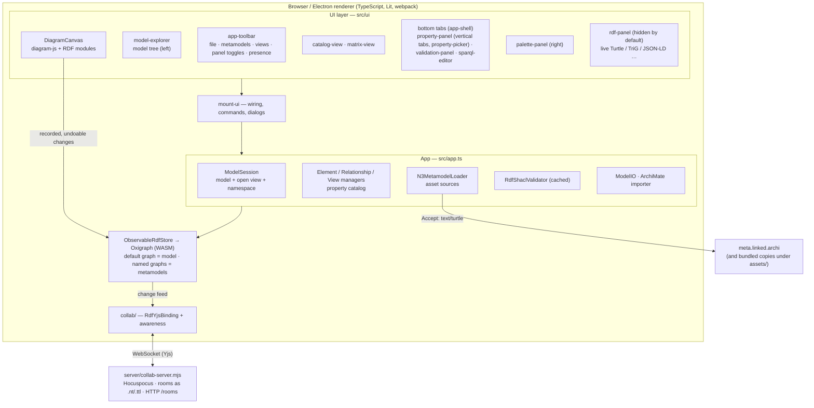
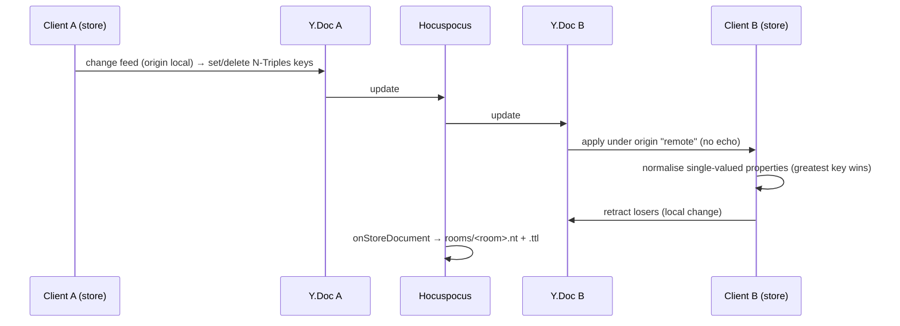

# Design: la-gram

## Overview

The RDF store is the model of record. The diagram canvas (diagram-js), the model
tree, the property panel, catalog and matrix views, files on disk and the
collaboration document are all projections of it, and every change to the model
is a change to triples first. Metamodels are published Linked.Archi assets loaded
at runtime; nothing about any modelling language is compiled in.

This is the design as implemented. The behaviour it serves is in
`requirements.md`; the plan is `tasks.md`; the implementation-independent tool
specification is `docs/linked-archi-tool-spec.md`.

---

## Architecture



### Layers

| Layer | Directory | Responsibility |
|---|---|---|
| RDF engine | `src/rdf-engine` | Oxigraph store (native bulk load), observable wrapper (change feed, recording), IRI minting, parser/serializer, SHACL validator |
| Metamodel manager | `src/metamodel-manager` | Asset sources, manifest-driven loader, catalogue, palette generation (dual classification, axes, notation), viewpoints |
| Model manager | `src/model-manager` | Session, model namespace (minting, moving), element/relationship/view managers, cascade rules, queries, property catalog (what to offer when adding a property), legacy migration, shared vocabulary |
| Import/export | `src/import-export` | Model I/O (six formats, DD-15 partition, profiles), ArchiMate exchange import, SVG/PNG |
| UI | `src/ui` | Shell (layout, side panels, bottom tabs), panels, canvas, dialogs, mounting |
| Collaboration | `src/collab`, `server/` | Y.Doc binding, presence and locks, Hocuspocus server |
| Platform | `src/platform` | Web vs. Electron file access |

---

## Core concepts

### Model / view / canvas

| Concept | RDF | Where at runtime | Persisted |
|---|---|---|---|
| **Model** | `arch:Model` + `arch:modelConformsToMetamodel` + its namespace (`vann:preferredNamespaceUri` / `…Prefix`) | default graph | yes |
| **Element** | a metamodel class; `skos:prefLabel`@en; `arch:inModel` | default graph | yes |
| **Relationship** | `arch:QualifiedRelationship` subclass instance: `arch:source`, `arch:target`, `arch:inModel` — **plus** the unqualified triple (`arch:unqualifiedForm`) | default graph | yes |
| **View** | `arch:View` + `arch:Diagram`/`Catalog`/`Matrix`, `arch:inModel`, `arch:viewConformsToViewpoint` | default graph | yes |
| **Membership** | `arch:inView` on each concept a view presents | default graph | yes |
| **Geometry** | `arch-vis:ArchNode` (bounds, `archElement`, `view`), `arch-vis:Link` (`archRelationship`, `source`/`target` nodes, `points` list with IRI cells) | default graph | yes (droppable profile) |
| **Canvas** | diagram-js elements, keyed by concept IRI | memory | no |

One placement per element per view (the canvas keys shapes by element IRI).

### IRIs

UUID-based, minted at creation, never changed by editing (`rdf-engine/iri.ts`).
A model owns a **namespace**, `{base}{notation}/{modelId}/` (DD-15/DD-29), and
everything minted for it is a flat local name in it — flat because a Turtle
prefixed name cannot contain `/`, so the whole model is written with `m:`:

```
{base}{notation}/{uuid}/           namespace     (base: https://example.org/ unless configured)
{ns}model                          model         m:model
{ns}element-{uuid}                 element       m:element-…
{ns}relationship-{uuid}            relationship  m:relationship-…
{ns}view-{uuid}                    view          m:view-…
{ns}node-{uuid}                    ArchNode      m:node-…
{ns}link-{uuid}                    Link          m:link-…   route: {link}-points-{i} (cells), {link}-p{i} (points)
```

The namespace is stated on the model with the VANN properties the Linked.Archi
ontologies use for their own (`model-manager/model-namespace.ts`):

```turtle
m:model a arch:Model ;
    vann:preferredNamespacePrefix "m" ;
    vann:preferredNamespaceUri "https://example.org/archimate/3f2c…/" .
```

A model that states none (an older file, another tool's) gets a derived one:
`{ns}` for `{ns}model`, else the model IRI plus `/` — where earlier versions of
la-gram minted (`urn:la-gram:archimate/{uuid}/element/{uuid}`).

**Configuring it.** The base for new models is `https://example.org/` (a
placeholder domain) unless `createApp({ base })` / `?base=` says otherwise; New
model shows the namespace it will use and lets it be edited. **Model settings**
(the model name in the toolbar, File menu, tree menu) edits name, namespace and
prefix. Changing the namespace **moves** the model's IRIs into it by default:
every IRI in the model data under the old namespace is rewritten under the new
one, keeping its local name with any `/` turned into `-` (so legacy IRIs become
prefixable), and `arch:Model` becomes `{ns}model`. Terms a loaded vocabulary
defines are never renamed. The move is one store change — one Yjs update —
and a collaborator's session follows it to the same view under its new IRI
(`ModelSession.resync`). Unticking "move" keeps existing IRIs and mints only new
ones in the new namespace. The canvas re-opens the view, which starts a fresh
undo history, so the move itself is not undoable.

No blank nodes are minted: geometry is synchronised triple by triple, and a blank
node has no identity outside its store.

### Named graphs

At runtime the **default graph is the model** and each metamodel document is a
named graph keyed by its ontology IRI — which is what lets a metamodel be
swapped without touching the model and lets files contain only the model. At
rest, formats that carry graphs use DD-15:

```
{ns}graph/model       the arch:Model resource
{ns}graph/semantic    elements, relationships, views, membership
{ns}graph/views       arch-vis geometry only
```

With `{ns}` = `{base}{notation}/{modelId}/`, these are exactly DD-15's graph
IRIs. (The model resource itself is `{ns}model` rather than DD-15's
`{base}{notation}/{modelId}`, so that it too is a prefixed name, `m:model`.)

Loading flattens every quad into the default graph.

---

## Key flows

### Metamodel loading

`N3MetamodelLoader` reads the manifest, follows the `arch:*` asset properties
and `owl:imports` a level at a time in parallel, and asks an **asset source
chain** for each document IRI:

```
uploaded  →  bundled (assets/, mirrors meta.linked.archi)  →  remote (Accept: text/turtle)
```

(`bundled-first`, the browser default; `remote-first` and `offline` reorder or
drop the remote source). Every discovered document gets a status (loaded,
already-loaded, skipped, unavailable, error) and an origin. Documents are bulk
loaded natively into Oxigraph — 110 ms for the 72 740-quad ArchiMate 3.2
relationship shapes, against 1.4 s quad by quad. Derivation rules, deliverable
templates, reference data and the framework document are skipped.

Palette generation (existing, unchanged in approach): dual classification over
the taxonomy (`conceptClassification`) and ontology, several axes, notation
resolved via presentation context → metamodel notation set → `prefVisNotation`.

### Editing on the canvas — recorded changes

diagram-js owns *when* things happen (its command stack, rules, tools);
la-gram owns *what* the model becomes. Every canvas gesture that changes the
model runs its model operation inside a nested command:

| Gesture | diagram-js command | Nested RDF command |
|---|---|---|
| Palette drop / append | `shape.create` | `rdf.element.create` → element + node (snapshot for redo) |
| Tree drop / "add to view" | `shape.create` (existing IRI) | `rdf.store.change` → node; then draws its relationships (`connection.create` + existing-relationship hint) |
| Connect | `connection.create` | `rdf.relationship.create` → qualified resource + triple + link |
| Change type | `rdf.relationship.retype` | retype in place (same IRI) |
| Move / resize | `shape.move` / `shape.resize` | `rdf.store.change` → node bounds |
| Route change | `connection.layout` / `updateWaypoints` / `move` | `rdf.store.change` → point list |
| Reconnect end | `connection.reconnect` | `rdf.store.change` → ends, triple, links in other views |
| Delete (key, pad ×) | `shape.delete` / `connection.delete` | `rdf.store.change` → remove from **view** |
| Delete from model (pad ✖, tree) | `rdf.model.delete` | removes shapes, then the concept everywhere |

`rdf.store.change` runs its operation once inside `ObservableRdfStore.record`;
undo applies the inverse diff, redo re-applies it. Re-running logic on redo
would mint new IRIs; replaying the diff cannot.

### Store → canvas

Changes that do not come from the canvas — a collaborator, the tree, the
property panel, opening a file — reach the canvas as `model-changed` events, and
`DiagramCanvas.syncFromStore()` reconciles the drawn view with the store
(add / remove / move / relabel / re-route) **without** the command stack, so they
never appear in the undo history. Markers (viewpoint, validation, remote
selection, lock) are kept per concept and re-applied to shapes drawn later.

### Layout

```
┌──────────────────────── toolbar ─────────────────────────┐
│ model    │ canvas                      │ palette │ RDF    │
│ tree     │─────────────────────────────│         │ (hidden│
│          │ [Properties|Validation|SPARQL Query]  │  until │
│          │ bottom panel                │         │ opened)│
└──────────┴─────────────────────────────┴─────────┴────────┘
```

`app-shell.ts` is a CSS grid with named slots: `explorer`, `canvas`,
`properties` / `validation` / `sparql` (the bottom panel's tabs), `palette`,
`rdf`. The two right-hand columns are *side panels*: each column's width is a
CSS variable that is 0 while the panel is hidden, and each has a drag handle on
its left edge (palette ≥ 180 px, RDF ≥ 280 px). The bottom panel's row height is
dragged by its top edge (≥ 120 px); clicking the open tab folds the row to the
tab strip, and another tab opens and unfolds it. The canvas keeps at least
240 × 160 px. Sizes, the open tab and the folding are remembered per browser in
`localStorage`. The Validation tab carries the number of violations, since it
is often not the open one. A `ResizeObserver` on the canvas host tells
diagram-js (`canvas.resized()`) whenever a panel changes the canvas's size.

### Property panel tabs

The panel (the bottom panel's Properties tab) has vertical tabs on the left,
under the heading (kind and type), each with a count where one applies:
**‹Kind› information** — ID, type, `inModel`, name, definition, always in that
order; **Properties** — everything else on the concept, then the add field;
**Analysis** — the relationships (or a relationship's ends); **Appears in
views**. Only the open tab's pane is rendered; its fields sit side by side where
there is room, a text area taking the whole row. Up/Down move between the tabs.
The open tab is kept in `localStorage` (`la-gram:property-panel-tab`), so it
holds from one selection to the next and across reloads; a concept without that
tab (a model has no analysis) shows its information instead.

### Adding a property

The property panel's "Add a property…" field is a picker over
`model-manager/property-catalog.ts`, which decides what to offer from the loaded
vocabularies' own `rdfs:domain` declarations (and SHACL shapes) rather than
offering every declared property — the core-vis ontology alone would bring the
diagram geometry and notation styling. Groups: **For ‹type›** (domain or shape
covers the selected concept's type closure), **Used in this model** (literal-valued
properties on the model's concepts, and anything in the model's namespace — so a
custom property added once is offered everywhere), **Documentation** (SKOS, Dublin
Core, PROV — not `skos:definition`, which the panel always lists under the name,
nor `dcterms:description`, which would say it again), and **More** (no declared domain; folded until opened or searched).
Never offered: `arch-vis:` / `sh:` / `owl:` terms, what the tool writes itself
(type, membership, ends, conformance, the name, the model's namespace) and the
metamodel-authoring annotations (`arch:unqualifiedForm`, `domainIncludes`, …).
A property whose domain is another class is not listed but can be typed. Typed
text resolves as a CURIE with a known prefix, an absolute IRI, or a plain name in
the model's namespace (`cost center` → `m:costCenter`). Each entry shows the name
first and the prefixed IRI under it. The list floats (`position: fixed`) under the
field, or above it when there is more room there — as in the bottom panel — so
no scrolling container clips it; a native `<datalist>` could neither group
nor put the name first.

### RDF panel

`rdf-panel` shows the model exactly as Save would write it: its text comes from
`App.saveModel` (so from `ModelIO`), in any of the six formats, with or without
geometry. It is hidden by default (the shell's fourth column is 0 wide) and does
no work while hidden; while shown it re-serializes on model events, debounced
250 ms. Highlighting is a line tokenizer producing one HTML string, assigned
once per change — cheaper than an editor component for a read-only view of a
possibly large file — and it wraps each subject's statements in a block keyed by
the subject IRI, which is what lets the panel highlight the selected concept and
turn a click on statements into a selection.

### Validation

Shapes: every `shapes` graph of the loaded metamodels + core + core-vis shapes
(+ legacy `urn:la-gram:shapes`), cached as one array so the validator keeps its
compiled engine. Data: the model + all `rdfs:subClassOf` axioms + the types of
referenced resources. `sh:sparql` is stripped (server-side, Req 8). Debounced
300 ms. Results go to the Validation tab; the tab carries the number of
Violations (Warnings and Infos are listed, not counted), and violating concepts
are marked on the canvas. Measured: 140 ms for a 500-element model against the ArchiMate 4.0
element and relationship shapes.

### Collaboration



The server's Turtle snapshot uses the model's own prefix, read from the model's
`vann:` statements as the editor reads them. A namespace move arrives at the
other clients as one update; `ModelSession.resync` re-points them at the model
and at the same view under its new IRI.

The Y.Doc holds one `Y.Map<true>` keyed by canonical N-Triples: an RDF graph is a
set of triples, and a map-as-set is its CRDT. Single-valued predicates (bounds,
points, list cells, endpoints, `skos:prefLabel` per language) are normalised
deterministically after remote changes, so concurrent moves converge. Awareness
carries name, colour, open view and selection; what others select is marked and
locked (a rule at priority 3000 denies move/resize/delete/re-route).

### Files

`ModelIO.serialize` writes the default graph only, sorted (deterministic;
`rdf:type` first under each subject), with prefixes from the loaded
vocabularies' `vann:` declarations and the model's own (`m:` unless it declares
another), partitioned per DD-15 for graph formats; `no-geometry` drops the views graph. Turtle and
TriG go through n3's writer; JSON-LD, RDF/XML, N-Quads, N-Triples through
Oxigraph. `ModelSession.adopt` runs after every load: migrate retired
vocabulary, ensure `arch:Model` and `arch:inModel`, ensure a view, and lay the
elements out in a grid when the data has no geometry.

---

## Key design decisions

1. **Store first.** The canvas never holds state the store does not; it is
   rebuilt from the store on every view switch and reconciled on every external
   change. (The alternative — semantic data in canvas elements, RDF at export —
   is what `la-modeller-excalidraw` does, and what makes integrity a post-hoc
   fix-up there.)
2. **The published vocabulary, exactly.** `arch:inModel`, `arch:inView`,
   `arch:modelConformsToMetamodel`, `arch:viewConformsToViewpoint`,
   `arch:source`/`arch:target`, `arch-vis:ArchNode`/`Link` — core 0.4.0 and
   core-vis, validated by `core-shapes` and `core-vis-shapes`. Retired terms are
   migrated on load, never written.
3. **Both relationship forms** (DD-10): the qualified resource is what views
   draw and properties hang off; the unqualified triple is what SPARQL walks.
4. **Offline first, network when asked.** ArchiMate 4.0 and 3.2 are bundled;
   every other published metamodel is one click away when online.
5. **Undo = inverse diff.** One mechanism for every model change a gesture
   makes.
6. **Collaboration shares the model, not the canvas.** A triple-set CRDT;
   deterministic convergence for single-valued properties; soft locks on
   selection.
7. **Indicative vs. normative.** `domainIncludes`/`rangeIncludes` drive
   suggestions; only SHACL decides validity.
8. **A model owns a namespace.** HTTP IRIs, minted flat in it, so every IRI of
   the model is a prefixed name in Turtle; the namespace is data on the model
   and can be moved.
9. **The vocabularies decide what to offer.** Properties are suggested by
   `rdfs:domain` and SHACL, not listed wholesale.

---

## Technology stack

| Concern | Choice |
|---|---|
| Canvas | diagram-js 14 (MIT) + custom RDF renderer, rules, modeling, context pad, popup menus |
| UI | Lit 3 web components, CodeMirror 6 (SPARQL) |
| RDF store / SPARQL | Oxigraph 0.4 (WASM in the browser, native module in Node) |
| Parsing / writing | n3 (Turtle, TriG, N-Triples, N-Quads), Oxigraph (JSON-LD, RDF/XML) |
| SHACL | rdf-validate-shacl |
| Collaboration | Yjs 13 + Hocuspocus 4 (provider and server) |
| Build | webpack 5 (web, electron-main, electron-renderer), TypeScript 5 (strict) |
| Tests | Vitest (unit, jsdom) + Playwright (browser suite against the production build) |
| Desktop | Electron |

## Running

| What | Command |
|---|---|
| Build and serve (http://localhost:8080) | `npm run dev` |
| Collaboration server (ws://localhost:1234) | `npm run collab` |
| Unit tests | `npm test` |
| Browser tests (builds first) | `npm run test:browser:build` |
| Type-check | `npm run typecheck` |
| Desktop | `npm run build:electron && npm run electron` |
