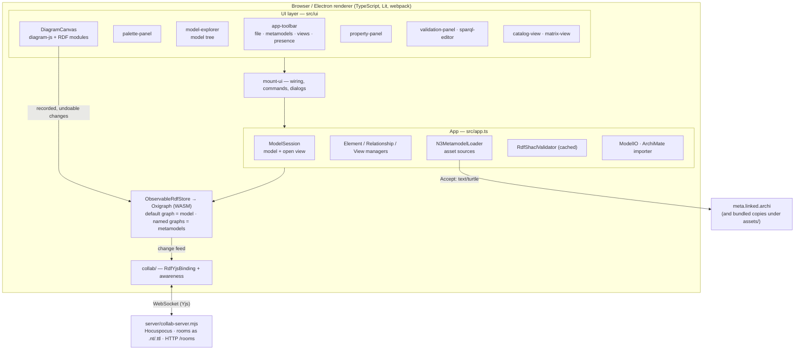
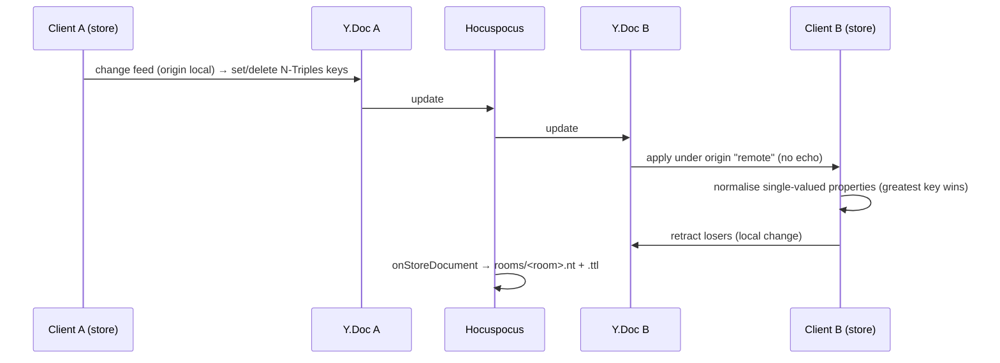

# Design: la-gram

## Overview

The RDF store is the model of record. The diagram canvas (diagram-js), the model
tree, the property panel, catalog and matrix views, files on disk and the
collaboration document are all projections of it, and every change to the model
is a change to triples first. Metamodels are published Linked.Archi assets loaded
at runtime; nothing about any modelling language is compiled in.

This is the design as implemented. The behaviour it serves is in
`requirements.md`; the plan is `tasks.md`; the implementation-independent tool
specification is `docs/linked-archi-tool-spec.md`.

---

## Architecture



### Layers

| Layer | Directory | Responsibility |
|---|---|---|
| RDF engine | `src/rdf-engine` | Oxigraph store (native bulk load), observable wrapper (change feed, recording), IRI minting, parser/serializer, SHACL validator |
| Metamodel manager | `src/metamodel-manager` | Asset sources, manifest-driven loader, catalogue, palette generation (dual classification, axes, notation), viewpoints |
| Model manager | `src/model-manager` | Session, element/relationship/view managers, cascade rules, queries, legacy migration, shared vocabulary |
| Import/export | `src/import-export` | Model I/O (six formats, DD-15 partition, profiles), ArchiMate exchange import, SVG/PNG |
| UI | `src/ui` | Shell, panels, canvas, dialogs, mounting |
| Collaboration | `src/collab`, `server/` | Y.Doc binding, presence and locks, Hocuspocus server |
| Platform | `src/platform` | Web vs. Electron file access |

---

## Core concepts

### Model / view / canvas

| Concept | RDF | Where at runtime | Persisted |
|---|---|---|---|
| **Model** | `arch:Model` + `arch:modelConformsToMetamodel` | default graph | yes |
| **Element** | a metamodel class; `skos:prefLabel`@en; `arch:inModel` | default graph | yes |
| **Relationship** | `arch:QualifiedRelationship` subclass instance: `arch:source`, `arch:target`, `arch:inModel` — **plus** the unqualified triple (`arch:unqualifiedForm`) | default graph | yes |
| **View** | `arch:View` + `arch:Diagram`/`Catalog`/`Matrix`, `arch:inModel`, `arch:viewConformsToViewpoint` | default graph | yes |
| **Membership** | `arch:inView` on each concept a view presents | default graph | yes |
| **Geometry** | `arch-vis:ArchNode` (bounds, `archElement`, `view`), `arch-vis:Link` (`archRelationship`, `source`/`target` nodes, `points` list with IRI cells) | default graph | yes (droppable profile) |
| **Canvas** | diagram-js elements, keyed by concept IRI | memory | no |

One placement per element per view (the canvas keys shapes by element IRI).

### IRIs

UUID-based, minted at creation, never changed (`rdf-engine/iri.ts`):

```
{base}{notation}/{uuid}            model        (base: urn:la-gram: unless configured)
{model}/element/{uuid}             element
{model}/relationship/{uuid}        relationship
{model}/view/{uuid}                view
{view}/node/{uuid}                 ArchNode
{view}/link/{uuid}                 Link          {link}/points/{i}, {link}/p/{i}
```

No blank nodes are minted: geometry is synchronised triple by triple, and a blank
node has no identity outside its store.

### Named graphs

At runtime the **default graph is the model** and each metamodel document is a
named graph keyed by its ontology IRI — which is what lets a metamodel be
swapped without touching the model and lets files contain only the model. At
rest, formats that carry graphs use DD-15:

```
{model}/graph/model       the arch:Model resource
{model}/graph/semantic    elements, relationships, views, membership
{model}/graph/views       arch-vis geometry only
```

Loading flattens every quad into the default graph.

---

## Key flows

### Metamodel loading

`N3MetamodelLoader` reads the manifest, follows the `arch:*` asset properties
and `owl:imports` a level at a time in parallel, and asks an **asset source
chain** for each document IRI:

```
uploaded  →  bundled (assets/, mirrors meta.linked.archi)  →  remote (Accept: text/turtle)
```

(`bundled-first`, the browser default; `remote-first` and `offline` reorder or
drop the remote source). Every discovered document gets a status (loaded,
already-loaded, skipped, unavailable, error) and an origin. Documents are bulk
loaded natively into Oxigraph — 110 ms for the 72 740-quad ArchiMate 3.2
relationship shapes, against 1.4 s quad by quad. Derivation rules, deliverable
templates, reference data and the framework document are skipped.

Palette generation (existing, unchanged in approach): dual classification over
the taxonomy (`conceptClassification`) and ontology, several axes, notation
resolved via presentation context → metamodel notation set → `prefVisNotation`.

### Editing on the canvas — recorded changes

diagram-js owns *when* things happen (its command stack, rules, tools);
la-gram owns *what* the model becomes. Every canvas gesture that changes the
model runs its model operation inside a nested command:

| Gesture | diagram-js command | Nested RDF command |
|---|---|---|
| Palette drop / append | `shape.create` | `rdf.element.create` → element + node (snapshot for redo) |
| Tree drop / "add to view" | `shape.create` (existing IRI) | `rdf.store.change` → node; then draws its relationships (`connection.create` + existing-relationship hint) |
| Connect | `connection.create` | `rdf.relationship.create` → qualified resource + triple + link |
| Change type | `rdf.relationship.retype` | retype in place (same IRI) |
| Move / resize | `shape.move` / `shape.resize` | `rdf.store.change` → node bounds |
| Route change | `connection.layout` / `updateWaypoints` / `move` | `rdf.store.change` → point list |
| Reconnect end | `connection.reconnect` | `rdf.store.change` → ends, triple, links in other views |
| Delete (key, pad ×) | `shape.delete` / `connection.delete` | `rdf.store.change` → remove from **view** |
| Delete from model (pad ✖, tree) | `rdf.model.delete` | removes shapes, then the concept everywhere |

`rdf.store.change` runs its operation once inside `ObservableRdfStore.record`;
undo applies the inverse diff, redo re-applies it. Re-running logic on redo
would mint new IRIs; replaying the diff cannot.

### Store → canvas

Changes that do not come from the canvas — a collaborator, the tree, the
property panel, opening a file — reach the canvas as `model-changed` events, and
`DiagramCanvas.syncFromStore()` reconciles the drawn view with the store
(add / remove / move / relabel / re-route) **without** the command stack, so they
never appear in the undo history. Markers (viewpoint, validation, remote
selection, lock) are kept per concept and re-applied to shapes drawn later.

### Validation

Shapes: every `shapes` graph of the loaded metamodels + core + core-vis shapes
(+ legacy `urn:la-gram:shapes`), cached as one array so the validator keeps its
compiled engine. Data: the model + all `rdfs:subClassOf` axioms + the types of
referenced resources. `sh:sparql` is stripped (server-side, Req 8). Debounced
300 ms. Measured: 140 ms for a 500-element model against the ArchiMate 4.0
element and relationship shapes.

### Collaboration



The Y.Doc holds one `Y.Map<true>` keyed by canonical N-Triples: an RDF graph is a
set of triples, and a map-as-set is its CRDT. Single-valued predicates (bounds,
points, list cells, endpoints, `skos:prefLabel` per language) are normalised
deterministically after remote changes, so concurrent moves converge. Awareness
carries name, colour, open view and selection; what others select is marked and
locked (a rule at priority 3000 denies move/resize/delete/re-route).

### Files

`ModelIO.serialize` writes the default graph only, sorted (deterministic),
with prefixes from the loaded vocabularies' `vann:` declarations, partitioned
per DD-15 for graph formats; `no-geometry` drops the views graph. Turtle and
TriG go through n3's writer; JSON-LD, RDF/XML, N-Quads, N-Triples through
Oxigraph. `ModelSession.adopt` runs after every load: migrate retired
vocabulary, ensure `arch:Model` and `arch:inModel`, ensure a view, and lay the
elements out in a grid when the data has no geometry.

---

## Key design decisions

1. **Store first.** The canvas never holds state the store does not; it is
   rebuilt from the store on every view switch and reconciled on every external
   change. (The alternative — semantic data in canvas elements, RDF at export —
   is what `la-modeller-excalidraw` does, and what makes integrity a post-hoc
   fix-up there.)
2. **The published vocabulary, exactly.** `arch:inModel`, `arch:inView`,
   `arch:modelConformsToMetamodel`, `arch:viewConformsToViewpoint`,
   `arch:source`/`arch:target`, `arch-vis:ArchNode`/`Link` — core 0.4.0 and
   core-vis, validated by `core-shapes` and `core-vis-shapes`. Retired terms are
   migrated on load, never written.
3. **Both relationship forms** (DD-10): the qualified resource is what views
   draw and properties hang off; the unqualified triple is what SPARQL walks.
4. **Offline first, network when asked.** ArchiMate 4.0 and 3.2 are bundled;
   every other published metamodel is one click away when online.
5. **Undo = inverse diff.** One mechanism for every model change a gesture
   makes.
6. **Collaboration shares the model, not the canvas.** A triple-set CRDT;
   deterministic convergence for single-valued properties; soft locks on
   selection.
7. **Indicative vs. normative.** `domainIncludes`/`rangeIncludes` drive
   suggestions; only SHACL decides validity.

---

## Technology stack

| Concern | Choice |
|---|---|
| Canvas | diagram-js 14 (MIT) + custom RDF renderer, rules, modeling, context pad, popup menus |
| UI | Lit 3 web components, CodeMirror 6 (SPARQL) |
| RDF store / SPARQL | Oxigraph 0.4 (WASM in the browser, native module in Node) |
| Parsing / writing | n3 (Turtle, TriG, N-Triples, N-Quads), Oxigraph (JSON-LD, RDF/XML) |
| SHACL | rdf-validate-shacl |
| Collaboration | Yjs 13 + Hocuspocus 4 (provider and server) |
| Build | webpack 5 (web, electron-main, electron-renderer), TypeScript 5 (strict) |
| Tests | Vitest (unit, jsdom) + Playwright (browser suite against the production build) |
| Desktop | Electron |

## Running

| What | Command |
|---|---|
| Build and serve (http://localhost:8080) | `npm run dev` |
| Collaboration server (ws://localhost:1234) | `npm run collab` |
| Unit tests | `npm test` |
| Browser tests (builds first) | `npm run test:browser:build` |
| Type-check | `npm run typecheck` |
| Desktop | `npm run build:electron && npm run electron` |
