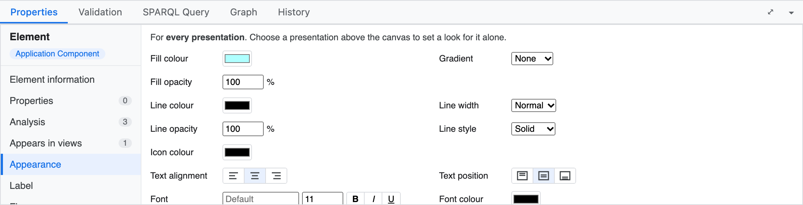

# Appearance, labels and pictures

Select an element, a relationship's line, a figure or a line from a note on the canvas, one or several,
and the Properties tab has four tabs for how it is drawn: *Appearance*, *Label*, *Figure* and *Image*.
What they set belongs to that placement alone, in that view: another placement of the same element keeps
its own. It is stored on the placement's own core-vis style, saved with the model, and undoable.

Where a placement sets nothing, its notation's look is drawn: a notation may set the same for a type, and
a presentation context for everything shown in it.

## Appearance tab {#appearance-tab}

*Appearance* shows only what applies to what is selected: a box has a fill, a line has ends. Each field
starts empty, meaning **the notation's**; a value set has a × beside it that takes it back, and *Reset
all* takes every one back.

<figure markdown="span">
  
  <figcaption>The Appearance tab of an element.</figcaption>
</figure>

1. Select "Web shop", and open *Properties › Appearance*.
2. Set *Fill colour* to a light green, and *Line width* to **Heavy**.
3. Choose *Reset all*: it is drawn as its notation says again.

## Fill {#fill}

| Field | Values | Default |
|---|---|---|
| *Fill colour* | a colour | **the notation's** |
| *Gradient* | **None**, Top, Left, Right, Bottom: the side the fill shades from | **None** |
| *Fill opacity* | a percentage | **the notation's** |

1. Select "Gift wrapping".
2. Set *Fill colour* to orange, *Gradient* to **Top**, and *Fill opacity* to 60 %.

## Line {#line}

The line of a box is its border; of a relationship or a line from a figure, the line itself.

| Field | Values | Default |
|---|---|---|
| *Line colour* | a colour | **the notation's** |
| *Line width* | **Normal** (1), Medium (2), Heavy (3) | **Normal** |
| *Line opacity* | a percentage | **the notation's** |
| *Line style* | Solid, Dashed, Dotted | **the notation's**; for a line from a figure, Dashed |

1. Select the line from "Payments" to "Card payment".
2. Set *Line colour* to red, and *Line width* to **Medium**.

## Line ends {#line-ends}

A line from a note, a group or a shape ([Lines from figures](canvas.md#lines-from-figures)) has an end
of its own at each side: *Start arrowhead* and *End arrowhead*. A relationship's ends are its notation's,
and not set here.

| Field | Values | Default |
|---|---|---|
| *Start arrowhead*, *End arrowhead* | None, Open arrow, Filled arrow, Hollow arrow, Half arrow, Hollow diamond, Filled diamond, Dot | **None** |

1. Select a line from a note.
2. Set *End arrowhead* to **Filled arrow**, and *Line style* to **Solid**.

## Text on a line {#text-on-a-line}

For a line, *Text position* is where its name or text sits along it: **Near its source**, **At its
middle** or **Near its target**. The default is the notation's, else its middle. Dragging the text moves
it off the line; *Move name back to its place* undoes that.

1. Switch *Relationship names* on above the canvas, and select a named relationship's line.
2. In *Text position*, choose **Near its target**.

## Icon colour {#icon-colour}

*Icon colour* sets the colour of the glyph an element is drawn with (ArchiMate's small icon in the top
right corner, or the whole figure when it is drawn as its icon). Default: **the notation's**.

1. Select "Customer".
2. Set *Icon colour* to blue: the actor glyph is drawn blue.

## Text in a box {#text-in-a-box}

| Field | Values | Default |
|---|---|---|
| *Text alignment* | Left, Centre, Right | **the notation's** |
| *Text position* | Top, Middle, Bottom | **the notation's** |

An element with something nested inside keeps its name at the top, above what is inside.

1. Select "Place order".
2. In *Text alignment*, choose Left; in *Text position*, Top.

## Font {#font}

| Field | Values | Default |
|---|---|---|
| *Font* | a name: Arial, Helvetica, Verdana, Tahoma, Trebuchet MS, Segoe UI, Lucida Grande, Georgia, Times New Roman, Courier New, or any other typed; a size; **B**, *I* and U for bold, italic and underline | **the notation's** |
| *Font colour* | a colour | **the notation's** |

The font's × takes name, size and style back at once. *Reset all*, under the fields, takes back every
value set in the tab. A name renamed in place is typed in its own font.

1. Select "Web shop".
2. In *Font*, choose Georgia, size 14, and **B**.
3. Choose *Reset all*.

## Format painter {#format-painter}

The format painter, 🖌 in the canvas toolbar, copies a look from one thing to others.

| State | The brush |
|---|---|
| **off** | the canvas selects as usual |
| pick | click what to copy the look of |
| paint | click each thing to give the look to, one undoable step each |

++esc++, or the brush again, puts it down. With a presentation chosen, it copies and gives the look for
that presentation.

1. Click 🖌 (*Format painter*) in the canvas toolbar.
2. Click "Web shop", whose look you set.
3. Click "Payments", then "Card payment": both take it.
4. Press ++esc++.

## Notation only {#notation-only}

*Notation only*, above the canvas, draws every element and relationship as its notation does, leaving
out the colours, fonts and lines set in the view. It is **off** by default, remembered in this browser.
It changes nothing in the model. While it is on, the Appearance tab says so, and what you set there is
kept but not drawn. A model converted from Archi, or an ArchiMate Exchange file, keeps its diagrams'
colours and fonts: *Notation only* shows it as the notation draws it.

1. Click *Notation only*: the colours set on "Web shop" are not drawn.
2. Click it again: they are back.

## Figure tab {#figure-tab}

*Figure* draws an element in another of the figures its notation offers. Each is a preview to pick; the
notation's own is marked *(notation)*.

| Figure | Draws the element as |
|---|---|
| *Shape with icon* | its shape, with its icon as a badge (ArchiMate's box with the glyph in the corner) |
| *Icon* | its icon, with its name under it |
| *Shape only* | its shape, without the icon |
| the notation's alternatives | other figures the notation defines for the type, such as a banded box or a 3D box |

Picking the notation's takes the placement's own figure away. An element drawn with a picture in place of
the notation's glyph (the Image tab: its own picture as the figure or the badge, or its element's picture
as the badge) has none of these marked, and gets the glyph back when one is picked here.

1. Select "Customer", and open *Properties › Figure*.
2. Pick *Icon*: "Customer" is drawn as the actor figure, its name under it.

## Label tab {#label-tab}

*Label* says what an element's label says, in place of its name alone: a label expression, typed in its
box, with *Shows* under it, the label as the first selected element draws it. Empty, the label is the
element's name (`{name}`), or what its notation or the presentation says. What cannot be read is listed
under the box, and drawn as written so the mistake shows. *Back to the notation's* takes the expression
away; *What it can say* lists the placeholders.

With a presentation chosen in the toolbar, the expression is for that presentation alone, unless *The
same in every presentation* is ticked; with none chosen, it is for every presentation. Renaming in place
still renames the element.

1. Select "Web shop", and open *Properties › Label*.
2. Type the expression below, and click outside the box.
3. *Shows* reads "Web shop" and, under it, "Owner: Shop team".

```text title="Label expression"
{name}
Owner: {^am4:associatedWith/skos:prefLabel}
```

## Label expressions {#label-expressions}

A label expression is text, drawn as it is, but for its placeholders between braces. Each line of it is a
line of the label, and a line whose placeholders all come to nothing is left out, so a line can be there
only when the element has what it shows.

| Placeholder | Shows |
|---|---|
| `{name}` | the element's name for the presentation chosen (its *Names by presentation* name, else its own) |
| `{type}` | the name of its type |
| `{skos:prefLabel}` | its own name, whatever the presentation |
| `{prefix:local}` | the values of that property, by its prefixed name: a literal as it is, a resource by its name, several joined by commas, at most **20** (then "…") |
| `{<https://…>}` | the same, the property by its full IRI |
| `{a/b}` | a path: `b` of each value of `a` |
| `{^a}` | `a` followed backwards: what has the element as its value |
| `{{` and `}}` | a brace |

The prefixes are those of the loaded vocabularies and the model's own. The expression is saved on the
placement's style (`arch-vis:LabelExpression`).

```text title="Label expression"
{name}
«{type}»
```

```text title="Label expression"
{name}
Realizes: {am4:realizes}
Served by: {^am4:serves/skos:prefLabel}
```

```text title="Label expression"
{{{name}}}
{<https://meta.linked.archi/archimate4/onto#realizes>}
```

On "Web shop" in the example, the second reads "Web shop", "Realizes: Online ordering" and "Served by:
Card payment"; the third, "{Web shop}" and "Online ordering".

## Image tab {#image-tab}

*Image* puts a picture in an element or a figure.

| Field | Values | Default |
|---|---|---|
| *Address* | an `https://` URL, or a `data:image/…` URI | **none** |
| *Choose file…* | a picture file of up to **200 KB**, kept in the model as a `data:` URI; a larger one is refused, to be linked by its address instead | |
| *Draw it* | **inside the figure**; *as the figure, its name under it*: the picture in place of the whole figure; *in the badge, in place of its type's glyph*: the picture in the corner where the glyph is, the figure kept. For an element only | **inside the figure** |
| *Position* | where it is drawn inside the figure: Top left, Top centre, Top right, Middle left, Centre, Middle right, Bottom left, Bottom centre, Bottom right, Fill | **Top left** |
| *Use its element's own picture* | for an element with a picture of its own here and one of its element's: gives up its own, its element's then drawn where its own was ([below](#element-picture)) | |
| *Pictures in this model* | every picture an element or a figure of the model already has, as thumbnails: click one to give it to what is selected | |
| *Remove image* | takes the picture away | |

At a corner, a side or the centre, the picture is drawn at its own size, made smaller to fit; *Fill*
fills the box. Inside the figure, it is drawn over its fill and under its text and glyph. A picture given
by its address is linked, not copied into the model, and fetched where the view is drawn; the desktop app
draws `https:` and `data:` pictures only.

1. Select "Payments", and open *Properties › Image*.
2. In *Address*, paste an `https://` address of a logo.
3. In *Position*, choose **Centre**.

### An element's own picture {#element-picture}

An element may have a picture of its own, for every presentation and for each
(*Pictures by presentation*, in [Properties](properties.md#information-tab)): model data, shown in every
view. Each of its placements draws its picture for the presentation chosen, else its picture for every
presentation, without anything set in the Image tab:

| The element drawn as | Its picture |
|---|---|
| a box (*Shape with icon*, *Shape only*) | inside the box, at the placement's *Position* (**Top left**); the badge keeps its type's glyph |
| its icon (*Icon*) | the icon itself, its name under it |

When the placement has no picture of its own, the Image tab's preview shows the element's, marked *Its
element's own picture*, and *Draw it* places it: **inside the figure**, *as the figure, its name under it*,
or *in the badge, in place of its type's glyph*. A badge or a figure drawn from the element's picture
follows it: give the element another picture, or choose another presentation, and the drawing shows that
one. A picture of the placement's own comes first, inside the box or as its icon.

1. Select "Web shop", and in *Properties › Element information*, under *Pictures by presentation*, give
   **Executive / C-Level** an `https://` address of a picture.
2. In the toolbar's *Presentation*, choose **Executive / C-Level**: the picture is drawn inside "Web
   shop", at its top left, and the badge is still the application component's glyph.
3. In *Properties › Image*, under *Draw it*, choose *in the badge, in place of its type's glyph*: the
   picture takes the glyph's place in the corner.
4. Choose **Developer / Engineering**: "Web shop" has its glyph again, and no picture.

## Per presentation {#per-presentation}

With a presentation chosen in the toolbar's *Presentation*, the Appearance, Figure and Image tabs set the
look for that presentation alone. A bar over them says which: *For Executive / C-Level — the presentation
chosen now*, with **The same in every presentation** to tick, which the three tabs share. With none
chosen, they say *For every presentation*, and set the look for every one.

A look for one presentation is a style of the placement's for that presentation, drawn over its style for
every one. The format painter copies and gives the look for the presentation chosen, and the model tree
shows an element's own picture for it as the row's icon.

1. In the toolbar's *Presentation*, choose **Executive / C-Level**.
2. Select "Web shop", and in *Image* give it a picture, *as the figure, its name under it*.
3. Choose **Developer / Engineering**: "Web shop" is drawn as before. Choose **Executive / C-Level**
   again: the picture is its figure.

## Several at once {#several-at-once}

With several selected, the Appearance, Label, Figure and Image tabs set the look of all of them, and say
so: *Changes apply to the 3 selected.* A change is one undoable step for all of them.

1. Select "Customer", then ++shift++-click "Shop team" and "Place order".
2. In *Appearance*, set *Fill colour*: the three change together.
