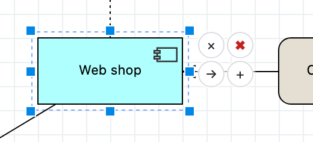

# Drawing on the canvas

The canvas draws the open diagram view. What can be connected, and how, comes from the loaded
metamodels: connect, change type and append offer only what their relationship shapes permit (for
ArchiMate, its relationship tables).

## Tools {#tools}

The canvas toolbar, above the diagram, starts with three tools. A tool lasts for one gesture, then the
canvas is back to selecting.

| Tool | Tooltip | Does |
|---|---|---|
| ↗ | *Connect — click a source element, then a target* | draws a relationship of the type the metamodel ranks first for the two, and opens *Change relationship type* on it when the two permit more than one specific type (no menu for a type chosen in the palette) |
| ⬚ | *Lasso select* | drag a rectangle round what to select |
| ✋ | *Pan the canvas* | drag to move the view; dragging the empty canvas does the same |

After them come the format painter (🖌, see [Appearance](appearance.md#format-painter)), *Arrange view…*
(three boxes in two rows joined by right-angled lines; see [Arrange view](#arrange-view)) with ▾ beside
it for the other ways to arrange, the quick actions that align, distribute, size and route what is
selected (see [Tidy a diagram](#tidy-a-diagram)), and three switches: *Relationship names*, *Notation
only* and *Shapes*.

1. Click ⬚ in the canvas toolbar.
2. Drag a rectangle round "Customer" and "Place order": both are selected.

## Placing elements {#placing-elements}

Elements come from the palette or the model tree:

- **From the palette**, drag an element type onto the canvas, or click it, then click the canvas where
  it goes. The new element is named after its type.
- **From the model tree**, drag an element's row onto the canvas. It is placed (again, if the view
  already shows it), and the relationships the model has between it and what the view shows are drawn
  too.

A relationship type in the palette is placed the same way: click it, then click the source, then the
target.

1. In the palette, click **Business Actor**, then click the canvas: a Business Actor is placed.
2. From the model tree, drag "Card payment" onto an empty part of the canvas: it is placed a second
   time.

## Rename in place {#rename-in-place}

**Double-click** an element's box, or select it and press ++f2++, and type its name: ++enter++ keeps
it, ++esc++ drops it, and undo brings the old one back. A relationship is named the same way on its line:
double-click the line, or its name. A relationship's name emptied is removed. A name is typed in its own
font, where it is drawn.

1. Double-click "Gift wrapping".
2. Type "Gift wrap service", and press ++enter++.
3. Press ++ctrl+z++ (++cmd+z++ on a Mac): the old name is back.

## Connecting {#connecting}

Select an element: its context pad, beside it, has *Connect*. Drag from it to the target, or click it and
then the target. Only the targets the metamodel permits accept the line, and the relationship drawn is
the type it ranks first for the two; *Change relationship type* changes it after. A relationship type
chosen in the palette first is drawn instead, when permitted. A line that is not permitted is refused, and
the message says which types are: *Realization is not permitted from Application Component to Application
Component. Permitted: Aggregation, …*

<figure markdown="span">
  
  <figcaption>An element's context pad.</figcaption>
</figure>

| Pad entry | For |
|---|---|
| *Delete from view* | an element or a relationship: takes it off this view |
| *Delete from model (all views)* | an element or a relationship: see [Delete](#delete) |
| *Connect* | an element: draws a relationship from it |
| *Append element* | an element: a new or related element, connected to it |
| *Change relationship type: Serving* | a relationship: the types permitted between its ends |
| *Draw a line to…* | a group, a note or a shape: a line that is no relationship |
| *Connect these two…* | two elements selected |

1. Select "Payments".
2. Drag from *Connect* in its pad to "Online ordering". An Assignment is drawn — the type ArchiMate 4.0
   ranks first from an Application Component to a Service — and *Change relationship type* opens on it:
   every type the two permit, best first.
3. Choose **Realization** to make it one; **Escape** keeps the Assignment. The line and the type picked
   are one step: ++ctrl+z++ (++cmd+z++) takes the line away. Later, select the line and choose
   *Change relationship type* in its pad. To draw a Realization at once, click **Realization** in the
   palette first: then no menu opens.

### The order of the types {#relationship-order}

The types a pair permits come in three groups, and within each in the metamodel's order of proposal:

| Group | Note in the menu | Example (ArchiMate 4.0) |
|---|---|---|
| what the relationship tables let you draw directly | — | Process → Process: **Triggering**, Flow, Composition, Aggregation |
| what they permit only as the conclusion of a derivation | *only by derivation* | Application Component → Process: **Assignment** |
| Association and Directed Association | *always permitted* | last — except to a Meaning or a Value, where Association comes first |

The order of proposal is the metamodel's, published with it: an order for every pair, and orders for
kinds of element that come before it. ArchiMate 4.0's and 3.2's are the same:

| From | To | First |
|---|---|---|
| a behaviour element | a behaviour element | Triggering, Flow, then Composition, Aggregation |
| a process, function or interaction | a service | Realization |
| a capability, value stream or course of action | one of those | Realization, then Serving |
| a capability | a capability | Composition |
| a collaboration | an actor, role, component, node… | Aggregation |
| a motivation element | a motivation element | Realization, then Influence |
| any other element | a Meaning or a Value | Association |
| a grouping, location, product or plateau | any element | Aggregation |
| anything else | | the strongest first: Composition, Aggregation, Assignment, Realization, Serving, Access, Influence, Triggering, Flow, Specialization |

*drawn in the metamodel* marks a type the specification's metamodel figures draw between the two
elements; it does not change the order. In ArchiMate 3.2, across layers, the tables permit Triggering
and Flow between behaviour elements only as derived, so the Realization they permit directly comes
first: an Application Process to a Business Process, **Realization**.

## Append {#append}

*Append element*, in the context pad, opens a menu of what can follow the element, in two tabs:

| Tab | Lists |
|---|---|
| *New element* | the element types a relationship from it may reach, by domain, each with its relationships (*choose: Assignment / Serving / Flow / Triggering*) or the one it would be (*via Influence*) |
| *Existing relationships (N)* | what the element is already related to in the model, to bring into this view |

A new element is placed beside it, connected. When several relationships fit, la-gram asks *Which
relationship?*.

1. Select "Web shop", and choose *Append element* in its pad.
2. Under **Application Domain**, choose **Data Object**.
3. Choose **Access** when asked *Which relationship?*. A Data Object is placed, with the access drawn to
   it.

## Change relationship type {#change-relationship-type}

A selected relationship's pad has *Change relationship type:* and its type (*Change relationship type:
Serving*, say), which opens *Change relationship type*: the types the metamodel permits between its two
ends, each saying why it is allowed. The right-click menu's *Change relationship type…* does the same.
The relationship keeps its identity, its name and its placements.

1. Select the line from "Card payment" to "Web shop".
2. Choose *Change relationship type* in its pad, and pick **Flow**.

## Connect these two {#connect-these-two}

With two elements selected, the pad offers *Connect these two…*, which lists the relationships allowed
between them in both directions (*Customer → Gift wrapping*, then *Gift wrapping → Customer*), each
saying why it is allowed: *always permitted*, *only by derivation* (the relationship tables permit it as
the conclusion of a derivation, not drawn directly), or *drawn in the metamodel* (the language's metamodel
figures draw it). Each direction is in the [order of the types](#relationship-order).

1. Click "Customer", then ++shift++-click "Online ordering".
2. Choose *Connect these two…* in the pad.
3. Under "Customer → Online ordering", pick **Association**.

## Lines from figures {#lines-from-figures}

A group, a note or a shape (see [Shapes](#shapes)) has *Draw a line to…* in its pad. The line it draws,
dashed, stands for no relationship: a note's to what it is about. Its Appearance tab makes it solid or
dotted and puts an arrowhead, a diamond or a dot at either end
([Line ends](appearance.md#line-ends)). Double-click it to write on it: the text sits at its middle, and
can be dragged elsewhere.

1. Open *Shapes*, and click and place a **Note** beside "Gift wrapping". Double-click it and type
   "Realized by nothing on purpose".
2. Choose *Draw a line to…* in the note's pad, and click "Gift wrapping".

## Nesting {#nesting}

Drop or move an element onto another to draw it inside. The drop asks *Which relationship?* the nesting
stands for: those the notation lets nesting draw and the metamodel permits (composition, aggregation,
assignment…), or **None** (*Only drawn inside: no relationship in the model*). The container grows to
hold what is inside, keeps its name at the top, and moves with it.

While nested, no line runs between the element and its container: the nesting shows it. Moved out, the
relationships the view showed are drawn as lines again. Relationships' lines and names are drawn above
every element, nested ones included.

1. Drag "Web shop" onto "Payments"' empty corner, and drop it.
2. Choose **None** when asked *Which relationship?*. "Web shop" is drawn inside "Payments", with no new
   relationship in the model.
3. Undo to take it out again.

## Reuse a relationship {#reuse-a-relationship}

Drawing a relationship the model already has between the two, but this view does not show, asks first:
*The model already has this relationship*.

| Choice | Does |
|---|---|
| *Use “Its name”*, or *Use the existing Serving* | draws the relationship the model has: one relationship, in both views |
| *New Serving* | makes another relationship of this type between the two |

1. Select the line from "Card payment" to "Web shop", and press ++delete++: it is off the view, still
   in the model.
2. In the palette, click **Serving**, then "Card payment", then "Web shop".
3. Choose *Use the existing* Serving: the model still has one Serving between them, drawn again.

## Relationship names {#relationship-names}

The *Relationship names* switch shows each named relationship's name on its line, at its middle, or near
its source or its target where the line's Appearance tab (or its notation) puts it. It is **off** by
default, remembered in this browser. A relationship without a name shows nothing.

Drag a name to move it: the view keeps where it is, as an `arch-vis:LabelNode`, and it follows its line as
the line moves. Right-click › *Move name back to its place* undoes that. All undoable.

1. Double-click the line from "Web shop" to "Online ordering", type "serves online", and press
   ++enter++.
2. Switch *Relationship names* on: the name is drawn at the line's middle.
3. Drag the name up, out of the way.

## Shapes {#shapes}

The *Shapes* switch opens a second row of figures, drawn with no model element behind them. It is
**closed** by default, remembered in this browser.

| Figure | Drawn as |
|---|---|
| Group | a box with its name in a tab, holding what is put in it |
| Note | a sticky note |
| Rectangle, Rounded rectangle, Ellipse, Circle, Diamond, Hexagon, Octagon, Parallelogram | that shape |

Drag one onto the diagram, or click it and place it. Figures are renamed, moved, resized and deleted as
elements are; selected, the Properties tab gives their text, and their look in the Appearance tab.
A figure that sets no colours of its own is drawn neutral: a group light grey, a shape white, **a note
yellow**. An ArchiMate Exchange file's groups, notes and the lines from them import as these.

1. Click *Shapes* above the canvas.
2. Drag **Rounded rectangle** onto the diagram, double-click it and type "Checkout".

## Move, resize and bend {#move-resize-bend}

Drag an element to move it, with its lines; a selection moves together. Drag a selected element's corner
handles to resize it. Drag a line's segment to add a bendpoint, and a bendpoint to move it. A move snaps
to line up with the elements around it. A straight line stays aimed at the two elements' centres; a line
of right angles — as *Arrange view* draws them — keeps its right angles: the bend next to the moved
element follows it, and where it would end up inside an element, the line is routed again at right
angles. A straight line *Arrange view* drew between elements one above the other stays straight while
they stay in line, and turns a right angle when one moves aside.

1. Drag "Gift wrapping" a little to the right: its line follows.
2. Select it and drag its bottom right handle to make it wider.
3. Drag the middle of its line to "Customer" sideways: the line bends.

## Arrange view {#arrange-view}

*Arrange view…*, on the canvas toolbar or in the empty canvas's right-click menu, lays the open diagram
out: its elements in rows, in the direction its relationships lead, each at its present size and each
nested element inside its parent; its relationships routed at right angles, as [*Arrange
relationships*](#arrange-relationships) routes them — from the middle of a side, bending clear of the
elements — in a diagram of up to 500 elements. A relationship ending on
another relationship keeps its line docked to that one. With elements selected, it can arrange only
those, with what is nested in them, keeping them where their top left was. It is one step to undo and one
change for collaborators, and it says what it did: *Arranged 8 elements and 8 relationships.*

| Field | Does | Values |
|---|---|---|
| *Arrange* | what is laid out; shown when elements are selected | **The selected element, and what is in it** (*The 2 selected, and what is in them* for two), *The whole view* |
| *Direction* | the way relationships lead, from their source to their target. An Association, which has no direction in ArchiMate, does not decide which of its ends comes first | **Down**, *Right*, *Up*, *Left* |
| *Spacing* | the room between elements side by side, and between rows | *Compact* (30 px, 50 px), **Normal** (50 px, 80 px), *Roomy* (80 px, 120 px) |
| *Group by band* | keeps elements in the bands their metamodel orders, in the direction chosen (with *Down*, the first band at the top). Shown when a loaded metamodel orders bands | **on** |

The bands are the groups a metamodel's manifest lists for its diagrams (`arch:diagramGroupOrder`):

| Language | Bands, in order |
|---|---|
| ArchiMate 4.0 | Motivation, Strategy, Business, Application, Technology, Implementation and Migration |
| ArchiMate 3.2 | Motivation, Strategy, Business, Application, Technology (its physical elements included), Implementation and Migration |

An element of no band — in ArchiMate 4.0, a Common Domain element such as a process, a service or a
role, or a grouping — goes into the band most of what it holds is in, else the band most of what it is
related to is in; on a tie, the upper. The choices are remembered in this browser
([Stored data](../reference/stored-data.md#panel-choices)). The same diagram arranged twice with the same
choices is placed the same, to the pixel.

1. Click *Arrange view…* in the canvas toolbar.
2. Leave *Down*, *Normal* and *Group by band*, and choose *Arrange*: Customer and Shop team, business
   actors, are above Payments, an application component, and the lines run at right angles.
3. Press ++ctrl+z++ (++cmd+z++): the diagram is back as it was.

!!! note "Large diagrams"
    The layout runs in the background, and la-gram keeps responding while it runs: on an Apple M4 Pro in
    Chrome, a diagram of 100 elements is arranged in under half a second, 500 elements with 1 000
    relationships in about 3 seconds, 2 000 with 4 000 in about 7. Routing the lines and drawing the
    result pause the canvas for about a second and a half at 500 elements, and 2 seconds at 2 000. Above
    500 elements, the lines are routed by the layout itself, which may dock them nearer a corner and bend
    them nearer the elements: [*Arrange relationships*](#arrange-relationships) routes them afterwards. Above 2 000 elements, or when the
    layout fails or takes more than 10 seconds, the elements are placed in a grid instead, and the
    message says why: *Arranged 2100 elements; too many elements for the layered layout: placed in a
    grid.*

A model opened with no diagram geometry, and a diagram made with [*Render as new
view*](sparql.md#render-as-new-view), are laid out the same way, with the choices last made here.

## Tidy a diagram {#tidy-a-diagram}

To tidy a diagram without laying it out again, la-gram offers four more ways to arrange it, each one
step to undo:

- **Arrange relationships:** the lines are routed again at right angles, around the elements in their
  way. The elements stay where they are.
- **Align and distribute:** the selected elements are lined up, or spaced with equal gaps.
- **Align to grid:** each element's top-left corner moves to the nearest grid line.
- **Sizes:** the selected elements are made the same size, or each is reset to its default size.

The dialogs open from ▾ beside *Arrange view…* in the canvas toolbar, and from the empty canvas's
right-click menu. The quick actions, buttons in the canvas toolbar after ▾, act at once on what is
selected, using what the dialogs last chose:

| Button | Does | Needs |
|---|---|---|
| *Align left*, *Align centre*, *Align right* | moves the selected elements' left edges to the leftmost, their centres to the selection's centre, or their right edges to the rightmost | 2 selected |
| *Align top*, *Align middle*, *Align bottom* | the same, up and down | 2 selected |
| *Distribute horizontally*, *Distribute vertically* | makes the gaps between neighbours equal; the first and the last stay where they are | 3 selected |
| *Match width*, *Match height*, *Match size* | makes them as wide, as high, or both, as what *Sizes…* last chose (**the largest** at first) | 2 selected |
| *Default size* | each its default size | — (the whole view when nothing is selected) |
| *Align to grid* | to the grid *Align to grid…* last chose (**20 px**, across and down, at first) | — (the whole view when nothing is selected) |
| *Arrange relationships* | routes the selected elements' lines again | — (every line of the view when nothing is selected) |

A button whose selection is too small is greyed out. Its tooltip says the size or grid it uses. What is
inside a selected element moves with it, and an element another collaborator is editing stays where it
is.

### Arrange relationships… {#arrange-relationships}

The lines are routed again at right angles, around the elements and shapes in their way, keeping a
margin; the elements stay where they are. Each line has as few bends as the elements in its way allow. It
leaves and reaches an element at the middle of a side, or, between two elements facing each other, runs
straight, from the middle of the smaller one. Where it bends, it bends clear of the elements, in the middle of the gap it runs through, and
it takes a longer way round rather than cross other lines, though not an extra bend for one or two
crossings, and never loops out and back where it could run on. The lines on one side of an element dock
in the order that crosses least — one turning up docks above those running straight on — as near the
middle as that allows: not crossing comes first. Lines sharing a gap run side by side. A line between
elements that overlap, or between an element and something inside it, keeps its route. la-gram says
how many lines it routed: *Arranged 2 relationships.*

| Field | Does | Values |
|---|---|---|
| *Arrange* | which lines; shown when elements are selected | **The relationships of the selected element** (*of the 2 selected* for two), *Every relationship of the view* |

1. Select nothing, and choose ▾ › *Arrange relationships…* in the canvas toolbar.
2. Choose *Arrange*: the lines run around the elements; the elements have not moved.

### Align to grid… {#align-to-grid}

Each element's top-left corner moves to the nearest line of the grid. What is inside an element is
aligned from where moving the element put it.

| Field | Does | Values |
|---|---|---|
| *Arrange* | what is aligned; shown when elements are selected | **The selected element** (*The 2 selected* for two), *The whole view* |
| *Grid* | the distance between grid lines | *10 px*, **20 px**, *40 px* |
| *Align* | which way | **Across and down (x and y)**, *Across only (x)*, *Down only (y)* |

1. Drag "Customer" a little to the right; it stays selected.
2. Choose ▾ › *Align to grid…*, leave *The selected element*, *20 px* and *Across and down*, and choose
   *Align*: *Aligned 1 element to the 20 px grid.*
3. Choose ▾ › *Align to grid…* again with *Grid* *40 px*: the *Align to grid* button now uses 40 px.

### Sizes… {#sizes}

The selected elements are made the same width, height or both; each keeps its centre, and an element
that holds others is never made smaller than what it holds. With nothing selected, only *Each its
default size* is possible, and it resets every element of the view.

| Field | Does | Values |
|---|---|---|
| *Make them* | the size they take | **The largest**, *The smallest*, *The median* (of an even number, the mean of the middle two), *Each its default size* — an element its type's, a group, note or shape its kind's |
| *Change* | which dimension; the default size sets both | **Width and height**, *Width*, *Height* |

1. Select "Customer" and "Shop team", and choose ▾ › *Sizes…*.
2. Choose *Make them* *The median*, and *Resize*. The *Match* buttons now match to the median.

The choices of *Align to grid…* and *Sizes…* are remembered in this browser
([Stored data](../reference/stored-data.md#panel-choices)).

!!! note "Large diagrams"
    *Arrange relationships* works out the routes before it draws them, and the canvas pauses meanwhile:
    on an Apple M4 Pro, under a tenth of a second for 200 lines, up to 2 seconds for 1 000, and about 4
    seconds for 4 000.

## Placed twice {#placed-twice}

As ArchiMate allows, an element can be placed more than once on a view: drag it from the model tree onto
a view that already shows it. Each placement moves, nests and is deleted on its own, and lines join the
placements they were drawn between; a relationship can be drawn again from another placement. Clicking
one placement **selects every placement** of the element.

1. Drag "Customer" from the model tree onto the diagram, apart from the one there.
2. Click either: both are selected.

## Copy and paste {#copy-and-paste}

Copy what is selected on a diagram — elements, groups, notes and shapes, with what is nested in them and
the lines between them — and paste it into this view, another view, or another model. A line goes with
its two ends: a relationship with only one end selected is not copied.

| Keys (Windows and Linux / macOS) | Right-click menu | Does |
|---|---|---|
| ++ctrl+c++ / ++cmd+c++ | *Copy* | copies the selection |
| ++ctrl+x++ / ++cmd+x++ | *Cut* | copies it, then deletes it from the view; the model keeps it |
| ++ctrl+v++ / ++cmd+v++ | *Paste* | pastes by where it goes (below) |
| ++ctrl+shift+v++ / ++shift+cmd+v++ | *Paste as copies* | always makes new elements and relationships |
| ++ctrl+alt+v++ / ++alt+cmd+v++ | *Paste as references* | always places the same elements again |
| ++ctrl+d++ / ++cmd+d++ | *Duplicate* | pastes the selection as copies into this view, 20 px right and down; the clipboard keeps what it held |

*Paste* decides by where it goes:

| Pasted into | Is |
|---|---|
| another view of the model it was copied from | **the same elements and relationships, placed again**: nothing new in the model |
| the view it was copied from | **copies**: new elements and relationships |
| another model | **copies**, always — *Paste as references* says so and makes copies |

- **A copy** is a new element or relationship of the same type, with the original's names, in every
  language, and its definition. Its other properties are left out, and la-gram says how many. In the
  model it was copied from, a copy goes into the original's folder.
- **A reference** is the element itself, placed again: pasted into the view it came from, the element is
  placed a second time ([Placed twice](#placed-twice)). One deleted from the model since it was copied is
  pasted as a copy, and la-gram says so.
- **Where:** at the pointer when it is over the diagram; otherwise where it was copied from, 20 px right
  and down, and 20 px further for each paste of the same copy. Lines keep their bends and moved names,
  and nesting is kept.
- **Into another model**, la-gram asks about elements of types the model's metamodels do not define:
  *Paste them, unclassified* or *Leave them out*. A relationship the model's rules do not permit between
  its two ends is left out. What was left out is said.
- **What was pasted is selected**, and la-gram says what it did: *Pasted 2 new elements and 1 new
  relationship; 1 property left out.* or *Placed 2 elements and 1 relationship again.* One paste is one
  step to undo.
- **Another window**: ++ctrl+v++ (++cmd+v++) pastes what another la-gram window copied. *Paste as
  copies*, *Paste as references*, *Duplicate* and the menu's *Paste* paste what this window copied last,
  or last pasted.
- **A text editor**: pasting there gives the copy as Turtle.
- **From the model tree**: *Copy* in a row's right-click menu, or ++ctrl+c++ (++cmd+c++) with rows
  selected, copies elements and relationships without their places; pasted into a diagram, they go in
  rows of six at each type's own size ([Model tree › Menus](model-tree.md#menus)).

1. Drag a rectangle round "Customer" and "Place order", and press ++ctrl+c++ (++cmd+c++).
2. Open another diagram view, point at an empty part of it, and press ++ctrl+v++ (++cmd+v++): the same
   two elements are placed there, and la-gram says *Placed 2 elements … again*.
3. Press ++ctrl+d++ (++cmd+d++): two new elements, copies of them, appear beside them.
4. Undo: the copies are gone.

## Delete {#delete}

| From | Does |
|---|---|
| *Delete from view*, or ++delete++ / ++backspace++ | takes the selection off this view; the model keeps it |
| *Delete from model (all views)* in the pad, *Delete from model…* in the right-click menu | removes it from the model and from every view |

Deleting from the model asks first, in *Delete element from model* (or *Delete relationship from model*):
*"Web shop" will be removed from the model and from every view it appears in*, with the views listed and,
for an element, *— and every relationship connected to it*. *Delete from model* confirms. Both are
undoable from the canvas. A figure has *Delete* only: it is in no model.

1. Select "Gift wrapping", and choose *Delete from model (all views)* in its pad.
2. Read the views it is in, and choose *Delete from model*.
3. Undo: it is back, with its relationship.

## Undo and redo {#undo-redo}

↶ and ↷ in the toolbar, or the keys, undo and redo what was done on the canvas, in the Properties tab and
in the model tree: placements, moves, model-level deletes, property edits, folder changes, an *Arrange
view…*. A line drawn with *Connect* and the type then picked from the menu it opened are one step.

=== "Windows and Linux"

    | Keys | Does |
    |---|---|
    | ++ctrl+z++ | undo |
    | ++ctrl+y++ or ++ctrl+shift+z++ | redo |

=== "macOS"

    | Keys | Does |
    |---|---|
    | ++cmd+z++ | undo |
    | ++cmd+y++ or ++shift+cmd+z++ | redo |

The toolbar's tooltips say *Undo (Ctrl+Z)* and *Redo (Ctrl+Y)* on every platform; on a Mac the keys are
++cmd+z++ and ++cmd+y++.

What undo does not cover:

- The undo history belongs to the **open view**: it starts again when another view opens.
- Changes that do not come from the canvas are not on it: a collaborator's edit, an opened or imported
  file, and a model-level delete from the model tree of a concept the open view does not show.

To try it:

1. Move "Customer".
2. Press ++ctrl+z++ (++cmd+z++): it is back where it was.
3. Press ++ctrl+y++ (++cmd+y++): moved again.

## Right-click menu {#right-click-menu}

Right-click on the canvas for what applies to what is under the pointer.

| On | Entries |
|---|---|
| an element | *Rename* (F2), *Change type…*, *Cut*, *Copy*, *Paste*, *Paste as copies*, *Paste as references* (once something is copied), *Duplicate*, *Append…*, *Move to folder…* (when the model has folders), *Properties*, *Show in model tree*, *Show relationship graph*, *Ask about this element…*, *Copy IRI*, *Delete from view*, *Delete from model…* |
| a relationship | *Rename* (F2), *Move name back to its place* (when its name was moved), *Change relationship type…*, *Paste*, *Paste as copies*, *Paste as references* (once something is copied), *Move to folder…*, *Properties*, *Show in model tree*, *Show source*, *Show target*, *Copy IRI*, *Delete from view*, *Delete from model…* |
| a group, a note or a shape | *Cut*, *Copy*, the three pastes (once something is copied), *Duplicate*, and its other entries |
| the empty canvas (the open view) | *Rename view…*, *Set viewpoint…*, *Duplicate view*, *Arrange view…*, *Arrange relationships…*, *Align to grid…*, *Sizes…*, *Paste*, *Paste as copies*, *Paste as references* (once something is copied), *Select all*, *Zoom to fit*, *View properties*, *Show in model tree*, *Copy IRI*, *Export view as SVG*, *Export view as PNG*, *Delete view…* |
| one of several selected | elements: *Cut*, *Copy*, the three pastes (once something is copied), *Duplicate*, and *Move 2 elements to folder…* when the model has folders; relationships: the three pastes (once something is copied), and *Move 2 relationships to folder…* when the model has folders |

What the entries do beyond the canvas:

| Entry | Does |
|---|---|
| *Properties*, *View properties* | selects it and opens the Properties tab |
| *Show in model tree* | shows the model tree, and the row, unfolded |
| *Show relationship graph* | opens the Graph tab with it at the centre |
| *Ask about this element…* | opens the SPARQL tab's Questions menu with the questions about it |
| *Copy IRI* | copies its IRI, and says *IRI copied* |
| *Show source*, *Show target* | selects the relationship's end, opening a view that shows it if this one does not |
| *Export view as SVG*, *Export view as PNG* | as [File › Export](files.md#export-svg-png) |

1. Right-click "Gift wrapping", and choose *Ask about this element…*.
2. The SPARQL tab opens, with the questions about "Gift wrapping".
