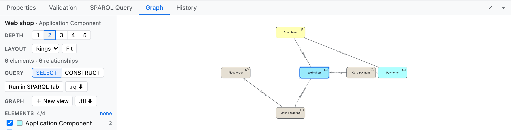

# Relationship graph

The *Graph* tab, under the canvas, draws what the selected element is related to in the model, in any
view or none, as a graph around it. It follows the selection while it is open, and does no work while it
is not.

<figure markdown="span">
  
  <figcaption>The relationships around "Web shop", two hops out.</figcaption>
</figure>

## Depth {#depth}

*Depth* is how many hops out the graph reaches: **1** to **5**, **2** by default, remembered in this
browser. Every relationship within that many hops of the element is drawn, either way round, with its
ends; the line over the graph counts them, *6 elements · 6 relationships*.

1. Select "Web shop", and open *Graph*.
2. Click *Depth* **1**: only what "Web shop" is directly related to.
3. Click **3**: one hop further.

## Layout {#layout}

| *Layout* | Draws |
|---|---|
| **Rings** (the default) | the element at the centre, each hop a ring further out |
| Tree | the element at the top, each hop a level down |
| Force | the graph pulled into shape by its links |

The layout is remembered in this browser. *Fit* fits the graph to the panel again, after a zoom or a
resize.

1. In *Layout*, choose **Tree**.
2. Drag the panel's top edge up, then choose *Fit*.

## Filters {#filters}

Under the buttons, *Elements* and *Relationships* list the types the graph holds, each with its count and
a checkbox, all **shown** at first; *none* and *all* switch a list at once. The filters **prune** the
walk, not only the drawing: a relationship type left out is not followed, and an element type left out
is not stepped onto, so what lies beyond them is not reached either.

1. With "Web shop" at depth 2, untick **Association** under *Relationships*.
2. "Shop team" goes from the graph: it was reached through an association only.

## Navigate {#navigate}

| Gesture | Does |
|---|---|
| click a node or a line | selects that element or relationship, on the canvas and in the Properties tab |
| **double-click a node** | makes it the graph's centre, and selects it |
| drag, scroll | moves and zooms the graph |

1. Double-click "Card payment" in the graph: the graph is redrawn around it.

## Query {#query}

The graph is the answer to a SPARQL query, and *Query* shows it, in either form:

| Form | Gives |
|---|---|
| **SELECT** (the default) | a table, one row per relationship |
| CONSTRUCT | the graph's triples |

The form is remembered in this browser. *Run in SPARQL tab* runs the query there, where it can be read
and changed; *.rq ⬇* downloads it. Run, it gives what is drawn.

1. Choose **CONSTRUCT** under *Query*.
2. Choose *Run in SPARQL tab*: the SPARQL Query tab opens, with the query and its triples.

## New view {#new-view}

*＋ New view*, under *Graph*, makes a diagram of the elements and relationships drawn, **laid out as
drawn**, and asks for its name, by default the element and the depth (*Web shop — 2 hops*).
*.ttl ⬇* downloads the graph's triples as Turtle instead.

1. Select "Web shop", at depth 2.
2. Choose *＋ New view*, and *OK*: the view "Web shop — 2 hops" opens, laid out as the graph was.
