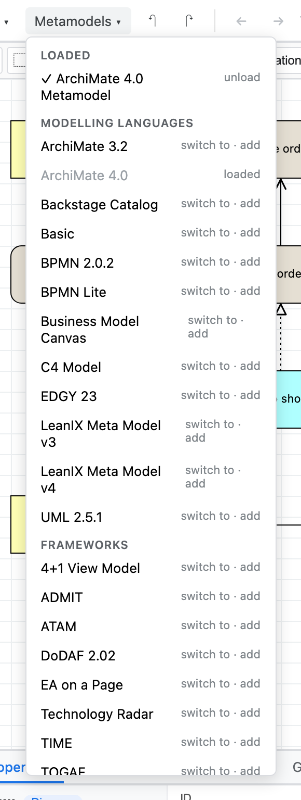

# Metamodels

A metamodel is the language la-gram models in: its element and relationship types, how they are drawn,
which relationships are permitted, its viewpoints, its checks. la-gram reads all of it from data, as
published on [meta.linked.archi](https://meta.linked.archi/), so a language la-gram has never seen works
the same as ArchiMate. ArchiMate 4.0 is loaded when la-gram starts; the *Metamodels* menu changes that.

<figure markdown="span">
  
  <figcaption>The Metamodels menu: what is loaded, then the catalogue by section.</figcaption>
</figure>

## Unload {#unload}

Under *Loaded*, each loaded metamodel has a ✓ and *unload*. Clicking it unloads that metamodel, with
every document it loaded — those its manifest names and those they import — except the core's and any
that another loaded metamodel uses: its types leave the palette. The model
is kept as it is: elements of the unloaded language stay, and show under *Unclassified* in the model tree
until a metamodel that knows them is loaded again.

1. Open *Metamodels*.
2. Click ✓ **ArchiMate 4.0 Metamodel** under *Loaded*. It is unloaded, and the palette empties.

## Add or switch {#add-or-switch}

Under *Loaded*, the catalogue's metamodels by section: *Core*, *Modelling languages*, *Frameworks* and
*Extensions*. Each entry offers two things:

| Choice | Does |
|---|---|
| the entry itself (**add**) | loads it alongside what is loaded: the palette offers both languages |
| *switch to* | replaces the loaded metamodels with this one |

A loaded entry says *loaded* and cannot be chosen again. Loading says what it loaded, and how many parts
could not be loaded (see [Loaded assets](#loaded-assets)).

1. Open *Metamodels*.
2. Click **Basic**: Basic is loaded beside ArchiMate 4.0, and its Connection relates any two elements.
3. To model in C4 alone instead, click *switch to* on **C4 Model**.

A metamodel can also be loaded as la-gram starts, with
[`?metamodel=`](../reference/url-parameters.md):

```text
https://app.linked.archi/la-gram/?metamodel=https://meta.linked.archi/basic/metamodel%23Basic
```

## Load by IRI {#load-by-iri}

*Load by IRI…* loads any metamodel, listed in the catalogue or not, by its IRI. Its dialog, *Load
metamodel*, asks for the *IRI of an arch:Metamodel (or its manifest)*, and starts at
**`https://meta.linked.archi/`**. It is fetched as [Sources](#sources) says, and added to what is loaded.

1. Choose *Metamodels › Load by IRI…*.
2. Type the IRI, and choose *OK*:

```text
https://meta.linked.archi/c4/metamodel#C4Model
```

In a URL parameter the `#` is written `%23`; in the dialog, as it is.

## Upload {#upload}

*Upload metamodel or asset file…* adds a file from your computer: `.ttl`, `.trig`, `.jsonld`, `.json`,
`.rdf`, `.owl`, `.nt` or `.nq`. An uploaded document is consulted before any other source, so it stands in
for the published one of the same IRI until the page is reloaded. A file that declares an
`arch:Metamodel` is loaded as a metamodel (*Loaded metamodel …*); any other, such as a notation or
shapes file of your own, is added (*Added …*) for the metamodels that name it.

1. Choose *Metamodels › Upload metamodel or asset file…*.
2. Choose your metamodel's manifest, `acme-metamodel.ttl`, say. It is loaded, and its types are in the
   palette.

## Loaded assets {#loaded-assets}

*Show loaded assets…* opens *Loaded semantic assets*: for each loaded metamodel, every document its
manifest names, with what became of it, its role, its IRI, where it came from and its triples. A
metamodel that is [incomplete](palette.md#incomplete) has a line for each thing it leaves out first,
with the types concerned by name:

```text
■ ATAM Metamodel
   ⚠ Incomplete: it names no classification (arch:conceptClassification): its 8 element types are listed under “Other”: ATAM Evaluation, Architectural Risk, Non-Risk, …
   loaded         manifest https://meta.linked.archi/atam/metamodel# (remote) · 30 triples
   …
```

| Outcome | Means |
|---|---|
| `loaded` | read and loaded |
| `not-bundled` | not in the bundle, and not fetched (offline) |
| `unavailable` | could not be fetched |
| `skipped` | not read on purpose: a role la-gram does not use (see [Manifest](#manifest)) |
| `error` | fetched, but could not be read |

Uploaded documents are listed last, under *Uploaded*.

1. Choose *Metamodels › Show loaded assets…*.
2. Read the list, as it is for ArchiMate 4.0 started with `?assets=offline`:

```text
■ ArchiMate 4.0 Metamodel
   loaded         manifest https://meta.linked.archi/archimate4/metamodel# (bundled) · 45 triples
   loaded         ontology https://meta.linked.archi/archimate4/onto# (bundled) · 987 triples
   loaded         taxonomy https://meta.linked.archi/archimate4/tax# (bundled) · 415 triples
   loaded         notation https://meta.linked.archi/archimate4/notation# (bundled) · 826 triples
   …
   skipped        derivationRules https://meta.linked.archi/archimate4/derivation#
```

## Choose which to show {#choose-which-to-show}

*Choose which to show…* opens [*File › Settings… › Metamodels*](settings.md#metamodels-tab), where each
catalogue entry has a checkbox, all **ticked** at first. What is unticked is left out of the menu, and
*Choose which to show…* then says how many are hidden. A loaded metamodel is listed anyway, and *Load by
IRI…* still reaches any.

1. Choose *Metamodels › Choose which to show…*.
2. Under *Frameworks*, choose *None*, then *Apply*. The menu lists no frameworks.

## Sources {#sources}

Every document a metamodel needs is looked for in up to three places, in an order the `assets` URL
parameter sets. A file uploaded with *Upload metamodel or asset file…* always comes first.

| `assets` | Order | When |
|---|---|---|
| **`bundled-first`** (the default in a browser) | uploaded → bundled → remote | the bundle wins; meta.linked.archi covers what is not bundled. Fast, the same every time |
| `remote-first` | uploaded → remote → bundled | the published version wins; the bundle covers an outage |
| `offline` | uploaded → bundled | nothing is fetched, the catalogue included |

The default is `bundled-first` (a comment in the source code says `remote-first`; the code starts
`bundled-first`). The desktop app starts the same way.

```text
https://app.linked.archi/la-gram/?assets=remote-first
```

## Remote fetch {#remote-fetch}

A document that is fetched is asked for at its IRI (without the fragment) with one exact type,
`Accept: text/turtle`: meta.linked.archi answers a list of types with quality values with a 404. A fetch
that takes more than **10 seconds** is given up, and the document is *unavailable*.

!!! example "What la-gram asks meta.linked.archi for"

    Loading C4 from the catalogue fetches its manifest with:

    ```http
    GET /c4/metamodel HTTP/1.1
    Host: meta.linked.archi
    Accept: text/turtle
    ```

## Bundled {#bundled}

la-gram ships, in `assets/`, a snapshot of what meta.linked.archi serves for:

- **ArchiMate 4.0**, the default language;
- **ArchiMate 3.2**, which [ArchiMate Exchange import](files.md#import-archimate-exchange) needs, the
  exchange format being a 3.x one;
- **Basic**, the generic language, whose Connection relates any two elements;
- **Architecture Decisions**, the extension for decision records — issues, decisions, options and the
  forces on them — to add beside a language;
- **Architecture Processes**, the extension for the architecture practice's own processes — a process, its
  activities and tasks, milestones, deliverables and roles, and what it governs — to add beside a language;
- the core vocabularies: core, core-vis, the core shapes and the core questions;
- their icons and the relationship-end markers;
- the catalogue, `assets/catalog.ttl`.

*About la-gram* names the snapshot (*Bundled metamodels: snapshot e4882df07d49*, say). A bundled icon's
published address, `https://meta.linked.archi/archimate4/icons/…`, is drawn from the app's own copy,
`assets/archimate4/icons/…?v=<digest>`, so it works offline; the `?v=` changes with the file, so a new
snapshot is never served from a cache. Other languages' icons come from meta.linked.archi.

```text
https://meta.linked.archi/archimate4/icons/business-actor.svg
assets/archimate4/icons/business-actor.svg?v=<digest>
```

## Catalogue {#catalogue}

What the menu offers is meta.linked.archi's catalogue, a DCAT catalogue of its semantic assets: each
metamodel by its `skos:prefLabel`, in the section its `dcat:theme` names (`core`, `languages`,
`frameworks` or `extensions`). Metamodels in other sections, such as the examples, are not offered, and
still load by IRI.

la-gram starts with the bundled copy, so the menu is complete offline, and, unless `assets=offline`,
replaces it with the published one, `https://meta.linked.archi/catalog`, when it arrives. A metamodel
meta.linked.archi publishes is then in the menu without a new la-gram. A published catalogue that cannot
be read, or lists no metamodels, leaves the bundled one.

What the menu reads of C4's entry, from the bundled `assets/catalog.ttl` (the menu drops the
" Metamodel" its label ends in):

```turtle
@prefix arch: <https://meta.linked.archi/core#> .
@prefix dcat: <http://www.w3.org/ns/dcat#> .
@prefix foaf: <http://xmlns.com/foaf/0.1/> .
@prefix skos: <http://www.w3.org/2004/02/skos/core#> .

<https://meta.linked.archi/c4/metamodel> a dcat:Dataset ;
    dcat:theme <https://meta.linked.archi/catalog#languages> ;
    foaf:primaryTopic <https://meta.linked.archi/c4/metamodel#C4Model> .

<https://meta.linked.archi/c4/metamodel#C4Model> a arch:Metamodel ;
    skos:prefLabel "C4 Model Metamodel"@en .

<https://meta.linked.archi/catalog#languages> a skos:Concept ;
    skos:notation "languages" .
```

## Manifest {#manifest}

A metamodel's manifest names its parts. la-gram follows these roles:

| Manifest property | Role |
|---|---|
| `arch:modelConcepts` | the ontology: element and relationship types |
| `arch:conceptClassification` | the taxonomy: how the palette groups the types |
| `arch:notationSet`, `arch:usesNotationSet` | how each type is drawn |
| `arch:formalRules`, `arch:architectureViewpointsRestrictions` | SHACL shapes: the relationship rules and the checks |
| `arch:architectureViewpoints`, `arch:viewpointLibrary` | the viewpoints |
| `arch:presentationContextScheme` | the presentation contexts (audiences) |
| `arch:referenceData` | the values a property may take |
| `arch:hasQuestionSet` | the model questions of the SPARQL tab |

These it records as *skipped*, on purpose: `derivationRules` (they need a SHACL-AF engine),
`referenceModels`, `hasDeliverableTemplate` and `basedOnFramework`, which feed document generation.

```turtle
@prefix arch: <https://meta.linked.archi/core#> .

<https://example.org/acme/metamodel#AcmeLanguage>
    a arch:Metamodel ;
    arch:modelConcepts <https://example.org/acme/onto#> ;
    arch:conceptClassification <https://example.org/acme/tax#> ;
    arch:notationSet <https://example.org/acme/notation#> ;
    arch:formalRules <https://example.org/acme/shapes#> .
```

## Notation lookup {#notation-lookup}

How an element or a relationship is drawn, its shape, colours and icon, is looked for in this order, the
first found winning. The active set is the notation set the presentation chosen names
(`arch:usesNotationSet`), else the first metamodel's `arch:notationSet`.

1. A description of the type in the active set.
2. A description of it in the other loaded metamodels' default sets, in the order they were loaded.
3. The type's own `arch:prefVisNotation`.
4. The nearest superclass that has a description, nearest first: for each, the active set, then the
   others. The walk stops at `arch:Element` and `arch:QualifiedRelationship`.
5. la-gram's built-in look: for an element, a rectangle with a white fill and a black line; for a
   relationship, a solid black line.

What is published for the type itself beats anything inherited, so a generic set cannot flatten another
language's notation: with Basic loaded beside ArchiMate 4.0, ArchiMate's Composition keeps its filled
diamond (step 2). An extension's subclass of `am4:BusinessActor` that says nothing of its look is drawn as
a Business Actor (step 4).
