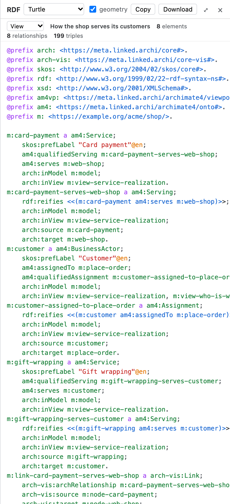

# The RDF panel

{ } *RDF*, in the toolbar, opens a panel on the right with the model as RDF, live: written as *Save*
would write it, by the same serializer, so what you read here is what goes into a file or into Git. It
starts hidden ([`?rdf=1`](../reference/url-parameters.md) opens it at the start), and does no work while
it is hidden.

The selected concepts' statements are highlighted, and the first is scrolled into view. Click a block of
statements to select its subject.

<figure markdown="span">
  
  <figcaption>The RDF panel showing the example's diagram view as Turtle.</figcaption>
</figure>

## Format {#format}

The format selector, at the left of the panel's header, picks how the RDF is written:

| Format | Writes |
|---|---|
| **Turtle** (the default) | the model in one graph |
| TriG (graph per layer) | three graphs: the model resource, its semantics (elements, relationships, views) and its diagram geometry |
| JSON-LD | JSON-LD, with the graphs |
| N-Quads | one statement per line, with its graph |
| N-Triples | one statement per line |
| RDF/XML | RDF/XML |

The format is this panel's own, for the session: it starts as Turtle each time, whatever *File › Save
as* last wrote.

1. Click { } *RDF* in the toolbar.
2. Choose **N-Triples** in the panel's format selector: one statement a line.

## Geometry {#geometry}

*geometry*, ticked by default, includes the diagram geometry: the `arch-vis:` nodes, links, bounds and
routes of the views. Unticked, the panel shows the model's semantics alone, as *File › Save as › Turtle
without diagram geometry* writes it. It is this panel's own setting, for the session.

1. Tick off *geometry*.
2. The `arch-vis:ArchNode` and `arch-vis:Link` blocks go; the elements and relationships stay.

## Scope {#scope}

*What to show*, under the header, chooses what is written. The choice is remembered in this browser.

| *What to show* | Writes |
|---|---|
| **View** (the default) | the open view: the view, the concepts it shows, and its diagram |
| Selection | the selected concepts, and how the open view draws them |
| Model | the whole model, exactly as *Save* writes it |

Beside it, the counts: the view's name, its elements, relationships and triples (*8 elements, 8
relationships, 199 triples* for the example's diagram); for the model, its views too.

1. Choose **Selection** in *What to show*.
2. Click "Gift wrapping" on the canvas: the panel writes what the model says of it, and its placement.

## Copy and download {#copy-and-download}

| Button | Does |
|---|---|
| *Copy* | copies what the panel shows to the clipboard; it says *Copied* |
| *Download* | saves it as a file: for *Model*, as *Save* does, in the panel's format, without geometry when *geometry* is off; for *View* and *Selection*, what the panel shows |
| ⤢ / ⤡ | maximizes the panel over the workspace, and restores it (or ++esc++) |
| × | hides the panel, as { } *RDF* does |

1. With *What to show* at **Model** and the format **TriG (graph per layer)**, choose *Download*.
2. The model is saved as `Acme-online-shop.trig`.

## Large models {#large-models}

A view or a selection is small enough to show and highlight on any model; a whole model may not be. Past
1.5 million characters, the panel shows the model's size instead of its text, and does not write it
again on every change:

!!! example "A large model, at *Model*"

    *The whole model is 2.4 MB of Turtle — too large to show here. Copy or download it, or show the open
    view or the selection.*, for a model of 2.4 million characters as Turtle; the size and the format
    are the model's.

*Copy* and *Download* still work: they write the model as it is at that moment.
