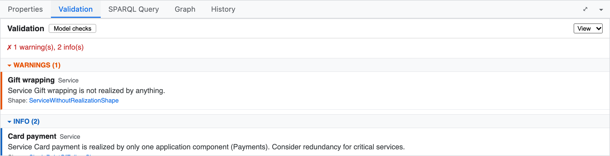

# Validation

la-gram checks the model against the loaded metamodels all the time, in the background: editing never
waits for it. The *Validation* tab, under the canvas, lists what it finds, and its badge counts the
violations. Violations are marked on the canvas too.

<figure markdown="span">
  
  <figcaption>The example's findings: the planted warning on "Gift wrapping", and the first of two Info findings.</figcaption>
</figure>

## Scope {#scope}

*Findings of*, at the right of the tab's header, chooses whose findings are listed:

| Scope | Lists |
|---|---|
| **View** (the default) | the open view's: the view itself, the concepts it presents, and its diagram |
| Model | the whole model's |

The choice is remembered in this browser. With *View* chosen and findings elsewhere in the model, a
button after the summary says how many more there are (*… more in the model*), and switches to *Model*.
With no view open, *View* cannot be chosen.

1. Open the example model, and the *Validation* tab.
2. *Findings of* is **View**: the summary reads "✗ 1 warning(s), 2 info(s)".
3. Choose **Model** in *Findings of* to see the whole model's.

## Findings {#findings}

Findings are grouped by severity: *Violations*, *Warnings* and *Info*, each folding, with its count. The
summary above them counts each (*✗ 1 warning(s), 2 info(s)*), or says *✓ View conforms*. Each finding
shows:

- what it is about, by name and type: "Gift wrapping", *Service*;
- the message: *Service Gift wrapping is not realized by anything.*;
- the property it is about, when there is one (*Property: View conforms to viewpoint*);
- the shape it comes from, *Shape: ServiceWithoutRealizationShape*, a link to the shape on the
  metamodel's documentation, or for a model check, *Check:* and the question.

Click a finding (or press ++enter++ on it) to **show the concept**: it is selected, on the canvas when
the view shows it. Click the shape's name to open its documentation in a new tab.

The example has one finding planted on purpose, and two that come with it:

| Severity | About | Message | Shape |
|---|---|---|---|
| Warning | Gift wrapping (Service) | *Service Gift wrapping is not realized by anything.* | [`ServiceWithoutRealizationShape`](https://meta.linked.archi/archimate4/principle-shapes#ServiceWithoutRealizationShape) |
| Info | Card payment (Service) | *Service Card payment is realized by only one application component (Payments). Consider redundancy for critical services.* | [`SinglePointOfFailureShape`](https://meta.linked.archi/archimate4/principle-shapes#SinglePointOfFailureShape) |
| Info | Online ordering (Service) | *Service Online ordering is realized by only one application component (Web shop). Consider redundancy for critical services.* | `SinglePointOfFailureShape` |

1. Click the "Gift wrapping" finding: "Gift wrapping" is selected on the diagram.
2. In the palette, click **Realization**, then "Payments", then "Gift wrapping".
3. The warning goes. An Info finding takes its place: "Gift wrapping" is now realized by only one
   application component.

## Model checks {#model-checks}

*Model checks*, beside the tab's title, asks the loaded languages' finding questions of the model on
request: those the SPARQL tab's Questions menu marks *finding*, such as orphans, unrealized services,
unrealized requirements, elements with no definition. Their findings join the list, each with *Check:*
and its question. A line under the summary says how they went: *Model checks: 14 run, 11 findings*, which
stopped at their limit, and which could not run.

The button then says *Run checks again*. The findings stay until the next run or another model; after an
edit, the line says *the model has changed since they ran*.

1. Choose *Model checks*. It says *Checking…* while they run.
2. The list grows: "Gift wrapping" again, from "Which services does nothing realise?", and the elements
   with no definition, from "Which elements have no definition?".
3. Give "Customer" a definition, and choose *Run checks again*: it is no longer listed.

## What is checked {#what-is-checked}

Validation runs in a Web Worker, 300 ms after the last change, so that a burst of edits is checked once:

- **SHACL** against the loaded metamodels' shapes and the core shapes: types, cardinalities, values;
- relationships against the metamodel's **relationship tables**: which types may join which;
- the shapes' **SPARQL-based rules** (`sh:sparql`), run with Oxigraph: ArchiMate's self-loops and
  principles, core's viewpoint rules;
- references to anything the model does not have: a relationship whose end is not in the model, say.

The planted warning is one of the SPARQL-based rules. The same question, asked of the example in the
SPARQL tab, finds the same service:

```sparql
PREFIX am4: <https://meta.linked.archi/archimate4/onto#>
PREFIX skos: <http://www.w3.org/2004/02/skos/core#>

SELECT ?service ?name WHERE {
  ?service a am4:Service ;
           skos:prefLabel ?name .
  FILTER NOT EXISTS { ?anything am4:realizes ?service }
}
```

| service | name |
|---|---|
| `m:gift-wrapping` | Gift wrapping |

[la-gram-git](../reference/la-gram-git.md) checks a model file with the same engine, on the command line
and in CI, and reports the SPARQL-based rules' findings as advisory:

```text
$ la-gram-git check docs-site/examples
✓ docs-site/examples/shop.ttl
  · 3 from the shapes' SPARQL-based rules (advisory):
  ·   warning: Gift wrapping (Service) · Service Gift wrapping is not realized by anything. (https://meta.linked.archi/archimate4/principle-shapes#ServiceWithoutRealizationShape)
  ·   info: Online ordering (Service) · Service Online ordering is realized by only one application component (Web shop). Consider redundancy for critical services. (https://meta.linked.archi/archimate4/principle-shapes#SinglePointOfFailureShape)
  ·   info: Card payment (Service) · Service Card payment is realized by only one application component (Payments). Consider redundancy for critical services. (https://meta.linked.archi/archimate4/principle-shapes#SinglePointOfFailureShape)
  · IRI layout (DD-41), advisory:
  …

1 model file checked: all well.
```
